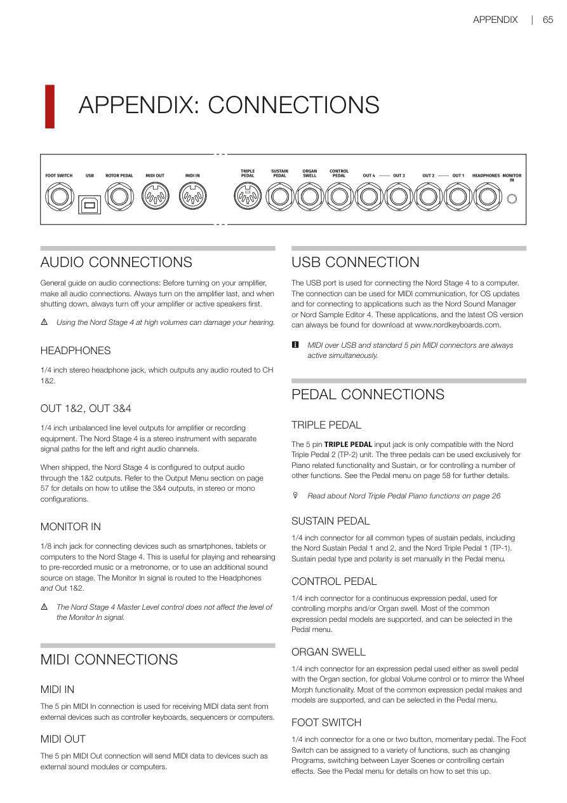
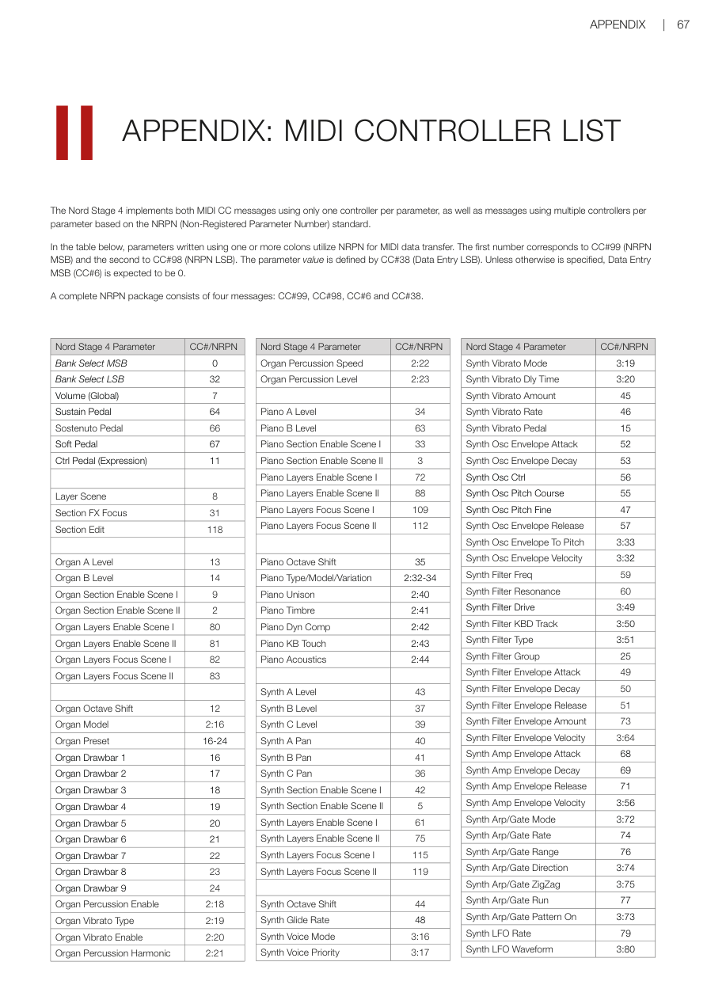

# 附錄 / Appendix

---

## 附錄一：接線說明 / APPENDIX I: CONNECTIONS

---

### 音訊連接 / AUDIO CONNECTIONS

連接音訊設備的基本原則：**先接好所有音訊線，再開擴大機的電源。關機時，請先關擴大機或主動喇叭，最後再關 Nord Stage 4。**

General guide on audio connections: Before turning on your amplifier, make all audio connections. Always turn on the amplifier last, and when shutting down, always turn off your amplifier or active speakers first.

> ⚠️ 長時間以高音量使用 Nord Stage 4 可能會損傷聽力，請注意保護耳朵。  
> Using the Nord Stage 4 at high volumes can damage your hearing.

---

### 耳機輸出 / HEADPHONES

標準 1/4 吋立體聲耳機插孔，輸出的是路由到聲道 1 和 2 的所有音訊。

1/4 inch stereo headphone jack, which outputs any audio routed to CH 1&2.

---

### OUT 1&2、OUT 3&4 輸出 / OUT 1&2, OUT 3&4

標準 1/4 吋非平衡線路輸出（Line Level Output——適合接擴大機或錄音設備的訊號強度），Nord Stage 4 是立體聲樂器，左右聲道的訊號各自獨立。

1/4 inch unbalanced line level outputs for amplifier or recording equipment. The Nord Stage 4 is a stereo instrument with separate signal paths for the left and right audio channels.

出廠預設是從 1&2 輸出音訊。如需使用 3&4 輸出（立體聲或單聲道），請參閱第 57 頁的輸出選單（Output Menu）設定。

When shipped, the Nord Stage 4 is configured to output audio through the 1&2 outputs. Refer to the Output Menu section on page 57 for details on how to utilise the 3&4 outputs, in stereo or mono configurations.

---

### 監聽輸入 / MONITOR IN

標準 1/8 吋（3.5mm）輸入插孔，可連接手機、平板或電腦。適合一邊播放參考音樂或節拍器，一邊練習。Monitor In 訊號會同時路由到耳機輸出和 Out 1&2。

1/8 inch jack for connecting devices such as smartphones, tablets or computers to the Nord Stage 4. This is useful for playing and rehearsing to pre-recorded music or a metronome, or to use an additional sound source on stage. The Monitor In signal is routed to the Headphones and Out 1&2.

> 💡 注意：Nord Stage 4 的主音量旋鈕（Master Level）不會影響 Monitor In 的音量。  
> The Nord Stage 4 Master Level control does not affect the level of the Monitor In signal.

---

### MIDI 連接 / MIDI CONNECTIONS

#### MIDI IN

標準 5 針 MIDI 輸入接頭，用於接收來自外部設備（如控制器鍵盤、音序器或電腦）發送的 MIDI（Musical Instrument Digital Interface——讓樂器之間溝通的數位訊號協議）資料。

The 5 pin MIDI In connection is used for receiving MIDI data sent from external devices such as controller keyboards, sequencers or computers.

#### MIDI OUT

標準 5 針 MIDI 輸出接頭，將 MIDI 資料發送到外部設備，如音源模組或電腦。

The 5 pin MIDI Out connection will send MIDI data to devices such as external sound modules or computers.

---

### USB 連接 / USB CONNECTION

USB 連接埠用於將 Nord Stage 4 連接到電腦，可用於 MIDI 通訊、作業系統更新，以及連接 Nord Sound Manager 或 Nord Sample Editor 4 等應用程式。最新 OS 版本和應用程式都可在 www.nordkeyboards.com 下載。

The USB port is used for connecting the Nord Stage 4 to a computer. The connection can be used for MIDI communication, for OS updates and for connecting to applications such as the Nord Sound Manager or Nord Sample Editor 4.

> 💡 USB MIDI 和傳統 5 針 MIDI 接頭可以同時使用，不需要選擇其中一個。  
> MIDI over USB and standard 5 pin MIDI connectors are always active simultaneously.

---

### 踏板連接 / PEDAL CONNECTIONS

#### TRIPLE PEDAL（三踏板）

標準 5 針接頭，**只相容於 Nord Triple Pedal 2（TP-2）**。三個踏板可以專門用於鋼琴功能和延音，也可以設定控制其他功能。詳見第 58 頁的踏板選單。

The 5 pin TRIPLE PEDAL input jack is only compatible with the Nord Triple Pedal 2 (TP-2) unit. The three pedals can be used exclusively for Piano related functionality and Sustain, or for controlling a number of other functions.

#### SUSTAIN PEDAL（延音踏板）

標準 1/4 吋接頭，相容於大多數延音踏板（Sustain Pedal——踩下時讓音符持續延響），包括 Nord Sustain Pedal 1 和 2，以及 Nord Triple Pedal 1（TP-1）。踏板類型和極性需在踏板選單中手動設定。

1/4 inch connector for all common types of sustain pedals, including the Nord Sustain Pedal 1 and 2, and the Nord Triple Pedal 1 (TP-1). Sustain pedal type and polarity is set manually in the Pedal menu.

#### CONTROL PEDAL（控制踏板）

標準 1/4 吋接頭，用於連接表情踏板（Expression Pedal——可連續變化的踏板，不是只有開關），用來控制變形（Morph）和/或風琴音量推桿（Swell）。大多數常見的表情踏板都受支援，可在踏板選單中選擇。

1/4 inch connector for a continuous expression pedal, used for controlling morphs and/or Organ swell. Most of the common expression pedal models are supported, and can be selected in the Pedal menu.

#### ORGAN SWELL（風琴音量踏板）

標準 1/4 吋接頭，用於連接表情踏板，可設定為風琴區段的音量推桿、全域音量控制，或複製調制輪的變形（Wheel Morph）功能。

1/4 inch connector for an expression pedal used either as swell pedal with the Organ section, for global Volume control or to mirror the Wheel Morph functionality.

#### FOOT SWITCH（腳踏開關）

標準 1/4 吋接頭，用於連接一或兩個按鈕的瞬時踏板（Momentary Pedal——按下時動作，放開時恢復）。腳踏開關可指定多種功能，例如切換程式、在音層場景之間切換，或控制某些效果器。詳見踏板選單。

1/4 inch connector for a one or two button, momentary pedal. The Foot Switch can be assigned to a variety of functions, such as changing Programs, switching between Layer Scenes or controlling certain effects. See the Pedal menu for details on how to set this up.

#### ROTOR PEDAL（旋轉喇叭踏板）

標準 1/4 吋接頭，用於連接開關型踏板，用來切換旋轉喇叭（Rotary Speaker）效果的慢速/停止和快速旋轉。踏板可設定為按住模式（Hold）或切換模式（Toggle），詳見踏板選單。

Nord Stage 4 Compact 型號可選用 Nord Half Moon Switch 半月形開關，接在此插孔上。

1/4 inch connector for a switch type pedal, used for switching between slow/stopped and fast rotor speed for the Rotary Speaker effect. The pedal can work in either hold or toggle mode, as set in the Pedal menu. The optional Nord Half Moon Switch, compatible with the Nord Stage 4 Compact model, is also attached to the Rotor Pedal jack.

---

## 附錄二：MIDI 控制器列表 / APPENDIX II: MIDI CONTROLLER LIST

> 💡 下表列出 Nord Stage 4 主要參數對應的 MIDI CC（控制訊息，Control Change——用數字編號控制樂器各種參數的 MIDI 訊號）編號。完整列表請參閱原版 PDF 手冊第 67 頁。

| 參數名稱 | Parameter | CC# |
|----------|-----------|-----|
| 音色庫選擇 MSB | Bank Select MSB | 0 |
| 音色庫選擇 LSB | Bank Select LSB | 32 |
| 整體音量 | Volume (Global) | 7 |
| 延音踏板 | Sustain Pedal | 64 |
| Sostenuto 踏板 | Sostenuto Pedal | 66 |
| 柔音踏板 | Soft Pedal | 67 |
| 控制踏板（表情）| Ctrl Pedal (Expression) | 11 |
| 音層場景切換 | Layer Scene | 8 |
| 區段效果焦點 | Section FX Focus | 31 |
| 風琴 A 音量 | Organ A Level | 13 |
| 風琴 B 音量 | Organ B Level | 14 |
| 風琴區段啟用 | Organ Section Enable | 9 |
| 風琴音桿 1 | Organ Drawbar 1 | 16 |
| 風琴音桿 2 | Organ Drawbar 2 | 17 |
| 風琴音桿 3 | Organ Drawbar 3 | 18 |
| 風琴音桿 4 | Organ Drawbar 4 | 19 |
| 風琴音桿 5 | Organ Drawbar 5 | 20 |
| 風琴音桿 6 | Organ Drawbar 6 | 21 |
| 風琴音桿 7 | Organ Drawbar 7 | 22 |
| 風琴音桿 8 | Organ Drawbar 8 | 23 |
| 風琴音桿 9 | Organ Drawbar 9 | 24 |
| 鋼琴 A 音量 | Piano A Level | 34 |
| 鋼琴 B 音量 | Piano B Level | 63 |
| 鋼琴區段啟用 | Piano Section Enable | 33 |
| 合成器 A 音量 | Synth A Level | 35 |
| 合成器 B 音量 | Synth B Level | 36 |
| 合成器 C 音量 | Synth C Level | 37 |

> 完整的 MIDI CC 列表請參閱原版 PDF 手冊第 66-70 頁。  
> For the full MIDI Controller list, refer to pages 66-70 of the original PDF manual.
