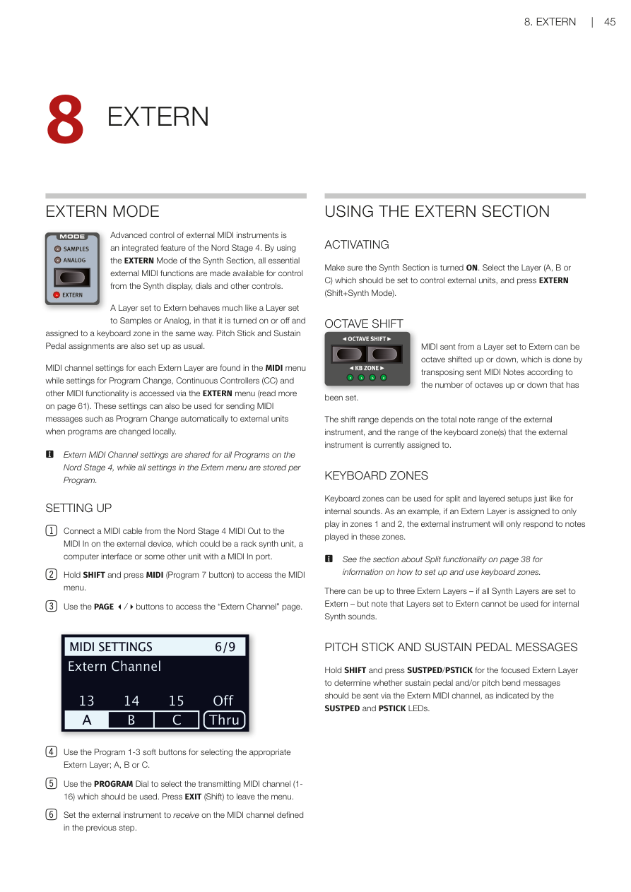
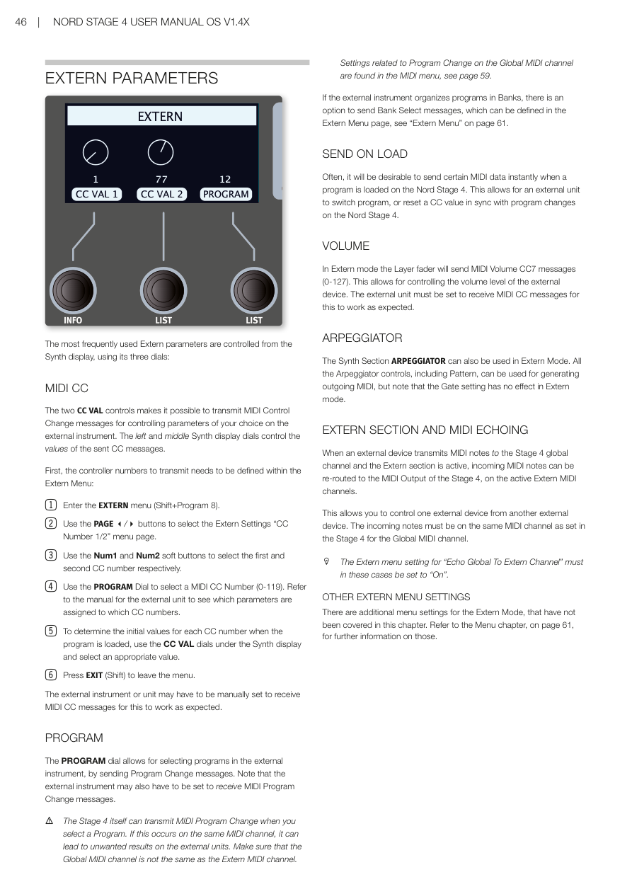

# 第八章：外部控制 / Chapter 8: Extern

---

## 外部控制模式 / EXTERN MODE

Nord Stage 4 內建了強大的外部 MIDI（一種讓電子樂器互相溝通的數位訊號標準）控制功能。透過合成器區段的外部控制（Extern）模式，所有常用的外部 MIDI 功能都可以從合成器顯示器、旋鈕和其他控制器直接操作。

Advanced control of external MIDI instruments is an integrated feature of the Nord Stage 4. By using the EXTERN Mode of the Synth Section, all essential external MIDI functions are made available for control from the Synth display, dials and other controls.

設定為外部控制的音層，使用方式和一般的 Samples 或 Analog 音層很相似——同樣可以開關、指定到鍵盤分區，音調搖桿和延音踏板的設定方式也一樣。

A Layer set to Extern behaves much like a Layer set to Samples or Analog, in that it is turned on or off and assigned to a keyboard zone in the same way. Pitch Stick and Sustain Pedal assignments are also set up as usual.

每個外部控制音層的 MIDI 頻道設定可在 MIDI 選單中找到；程式切換（Program Change——傳送訊號給外部設備，讓它切換到指定的音色）、CC（Continuous Controller，持續控制器——用數字編號控制外部設備上某個特定參數）以及其他 MIDI 功能的設定則在 EXTERN 選單中（詳見第 61 頁）。這些設定也可以用來在切換 Nord Stage 4 程式時，自動傳送 MIDI 訊息給外部設備。

MIDI channel settings for each Extern Layer are found in the MIDI menu while settings for Program Change, Continuous Controllers (CC) and other MIDI functionality is accessed via the EXTERN menu (read more on page 61). These settings can also be used for sending MIDI messages such as Program Change automatically to external units when programs are changed locally.

> 💡 **注意**：外部控制的 MIDI 頻道設定是全機共用的，不隨程式改變；而 EXTERN 選單中的其他設定則是每個程式獨立儲存的。

Extern MIDI Channel settings are shared for all Programs on the Nord Stage 4, while all settings in the Extern menu are stored per Program.

---

### 連接設定 / SETTING UP

1. 用 MIDI 連接線將 Nord Stage 4 的 MIDI Out 接到外部設備的 MIDI In。外部設備可以是機架合成音源、電腦介面或任何有 MIDI In 插孔的設備。

   Connect a MIDI cable from the Nord Stage 4 MIDI Out to the MIDI In on the external device, which could be a rack synth unit, a computer interface or some other unit with a MIDI In port.

2. 按住 SHIFT 並按 MIDI（Program 7 按鈕）進入 MIDI 選單。

   Hold SHIFT and press MIDI (Program 7 button) to access the MIDI menu.

3. 用 PAGE 按鈕切換到「Extern Channel」頁面。

   Use the PAGE buttons to access the "Extern Channel" page.

4. 用 Program 1-3 軟按鍵選擇要使用的外部控制音層：A、B 或 C。

   Use the Program 1-3 soft buttons for selecting the appropriate Extern Layer; A, B or C.

5. 用 PROGRAM 旋鈕選擇要傳送的 MIDI 頻道（1-16）。完成後按 EXIT（Shift）離開選單。

   Use the PROGRAM Dial to select the transmitting MIDI channel (1-16). Press EXIT (Shift) to leave the menu.

6. 將外部設備設定為接收剛才指定的 MIDI 頻道。

   Set the external instrument to receive on the MIDI channel defined in the previous step.

---

## 使用外部控制區段 / USING THE EXTERN SECTION

### 啟動 / ACTIVATING

確認合成器區段已開啟。選擇要用來控制外部設備的音層（A、B 或 C），然後按 EXTERN（Shift + Synth Mode）。

Make sure the Synth Section is turned ON. Select the Layer (A, B or C) which should be set to control external units, and press EXTERN (Shift+Synth Mode).

### 八度移調 / OCTAVE SHIFT

外部控制音層傳出的 MIDI 訊息可以上下移調，讓外部設備收到的音符依此偏移。移調範圍取決於外部設備的音域，以及目前指定給外部控制音層的鍵盤分區範圍。

MIDI sent from a Layer set to Extern can be octave shifted up or down, transposing sent MIDI Notes accordingly. The shift range depends on the total note range of the external instrument, and the range of the keyboard zone(s) that the external instrument is currently assigned to.

### 鍵盤分區 / KEYBOARD ZONES

和內部音色一樣，外部控制也可以使用鍵盤分區做分割或疊加設定。舉例來說，如果把外部控制音層只指定到分區 1 和 2，外部設備就只會對這兩個分區內彈奏的音符有反應。

Keyboard zones can be used for split and layered setups just like for internal sounds. If an Extern Layer is assigned to only play in zones 1 and 2, the external instrument will only respond to notes played in these zones.

> 💡 最多可以有三個外部控制音層（當全部三個合成器音層都設為外部控制時）。但設為外部控制的音層就無法再發出合成器內部音色了。

There can be up to three Extern Layers – if all Synth Layers are set to Extern – but Layers set to Extern cannot be used for internal Synth sounds.

### 音調搖桿與延音踏板訊息 / PITCH STICK AND SUSTAIN PEDAL MESSAGES

按住 SHIFT 並按目前焦點外部控制音層的 SUSTPED/PSTICK，可以決定要不要透過外部控制的 MIDI 頻道傳送延音踏板或音調彎曲訊息。

Hold SHIFT and press SUSTPED/PSTICK for the focused Extern Layer to determine whether sustain pedal and/or pitch bend messages should be sent via the Extern MIDI channel.

---

---

## 外部控制參數 / EXTERN PARAMETERS

最常用的外部控制參數可以直接從合成器顯示器的三個旋鈕來操作。

The most frequently used Extern parameters are controlled from the Synth display, using its three dials:

---

### MIDI CC

兩個 CC VAL 控制器可以傳送 MIDI CC 訊息，讓你控制外部設備上你選擇的參數。左邊和中間的合成器顯示旋鈕分別控制這兩個 CC 訊息的數值。

The two CC VAL controls make it possible to transmit MIDI Control Change messages for controlling parameters of your choice on the external instrument. The left and middle Synth display dials control the values of the sent CC messages.

**設定 CC 編號的步驟：**

**To set up CC numbers:**

1. 進入 EXTERN 選單（Shift + Program 8）。

   Enter the EXTERN menu (Shift+Program 8).

2. 用 PAGE 按鈕切換到「CC Number 1/2」選單頁面。

   Use the PAGE buttons to select the "CC Number 1/2" menu page.

3. 用 Num1 和 Num2 軟按鍵分別選擇第一和第二個 CC 編號。

   Use the Num1 and Num2 soft buttons to select the first and second CC number respectively.

4. 用 PROGRAM 旋鈕選擇 MIDI CC 編號（0-119）。請參閱外部設備的說明書，了解哪些參數對應哪些 CC 編號。

   Use the PROGRAM Dial to select a MIDI CC Number (0-119). Refer to the external unit's manual to see which parameters are assigned to which CC numbers.

5. 用合成器顯示器下方的 CC VAL 旋鈕設定初始值。

   To determine the initial values, use the CC VAL dials and select an appropriate value.

6. 按 EXIT（Shift）離開選單。

   Press EXIT (Shift) to leave the menu.

> 💡 外部設備可能需要手動設定才能接收 MIDI CC 訊息，請查閱該設備的說明書。

The external instrument may have to be manually set to receive MIDI CC messages.

---

### 程式切換 / PROGRAM

PROGRAM 旋鈕可以透過傳送 Program Change 訊息，來切換外部設備上的音色。

The PROGRAM dial allows for selecting programs in the external instrument, by sending Program Change messages.

> ⚠️ **注意**：Nord Stage 4 本身在切換程式時也會傳送 MIDI Program Change 訊息。如果這和外部控制音層使用同一個 MIDI 頻道，可能會造成外部設備意外切換音色。請確認全域 MIDI 頻道和外部控制的 MIDI 頻道不同。全域 MIDI 頻道的 Program Change 相關設定在 MIDI 選單中（見第 59 頁）。

The Stage 4 itself can transmit MIDI Program Change when you select a Program. If this occurs on the same MIDI channel as the Extern channel, it can lead to unwanted results on the external units. Make sure that the Global MIDI channel is not the same as the Extern MIDI channel. Settings related to Program Change on the Global MIDI channel are found in the MIDI menu, see page 59.

如果外部設備的音色是以「音色庫（Bank）」分類，可以在 Extern 選單中設定 Bank Select 訊息（見第 61 頁）。

If the external instrument organizes programs in Banks, there is an option to send Bank Select messages, which can be defined in the Extern Menu, see page 61.

---

### 載入時傳送 / SEND ON LOAD

很多時候，當 Nord Stage 4 載入某個程式時，你會希望立刻傳送特定的 MIDI 資料給外部設備。這樣外部設備就能在你切換程式的同時，自動切換對應的音色或重設 CC 數值。

Often, it will be desirable to send certain MIDI data instantly when a program is loaded on the Nord Stage 4. This allows for an external unit to switch program, or reset a CC value in sync with program changes on the Nord Stage 4.

---

### 音量 / VOLUME

在外部控制模式下，音層的推桿會傳送 MIDI Volume CC7 訊息（數值 0-127），讓你控制外部設備的音量大小。外部設備需要能接收 MIDI CC 訊息才能正常運作。

In Extern mode the Layer fader will send MIDI Volume CC7 messages (0-127). This allows for controlling the volume level of the external device.

---

### 琶音器 / ARPEGGIATOR

合成器區段的琶音器（Arpeggiator）在外部控制模式下同樣可以使用。所有琶音器控制功能，包括節奏型態（Pattern），都可以用來產生傳出的 MIDI 訊息。不過請注意，Gate 設定在外部控制模式下無效。

The Synth Section ARPEGGIATOR can also be used in Extern Mode. All the Arpeggiator controls, including Pattern, can be used for generating outgoing MIDI, but note that the Gate setting has no effect in Extern mode.

---

### 外部控制區段與 MIDI 轉發 / EXTERN SECTION AND MIDI ECHOING

當外部設備傳送 MIDI 音符到 Stage 4 的全域頻道，且外部控制區段已啟動時，這些傳入的 MIDI 音符可以被轉發到 Stage 4 的 MIDI 輸出，透過目前啟用的外部控制 MIDI 頻道傳出去。

When an external device transmits MIDI notes to the Stage 4 global channel and the Extern section is active, incoming MIDI notes can be re-routed to the MIDI Output of the Stage 4, on the active Extern MIDI channels.

這樣一來，你就可以用一台外部設備來控制另一台外部設備。要使用這個功能，必須在 Extern 選單中將「Echo Global To Extern Channel」設為「On」。

This allows you to control one external device from another external device. The Extern menu setting for "Echo Global To Extern Channel" must be set to "On".

---

### 其他外部控制選單設定 / OTHER EXTERN MENU SETTINGS

外部控制模式還有更多選單設定，本章節未一一涵蓋。詳細說明請參閱第 61 頁的選單章節。

There are additional menu settings for the Extern Mode not covered in this chapter. Refer to the Menu chapter, on page 61, for further information.
