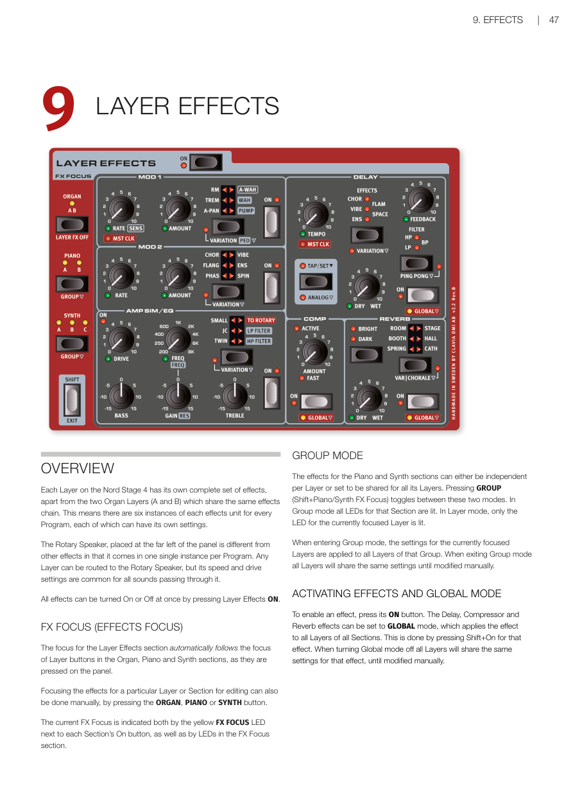
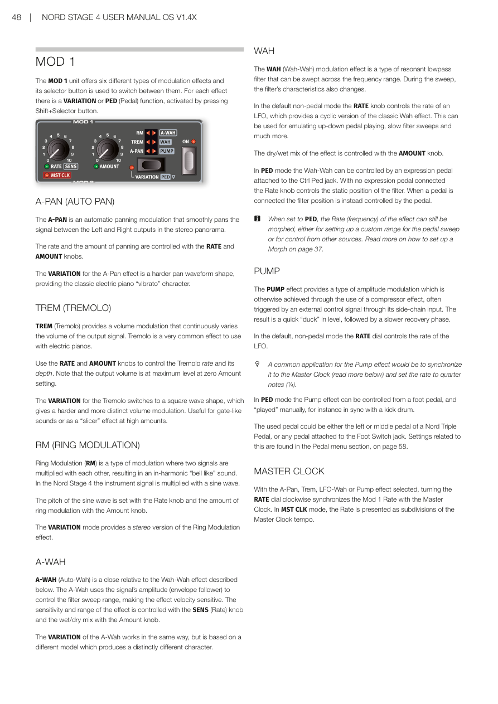
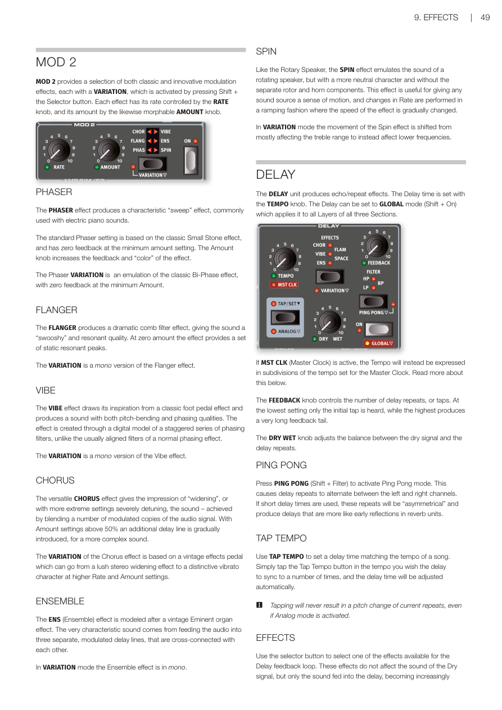
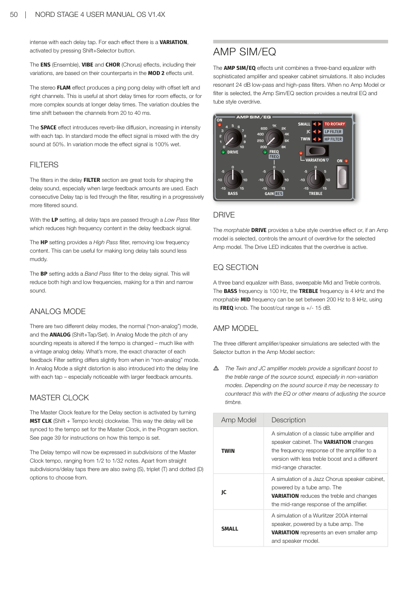
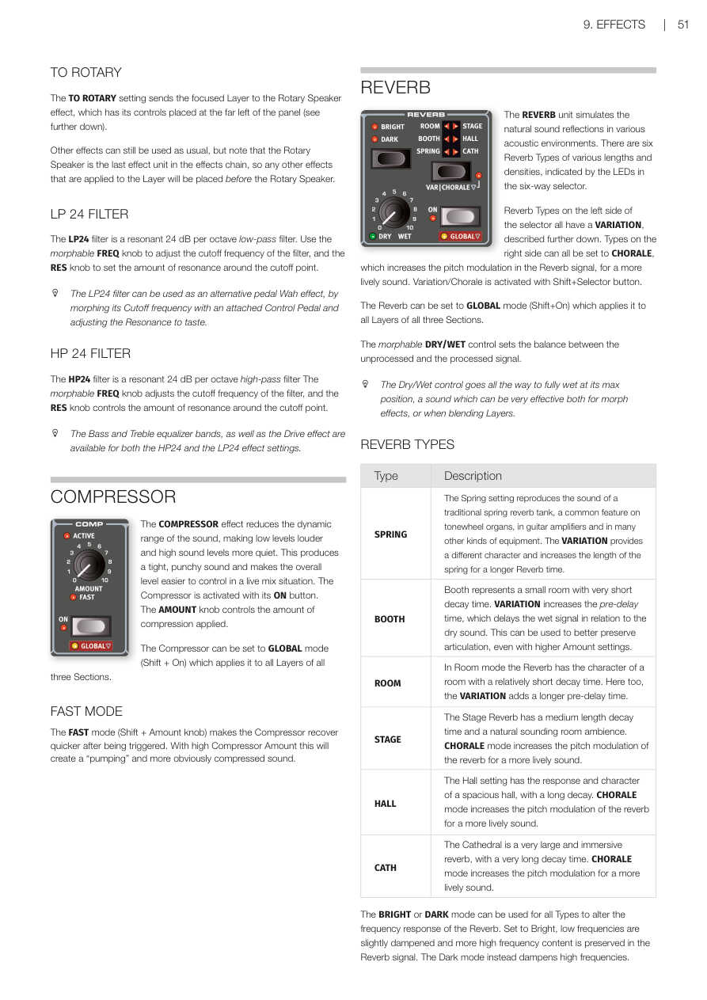
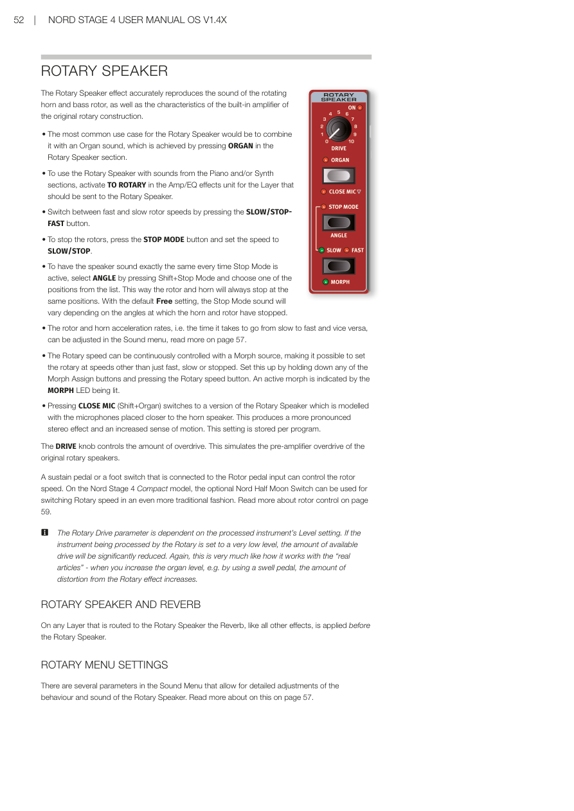

# 第九章：音層效果 / Chapter 9: Layer Effects

---

## 概覽 / OVERVIEW

Nord Stage 4 的每個音層都有完整的效果組合，唯一例外是風琴音層 A 和 B 共用同一個效果鏈。這表示每個程式中，每個效果單元各有六個獨立實例，每個都可以有自己的設定。

Each Layer on the Nord Stage 4 has its own complete set of effects, apart from the two Organ Layers (A and B) which share the same effects chain. This means there are six instances of each effects unit for every Program, each of which can have its own settings.

位於面板最左側的**旋轉喇叭（Rotary Speaker）**效果與其他效果不同，每個程式只有一個實例。任何音層都可以路由到旋轉喇叭，但其速度和驅動設定對所有通過它的聲音都是共用的。

The Rotary Speaker, placed at the far left of the panel is different from other effects in that it comes in one single instance per Program. Any Layer can be routed to the Rotary Speaker, but its speed and drive settings are common for all sounds passing through it.

按 Layer Effects ON 可以同時開啟或關閉所有效果。

All effects can be turned On or Off at once by pressing Layer Effects ON.

---

## 效果焦點 / FX FOCUS (EFFECTS FOCUS)

效果區段的焦點會自動跟隨面板上風琴、鋼琴和合成器區段的音層按鈕。

The focus for the Layer Effects section automatically follows the focus of Layer buttons in the Organ, Piano and Synth sections, as they are pressed on the panel.

也可以手動設定特定音層或區段的效果焦點，方法是按 ORGAN、PIANO 或 SYNTH 按鈕。

Focusing the effects for a particular Layer or Section for editing can also be done manually, by pressing the ORGAN, PIANO or SYNTH button.

目前的效果焦點由每個區段 On 按鈕旁邊的黃色 FX FOCUS LED 以及效果焦點區段中的 LED 共同顯示。

The current FX Focus is indicated both by the yellow FX FOCUS LED next to each Section's On button, as well as by LEDs in the FX Focus section.

---

## 群組模式 / GROUP MODE

鋼琴和合成器區段的效果可以是每個音層獨立，或設定為所有音層共用。按 GROUP（Shift + Piano/Synth FX Focus）可在這兩種模式之間切換。群組模式下，該區段的所有 LED 都會亮起；音層模式下，只有目前聚焦音層的 LED 亮起。

The effects for the Piano and Synth sections can either be independent per Layer or set to be shared for all its Layers. Pressing GROUP (Shift+Piano/Synth FX Focus) toggles between these two modes. In Group mode all LEDs for that Section are lit. In Layer mode, only the LED for the currently focused Layer is lit.

進入群組模式時，目前聚焦音層的設定會套用到該群組的所有音層。離開群組模式時，所有音層會共用相同的效果設定，直到手動修改為止。

When entering Group mode, the settings for the currently focused Layers are applied to all Layers of that Group. When exiting Group mode all Layers will share the same settings until modified manually.

---

## 啟用效果與全域模式 / ACTIVATING EFFECTS AND GLOBAL MODE

按效果的 ON 按鈕來啟用效果。延遲（Delay）、壓縮器（Compressor）和殘響（Reverb）效果可以設定為**全域（GLOBAL）**模式，將效果套用到所有區段的所有音層。方法是按 Shift + 該效果的 On 按鈕。關閉全域模式後，所有音層會共用相同的設定，直到手動修改為止。

To enable an effect, press its ON button. The Delay, Compressor and Reverb effects can be set to GLOBAL mode, which applies the effect to all Layers of all Sections. This is done by pressing Shift+On for that effect. When turning Global mode off all Layers will share the same settings for that effect, until modified manually.

---

---

## MOD 1 調製效果 / MOD 1

**MOD 1** 提供六種不同的調製效果，使用選擇按鈕切換。每種效果都有一個變化版（VARIATION）或踏板（PED）功能，按 Shift + 選擇按鈕啟用。

The MOD 1 unit offers six different types of modulation effects and its selector button is used to switch between them. For each effect there is a VARIATION or PED (Pedal) function, activated by pressing Shift+Selector button.

### 自動搖擺 / A-PAN (AUTO PAN)

**A-PAN（自動搖擺）**是一種自動左右搖擺的調製效果，讓訊號在立體聲全景中左右輸出之間平滑移動。用 RATE（速率）和 AMOUNT（量）旋鈕控制搖擺速度和程度。VARIATION 提供較硬的搖擺波形，呈現電鋼琴的經典「顫音」特性。

The A-PAN is an automatic panning modulation that smoothly pans the signal between the Left and Right outputs in the stereo panorama. Use RATE and AMOUNT knobs. The VARIATION for the A-Pan effect is a harder pan waveform shape, providing the classic electric piano "vibrato" character.

### 顫音 / TREM (TREMOLO)

**TREM（顫音）**提供音量調製，持續改變輸出訊號的音量，常用於電鋼琴。用 RATE 和 AMOUNT 旋鈕控制速度和深度。注意：Amount 為零時輸出音量為最大值。VARIATION 切換為方波形狀，產生更硬且更明顯的音量調製，適合閘控音效或高 Amount 下的「切片」效果。

TREM (Tremolo) provides a volume modulation that continuously varies the volume of the output signal. Use the RATE and AMOUNT knobs. Note that the output volume is at maximum level at zero Amount setting. The VARIATION switches to a square wave shape, useful for gate-like sounds or as a "slicer" effect at high amounts.

### 環形調製 / RM (RING MODULATION)

**環形調製（Ring Modulation——將兩個訊號相乘，產生不和諧的「鐘聲般」音色）**：用 Rate 旋鈕設定正弦波音高，Amount 旋鈕設定環形調製量。VARIATION 提供立體聲版本。

Ring Modulation (RM) multiplies the instrument signal with a sine wave, producing an in-harmonic "bell like" sound. Set the sine wave pitch with Rate and the amount with Amount. VARIATION mode provides a stereo version.

### 自動哇音 / A-WAH (AUTO WAH)

**A-WAH（自動哇音）**使用訊號的振幅（包絡跟隨）來控制濾波器掃描範圍，使效果對力度敏感。用 SENS（Rate）旋鈕控制靈敏度和範圍，Amount 旋鈕控制乾濕比。VARIATION 基於不同模型，產生截然不同的特性。

A-WAH (Auto-Wah) uses the signal's amplitude (envelope follower) to control the filter sweep range, making the effect velocity sensitive. SENS (Rate) controls sensitivity and range, Amount controls dry/wet mix. VARIATION produces a distinctly different character.

### 哇音 / WAH

**WAH（哇音——模擬腳踏板掃頻效果的共振低通濾波器）**：在預設的非踏板模式下，RATE 旋鈕控制 LFO 速率，提供循環版本的哇音效果。AMOUNT 旋鈕控制乾濕比。在 PED 模式下，哇音可由連接到 Ctrl Ped 插孔的表情踏板控制。

WAH (Wah-Wah) is a resonant lowpass filter swept across the frequency range. In the default non-pedal mode the RATE knob controls the rate of an LFO. The dry/wet mix is controlled with the AMOUNT knob. In PED mode the Wah-Wah can be controlled by an expression pedal attached to the Ctrl Ped jack.

> 💡 設定為 PED 時，效果的 Rate（頻率）仍可透過變形控制（Morph）來設定自訂的踏板掃頻範圍，或從其他來源控制。詳見第 37 頁的 Morph 設定說明。

### 泵浦效果 / PUMP

**PUMP（泵浦效果）**提供一種振幅調製效果，產生快速的音量「閃避」，然後緩慢恢復。在預設非踏板模式下，RATE 旋鈕控制 LFO 速率。在 PED 模式下，可用腳踏板手動「演奏」此效果，例如與大鼓同步。

The PUMP effect provides a quick "duck" in level followed by a slower recovery. In the default non-pedal mode the RATE dial controls the rate of the LFO.

> 💡 常見用法是將 PUMP 同步到主時鐘，並將速率設為四分音符（1/4）。

### 主時鐘同步（MOD 1）/ MASTER CLOCK (MOD 1)

選擇 A-Pan、Trem、LFO-Wah 或 Pump 效果時，順時針轉動 RATE 旋鈕到底可將 Mod 1 速率同步到主時鐘。在 MST CLK 模式下，速率以主時鐘速度的細分節拍來表示。

With the A-Pan, Trem, LFO-Wah or Pump effect selected, turning the RATE dial clockwise synchronizes the Mod 1 Rate with the Master Clock.

---

---

## MOD 2 調製效果 / MOD 2

**MOD 2** 提供多種經典和創新的調製效果，每種都有 VARIATION，按 Shift + 選擇按鈕啟用。每種效果的速率由 RATE 旋鈕控制，量由同樣可設定變形的 AMOUNT 旋鈕控制。

MOD 2 provides a selection of both classic and innovative modulation effects, each with a VARIATION, activated by pressing Shift + the Selector button.

### 移相器 / PHASER

**PHASER（移相器）**產生「掃頻」特性的效果，常用於電鋼琴音色。標準設定基於經典的 Small Stone 效果，最小 Amount 設定時反饋為零。Amount 旋鈕增加反饋和音色「色彩」。VARIATION 是經典 Bi-Phase 效果的模擬。

The PHASER effect produces a characteristic "sweep" effect. The standard Phaser setting is based on the classic Small Stone effect. The Amount knob increases the feedback and "color" of the effect. The Phaser VARIATION is an emulation of the classic Bi-Phase effect.

### 鑲邊效果 / FLANGER

**FLANGER（鑲邊效果）**產生戲劇性的梳狀濾波效果，給聲音帶來「呼嘯」和共鳴的質感。Amount 為零時提供一組靜態共鳴峰值。VARIATION 是單聲道版本。

The FLANGER produces a dramatic comb filter effect, giving the sound a "swooshy" and resonant quality. The VARIATION is a mono version.

### 顫動效果 / VIBE

**VIBE（顫動效果）**靈感來自經典腳踏板效果，產生同時具有音高彎曲和相位特性的聲音。VARIATION 是單聲道版本。

The VIBE effect produces a sound with both pitch-bending and phasing qualities. VARIATION is a mono version.

### 合唱效果 / CHORUS

**CHORUS（合唱效果）**給人「加寬」的感覺，或在更極端的設定下嚴重去諧。Amount 超過 50% 時逐漸引入額外的延遲線，產生更複雜的聲音。VARIATION 基於復古效果踏板，可從豐富的立體聲加寬效果到高 Rate 和 Amount 設定下的獨特顫音特性。

The CHORUS effect gives the impression of "widening", or with more extreme settings severely detuning, the sound. VARIATION is based on a vintage effects pedal with a range from lush stereo widening to distinctive vibrato character.

### 合奏效果 / ENSEMBLE

**ENS（合奏效果）**以復古 Eminent 管風琴效果為模型。VARIATION 下為單聲道。

The ENS (Ensemble) effect is modeled after a vintage Eminent organ effect. In VARIATION mode the Ensemble effect is in mono.

### 旋轉效果 / SPIN

**SPIN（旋轉效果）**類似旋轉喇叭，但特性更為中性，沒有獨立的低頻轉子和高頻喇叭組件。速率的變化以漸進方式執行。VARIATION 將效果的運動從主要影響高音範圍切換到影響較低頻率。

Like the Rotary Speaker, the SPIN effect emulates the sound of a rotating speaker, but with a more neutral character. In VARIATION mode the movement shifts from mostly affecting the treble range to instead affect lower frequencies.

---

## 延遲效果 / DELAY

**DELAY（延遲效果——將聲音重複播放，創造回音效果）**單元產生回音/重複效果。用 TEMPO 旋鈕設定延遲時間。延遲可設定為全域模式（Shift + On），套用到所有區段的所有音層。

The DELAY unit produces echo/repeat effects. The Delay time is set with the TEMPO knob. The Delay can be set to GLOBAL mode (Shift + On) which applies it to all Layers of all three Sections.

如果啟用了主時鐘（MST CLK），Tempo 將以主時鐘速度的細分節拍來表示。

If MST CLK (Master Clock) is active, the Tempo will instead be expressed in subdivisions of the tempo set for the Master Clock.

FEEDBACK 旋鈕控制延遲重複次數。最低設定只聽到初始音符，最高設定產生非常長的反饋尾音。DRY WET 旋鈕調整乾訊號和延遲重複之間的平衡。

The FEEDBACK knob controls the number of delay repeats. The DRY WET knob adjusts the balance between the dry signal and the delay repeats.

### 乒乓模式 / PING PONG

按 PING PONG（Shift + Filter）啟用乒乓模式，使延遲重複在左右聲道之間交替出現。短延遲時間下，這些重複會像殘響單元中的早期反射一樣。

Press PING PONG (Shift + Filter) to activate Ping Pong mode, causing delay repeats to alternate between the left and right channels.

### 敲擊節拍設定延遲 / TAP TEMPO

用 TAP TEMPO（敲擊節拍）按鈕設定符合歌曲速度的延遲時間。按幾下即可自動調整延遲時間。

> 💡 敲擊節拍不會導致當前重複音的音高變化，即使在類比模式下也是如此。

Tapping will never result in a pitch change of current repeats, even if Analog mode is activated.

### 延遲反饋效果 / EFFECTS (IN DELAY FEEDBACK LOOP)

使用選擇按鈕選擇可用的延遲反饋迴路效果，這些效果不影響乾訊號，但每次延遲敲擊後強度逐漸增加。

Use the selector button to select one of the effects available for the Delay feedback loop. These effects do not affect the Dry signal, but only the sound fed into the delay, becoming increasingly intense with each delay tap.

### 延遲濾波器 / FILTERS

延遲 FILTER 區段的濾波器用於塑造延遲音色。每次連續的延遲敲擊都通過濾波器，產生逐漸增加的濾波聲音。LP（低通）移除高頻，HP（高通）移除低頻，BP（帶通）同時減少高低頻，產生細窄的聲音。

The filters in the delay FILTER section shape the delay sound. LP provides Low Pass, HP provides High Pass, and BP adds Band Pass filter to the delay signal.

### 類比模式 / ANALOG MODE

有兩種不同的延遲模式：普通模式和類比模式（Shift + Tap/Set）。在類比模式下，如果改變速度，當前重複音的音高會像復古類比延遲一樣改變。類比模式下每次敲擊都會在延遲線中引入輕微失真，特別是在較大反饋量時明顯。

In Analog Mode the pitch of any sounding repeats is altered if the tempo is changed – much like with a vintage analog delay. A slight distortion is also introduced into the delay line with each tap.

### 主時鐘同步（延遲）/ MASTER CLOCK (DELAY)

順時針轉動 MST CLK（Shift + Tempo 旋鈕）啟用主時鐘功能。延遲速度將以主時鐘速度的細分節拍來表示，範圍從二分音符（1/2）到三十二分音符（1/32），另有搖擺（S）、三連音（T）和附點（D）選項。

The Master Clock feature for the Delay section is activated by turning MST CLK (Shift + Tempo knob) clockwise. The Delay tempo will now be expressed in subdivisions of the Master Clock tempo, ranging from 1/2 to 1/32 notes, plus swing (S), triplet (T) and dotted (D) options.

---

---

## 擴大機模擬 / 均衡器 / AMP SIM/EQ

**AMP SIM/EQ（擴大機模擬/均衡器）**效果單元結合了三段均衡器和精密的擴大機及喇叭箱模擬，以及共振 24dB 低通和高通濾波器。未選擇任何 Amp 模型或濾波器時，提供中性 EQ 和電子管風格過載。

The AMP SIM/EQ effects unit combines a three-band equalizer with amplifier and speaker cabinet simulations. It also includes resonant 24 dB low-pass and high-pass filters.

### 驅動 / DRIVE

可設定變形的 DRIVE 旋鈕提供電子管風格的過載效果；若選擇了 Amp 模型，則控制所選模型的過載量。Drive LED 亮起表示過載啟用。

The morphable DRIVE provides a tube style overdrive effect or controls the overdrive amount for the selected Amp model.

### 均衡器區段 / EQ SECTION

三段均衡器，包含低音（BASS）、可掃頻的中頻（Mid）和高音（Treble）控制。低音頻率為 100 Hz，高音頻率為 4 kHz，可設定變形的中頻（MID）可在 200 Hz 到 8 kHz 之間調整，增益/衰減範圍為 ±15 dB。

A three band equalizer with Bass, sweepable Mid and Treble controls. BASS: 100 Hz, TREBLE: 4 kHz, morphable MID: 200 Hz to 8 kHz. Boost/cut range: +/- 15 dB.

### 擴大機模型 / AMP MODEL

| 模型 / Model | 說明 / Description |
|---|---|
| TWIN | 經典電子管擴大機和喇叭箱的模擬。VARIATION 改變頻率響應為高音提升較少、中頻特性不同的版本。/ A simulation of a classic tube amplifier and speaker cabinet. VARIATION changes frequency response with less treble boost and a different mid-range character. |
| JC | Jazz Chorus 喇叭箱和電子管擴大機的模擬。VARIATION 減少高音並改變中頻響應。/ A simulation of a Jazz Chorus speaker cabinet powered by a tube amp. VARIATION reduces the treble and changes the mid-range response. |
| SMALL | Wurlitzer 200A 內置喇叭和電子管擴大機的模擬。VARIATION 代表更小的擴大機和喇叭模型。/ A simulation of a Wurlitzer 200A internal speaker powered by a tube amp. VARIATION is an even smaller amp and speaker model. |

> ⚠️ Twin 和 JC 擴大機模型會大幅提升訊號來源的高音範圍，尤其是在非 VARIATION 模式下。可能需要用 EQ 或其他方式來抵消這種效果。

---

---

## 路由至旋轉喇叭 / TO ROTARY

**TO ROTARY（路由至旋轉喇叭）**設定將聚焦音層發送到旋轉喇叭效果，旋轉喇叭的控制器位於面板最左側。其他效果仍可正常使用，但旋轉喇叭是效果鏈中的最後一個單元，套用到音層的其他效果都會排在旋轉喇叭之前。

The TO ROTARY setting sends the focused Layer to the Rotary Speaker effect. Note that the Rotary Speaker is the last effect unit in the effects chain, so any other effects applied to the Layer will be placed before the Rotary Speaker.

---

## LP 24 低通濾波器 / LP 24 FILTER

**LP24 濾波器**是每八度 24 dB 的共振低通濾波器。用可設定變形的 FREQ 旋鈕調整截止頻率，RES 旋鈕設定截止點的共鳴量。

The LP24 filter is a resonant 24 dB per octave low-pass filter. Use the morphable FREQ knob to adjust the cutoff frequency, and the RES knob to set the amount of resonance.

> 💡 LP24 濾波器可以作為踏板哇音效果的替代方案，透過連接到 Control Pedal 的變形控制來調整截止頻率，並根據個人喜好調整共鳴量。

---

## HP 24 高通濾波器 / HP 24 FILTER

**HP24 濾波器**是每八度 24 dB 的共振高通濾波器。可設定變形的 FREQ 旋鈕調整截止頻率，RES 旋鈕控制截止點的共鳴量。

The HP24 filter is a resonant 24 dB per octave high-pass filter. The morphable FREQ knob adjusts the cutoff frequency, and the RES knob controls the amount of resonance.

> 💡 低音和高音均衡器，以及 Drive 效果，在 HP24 和 LP24 效果設定下都可以使用。

---

## 壓縮效果 / COMPRESSOR

**壓縮效果（Compressor——縮小動態範圍，讓安靜的部分更大聲、大聲的部分更小聲，產生緊實飽滿的聲音）**：AMOUNT 旋鈕控制壓縮量。可設定為全域模式（Shift + On）套用到所有區段所有音層。

The COMPRESSOR reduces the dynamic range, making low levels louder and high sound levels more quiet. The AMOUNT knob controls the amount of compression. Can be set to GLOBAL mode (Shift + On).

### 快速模式 / FAST MODE

**快速模式（FAST mode——Shift + Amount 旋鈕）**讓壓縮器在觸發後更快恢復。高 Amount 下會產生「泵浦」和更明顯的壓縮聲音。

FAST mode (Shift + Amount knob) makes the Compressor recover quicker after being triggered. With high Compressor Amount this will create a "pumping" and more obviously compressed sound.

---

## 殘響效果 / REVERB

**殘響效果（Reverb——模擬不同聲學空間中的自然音效反射）**：六種殘響類型，由六路選擇器上的 LED 指示。選擇器左側的類型都有 VARIATION，右側的類型都可設定為 CHORALE（增加殘響訊號中的音高調製，產生更生動的聲音）。可設定為全域模式（Shift + On）。可設定變形的 DRY/WET 控制調整未處理和已處理訊號之間的平衡。

The REVERB unit simulates natural sound reflections in various acoustic environments. There are six Reverb Types indicated by LEDs. Reverb can be set to GLOBAL mode (Shift+On). The morphable DRY/WET control sets the balance between the unprocessed and processed signal.

> 💡 乾濕比控制可以調到完全濕潤，非常適合變形效果或混合音層時使用。

### 殘響類型 / REVERB TYPES

| 類型 / Type | 說明 / Description |
|---|---|
| SPRING | 模擬傳統彈簧殘響槽。VARIATION 改變特性並增加彈簧長度。/ Reproduces the sound of a traditional spring reverb tank. VARIATION provides different character and increases spring length. |
| BOOTH | 代表衰退時間很短的小房間。VARIATION 增加預延遲時間，可在高 Amount 設定下保持清晰度。/ Represents a small room with very short decay. VARIATION increases the pre-delay time. |
| ROOM | 相對衰退時間較短的房間殘響。VARIATION 增加預延遲時間。/ Room with relatively short decay time. VARIATION adds longer pre-delay. |
| STAGE | 中等長度衰退時間和自然房間氛圍。CHORALE 模式增加殘響的音高調製。/ Medium length decay and natural room ambience. CHORALE increases pitch modulation. |
| HALL | 寬敞大廳的響應和特性，衰退時間長。CHORALE 模式增加音高調製。/ Spacious hall response with long decay. CHORALE increases pitch modulation. |
| CATH | 非常大且沉浸感強的殘響，衰退時間極長。CHORALE 模式增加音高調製。/ Very large and immersive reverb with very long decay. CHORALE increases pitch modulation. |

所有類型都可以使用 **BRIGHT（亮）**或 **DARK（暗）**模式來改變殘響的頻率響應。Bright 模式輕微壓制低頻並保留更多高頻；Dark 模式則壓制高頻。

The BRIGHT or DARK mode can be used for all Types to alter the frequency response of the Reverb.

---

---

## 旋轉喇叭 / ROTARY SPEAKER

**旋轉喇叭（Rotary Speaker——模擬旋轉喇叭的物理音色，常見於管風琴演奏）**效果精確重現旋轉高頻喇叭和低頻轉子的聲音，以及原始旋轉結構內置擴大機的特性。

The Rotary Speaker effect accurately reproduces the sound of the rotating horn and bass rotor, as well as the characteristics of the built-in amplifier of the original rotary construction.

### 使用旋轉喇叭的方式 / HOW TO USE

- 最常見的用法是與管風琴音色組合，方法是按旋轉喇叭區段的 ORGAN 按鈕。/ Most common use: combine with Organ sound by pressing ORGAN in the Rotary Speaker section.
- 要將旋轉喇叭用於鋼琴和/或合成器區段的音色，在該音層的 Amp/EQ 效果單元中啟用 TO ROTARY。/ For Piano/Synth sounds, activate TO ROTARY in the Amp/EQ effects unit.
- 按 SLOW/STOP-FAST 按鈕切換快速和慢速轉子速度。/ Switch between fast and slow rotor speeds by pressing the SLOW/STOP-FAST button.
- 要停止轉子，按 STOP MODE 按鈕並將速度設為 SLOW/STOP。/ To stop the rotors, press STOP MODE and set speed to SLOW/STOP.
- 要讓喇叭每次停止時都在相同位置，按 Shift + Stop Mode 選擇 ANGLE 並從清單中選擇位置。預設的 Free 設定會根據喇叭和轉子停止的角度而有不同聲音。/ To have the speaker stop at the same position every time, press Shift+Stop Mode and select an ANGLE. With the default Free setting, the Stop Mode sound varies depending on angles at which horn and rotor have stopped.
- 轉子和喇叭的加速率（從慢到快或從快到慢的時間）可以在音色選單中調整，詳見第 57 頁。/ The rotor and horn acceleration rates can be adjusted in the Sound menu, see page 57.
- 旋轉速度可以透過變形控制來連續調整，讓旋轉喇叭不只能在快、慢或停止之間切換。方法是按住任意 Morph Assign 按鈕並按旋轉速度按鈕。/ The Rotary speed can be continuously controlled with a Morph source. Set this up by holding down any Morph Assign button and pressing the Rotary speed button.
- 按 CLOSE MIC（Shift + Organ）切換到麥克風更靠近喇叭的模型版本，產生更明顯的立體聲效果和更強的動感。此設定每個程式獨立儲存。/ Pressing CLOSE MIC (Shift+Organ) switches to a version with microphones placed closer to the horn speaker, producing more pronounced stereo effect and increased sense of motion. Stored per program.

DRIVE 旋鈕控制過載量，模擬原始旋轉喇叭前置擴大機的過載特性。

The DRIVE knob controls the amount of overdrive, simulating the pre-amplifier overdrive of the original rotary speakers.

> 💡 Rotary Drive 參數取決於通過它處理的樂器音量設定。如果被旋轉喇叭處理的樂器音量設定很低，可用的 Drive 量會大幅減少。這與真實旋轉喇叭的工作原理非常相似——增大風琴音量時（例如使用 swell 踏板），Rotary 效果的失真量也會增加。

The Rotary Drive parameter is dependent on the processed instrument's Level setting. If set to a very low level, the amount of available drive will be significantly reduced.

連接到 Rotor 踏板輸入的延音踏板或腳踏開關可以控制轉子速度。Nord Stage 4 Compact 型號可以使用可選配的 Nord Half Moon Switch 來以更傳統的方式切換旋轉速度。

A sustain pedal or foot switch connected to the Rotor pedal input can control the rotor speed. On the Nord Stage 4 Compact model, the optional Nord Half Moon Switch can be used for switching Rotary speed in an even more traditional fashion.

### 旋轉喇叭與殘響 / ROTARY SPEAKER AND REVERB

在任何路由到旋轉喇叭的音層上，殘響（如同所有其他效果一樣）都是在旋轉喇叭之前套用的。

On any Layer that is routed to the Rotary Speaker the Reverb, like all other effects, is applied before the Rotary Speaker.

### 旋轉喇叭選單設定 / ROTARY MENU SETTINGS

音色選單中有數個參數允許對旋轉喇叭的行為和音色進行詳細調整。詳見第 57 頁。

There are several parameters in the Sound Menu that allow for detailed adjustments of the behaviour and sound of the Rotary Speaker. Read more about this on page 57.
