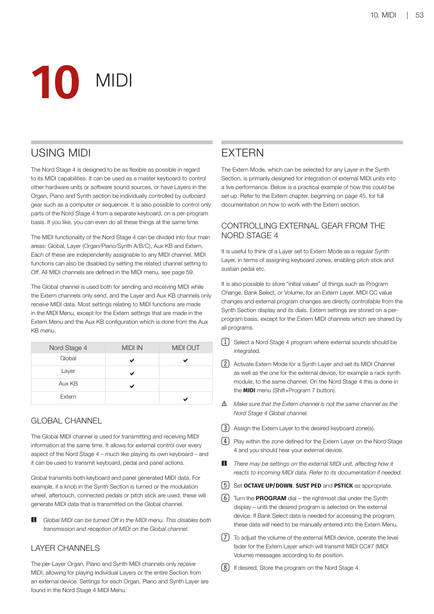
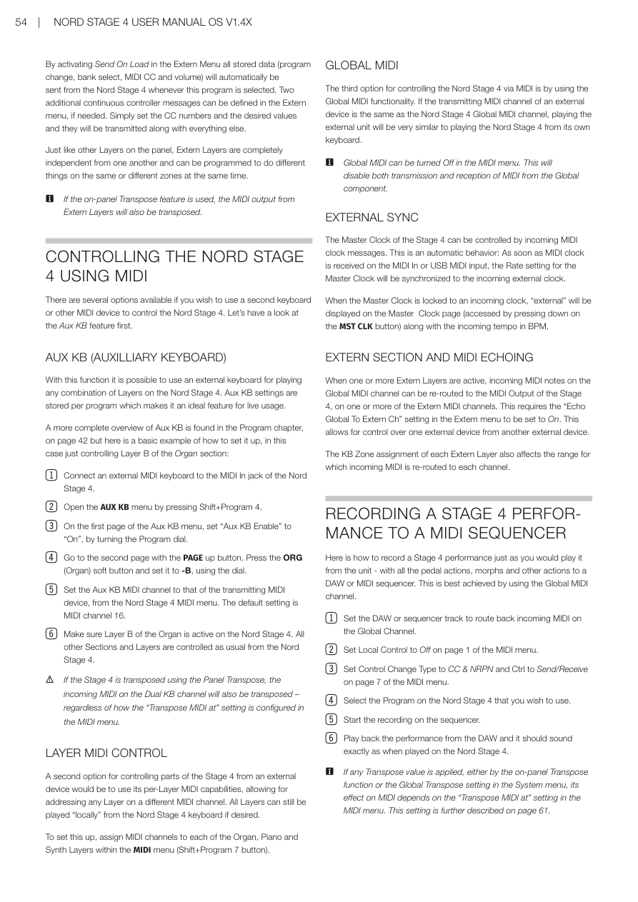
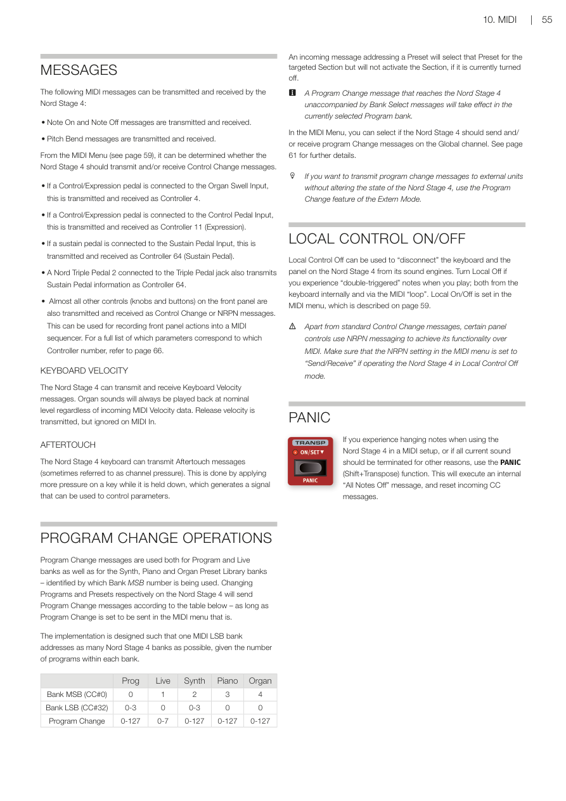

# 第十章：MIDI / Chapter 10: MIDI

---

## 使用 MIDI / USING MIDI

Nord Stage 4 的 MIDI 功能設計得相當靈活，可以同時扮演多種角色。你可以把它當作主控鍵盤，去控制其他硬體設備或軟體音源；也可以讓外部設備（例如電腦或音序器）個別控制風琴、鋼琴、合成器各個音層。甚至可以同時做到以上所有事情。

The Nord Stage 4 is designed to be as flexible as possible in regard to its MIDI capabilities. It can be used as a master keyboard to control other hardware units or software sound sources, or have Layers in the Organ, Piano and Synth section be individually controlled by outboard gear such as a computer or sequencer. It is also possible to control only parts of the Nord Stage 4 from a separate keyboard, on a per-program basis. If you like, you can even do all these things at the same time.

Nord Stage 4 的 MIDI 功能分為四大區塊：**全域通道（Global Channel）**、**各音層通道（Layer Channels，包含風琴/鋼琴/合成器 A/B/C）**、**輔助鍵盤（Aux KB）** 和 **Extern（外部模式）**。每個區塊都可以單獨指定不同的 MIDI 通道（MIDI Channel——用來區分不同樂器信號的頻道，數字為 1 到 16），也可以設定為 Off 來停用。所有 MIDI 通道的設定都在 MIDI 選單中完成（請參閱第 59 頁）。

The MIDI functionality of the Nord Stage 4 can be divided into four main areas: Global, Layer (Organ/Piano/Synth A/B/C), Aux KB and Extern. Each of these are independently assignable to any MIDI channel. MIDI functions can also be disabled by setting the related channel setting to Off. All MIDI channels are defined in the MIDI menu, see page 59.

全域通道同時負責發送和接收 MIDI；Extern 通道只發送；音層通道和輔助鍵盤通道只接收。大部分 MIDI 設定都在 MIDI 選單裡，Extern 相關設定在 Extern 選單，輔助鍵盤設定在 Aux KB 選單。

The Global channel is used both for sending and receiving MIDI while the Extern channels only send, and the Layer and Aux KB channels only receive MIDI data. Most settings relating to MIDI functions are made in the MIDI Menu, except for the Extern settings that are made in the Extern Menu and the Aux KB configuration which is done from the Aux KB menu.

---

## 全域通道 / GLOBAL CHANNEL

全域通道是 Nord Stage 4 的主要 MIDI 頻道，可以同時發送與接收 MIDI 訊號。透過全域通道，外部設備可以完整控制 Stage 4，就像直接在琴鍵上彈奏一樣。

The Global MIDI channel is used for transmitting and receiving MIDI information at the same time. It allows for external control over every aspect of the Nord Stage 4 – much like playing its own keyboard – and it can be used to transmit keyboard, pedal and panel actions.

全域通道會傳送來自鍵盤和面板的所有 MIDI 資料。例如：你轉動合成器區段的旋鈕、推動調音輪（Modulation Wheel）、使用後觸感應（Aftertouch——按下琴鍵後繼續施力所產生的訊號）、踩踏板，或推音高推桿（Pitch Bend）——這些動作都會透過全域通道發送出去。

Global transmits both keyboard and panel generated MIDI data. For example, if a knob in the Synth Section is turned or the modulation wheel, aftertouch, connected pedals or pitch stick are used, these will generate MIDI data that is transmitted on the Global channel.

> 💡 如果不需要全域通道，可在 MIDI 選單中將它關掉（Off）。關掉後，發送與接收都會停止。

Global MIDI can be turned Off in the MIDI menu. This disables both transmission and reception of MIDI on the Global channel.

---

## 各音層通道 / LAYER CHANNELS

每個音層（風琴、鋼琴、合成器）都有自己的 MIDI 通道，但這些通道**只接收**外部訊號，不會主動發送。這讓你可以用外部設備單獨控制特定音層或整個區段。設定方式在 MIDI 選單裡。

The per-Layer Organ, Piano and Synth MIDI channels only receive MIDI, allowing for playing individual Layers or the entire Section from an external device. Settings for each Organ, Piano and Synth Layer are found in the Nord Stage 4 MIDI Menu.

---

## Extern 外部模式 / EXTERN

Extern（外部模式）可以在合成器區段的任何音層上啟用，專門用來把外部 MIDI 設備整合進現場演出。下面有一個實際範例說明怎麼設定。完整說明請參閱第 45 頁的 Extern 章節。

The Extern Mode, which can be selected for any Layer in the Synth Section, is primarily designed for integration of external MIDI units into a live performance. Below is a practical example of how this could be set up. Refer to the Extern chapter, beginning on page 45, for full documentation on how to work with the Extern section.

---

## 用 Nord Stage 4 控制外部設備 / CONTROLLING EXTERNAL GEAR FROM THE NORD STAGE 4

把一個音層設定為 Extern 模式，就可以把它想成一個普通的合成器音層——一樣可以分配鍵盤分區、開關音高推桿和延音踏板等。

It is useful to think of a Layer set to Extern Mode as a regular Synth Layer, in terms of assigning keyboard zones, enabling pitch stick and sustain pedal etc.

你也可以為 Extern 音層預存一些「初始值」，例如程式切換（Program Change——切換外部設備上音色的指令）、音色庫選擇（Bank Select——用來選擇外部設備音色庫的指令）和音量設定。這些值在切換程式時可以自動發送給外部設備。

It is also possible to store "initial values" of things such as Program Change, Bank Select, or Volume, for an Extern Layer. MIDI CC value changes and external program changes are directly controllable from the Synth Section display and its dials. Extern settings are stored on a per-program basis, except for the Extern MIDI channels which are shared by all programs.

**設定步驟：**

1. 選一個想整合外部音色的 Nord Stage 4 程式。

   Select a Nord Stage 4 program where external sounds should be integrated.

2. 為合成器某個音層啟用 Extern 模式，並在 MIDI 選單（Shift + Program 7 按鈕）中把這個音層的 MIDI 通道設定成和外部設備相同的通道。

   Activate Extern Mode for a Synth Layer and set its MIDI Channel as well as the one for the external device, for example a rack synth module, to the same channel. On the Nord Stage 4 this is done in the MIDI menu (Shift+Program 7 button).

   > ⚠️ 請確認 Extern 通道和 Nord Stage 4 的全域通道不同，否則會造成混亂。

   Make sure that the Extern channel is not the same channel as the Nord Stage 4 Global channel.

3. 把 Extern 音層指定到想要的鍵盤分區。

   Assign the Extern Layer to the desired keyboard zone(s).

4. 在 Extern 音層的分區內彈奏，應該就能聽到外部設備發出聲音。

   Play within the zone defined for the Extern Layer on the Nord Stage 4 and you should hear your external device.

   > 💡 如果外部設備沒有反應，請查看它的說明書，確認它的接收 MIDI 通道設定是否正確。

   There may be settings on the external MIDI unit, affecting how it reacts to incoming MIDI data. Refer to its documentation if needed.

5. 視需要設定 OCTAVE UP/DOWN（八度移位）、SUST PED（延音踏板）和 PSTICK（音高推桿）。

   Set OCTAVE UP/DOWN, SUST PED and PSTICK as appropriate.

6. 轉動合成器顯示器最右邊的旋鈕（PROGRAM 旋鈕），直到外部設備顯示你想要的音色。如果外部設備需要 Bank Select 資料，請在 Extern 選單中手動輸入。

   Turn the PROGRAM dial – the rightmost dial under the Synth display – until the desired program is selected on the external device. If Bank Select data is needed for accessing the program, these data will need to be manually entered into the Extern Menu.

7. 推動 Extern 音層的音量推桿，可以調整外部設備的音量——這會發送 MIDI CC#7（MIDI 音量）訊息。

   To adjust the volume of the external MIDI device, operate the level fader for the Extern Layer which will transmit MIDI CC#7 (MIDI Volume) messages according to its position.

8. 如果想保留這些設定，請儲存這個程式。

   If desired, Store the program on the Nord Stage 4.

---

---

在 Extern 選單中開啟「Send On Load」，每次切換到這個程式時，所有已儲存的資料（程式切換、音色庫選擇、MIDI CC 和音量）都會自動發送給外部設備——非常適合現場演出使用。另外還可以在 Extern 選單中定義兩個額外的 CC 訊息。

By activating Send On Load in the Extern Menu all stored data (program change, bank select, MIDI CC and volume) will automatically be sent from the Nord Stage 4 whenever this program is selected. Two additional continuous controller messages can be defined in the Extern menu, if needed. Simply set the CC numbers and the desired values and they will be transmitted along with everything else.

每個 Extern 音層彼此獨立，可以同時在相同或不同的鍵盤分區中做不同的事。

Just like other Layers on the panel, Extern Layers are completely independent from one another and can be programmed to do different things on the same or different zones at the same time.

如果使用了面板上的移調（Transpose）功能，Extern 音層發出的 MIDI 訊號也會跟著移調。

If the on-panel Transpose feature is used, the MIDI output from Extern Layers will also be transposed.

---

## 用外部設備控制 Nord Stage 4 / CONTROLLING THE NORD STAGE 4 USING MIDI

---

## 輔助鍵盤 / AUX KB (AUXILIARY KEYBOARD)

輔助鍵盤（Aux KB）讓你可以用外部鍵盤來演奏 Nord Stage 4 上的任何音層組合。設定以程式為單位儲存，非常適合現場演出。

With this function it is possible to use an external keyboard for playing any combination of Layers on the Nord Stage 4. Aux KB settings are stored per program which makes it an ideal feature for live usage.

更完整的 Aux KB 說明請見第 42 頁的程式章節。以下是一個基本範例，示範如何設定輔助鍵盤來控制風琴區段的 B 音層：

A more complete overview of Aux KB is found in the Program chapter, on page 42 but here is a basic example of how to set it up, in this case just controlling Layer B of the Organ section:

1. 把外部 MIDI 鍵盤連接到 Nord Stage 4 的 MIDI In 接口。

   Connect an external MIDI keyboard to the MIDI In jack of the Nord Stage 4.

2. 按 Shift + Program 4，開啟 AUX KB 選單。

   Open the AUX KB menu by pressing Shift+Program 4.

3. 在 Aux KB 選單第一頁，轉動 Program 旋鈕，把「Aux KB Enable」設為「On」。

   On the first page of the Aux KB menu, set "Aux KB Enable" to "On", by turning the Program dial.

4. 按 PAGE 向上翻到第二頁，按下 ORG（風琴）軟按鈕，用旋鈕把它設為「-B」。

   Go to the second page with the PAGE up button. Press the ORG (Organ) soft button and set it to -B, using the dial.

5. 在 MIDI 選單中，把 Aux KB 的 MIDI 通道設定成和外部鍵盤發送的通道相同。預設值是 MIDI 通道 16。

   Set the Aux KB MIDI channel to that of the transmitting MIDI device, from the Nord Stage 4 MIDI menu. The default setting is MIDI channel 16.

6. 確認 Nord Stage 4 上的風琴 B 音層已開啟，其他區段和音層照常由 Nord Stage 4 本身控制。

   Make sure Layer B of the Organ is active on the Nord Stage 4. All other Sections and Layers are controlled as usual from the Nord Stage 4.

> ⚠️ 如果 Stage 4 使用了面板移調，輔助鍵盤收到的 MIDI 也會跟著移調，不管 MIDI 選單裡「Transpose MIDI at」的設定為何。

If the Stage 4 is transposed using the Panel Transpose, the incoming MIDI on the Dual KB channel will also be transposed – regardless of how the "Transpose MIDI at" setting is configured in the MIDI menu.

---

## 分音層 MIDI 控制 / LAYER MIDI CONTROL

第二種用外部設備控制 Stage 4 的方式，是利用每個音層各自的 MIDI 通道，把不同音層分配到不同頻道，讓外部設備精準控制特定音層。如果需要，所有音層仍然可以從 Nord Stage 4 自己的琴鍵「本地」演奏。

A second option for controlling parts of the Stage 4 from an external device would be to use its per-Layer MIDI capabilities, allowing for addressing any Layer on a different MIDI channel. All Layers can still be played "locally" from the Nord Stage 4 keyboard if desired.

設定方式：在 MIDI 選單（Shift + Program 7 按鈕）中，分別為風琴、鋼琴、合成器各音層指定 MIDI 通道。

To set this up, assign MIDI channels to each of the Organ, Piano and Synth Layers within the MIDI menu (Shift+Program 7 button).

---

## 全域 MIDI 控制 / GLOBAL MIDI

第三種方式是使用全域 MIDI。只要外部設備的 MIDI 發送通道和 Nord Stage 4 的全域通道相同，外部設備就能像直接彈奏 Stage 4 本身的琴鍵一樣控制它。

The third option for controlling the Nord Stage 4 via MIDI is by using the Global MIDI functionality. If the transmitting MIDI channel of an external device is the same as the Nord Stage 4 Global MIDI channel, playing the external unit will be very similar to playing the Nord Stage 4 from its own keyboard.

如需要，可以在 MIDI 選單中把全域 MIDI 關掉，這樣發送和接收都會停止。

Global MIDI can be turned Off in the MIDI menu. This will disable both transmission and reception of MIDI from the Global component.

---

## 外部同步 / EXTERNAL SYNC

Stage 4 的主時鐘（Master Clock——控制整台樂器節奏速度的核心時鐘）可以接受外部 MIDI 時鐘訊號。這是自動運作的：只要 MIDI In 或 USB MIDI 接口收到 MIDI 時鐘，主時鐘速度就會跟著外部時鐘同步。

The Master Clock of the Stage 4 can be controlled by incoming MIDI clock messages. This is an automatic behavior: As soon as MIDI clock is received on the MIDI In or USB MIDI input, the Rate setting for the Master Clock will be synchronized to the incoming external clock.

同步成功後，按下 MST CLK 按鈕進入主時鐘頁面，畫面上會顯示「external」以及外部時鐘的 BPM 數值。

When the Master Clock is locked to an incoming clock, "external" will be displayed on the Master Clock page (accessed by pressing down on the MST CLK button) along with the incoming tempo in BPM.

---

## Extern 和 MIDI 迴路 / EXTERN SECTION AND MIDI ECHOING

當 Extern 音層啟用時，全域通道收到的 MIDI 音符可以「轉發」到 Stage 4 的 MIDI 輸出，轉發到指定的 Extern 通道上。這樣就能用一台外部設備控制另一台外部設備。

When one or more Extern Layers are active, incoming MIDI notes on the Global MIDI channel can be re-routed to the MIDI Output of the Stage 4, on one or more of the Extern MIDI channels. This requires the "Echo Global To Extern Ch" setting in the Extern menu to be set to On. This allows for control over one external device from another external device.

> 💡 要啟用這個功能，需要在 Extern 選單中把「Echo Global To Extern Channel」設為「On」。每個 Extern 音層的鍵盤分區設定也會影響 MIDI 訊號被轉發的音域範圍。

The KB Zone assignment of each Extern Layer also affects the range for which incoming MIDI is re-routed to each channel.

---

## 錄製演奏到音序器 / RECORDING A STAGE 4 PERFORMANCE TO A MIDI SEQUENCER

以下說明如何把你在 Stage 4 上的完整演奏（包含踩踏板、Morph 等所有動作）錄製到 DAW（數位音訊工作站）或音序器（Sequencer——可以錄製和播放 MIDI 資料的軟體或硬體），最佳方式是透過全域通道。

Here is how to record a Stage 4 performance just as you would play it from the unit - with all the pedal actions, morphs and other actions to a DAW or MIDI sequencer. This is best achieved by using the Global MIDI channel.

1. 在 DAW 或音序器中，把相應的音軌設定為將全域通道收到的 MIDI 資料回傳給 Stage 4。

   Set the DAW or sequencer track to route back incoming MIDI on the Global Channel.

2. 在 MIDI 選單第 1 頁，把本地控制（Local Control——控制琴鍵是否直接觸發內部音源的設定）設為 Off。

   Set Local Control to Off on page 1 of the MIDI menu.

3. 在 MIDI 選單第 7 頁，把 Control Change Type 設為「CC & NRPN」，Ctrl 設為「Send/Receive」。

   Set Control Change Type to CC & NRPN and Ctrl to Send/Receive on page 7 of the MIDI menu.

4. 選好要使用的程式。

   Select the Program on the Nord Stage 4 that you wish to use.

5. 開始在音序器上錄音，然後開始彈奏。

   Start the recording on the sequencer.

6. 播放錄製好的資料，聽起來應該和直接在 Stage 4 上演奏一模一樣。

   Play back the performance from the DAW and it should sound exactly as when played on the Nord Stage 4.

> 💡 如果有使用移調功能（面板 Transpose 或系統選單中的 Global Transpose），移調對 MIDI 訊號的影響取決於 MIDI 選單中「Transpose MIDI at」的設定（詳見第 61 頁）。

If any Transpose value is applied, either by the on-panel Transpose function or the Global Transpose setting in the System menu, its effect on MIDI depends on the "Transpose MIDI at" setting in the MIDI menu. This setting is further described on page 61.

---

---

## MIDI 訊息種類 / MESSAGES

Nord Stage 4 可以發送和接收以下 MIDI 訊息：

The following MIDI messages can be transmitted and received by the Nord Stage 4:

- **音符開/關（Note On / Note Off）**：按下和放開琴鍵時發送。  
  Note On and Note Off messages are transmitted and received.

- **音高推桿（Pitch Bend）**：推動音高桿時發送。  
  Pitch Bend messages are transmitted and received.

從 MIDI 選單（第 59 頁）可以設定是否要發送/接收控制訊息（CC）：

From the MIDI Menu (see page 59), it can be determined whether the Nord Stage 4 should transmit and/or receive Control Change messages.

- 連接到風琴 Swell 輸入的控制/表情踏板：作為 **Controller 4** 傳輸。  
  If a Control/Expression pedal is connected to the Organ Swell Input, this is transmitted and received as Controller 4.

- 連接到 Control Pedal 輸入的控制/表情踏板：作為 **Controller 11（Expression）** 傳輸。  
  If a Control/Expression pedal is connected to the Control Pedal Input, this is transmitted and received as Controller 11 (Expression).

- 連接到 Sustain Pedal 輸入的延音踏板：作為 **Controller 64** 傳輸。  
  If a sustain pedal is connected to the Sustain Pedal Input, this is transmitted and received as Controller 64 (Sustain Pedal).

- 連接到 Triple Pedal 接口的 Nord Triple Pedal 2：同樣作為 **Controller 64** 傳輸。  
  A Nord Triple Pedal 2 connected to the Triple Pedal jack also transmits Sustain Pedal information as Controller 64.

- 面板上幾乎所有的旋鈕和按鈕都可以作為控制訊息（CC）或 NRPN（非標準參數訊息——可傳送更多種類參數的進階 MIDI 訊息）發送，可以錄製面板上的所有操作動作到音序器。完整的控制器號碼對應表請參閱第 66 頁。  
  Almost all other controls (knobs and buttons) on the front panel are also transmitted and received as Control Change or NRPN messages. This can be used for recording front panel actions into a MIDI sequencer. For a full list of which parameters correspond to which Controller number, refer to page 66.

---

## 鍵盤力度 / KEYBOARD VELOCITY

Nord Stage 4 可以發送和接收鍵盤力度（Keyboard Velocity——彈琴時用力的大小，決定音量或音色變化）訊息。風琴音色不管收到什麼力度值，永遠以標準音量播放。放開琴鍵時也會發送放鍵力度（Release Velocity），但接收時會被忽略。

The Nord Stage 4 can transmit and receive Keyboard Velocity messages. Organ sounds will always be played back at nominal level regardless of incoming MIDI Velocity data. Release velocity is transmitted, but ignored on MIDI In.

---

## 後觸感應 / AFTERTOUCH

Nord Stage 4 的琴鍵可以發送後觸感應（Aftertouch，有時也稱為 Channel Pressure）訊號：按下琴鍵後持續施力，就會產生這個訊號，可以用來控制各種參數（例如：加深顫音、改變音色亮度）。

The Nord Stage 4 keyboard can transmit Aftertouch messages (sometimes referred to as channel pressure). This is done by applying more pressure on a key while it is held down, which generates a signal that can be used to control parameters.

---

## 程式切換操作 / PROGRAM CHANGE OPERATIONS

程式切換（Program Change）訊息用於切換程式庫（Prog）和現場庫（Live），以及合成器、鋼琴、風琴的預設音色庫——由 Bank MSB 編號來識別是哪一個庫。切換程式或音色時，Stage 4 會根據下表發送程式切換訊息：

Program Change messages are used both for Program and Live banks as well as for the Synth, Piano and Organ Preset Library banks – identified by which Bank MSB number is being used. Changing Programs and Presets respectively on the Nord Stage 4 will send Program Change messages according to the following table:

| 庫 / Bank | Bank MSB (CC#0) | Bank LSB (CC#32) | Program Change |
|-----------|----------------|------------------|----------------|
| 程式（Prog） | 0 | 0–3 | 0–127 |
| 現場（Live） | 1 | 0 | 0–7 |
| 合成器（Synth） | 2 | 0–3 | 0–127 |
| 鋼琴（Piano） | 3 | 0 | 0–127 |
| 風琴（Organ） | 4 | 0 | 0–127 |

如果收到的訊息是針對預設音色（Preset），會選擇對應區段的音色，但如果該區段目前是關閉的，不會自動開啟它。

An incoming message addressing a Preset will select that Preset for the targeted Section but will not activate the Section, if it is currently turned off.

> 💡 如果收到程式切換訊息時沒有附帶 Bank Select，Stage 4 會在目前所在的程式庫中切換音色。若想對外部設備發送程式切換而不影響 Stage 4 本身，請使用 Extern 模式的程式切換功能。

A Program Change message that reaches the Nord Stage 4 unaccompanied by Bank Select messages will take effect in the currently selected Program bank.

---

## 本地控制開關 / LOCAL CONTROL ON/OFF

本地控制（Local Control）關掉後，琴鍵和面板操作不會直接觸發 Stage 4 內部的音源引擎。如果你在 MIDI 迴路中聽到音符被觸發兩次，可以把本地控制設為 Off 解決這個問題。設定在 MIDI 選單（第 59 頁）。

Local Control Off can be used to "disconnect" the keyboard and the panel on the Nord Stage 4 from its sound engines. Turn Local Off if you experience "double-triggered" notes when you play; both from the keyboard internally and via the MIDI "loop". Local On/Off is set in the MIDI menu, which is described on page 59.

> ⚠️ 在本地控制 Off 模式下，請確認 MIDI 選單中的 NRPN 設定為「Send/Receive」，否則部分功能無法正常運作。

Apart from standard Control Change messages, certain panel controls use NRPN messaging to achieve its functionality over MIDI. Make sure that the NRPN setting in the MIDI menu is set to "Send/Receive" if operating the Nord Stage 4 in Local Control Off mode.

---

## 緊急清音 / PANIC

如果在 MIDI 環境中遇到音符卡住無法停止的情況，或需要立即終止所有聲音，使用 **PANIC（Shift + Transpose）** 功能。這會發送「All Notes Off」訊息，同時重置所有收到的 CC 訊息。

If you experience hanging notes when using the Nord Stage 4 in a MIDI setup, or if all current sound should be terminated for other reasons, use the PANIC (Shift+Transpose) function. This will execute an internal "All Notes Off" message, and reset incoming CC messages.
