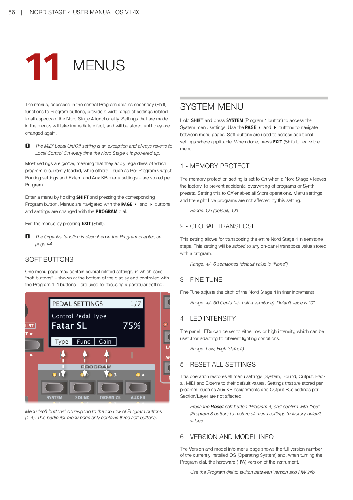
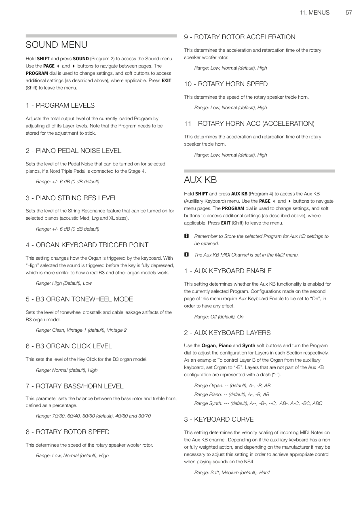
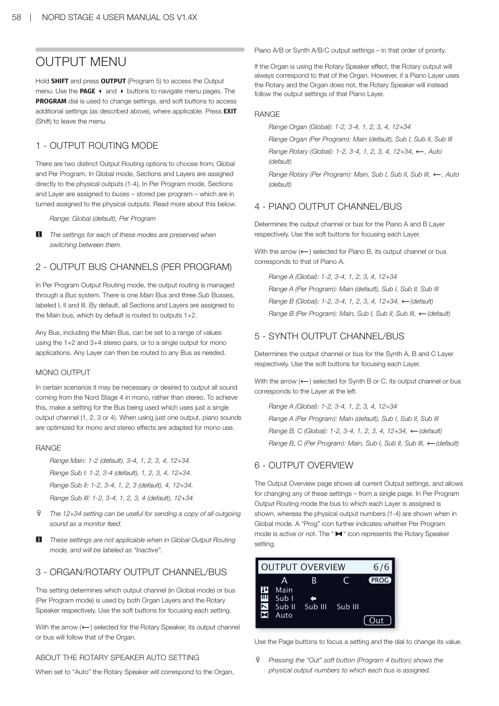
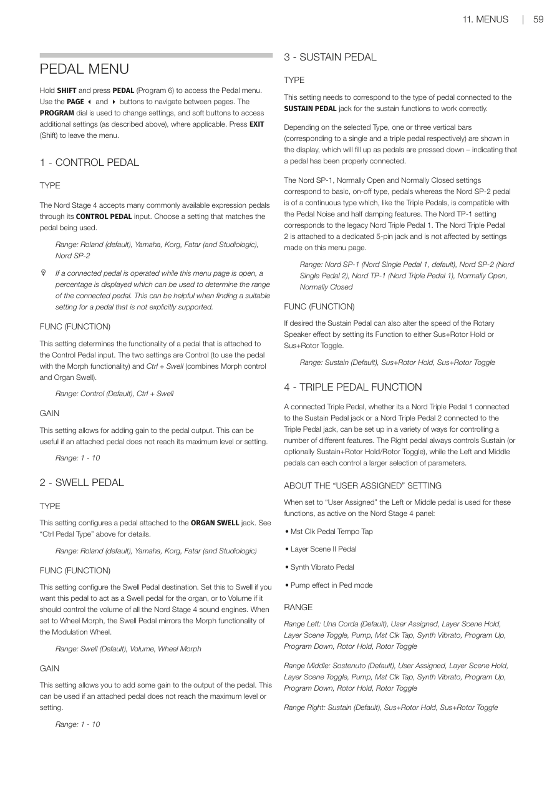
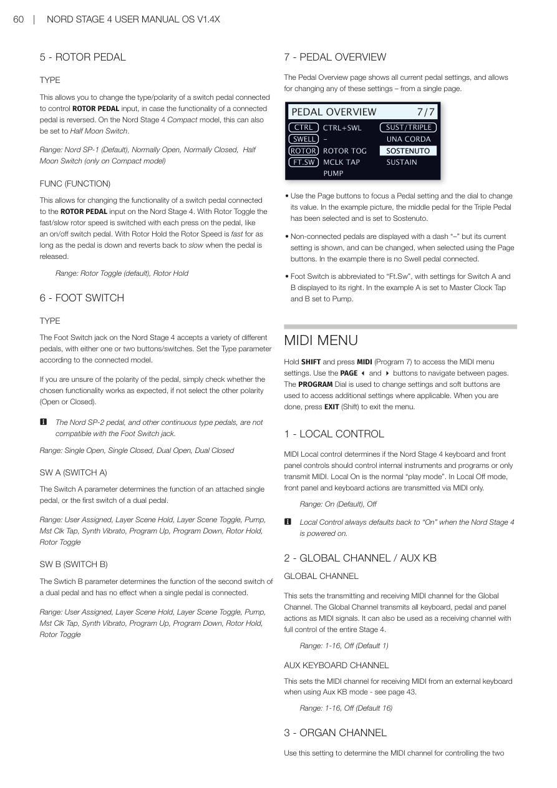
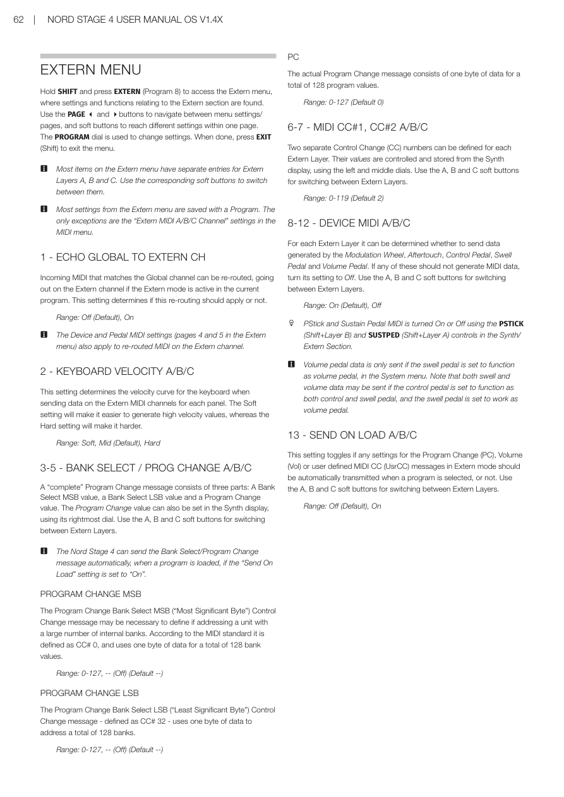

# 第十一章：選單 / Chapter 11: Menus

---

## 選單總覽 / MENUS OVERVIEW

Nord Stage 4 的選單藏在中央程式（Program）區，透過 **Shift + 程式按鈕** 來進入。選單裡的設定涵蓋樂器所有功能，改動後立刻生效，並會一直保留到下次更改為止。

The menus, accessed in the central Program area as secondary (Shift) functions to Program buttons, provide a wide range of settings related to all aspects of the Nord Stage 4 functionality. Settings that are made in the menus will take immediate effect, and will be stored until they are changed again.

> 💡 **注意例外**：MIDI 本地控制（Local Control）的 On/Off 設定是唯一的例外——每次開機都會自動恢復為 Local Control On（本地控制開啟）。

大多數設定是**全域性**的，不管載入哪個程式都會生效。但有些設定（例如：每程式輸出路由設定、Extern 選單和輔助鍵盤 Aux KB 選單的設定）是隨程式儲存的。

Most settings are global, meaning that they apply regardless of which program is currently loaded, while others – such as Per Program Output Routing settings and Extern and Aux KB menu settings – are stored per Program.

**如何進入選單：** 按住 SHIFT，再按對應的程式按鈕。用 PAGE 3/4 按鈕在選單頁面間切換，用 PROGRAM 旋鈕調整設定值。按 EXIT（即 Shift）離開選單。

Enter a menu by holding SHIFT and pressing the corresponding Program button. Menus are navigated with the PAGE 3 and 4 buttons and settings are changed with the PROGRAM dial. Exit the menus by pressing EXIT (Shift).

---

## 軟鍵（Soft Buttons）/ SOFT BUTTONS

有些選單頁面包含多個相關設定，這時會使用**軟鍵（Soft Buttons）**——顯示在螢幕下方，對應 Program 1-4 按鈕——來切換聚焦不同的設定項目。

One menu page may contain several related settings, in which case "soft buttons" – shown at the bottom of the display and controlled with the Program 1-4 buttons – are used for focusing a particular setting.

---

## 系統選單 / SYSTEM MENU

按住 **SHIFT + SYSTEM（Program 1）** 進入系統選單。用 PAGE 3/4 瀏覽頁面，完成後按 EXIT 離開。

Hold SHIFT and press SYSTEM (Program 1 button) to access the System menu settings. Use the PAGE 3 and 4 buttons to navigate between menu pages. When done, press EXIT (Shift) to leave the menu.

### 1 — 記憶保護 / MEMORY PROTECT

出廠時記憶保護預設為**開啟（On）**，防止意外覆寫程式或合成器預設音色。設為 Off 後，所有儲存操作才能生效。選單設定和八個 Live 程式不受此設定影響。

The memory protection setting is set to On when a Nord Stage 4 leaves the factory, to prevent accidental overwriting of programs or Synth presets. Setting this to Off enables all Store operations. Menu settings and the eight Live programs are not affected by this setting.

**範圍（Range）：** On（預設）、Off

### 2 — 全域移調 / GLOBAL TRANSPOSE

以半音為單位，對整台 Nord Stage 4 進行移調。這個設定會疊加在每個程式已儲存的面板移調值上。

This setting allows for transposing the entire Nord Stage 4 in semitone steps. This setting will be added to any on-panel transpose value stored with a program.

**範圍：** +/- 6 半音（預設：None）

### 3 — 精細調音 / FINE TUNE

以更細緻的音分（Cent）為單位調整 Nord Stage 4 的音高，適合與其他樂器對準音高。

Fine Tune adjusts the pitch of the Nord Stage 4 in finer increments.

**範圍：** +/- 50 音分（約半個半音）。預設值：0

### 4 — LED 亮度 / LED INTENSITY

調整面板 LED 的亮度，方便在不同光線環境下使用。

The panel LEDs can be set to either low or high intensity, which can be useful for adapting to different lighting conditions.

**範圍：** Low、High（預設）

### 5 — 重置所有設定 / RESET ALL SETTINGS

將所有選單設定（系統、音色、輸出、踏板、MIDI 和 Extern）還原為出廠預設值。每程式儲存的設定（例如 Aux KB 配置、各音層的輸出匯流排設定）不受影響。

This operation restores all menu settings (System, Sound, Output, Pedal, MIDI and Extern) to their default values. Settings that are stored per program are not affected.

按 Reset 軟鍵（Program 4），再用「Yes」（Program 3）確認，即可還原所有選單設定為出廠預設值。

Press the Reset soft button (Program 4) and confirm with "Yes" (Program 3 button) to restore all menu settings to factory default values.

### 6 — 版本與型號資訊 / VERSION AND MODEL INFO

顯示目前安裝的作業系統（OS）完整版本號。轉動 PROGRAM 旋鈕可切換查看硬體（HW）版本資訊。

The Version and model info menu page shows the full version number of the currently installed OS (Operating System) and, when turning the Program dial, the hardware (HW) version of the instrument.

---

---

## 音色選單 / SOUND MENU

按住 **SHIFT + SOUND（Program 2）** 進入音色選單。用 PAGE 3/4 瀏覽頁面，完成後按 EXIT 離開。

Hold SHIFT and press SOUND (Program 2) to access the Sound menu. Use the PAGE 3 and 4 buttons to navigate between pages. Press EXIT (Shift) to leave the menu.

### 1 — 程式音量 / PROGRAM LEVELS

調整目前載入程式的整體輸出音量（同時調整所有音層音量）。請注意：調整後需要**儲存程式**，設定才會保留。

Adjusts the total output level of the currently loaded Program by adjusting all of its Layer levels. Note that the Program needs to be stored for the adjustment to stick.

### 2 — 鋼琴踏板噪音音量 / PIANO PEDAL NOISE LEVEL

設定踏板噪音（Pedal Noise）的音量，這是某些鋼琴音色可開啟的真實感效果，需要接上 Nord Triple Pedal。

Sets the level of the Pedal Noise that can be turned on for selected pianos, if a Nord Triple Pedal is connected to the Stage 4.

**範圍：** +/- 6 dB（預設：0 dB）

### 3 — 鋼琴弦共鳴音量 / PIANO STRING RES LEVEL

設定弦共鳴（String Resonance）功能的音量，適用於原聲鋼琴 Med、Lrg 和 XL 尺寸。

Sets the level of the String Resonance feature that can be turned on for selected pianos (acoustic Med, Lrg and XL sizes).

**範圍：** +/- 6 dB（預設：0 dB）

### 4 — 風琴琴鍵觸發點 / ORGAN KEYBOARD TRIGGER POINT

設定風琴如何被琴鍵觸發。選 "High" 時，聲音會在琴鍵還未完全按下前就發聲，更接近真實 B3 等風琴的手感。

This setting changes how the Organ is triggered by the keyboard. With "High" selected the sound is triggered before the key is fully depressed, which is more similar to how a real B3 and other organ models work.

**範圍：** High（預設）、Low

### 5 — B3 音輪模式 / B3 ORGAN TONEWHEEL MODE

設定 B3 風琴模型中音輪串擾（crosstalk）和電纜洩漏（cable leakage）的程度，影響音色的「骯髒感」和復古特性。

Sets the level of tonewheel crosstalk and cable leakage artifacts of the B3 organ model.

> 💡 **新手提示**：Vintage 1/2 設定會讓 B3 音色更有老琴的「嘈雜感」，更接近真實的老舊 B3 Hammond。如果想要純淨聲音就選 Clean。

**範圍：** Clean、Vintage 1（預設）、Vintage 2

### 6 — B3 按鍵點擊聲音量 / B3 ORGAN CLICK LEVEL

設定 B3 風琴模型按鍵點擊聲（Key Click）的音量，就是按下琴鍵瞬間的「咔」聲。

This sets the level of the Key Click for the B3 organ model.

**範圍：** Normal（預設）、High

### 7 — 旋轉喇叭低音/高音比例 / ROTARY BASS/HORN LEVEL

設定旋轉喇叭（Rotary Speaker）低音轉子和高音喇叭的音量比例。

This parameter sets the balance between the bass rotor and treble horn, defined as a percentage.

**範圍：** 70/30、60/40、50/50（預設）、40/60、30/70

### 8 — 旋轉喇叭低音轉速 / ROTARY ROTOR SPEED

設定旋轉喇叭低音轉子的旋轉速度。

This determines the speed of the rotary speaker woofer rotor.

**範圍：** Low、Normal（預設）、High

### 9 — 旋轉喇叭低音加速度 / ROTARY ROTOR ACCELERATION

設定旋轉喇叭低音轉子在快慢速之間切換時的加速/減速時間。

This determines the acceleration and retardation time of the rotary speaker woofer rotor.

**範圍：** Low、Normal（預設）、High

### 10 — 旋轉喇叭高音轉速 / ROTARY HORN SPEED

設定旋轉喇叭高音喇叭的旋轉速度。

This determines the speed of the rotary speaker treble horn.

**範圍：** Low、Normal（預設）、High

### 11 — 旋轉喇叭高音加速度 / ROTARY HORN ACC (ACCELERATION)

設定旋轉喇叭高音喇叭的加速/減速時間。

This determines the acceleration and retardation time of the rotary speaker treble horn.

**範圍：** Low、Normal（預設）、High

---

## 輔助鍵盤選單 / AUX KB MENU

按住 **SHIFT + AUX KB（Program 4）** 進入輔助鍵盤（Aux KB）選單。設定完成後需要**儲存程式**才能保留。Aux KB 的 MIDI 通道在 MIDI 選單中設定。

Hold SHIFT and press AUX KB (Program 4) to access the Aux KB (Auxilliary Keyboard) menu. Remember to Store the selected Program for Aux KB settings to be retained. The Aux KB MIDI Channel is set in the MIDI menu.

### 1 — 啟用輔助鍵盤 / AUX KEYBOARD ENABLE

決定目前程式是否啟用輔助鍵盤功能。第二頁的配置設定需要此項目設為 "On" 才會生效。

This setting determines whether the Aux KB functionality is enabled for the currently selected Program.

**範圍：** Off（預設）、On

### 2 — 輔助鍵盤音層配置 / AUX KEYBOARD LAYERS

用風琴、鋼琴、合成器的軟鍵加上 PROGRAM 旋鈕，設定外接鍵盤要控制哪些音層。例如：要讓外接鍵盤控制風琴的 B 音層，就把 Organ 設為 "-B"。沒有配置的音層顯示為橫線（"-"）。

Use the Organ, Piano and Synth soft buttons and turn the Program dial to adjust the configuration for Layers in each Section. Example: set Organ to "-B" to control Layer B of the Organ from the auxiliary keyboard.

**範圍 Organ：** --（預設）、A-、-B、AB  
**範圍 Piano：** --（預設）、A-、-B、AB  
**範圍 Synth：** ---（預設）、A--、-B-、--C、AB-、A-C、-BC、ABC

### 3 — 鍵盤力度曲線 / KEYBOARD CURVE

設定輔助鍵盤 MIDI 訊號的力度（Velocity）縮放方式。若外接鍵盤的鍵盤手感較輕，可以選 Soft 讓它更容易觸發強音。

This setting determines the velocity scaling of incoming MIDI Notes on the Aux KB channel.

**範圍：** Soft、Medium（預設）、Hard

---

---

## 輸出選單 / OUTPUT MENU

按住 **SHIFT + OUTPUT（Program 5）** 進入輸出選單。

Hold SHIFT and press OUTPUT (Program 5) to access the Output menu.

### 1 — 輸出路由模式 / OUTPUT ROUTING MODE

有兩種輸出路由方式可選：
- **Global（全域）**：直接將各區段和音層指定到實體輸出端（1-4）
- **Per Program（每程式）**：各區段和音層指定到匯流排（Bus），匯流排再對應到實體輸出，設定隨程式儲存

There are two distinct Output Routing options: Global mode assigns Sections and Layers directly to the physical outputs (1-4). In Per Program mode, Sections and Layers are assigned to buses – stored per program – which are then assigned to the physical outputs.

**範圍：** Global（預設）、Per Program

> 💡 切換這兩種模式時，各自的設定都會被保留，不會互相影響。

### 2 — 輸出匯流排通道（每程式）/ OUTPUT BUS CHANNELS (PER PROGRAM)

在每程式輸出路由模式下，透過匯流排（Bus）系統管理輸出。有一個主匯流排（Main Bus）和三個子匯流排（Sub I、II、III）。預設情況下，所有區段和音層都在主匯流排，主匯流排輸出到 1+2 端子。

In Per Program Output Routing mode, the output routing is managed through a Bus system with one Main Bus and three Sub Busses (I, II, III). By default, all Sections and Layers are assigned to the Main bus, routed to outputs 1+2.

**單聲道輸出（Mono Output）：** 若需要單聲道輸出，將匯流排設定為單一輸出端（1、2、3 或 4）即可。

**範圍 Main：** 1-2（預設）、3-4、1、2、3、4、12+34  
**範圍 Sub I：** 1-2、3-4（預設）、1、2、3、4、12+34  
**範圍 Sub II：** 1-2、3-4、1、2、3（預設）、4、12+34  
**範圍 Sub III：** 1-2、3-4、1、2、3、4（預設）、12+34

> 💡 **12+34 設定**可以把所有聲音同時送到 1+2 和 3+4，適合做監聽饋送（monitor feed）。

### 3 — 風琴/旋轉喇叭輸出 / ORGAN/ROTARY OUTPUT CHANNEL/BUS

設定風琴音層和旋轉喇叭各自使用哪個輸出通道（全域模式）或匯流排（每程式模式）。旋轉喇叭選 ← 箭頭時，會跟隨風琴的輸出設定。

選「Auto」時，旋轉喇叭的輸出優先跟隨風琴，其次是鋼琴 A/B，再次是合成器 A/B/C。

This setting determines the output channel or bus for Organ Layers and Rotary Speaker. When set to "Auto", Rotary Speaker output follows Organ, then Piano A/B, then Synth A/B/C output settings.

### 4 — 鋼琴輸出通道/匯流排 / PIANO OUTPUT CHANNEL/BUS

分別設定鋼琴 A 和 B 音層的輸出通道或匯流排。鋼琴 B 選 ← 時跟隨鋼琴 A 的設定。

Determines the output channel or bus for Piano A and B Layers. Setting B to ← makes it follow Piano A's setting.

### 5 — 合成器輸出通道/匯流排 / SYNTH OUTPUT CHANNEL/BUS

分別設定合成器 A、B、C 音層的輸出通道或匯流排。B 或 C 選 ← 時跟隨左側音層的設定。

Determines the output channel or bus for Synth A, B and C Layers. B or C set to ← follows the Layer to the left.

### 6 — 輸出總覽 / OUTPUT OVERVIEW

在單一頁面顯示所有輸出設定，並可直接修改。每程式模式顯示各音層的匯流排，全域模式顯示實體輸出編號（1-4）。

The Output Overview page shows all current Output settings and allows changing any of them from a single page.

---

---

## 踏板選單 / PEDAL MENU

按住 **SHIFT + PEDAL（Program 6）** 進入踏板選單。

Hold SHIFT and press PEDAL (Program 6) to access the Pedal menu.

### 1 — 控制踏板 / CONTROL PEDAL

**TYPE（類型）：** Nord Stage 4 的 CONTROL PEDAL 輸入支援多種常見表情踏板。選擇符合你踏板品牌的設定。

The Nord Stage 4 accepts many commonly available expression pedals. Choose a setting that matches the pedal being used.

**範圍：** Roland（預設）、Yamaha、Korg、Fatar（和 Studiologic）、Nord SP-2

> 💡 在這個選單頁面踩踏板，螢幕會顯示一個百分比值，可以幫助你判斷踏板的行程範圍，方便選擇合適的設定。

**FUNC（功能）：** 決定控制踏板的用途——Control（用於變形 Morph 功能）或 Ctrl + Swell（同時控制 Morph 和風琴音量）。

This setting determines the functionality of the Control Pedal: Control (for Morph) or Ctrl + Swell (combines Morph control and Organ Swell).

**範圍：** Control（預設）、Ctrl + Swell

**GAIN（增益）：** 若踏板踩到底也無法達到最大值，可以提升增益補償。

**範圍：** 1 - 10

---

### 2 — 表情踏板（風琴音量）/ SWELL PEDAL

**TYPE（類型）：** 設定接在 ORGAN SWELL 插孔的踏板品牌。

**範圍：** Roland（預設）、Yamaha、Korg、Fatar（和 Studiologic）

**FUNC（功能）：** 設定風琴音量踏板（Swell Pedal——風琴專用的音量控制踏板）的功能：
- **Swell**：作為風琴的音量踏板（預設）
- **Volume**：控制整台 Nord Stage 4 的總音量
- **Wheel Morph**：複製調製輪（Mod Wheel）的 Morph 功能

**範圍：** Swell（預設）、Volume、Wheel Morph

**GAIN（增益）：** 同控制踏板的增益設定。

**範圍：** 1 - 10

---

### 3 — 延音踏板 / SUSTAIN PEDAL

**TYPE（類型）：** 需要與接在 SUSTAIN PEDAL 插孔的踏板類型對應，延音功能才能正確運作。選擇正確類型後，螢幕會顯示一個或三個直條圖示，踩下踏板時會填滿，確認連接正常。

This setting needs to correspond to the type of pedal connected to the SUSTAIN PEDAL jack.

**範圍：** Nord SP-1（預設）、Nord SP-2、Nord TP-1、Normally Open、Normally Closed

**FUNC（功能）：** 延音踏板也可以額外控制旋轉喇叭的速度。

**範圍：** Sustain（預設）、Sus+Rotor Hold、Sus+Rotor Toggle

---

### 4 — 三踏板功能 / TRIPLE PEDAL FUNCTION

三踏板（Triple Pedal）可設定成多種功能。右踏板固定為延音（Sustain），左踏板和中踏板可各自設定為多種功能。

A connected Triple Pedal's Right pedal always controls Sustain. Left and Middle pedals can each be assigned to a range of functions.

**「User Assigned（使用者指定）」設定說明：** 設為此選項時，踏板會自動偵測面板上哪個功能設為「踏板觸發」，包括：主時鐘踏板拍速、音層場景 II 踏板、合成器顫音踏板、Pump 效果踏板模式。

**範圍 左踏板：** Una Corda（預設）、User Assigned、Layer Scene Hold/Toggle、Pump、Mst Clk Tap、Synth Vibrato、Program Up/Down、Rotor Hold/Toggle  
**範圍 中踏板：** Sostenuto（預設）、User Assigned、Layer Scene Hold/Toggle、Pump、Mst Clk Tap、Synth Vibrato、Program Up/Down、Rotor Hold/Toggle  
**範圍 右踏板：** Sustain（預設）、Sus+Rotor Hold、Sus+Rotor Toggle

---

---

### 5 — 旋轉喇叭踏板 / ROTOR PEDAL

**TYPE（類型）：** 若接在 ROTOR PEDAL 輸入的踏板功能方向相反，可以在此調整極性。Nord Stage 4 Compact 型號也支援 Half Moon Switch（半月形開關）。

**範圍：** Nord SP-1（預設）、Normally Open、Normally Closed、Half Moon Switch（僅 Compact 型號）

**FUNC（功能）：**
- **Rotor Toggle**：每次踩踏板切換快/慢轉速（預設）
- **Rotor Hold**：踩住踏板時為快速，放開後恢復慢速

**範圍：** Rotor Toggle（預設）、Rotor Hold

---

### 6 — 腳踏開關 / FOOT SWITCH

**TYPE（類型）：** FOOT SWITCH 插孔支援單鍵或雙鍵踏板。根據連接的踏板類型選擇設定。若不確定踏板極性，試試看功能是否正常，不對就換另一個極性。

**範圍：** Single Open、Single Closed、Dual Open、Dual Closed

**SW A（開關 A）：** 設定單鍵踏板，或雙鍵踏板第一個按鍵的功能。

**範圍：** User Assigned、Layer Scene Hold/Toggle、Pump、Mst Clk Tap、Synth Vibrato、Program Up/Down、Rotor Hold/Toggle

**SW B（開關 B）：** 設定雙鍵踏板第二個按鍵的功能（單鍵踏板時無效）。

**範圍：** 同上

---

### 7 — 踏板總覽 / PEDAL OVERVIEW

在單一頁面顯示所有踏板設定，並可直接修改。用 PAGE 按鈕選擇要修改的踏板，用旋鈕改值。

The Pedal Overview page shows all current pedal settings and allows changing any of them from a single page.

---

## MIDI 選單 / MIDI MENU

按住 **SHIFT + MIDI（Program 7）** 進入 MIDI 選單。完成後按 EXIT 離開。

Hold SHIFT and press MIDI (Program 7) to access the MIDI menu settings.

### 1 — 本地控制 / LOCAL CONTROL

本地控制（Local Control）決定 Nord Stage 4 的琴鍵和面板按鈕是否直接控制內部音源。
- **Local On（本地控制開啟）**：正常演奏模式（預設）
- **Local Off（本地控制關閉）**：琴鍵和面板操作只透過 MIDI 傳送，不直接觸發內部音源（通常用於 DAW 錄音時避免音符重複觸發）

> 💡 **重要**：每次開機都會自動恢復為 Local On。

MIDI Local control determines if the keyboard and front panel controls should control internal instruments or only transmit MIDI. Local On is the normal play mode.

**範圍：** On（預設）、Off

---

### 2 — 全域通道 / 輔助鍵盤通道 / GLOBAL CHANNEL / AUX KB

**全域通道（Global Channel）：** 設定 Nord Stage 4 全域 MIDI 通道，同時用於傳送和接收。

**範圍：** 1-16、Off（預設：1）

**輔助鍵盤通道（Aux KB Channel）：** 設定外接鍵盤（Aux KB 模式）接收 MIDI 的通道。

**範圍：** 1-16、Off（預設：16）

---

### 3 — 風琴 MIDI 通道 / ORGAN CHANNEL

設定接收 MIDI 來控制風琴 A 和 B 音層的 MIDI 通道。用軟鍵切換 A/B 設定。「Sect」設定開啟時，可用 A 音層的通道同時控制整個風琴區段。

Use this to determine the MIDI channel for controlling Organ Layers via incoming MIDI. Use soft buttons for A and B settings.

**範圍 A：** 1-16、Off（預設：Off）  
**範圍 B：** 1-16、Off、←（預設：Off）  
**範圍 Sect：** On、Off（預設）

---

### 4 — 鋼琴 MIDI 通道 / PIANO CHANNEL

設定接收 MIDI 來控制鋼琴 A 和 B 音層的通道。

**範圍 A：** 1-16、Off（預設：Off）  
**範圍 B：** 1-16、Off、←（預設：Off）  
**範圍 Sect：** On、Off（預設）

---

### 5 — 合成器 MIDI 通道 / SYNTH CHANNEL

設定接收 MIDI 來控制合成器 A、B、C 三個音層的通道。

**範圍 A：** 1-16、Off（預設：Off）  
**範圍 B：** 1-16、Off、←（預設：Off）  
**範圍 C：** 1-16、Off、←（預設：Off）  
**範圍 Sect：** On、Off（預設）

---

### 6 — Extern 通道 / EXTERN CHANNEL

設定合成器 A、B、C 音層在 Extern 外部模式下傳送 MIDI 所使用的通道。注意：這是**全域設定**，不隨程式改變。

This sets the transmitting MIDI channel for Synth Layers A, B and C set to Extern Mode. This is a global setting.

**範圍 A、B、C：** 1-16、Off（預設：A=13、B=14、C=15）

> 💡 **警告**：Extern 通道不能與全域通道（Global Channel）相同，否則可能造成 MIDI 訊號衝突。

---

### 7 — 控制訊息 / NRPN / 裝置模式 / CONTROL / NRPN / DEVICE MODE

**TYPE（類型）：** 某些面板控制（例如合成器顫音、琶音器）使用 NRPN 訊息而非標準 CC。在 Local Off 模式下操作時，請確保此設定為「CC & NRPN」，才能完整傳送所有控制。

**範圍：** CC、CC & NRPN（預設）

**CTRL：** 設定 Nord Stage 4 是否在全域通道上傳送/接收 MIDI CC 和 NRPN 訊息。

**範圍：** Off（預設）、Send、Receive、Send & Receive

**DEV（Device，裝置）：** 設定是否傳送/接收「裝置類」MIDI 訊息，包括音高推桿、調製輪、後觸感應、延音踏板、控制踏板、表情踏板、音量踏板。

**範圍：** Off、Send、Receive、Send & Receive（預設）

---

### 8 — 程式切換模式 / PROGRAM CHANGE MODE

**PC（程式切換）：** 設定 Nord Stage 4 是否在全域通道上傳送/接收 MIDI 程式切換（Program Change）訊息。此設定不影響 Extern 通道的程式切換。

**範圍：** Off、Send、Receive、Send & Receive（預設）

**PC EXT（延伸程式切換）：** 設定預設音色庫（Preset Library）的程式切換和音色庫選擇訊息是否傳送/接收。

**範圍：** Off、Send、Receive、Send & Receive（預設）

---

### 9 — 移調 MIDI 位置 / TRANSPOSE MIDI AT

設定移調（Transpose）值是作用於傳出的 MIDI 訊號，還是傳入的 MIDI 訊號：
- **In（輸入）**：移調不影響傳出的 MIDI，只影響接收進來的 MIDI（預設）
- **Out（輸出）**：移調作用在傳出的 MIDI 音符上，接收的不受影響

**範圍：** In（預設）、Out

---

### 10 — MIDI 總覽 / MIDI OVERVIEW

在單一頁面顯示所有 MIDI 設定，並可直接修改。用 PAGE 按鈕選擇設定，用旋鈕改值。

The MIDI Overview page shows the current MIDI settings and allows changing any of them from a single page.

---

---

## Extern 選單 / EXTERN MENU

按住 **SHIFT + EXTERN（Program 8）** 進入 Extern 選單，管理外部模式（Extern Mode）的所有詳細設定。用 PAGE 3/4 瀏覽頁面，用軟鍵切換 A/B/C 音層，完成後按 EXIT 離開。

Hold SHIFT and press EXTERN (Program 8) to access the Extern menu. Most items have separate entries for Extern Layers A, B and C.

> 💡 大多數 Extern 選單設定都**隨程式儲存**，唯一例外是 MIDI 選單中的「Extern MIDI A/B/C Channel（Extern MIDI A/B/C 通道）」設定，那是全域設定。

### 1 — 將全域通道轉發至 Extern / ECHO GLOBAL TO EXTERN CH

開啟後，傳入全域通道的 MIDI 音符會被轉送到 Extern 通道輸出，讓你用另一台外接裝置控制 Extern 連接的音源。

Incoming MIDI matching the Global channel can be re-routed to the Extern channel when Extern mode is active.

**範圍：** Off（預設）、On

---

### 2 — 鍵盤力度曲線 A/B/C / KEYBOARD VELOCITY A/B/C

設定各 Extern 音層在傳送 MIDI 訊號時的力度曲線。Soft 設定讓強音更容易觸發，Hard 則相反。

**範圍：** Soft、Mid（預設）、Hard

---

### 3-5 — 音色庫選擇 / 程式切換 A/B/C / BANK SELECT / PROG CHANGE A/B/C

一個完整的程式切換訊息包含三個部分：Bank Select MSB（高位元組）、Bank Select LSB（低位元組）和程式切換值（PC）。設定後，可搭配「載入時傳送（Send On Load）」在切換程式時自動傳送。

A complete Program Change message has three parts: Bank Select MSB, Bank Select LSB, and Program Change value.

**PROGRAM CHANGE MSB（CC#0）：** 範圍：0-127、--（Off）（預設：--）  
**PROGRAM CHANGE LSB（CC#32）：** 範圍：0-127、--（Off）（預設：--）  
**PC（程式切換值）：** 範圍：0-127（預設：0）

---

### 6-7 — MIDI CC#1、CC#2 A/B/C / MIDI CC#1, CC#2 A/B/C

每個 Extern 音層可設定兩個自定義 CC 控制訊息的編號，對應值在合成器顯示器的左/中旋鈕上調整和儲存。

Two CC numbers can be defined for each Extern Layer, controlled from the Synth display dials.

**範圍：** 0-119（預設：2）

---

### 8-12 — 裝置 MIDI A/B/C / DEVICE MIDI A/B/C

為每個 Extern 音層設定是否傳送以下裝置產生的 MIDI 資料：調製輪、後觸感應、控制踏板、表情踏板、音量踏板。

For each Extern Layer, set whether to send data from Modulation Wheel, Aftertouch, Control Pedal, Swell Pedal, and Volume Pedal.

**範圍：** On（預設）、Off

---

### 13 — 載入時傳送 A/B/C / SEND ON LOAD A/B/C

開啟後，每次載入程式時，Extern 選單中儲存的程式切換（PC）、音量（Vol）和使用者自定義 CC（UsrCC）訊息會自動傳送給外接裝置，讓它跟著切換。

This setting determines if stored Extern data (Program Change, Volume, user CC) is automatically transmitted when a program is selected.

**範圍：** Off（預設）、On
