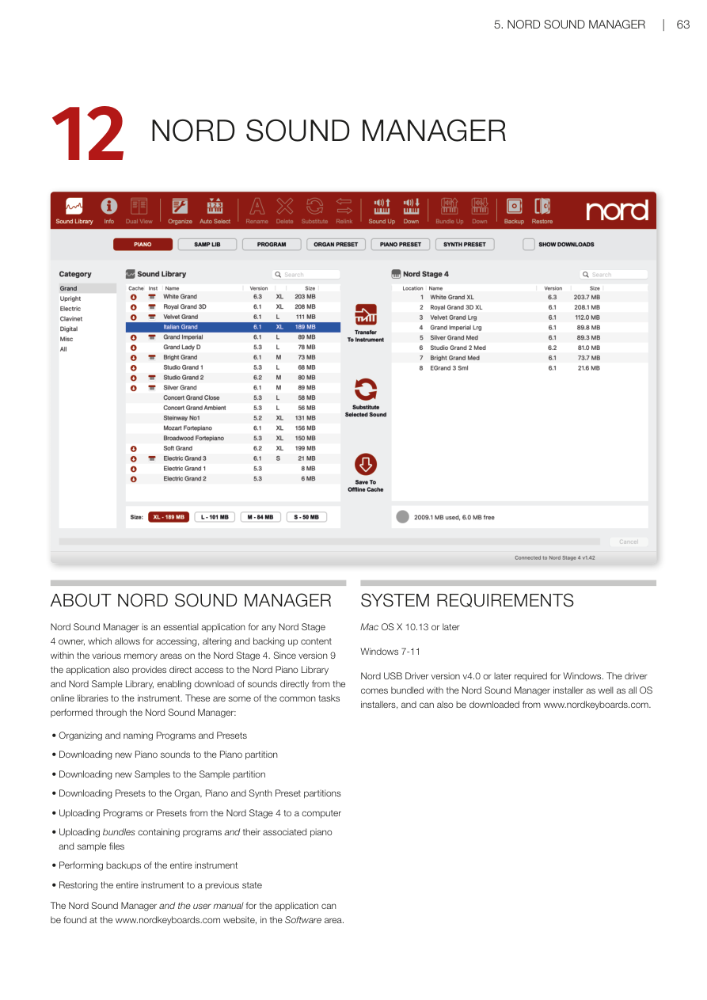

# 第十二章：Nord Sound Manager / Chapter 12: Nord Sound Manager

---

## 關於 Nord Sound Manager / ABOUT NORD SOUND MANAGER

**Nord Sound Manager** 是任何 Nord Stage 4 擁有者不可或缺的應用程式，讓你可以存取、修改和備份 Nord Stage 4 各個記憶體分區中的內容。從第 9 版起，此應用程式還提供直接存取 Nord Piano Library 和 Nord Sample Library 的功能，可以直接從線上音色庫下載音色到樂器。以下是透過 Nord Sound Manager 執行的一些常見任務：

Nord Sound Manager is an essential application for any Nord Stage 4 owner, which allows for accessing, altering and backing up content within the various memory areas on the Nord Stage 4. Since version 9 the application also provides direct access to the Nord Piano Library and Nord Sample Library, enabling download of sounds directly from the online libraries to the instrument.

常見用途 / Common tasks:

- 整理和命名程式及預設音色 / Organizing and naming Programs and Presets
- 下載新鋼琴音色到鋼琴分區 / Downloading new Piano sounds to the Piano partition
- 下載新樣本到樣本分區 / Downloading new Samples to the Sample partition
- 下載預設音色到風琴、鋼琴和合成器預設音色分區 / Downloading Presets to the Organ, Piano and Synth Preset partitions
- 將程式或預設音色從 Nord Stage 4 上傳到電腦 / Uploading Programs or Presets from the Nord Stage 4 to a computer
- 上傳包含程式及其關聯鋼琴和樣本檔案的組合包 / Uploading bundles containing programs and their associated piano and sample files
- 執行整個樂器的備份 / Performing backups of the entire instrument
- 將整個樂器恢復到之前的狀態 / Restoring the entire instrument to a previous state

Nord Sound Manager 及其應用程式使用手冊可在 **www.nordkeyboards.com** 的軟體（Software）區找到。

The Nord Sound Manager and the user manual for the application can be found at www.nordkeyboards.com, in the Software area.

---

## 系統需求 / SYSTEM REQUIREMENTS

- Mac OS X 10.13 或更高版本 / Mac OS X 10.13 or later
- Windows 7-11

> 💡 Windows 需要 Nord USB Driver 版本 v4.0 或更高版本。驅動程式隨 Nord Sound Manager 安裝程式以及所有 OS 安裝程式一起提供，也可以從 www.nordkeyboards.com 下載。

Nord USB Driver version v4.0 or later required for Windows. The driver comes bundled with the Nord Sound Manager installer as well as all OS installers, and can also be downloaded from www.nordkeyboards.com.
