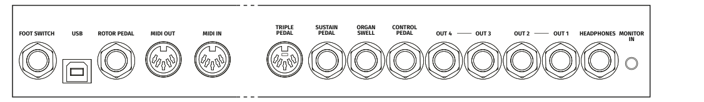
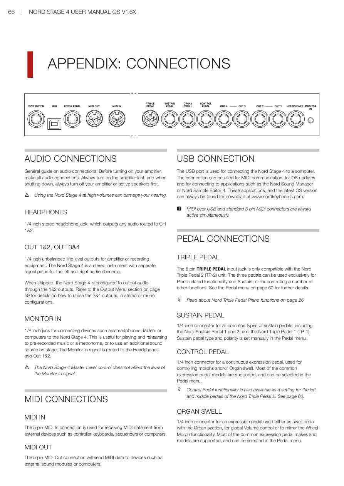
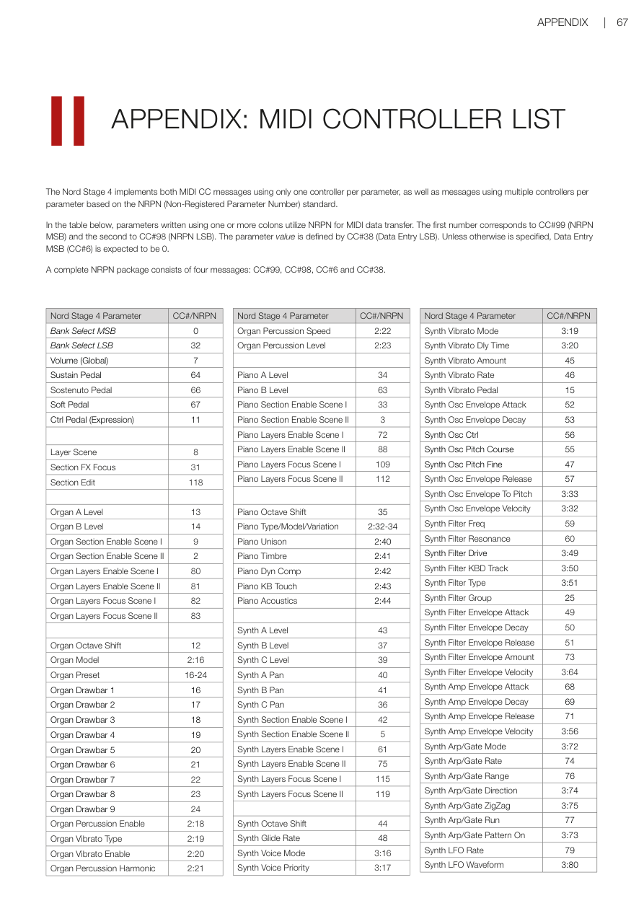

# 附錄 / Appendix

---

## 附錄 I：連接埠 / APPENDIX I: CONNECTIONS

---

### 音源線連接 / AUDIO CONNECTIONS

> ⚠️ 音源線連接注意事項：開啟擴大機前，先接妥所有音源線。**最後**開啟擴大機；關機時，**先**關閉擴大機或主動喇叭。在高音量下使用 Nord Stage 4 可能損傷您的聽力。

General guide on audio connections: Before turning on your amplifier, make all audio connections. Always turn on the amplifier last, and when shutting down, always turn off your amplifier or active speakers first. Using the Nord Stage 4 at high volumes can damage your hearing.

**耳機（HEADPHONES）**：1/4 吋立體聲耳機插孔，可輸出所有路由至 CH 1&2 的聲音。

1/4 inch stereo headphone jack, which outputs any audio routed to CH 1&2.

**OUT 1&2、OUT 3&4**：1/4 吋非平衡線路輸出，用於擴大機或錄音設備。Nord Stage 4 是立體聲樂器，左右聲道有獨立的訊號路徑。

1/4 inch unbalanced line level outputs for amplifier or recording equipment. The Nord Stage 4 is a stereo instrument with separate signal paths for the left and right audio channels.

出廠時，Nord Stage 4 設定為透過 1&2 輸出聲音。關於如何使用 3&4 輸出（立體聲或單聲道配置），請參閱第 59 頁的輸出選單章節。

When shipped, the Nord Stage 4 is configured to output audio through the 1&2 outputs. Refer to the Output Menu section on page 59 for details on how to utilise the 3&4 outputs.

**監聽輸入（MONITOR IN）**：1/8 吋插孔，用於連接智慧型手機、平板電腦或電腦。適合隨預錄音樂或節拍器練習，或在台上使用額外音源。監聽輸入訊號路由到耳機和 Out 1&2。

1/8 inch jack for connecting devices such as smartphones, tablets or computers. The Monitor In signal is routed to the Headphones and Out 1&2.

> ⚠️ Nord Stage 4 主音量控制不影響監聽輸入訊號的音量。

---

### MIDI 連接 / MIDI CONNECTIONS

**MIDI IN**：5 針 MIDI 輸入連接埠，用於接收從外部裝置（如控制器鍵盤、編曲機或電腦）發送的 MIDI 資料。

The 5 pin MIDI In connection is used for receiving MIDI data sent from external devices such as controller keyboards, sequencers or computers.

**MIDI OUT**：5 針 MIDI 輸出連接埠，向外部音源模組或電腦等裝置發送 MIDI 資料。

The 5 pin MIDI Out connection will send MIDI data to devices such as external sound modules or computers.

---

### USB 連接 / USB CONNECTION

USB 連接埠用於將 Nord Stage 4 連接到電腦，可用於 MIDI 通訊、韌體更新，以及連接 Nord Sound Manager 或 Nord Sample Editor 4 等應用程式。

The USB port is used for connecting the Nord Stage 4 to a computer. The connection can be used for MIDI communication, for OS updates and for connecting to applications such as the Nord Sound Manager or Nord Sample Editor 4.

> 💡 USB MIDI 和標準 5 針 MIDI 連接器始終同時活躍。

MIDI over USB and standard 5 pin MIDI connectors are always active simultaneously.

---

### 踏板連接 / PEDAL CONNECTIONS

**三踏板（TRIPLE PEDAL）**：5 針三踏板輸入插孔，僅相容 Nord Triple Pedal 2（TP-2）裝置。三個踏板可以專用於鋼琴相關功能和延音，或用於控制多種其他功能。詳見第 60 頁的踏板選單。

The 5 pin TRIPLE PEDAL input jack is only compatible with the Nord Triple Pedal 2 (TP-2) unit.

**延音踏板（SUSTAIN PEDAL）**：1/4 吋連接埠，適用於所有常見類型的延音踏板，包括 Nord Sustain Pedal 1 和 2，以及 Nord Triple Pedal 1（TP-1）。延音踏板類型和極性在踏板選單中手動設定。

1/4 inch connector for all common types of sustain pedals, including the Nord Sustain Pedal 1 and 2, and the Nord Triple Pedal 1 (TP-1).

**控制踏板（CONTROL PEDAL）**：1/4 吋連接埠，用於連續表情踏板，用於控制 Morph 和/或風琴 Swell。大多數常見的表情踏板型號都受支援，可在踏板選單中選擇。

1/4 inch connector for a continuous expression pedal, used for controlling morphs and/or Organ swell.

> 💡 Nord Triple Pedal 2 的左踏板與中間踏板也可設定為控制踏板功能，請見第 60 頁。
>
> Control Pedal functionality is also available as a setting for the Left and Middle pedals of the Nord Triple Pedal 2. See page 60.

**風琴 Swell 插孔（ORGAN SWELL）**：1/4 吋連接埠，用於表情踏板，可作為風琴區段的 Swell 踏板、全域音量控制或鏡像調變輪 Morph 功能。

1/4 inch connector for an expression pedal used either as swell pedal with the Organ section, for global Volume control or to mirror the Wheel Morph functionality.

**腳踏開關（FOOT SWITCH）**：1/4 吋連接埠，用於一個或兩個按鈕的瞬時踏板。腳踏開關可以指定多種功能，如切換音色配置、在音層場景之間切換或控制特定效果。

1/4 inch connector for a one or two button, momentary pedal, assignable to a variety of functions.

---

**旋轉喇叭控制踏板（ROTOR PEDAL）**：1/4 吋連接埠，用於開關類型踏板，用於在旋轉喇叭效果的慢速/停止和快速轉子速度之間切換。踏板可以在保持（Hold）或切換（Toggle）模式下工作，在踏板選單中設定。

1/4 inch connector for a switch type pedal, used for switching between slow/stopped and fast rotor speed for the Rotary Speaker effect.

可選配的 Nord Half Moon Switch 也可連接到 Rotor Pedal 插孔，與 Nord Stage 4 Compact 型號相容。

The optional Nord Half Moon Switch, compatible with the Nord Stage 4 Compact model, is also attached to the Rotor Pedal jack.

---

## 附錄 II：MIDI 控制器列表 / APPENDIX II: MIDI CONTROLLER LIST

Nord Stage 4 同時實作使用每個參數一個控制器的 MIDI CC 訊息，以及基於 NRPN（Non-Registered Parameter Number——非注冊參數號碼，一種允許更多參數的擴展 MIDI 控制訊息）標準、每個參數使用多個控制器的訊息。

The Nord Stage 4 implements both MIDI CC messages using only one controller per parameter, as well as messages using multiple controllers per parameter based on the NRPN standard.

在下表中，使用一個或多個冒號書寫的參數使用 NRPN 進行 MIDI 資料傳輸。第一個數字對應 CC#99（NRPN MSB），第二個對應 CC#98（NRPN LSB）。參數值由 CC#38（Data Entry LSB）定義。除非另有說明，Data Entry MSB（CC#6）預期為 0。完整的 NRPN 封包由四個訊息組成：CC#99、CC#98、CC#6 和 CC#38。

In the table below, parameters written using one or more colons utilize NRPN for MIDI data transfer. The first number corresponds to CC#99 (NRPN MSB) and the second to CC#98 (NRPN LSB). A complete NRPN package consists of four messages: CC#99, CC#98, CC#6 and CC#38.

### 全域參數 / Global Parameters

| 參數 / Parameter | CC#/NRPN |
|---|---|
| Bank Select MSB | 0 |
| Bank Select LSB | 32 |
| Volume (Global) | 7 |
| Sustain Pedal | 64 |
| Sostenuto Pedal | 66 |
| Soft Pedal | 67 |
| Ctrl Pedal (Expression) | 11 |
| Layer Scene | 8 |
| Section FX Focus | 31 |
| Section Edit | 118 |

### 風琴參數 / Organ Parameters

| 參數 / Parameter | CC#/NRPN |
|---|---|
| Organ A Level | 13 |
| Organ B Level | 14 |
| Organ Section Enable Scene I | 9 |
| Organ Section Enable Scene II | 2 |
| Organ Layers Enable Scene I | 80 |
| Organ Layers Enable Scene II | 81 |
| Organ Layers Focus Scene I | 82 |
| Organ Layers Focus Scene II | 83 |
| Organ Octave Shift | 12 |
| Organ Model | 2:16 |
| Organ Preset | 16-24 |
| Organ Drawbar 1-9 | 16-24 |
| Organ Percussion Enable | 2:18 |
| Organ Vibrato Type | 2:19 |
| Organ Vibrato Enable | 2:20 |
| Organ Percussion Harmonic | 2:21 |
| Organ Percussion Speed | 2:22 |
| Organ Percussion Level | 2:23 |

### 鋼琴參數 / Piano Parameters

| 參數 / Parameter | CC#/NRPN |
|---|---|
| Piano A Level | 34 |
| Piano B Level | 63 |
| Piano Section Enable Scene I | 33 |
| Piano Section Enable Scene II | 3 |
| Piano Layers Enable Scene I | 72 |
| Piano Layers Enable Scene II | 88 |
| Piano Layers Focus Scene I | 109 |
| Piano Layers Focus Scene II | 112 |
| Piano Octave Shift | 35 |
| Piano Type/Model/Variation | 2:32-34 |
| Piano Unison | 2:40 |
| Piano Timbre | 2:41 |
| Piano Dyn Comp | 2:42 |
| Piano KB Touch | 2:43 |
| Piano Acoustics | 2:44 |

### 合成器參數 / Synth Parameters

| 參數 / Parameter | CC#/NRPN |
|---|---|
| Synth A Level | 43 |
| Synth B Level | 37 |
| Synth C Level | 39 |
| Synth A/B/C Pan | 40/41/36 |
| Synth Section Enable Scene I | 42 |
| Synth Section Enable Scene II | 5 |
| Synth Octave Shift | 44 |
| Synth Glide Rate | 48 |
| Synth Voice Mode | 3:16 |
| Synth Vibrato Mode | 3:19 |
| Synth Vibrato Amount | 45 |
| Synth Vibrato Rate | 46 |
| Synth Osc Ctrl | 56 |
| Synth Osc Pitch Course | 55 |
| Synth Osc Pitch Fine | 47 |
| Synth Filter Freq | 59 |
| Synth Filter Resonance | 60 |
| Synth Filter Type | 3:51 |
| Synth Filter Envelope Attack/Decay/Release | 49/50/51 |
| Synth Filter Envelope Amount | 73 |
| Synth Amp Envelope Attack/Decay/Release | 68/69/71 |
| Synth Arp/Gate Mode | 3:72 |
| Synth Arp/Gate Rate | 74 |
| Synth Arp/Gate Range | 76 |
| Synth Arp/Gate Run | 77 |
| Synth LFO Rate | 79 |
| Synth LFO Amount | 54 |

### 效果參數 / Effects Parameters

| 參數 / Parameter | CC#/NRPN |
|---|---|
| Mod 1 Enable | 2:64 |
| Mod 1 Type/Variation | 2:65 |
| Mod 1 Amount | 85 |
| Mod 1 Rate | 86 |
| Mod 2 Enable | 2:72 |
| Mod 2 Type/Variation | 2:73 |
| Mod 2 Amount | 89 |
| Mod 2 Rate | 90 |
| Delay Enable | 2:88 |
| Delay Dry Wet | 93 |
| Delay Tempo | 94 |
| Delay Feedback | 95 |
| Delay Global | 29 |
| Amp/EQ Enable | 2:80 |
| Amp/EQ Drive | 101 |
| Amp/EQ Bass/Mid/Treble | 102/103/104 |
| Amp/EQ Mid Frequency | 107 |
| Rotary Speed | 108 |
| Rotary Drive | 110 |
| Reverb Enable | 2:104 |
| Reverb Amount | 113 |
| Reverb Type/Variation | 2:105 |
| Reverb Global | 30 |
| Compressor Enable | 2:96 |
| Compressor Amount | 117 |
| Compressor Fast | 2:97 |
| Compressor Global | 28 |

---

## 附錄 III：索引 / APPENDIX III: INDEX

請參考原版手冊第 69-70 頁的完整英文索引。以下列出本翻譯中使用的主要中文術語對照：

For complete index, refer to pages 69-70 of the original manual. Below are the key Chinese term translations used throughout this manual:

| 英文 / English | 中文 / Chinese |
|---|---|
| Program | 音色配置 |
| Organ | 風琴 |
| Pipe Organ | 管風琴 |
| Piano | 鋼琴 |
| Synth / Synthesizer | 合成器 |
| Layer | 音層 |
| Preset | 預設音色 |
| Split | 分區 |
| Morph | Morph 多參數控制 |
| KB Zone / Keyboard Zone | 鍵盤分區 |
| Master Clock | 主節拍時鐘 |
| Arpeggiator | 琶音器 |
| Transpose | 移調 |
| Live Mode | 即時模式 |
| Layer Scene | 音層場景 |
| Solo | 獨奏 |
| Undo | 復原 |
| Section Edit | 區段編輯 |
| Rotary Speaker | 旋轉喇叭 |
| Drawbars | 音栓拉桿 |
| Compressor | 壓縮效果 |
| Reverb | 殘響效果 |
| Delay | 延遲效果 |
| Extern | 外部 MIDI 控制 |
| Aux KB | 輔助鍵盤 |
| Aftertouch | 二段觸鍵感應 |
| Velocity | 力度 |
| LFO | 低頻振盪器 |
| Filter | 濾波器 |
| Envelope | 包絡線 |
| Oscillator | 振盪器 |
| Waveform | 波形 |
| Glide / Portamento | 滑音 |
| Unison | 同音疊加 |
| Vibrato | 顫音 |
| Tremolo | 音量顫音 |
| Chorus | 合聲效果 |
| Phaser | 移相器 |
| Flanger | 鑲邊效果 |
| Ring Modulation | 環形調變 |
