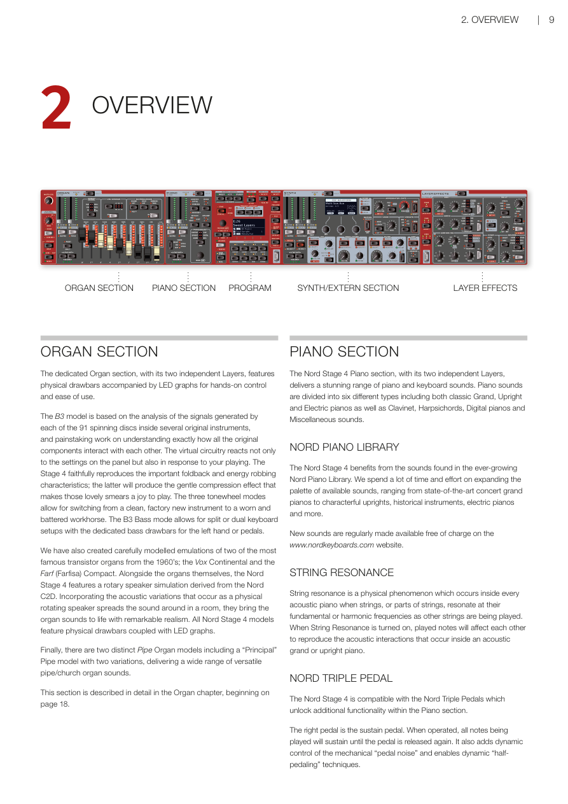
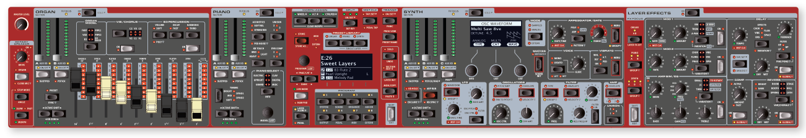
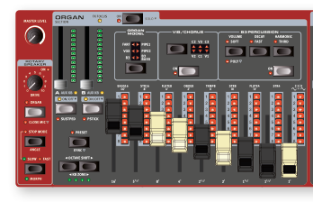
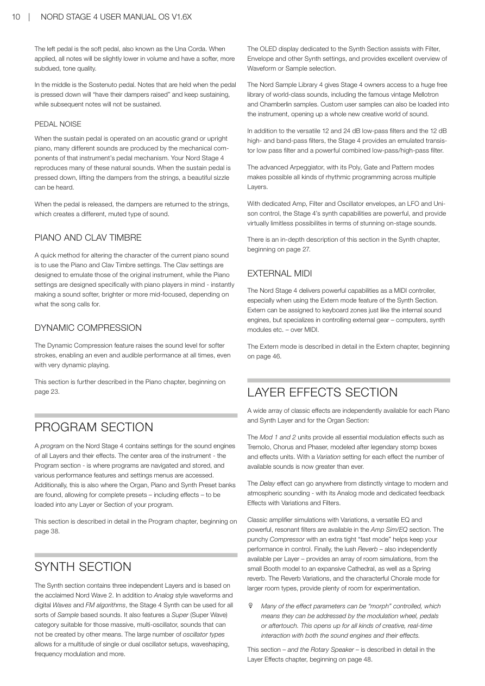

# 第二章：概覽 / Chapter 2: Overview

---

## 風琴區段 / ORGAN SECTION

專屬的風琴區段配備兩個獨立音層，擁有實體音栓拉桿與 LED 顯示，提供直覺的手動控制與便利的操作體驗。

The dedicated Organ section, with its two independent Layers, features physical drawbars accompanied by LED graphs for hands-on control and ease of use.

B3 電風琴模組基於對多台原版 Hammond B3 樂器內部 91 個旋轉碟片所產生訊號的分析，以及對所有原始元件相互作用方式的深入研究。虛擬電路不僅對面板設定有所反應，也會根據您的演奏方式做出回應。Stage 4 忠實重現了重要的折返（foldback）和能量消耗特性；後者將產生溫和的壓縮效果，使那些美妙的滑音演奏起來令人愉悅。三種音輪模式可讓您在全新的樂器音色與飽經風霜的老舊音色之間切換。B3 Bass 模式支援分割或雙鍵盤設置，配有專用低音音栓拉桿供左手或腳踏板使用。

The B3 model is based on the analysis of the signals generated by each of the 91 spinning discs inside several original instruments, and painstaking work on understanding exactly how all the original components interact with each other. The virtual circuitry reacts not only to the settings on the panel but also in response to your playing. The Stage 4 faithfully reproduces the important foldback and energy robbing characteristics; the latter will produce the gentle compression effect that makes those lovely smears a joy to play. The three tonewheel modes allow for switching from a clean, factory new instrument to a worn and battered workhorse. The B3 Bass mode allows for split or dual keyboard setups with the dedicated bass drawbars for the left hand or pedals.

我們也精心建模了兩款 1960 年代最著名的電晶體風琴：Vox Continental 和 Farf（Farfisa）Compact。除了風琴本身，Nord Stage 4 還配備了源自 Nord C2D 的旋轉喇叭模擬。結合物理旋轉揚聲器在房間中傳播聲音時產生的聲學變化，這些效果以卓越的真實感賦予風琴音色生命力。所有 Nord Stage 4 型號均配備實體音栓拉桿與 LED 顯示。

We have also created carefully modelled emulations of two of the most famous transistor organs from the 1960's; the Vox Continental and the Farf (Farfisa) Compact. Alongside the organs themselves, the Nord Stage 4 features a rotary speaker simulation derived from the Nord C2D. Incorporating the acoustic variations that occur as a physical rotating speaker spreads the sound around in a room, they bring the organ sounds to life with remarkable realism. All Nord Stage 4 models feature physical drawbars coupled with LED graphs.

最後，還有兩種獨特的管風琴型號，包括一款帶有兩種變體的「主要管」（Principal Pipe）型號，提供多種靈活的管風琴/教堂風琴音色。

Finally, there are two distinct Pipe Organ models including a "Principal" Pipe model with two variations, delivering a wide range of versatile pipe/church organ sounds.

本區段的詳細說明請見第 18 頁起的風琴章節。

This section is described in detail in the Organ chapter, beginning on page 18.

---

## 鋼琴區段 / PIANO SECTION

Nord Stage 4 的鋼琴區段配備兩個獨立音層，提供令人驚嘆的鋼琴與鍵盤音色。鋼琴音色分為六種類型，包括經典的原聲大鋼琴、直立式鋼琴、電鋼琴，以及 Clavinet、大鍵琴、數位鋼琴和其他雜項音色。

The Nord Stage 4 Piano section, with its two independent Layers, delivers a stunning range of piano and keyboard sounds. Piano sounds are divided into six different types including both classic Grand, Upright and Electric pianos as well as Clavinet, Harpsichords, Digital pianos and Miscellaneous sounds.

### Nord 鋼琴音色庫 / NORD PIANO LIBRARY

Nord Stage 4 受益於持續擴充的 Nord Piano Library 中的豐富音色。我們投入大量時間和精力擴展可用音色的範疇，涵蓋頂尖的演奏廳大鋼琴、個性十足的直立式鋼琴、歷史樂器、電鋼琴等。

The Nord Stage 4 benefits from the sounds found in the ever-growing Nord Piano Library. We spend a lot of time and effort on expanding the palette of available sounds, ranging from state-of-the-art concert grand pianos to characterful uprights, historical instruments, electric pianos and more.

全新音色定期在 www.nordkeyboards.com 網站上免費提供。

New sounds are regularly made available free of charge on the www.nordkeyboards.com website.

### 琴弦共鳴 / STRING RESONANCE

琴弦共鳴是每台原聲鋼琴內部都會發生的物理現象——當其他琴弦被彈奏時，部分或全部琴弦會以其基頻或泛音頻率產生共鳴。開啟琴弦共鳴功能後，彈奏的音符會互相影響，重現原聲大鋼琴或直立式鋼琴內部的聲學互動效果。

String resonance is a physical phenomenon which occurs inside every acoustic piano when strings, or parts of strings, resonate at their fundamental or harmonic frequencies as other strings are being played. When String Resonance is turned on, played notes will affect each other to reproduce the acoustic interactions that occur inside an acoustic grand or upright piano.

### Nord 三踏板 / NORD TRIPLE PEDAL

Nord Stage 4 相容於 Nord Triple Pedal，可在鋼琴區段中解鎖額外功能。

The Nord Stage 4 is compatible with the Nord Triple Pedals which unlock additional functionality within the Piano section.

右側踏板是延音踏板。踩下時，所有正在演奏的音符將持續發聲，直到踏板鬆開。它還提供對機械「踏板機械聲」的動態控制，並支援動態「半踏」技術。

The right pedal is the sustain pedal. When operated, all notes being played will sustain until the pedal is released again. It also adds dynamic control of the mechanical "pedal noise" and enables dynamic "half-pedaling" techniques.

---

---

左側踏板是柔音踏板，又稱為 Una Corda。踩下時，所有音符的音量會略微降低，並帶有更柔和、更內斂的音色質感。

The left pedal is the soft pedal, also known as the Una Corda. When applied, all notes will be slightly lower in volume and have a softer, more subdued, tone quality.

中間是持續踏板（Sostenuto）。踩下踏板時所持有的音符將「抬起制音器」繼續延音，而之後彈奏的音符則不會被延音。

In the middle is the Sostenuto pedal. Notes that are held when the pedal is pressed down will "have their dampers raised" and keep sustaining, while subsequent notes will not be sustained.

### 踏板機械聲 / PEDAL NOISE

在原聲大鋼琴或直立式鋼琴上踩下延音踏板時，樂器踏板機構的機械元件會產生各種聲音。Nord Stage 4 重現了許多這些自然聲音。踩下延音踏板將制音器從琴弦上抬起時，可以聽到美麗的嗡嗡聲。

When the sustain pedal is operated on an acoustic grand or upright piano, many different sounds are produced by the mechanical components of that instrument's pedal mechanism. Your Nord Stage 4 reproduces many of these natural sounds. When the sustain pedal is pressed down, lifting the dampers from the strings, a beautiful sizzle can be heard.

當踏板放開時，制音器回到琴弦上，產生一種不同的、柔和的聲音。

When the pedal is released, the dampers are returned to the strings, which creates a different, muted type of sound.

### 鋼琴與 Clav 音色 / PIANO AND CLAV TIMBRE

快速改變當前鋼琴音色特性的方法是使用鋼琴和 Clav 音色設定。Clav 設定旨在模擬原始樂器的音色，而鋼琴設定則專為鋼琴演奏者設計——可立即讓音色變得更柔和、更明亮或更突出中頻，視歌曲需求而定。

A quick method for altering the character of the current piano sound is to use the Piano and Clav Timbre settings. The Clav settings are designed to emulate those of the original instrument, while the Piano settings are designed specifically with piano players in mind - instantly making a sound softer, brighter or more mid-focused, depending on what the song calls for.

### 動態壓縮 / DYNAMIC COMPRESSION

動態壓縮功能可提高輕觸時的音量，確保在所有情況下——即使在演奏非常動態的樂句時——都能保持均勻且清晰的演奏效果。

The Dynamic Compression feature raises the sound level for softer strokes, enabling an even and audible performance at all times, even with very dynamic playing.

本區段的進一步說明請見第 23 頁起的鋼琴章節。

This section is further described in the Piano chapter, beginning on page 23.

---

## 音色配置區段 / PROGRAM SECTION

Nord Stage 4 上的一個音色配置（Program——用來儲存整台樂器所有設定的記憶單位）包含所有音層及其效果的音源引擎設定。樂器中央區域——音色配置區段——是導覽和儲存音色配置、以及存取各種演奏功能和設定選單的地方。此外，風琴、鋼琴和合成器預設音色庫也在這裡，可將包含效果的完整預設音色載入音色配置的任何音層或區段。

A program on the Nord Stage 4 contains settings for the sound engines of all Layers and their effects. The center area of the instrument - the Program section - is where programs are navigated and stored, and various performance features and settings menus are accessed. Additionally, this is also where the Organ, Piano and Synth Preset banks are found, allowing for complete presets – including effects – to be loaded into any Layer or Section of your program.

本區段的詳細說明請見第 38 頁起的音色配置章節。

This section is described in detail in the Program chapter, beginning on page 38.

---

## 合成器區段 / SYNTH SECTION

合成器區段包含三個獨立音層，基於廣受好評的 Nord Wave 2。除了類比風格波形、數位波形和 FM 演算法外，Stage 4 合成器還可用於各種基於取樣音色的音色。它還配備了超級波形（Super Wave）類別，適合那些其他方式無法創造的龐大多振盪器音色。大量的振盪器類型支援多種單或雙振盪器配置、波形整形、頻率調變等功能。

The Synth section contains three independent Layers and is based on the acclaimed Nord Wave 2. In addition to Analog style waveforms and digital Waves and FM algorithms, the Stage 4 Synth can be used for all sorts of Sample based sounds. It also features a Super (Super Wave) category suitable for those massive, multi-oscillator, sounds that can not be created by other means. The large number of oscillator types allows for a multitude of single or dual oscillator setups, waveshaping, frequency modulation and more.

合成器區段專用的 OLED 顯示器協助管理濾波器、包絡線及其他合成器設定，並提供波形或取樣音色選擇的良好概覽。

The OLED display dedicated to the Synth Section assists with Filter, Envelope and other Synth settings, and provides excellent overview of Waveform or Sample selection.

Nord Sample Library 4 為 Stage 4 用戶提供大量免費的世界級音色庫，包括著名的復古 Mellotron 和 Chamberlin 取樣音色。自訂用戶取樣音色也可載入樂器，開啟全新的創意音效世界。

The Nord Sample Library 4 gives Stage 4 owners access to a huge free library of world-class sounds, including the famous vintage Mellotron and Chamberlin samples. Custom user samples can also be loaded into the instrument, opening up a whole new creative world of sound.

除了多功能的 12 和 24 dB 低通濾波器以及 12 dB 高通和帶通濾波器外，Stage 4 還提供模擬電晶體低通濾波器和強大的組合低通/高通濾波器。

In addition to the versatile 12 and 24 dB low-pass filters and the 12 dB high- and band-pass filters, the Stage 4 provides an emulated transistor low pass filter and a powerful combined low-pass/high-pass filter.

進階琶音器配備 Poly、Gate 和 Pattern 模式，可在多個音層上實現各種節奏編程。

The advanced Arpeggiator, with its Poly, Gate and Pattern modes makes possible all kinds of rhythmic programming across multiple Layers.

配備專用的 Amp、Filter 和 Oscillator 包絡線、LFO 和 Unison 控制，Stage 4 的合成器功能強大，在舞台音色方面提供幾乎無限的可能性。

With dedicated Amp, Filter and Oscillator envelopes, an LFO and Unison control, the Stage 4's synth capabilities are powerful, and provide virtually limitless possibilites in terms of stunning on-stage sounds.

本區段的深入說明請見第 27 頁起的合成器章節。

There is an in-depth description of this section in the Synth chapter, beginning on page 27.

---

## 外部 MIDI / EXTERNAL MIDI

Nord Stage 4 作為 MIDI 控制器具有強大的功能，尤其是在使用合成器區段的外部模式（Extern mode）功能時。外部模式可以像內部音源引擎一樣指定到鍵盤分區，專門用於通過 MIDI 控制外部設備——電腦、合成器模組等。

The Nord Stage 4 delivers powerful capabilities as a MIDI controller, especially when using the Extern mode feature of the Synth Section. Extern can be assigned to keyboard zones just like the internal sound engines, but specializes in controlling external gear – computers, synth modules etc. – over MIDI.

外部模式的詳細說明請見第 46 頁起的外部章節。

The Extern mode is described in detail in the Extern chapter, beginning on page 46.

---

## 音層效果區段 / LAYER EFFECTS SECTION

每個鋼琴和合成器音層以及風琴區段都可以獨立使用各種經典效果：

A wide array of classic effects are independently available for each Piano and Synth Layer and for the Organ Section:

Mod 1 和 Mod 2 單元提供所有基本的調變效果，如顫音（Tremolo）、合唱（Chorus）和相位效果（Phaser），這些效果以傳奇的效果踏板和效果單元為原型。每種效果都有變體設定，使可用音色數量比以往更多。

The Mod 1 and 2 units provide all essential modulation effects such as Tremolo, Chorus and Phaser, modeled after legendary stomp boxes and effects units. With a Variation setting for each effect the number of available sounds is now greater than ever.

延遲效果可以從極具復古感到現代感和氛圍感——具有類比模式以及專用的帶有變體和濾波器的反饋效果。

The Delay effect can go anywhere from distinctly vintage to modern and atmospheric sounding - with its Analog mode and dedicated feedback Effects with Variations and Filters.

Amp Sim/EQ 區段提供帶有變體的經典擴大機模擬、多功能均衡器和強力的共鳴濾波器。強勁的壓縮器配備額外的「快速模式」，有助於控制您的演奏動態。最後，豐富的殘響——也可每個音層獨立使用——提供多種空間模擬，從小型 Booth 型號到寬廣的 Cathedral，以及 Spring 彈簧殘響。殘響變體和大型空間類型特有的 Chorale 模式，提供豐富的實驗空間。

Classic amplifier simulations with Variations, a versatile EQ and powerful, resonant filters are available in the Amp Sim/EQ section. The punchy Compressor with an extra tight "fast mode" helps keep your performance in control. Finally, the lush Reverb – also independently available per Layer – provides an array of room simulations, from the small Booth model to an expansive Cathedral, as well as a Spring reverb. The Reverb Variations, and the characterful Chorale mode for larger room types, provide plenty of room for experimentation.

許多效果參數可以通過「Morph」控制，這意味著它們可以由調變輪、踏板或二段觸鍵感應（aftertouch）來控制。這為音源引擎及其效果開啟了各種創意的即時互動可能性。

Many of the effect parameters can be "morph" controlled, which means they can be addressed by the modulation wheel, pedals or aftertouch. This opens up for all kinds of creative, real-time interaction with both the sound engines and their effects.

本區段——以及旋轉喇叭——的詳細說明請見第 48 頁起的音層效果章節。

This section – and the Rotary Speaker – is described in detail in the Layer Effects chapter, beginning on page 48.

