# 第三章：快速入門 / Chapter 3: Getting Started

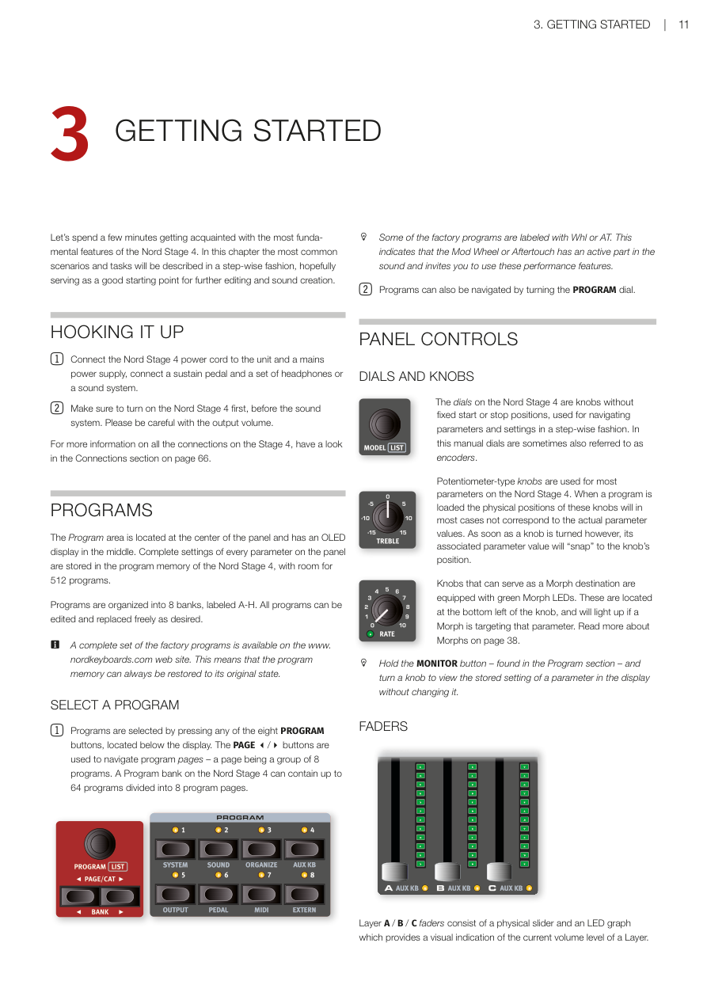

---

讓我們花幾分鐘熟悉 Nord Stage 4 最基本的功能。本章將以循序漸進的方式描述最常見的操作情境和任務，希望作為進一步編輯和音色創作的良好起點。

Let's spend a few minutes getting acquainted with the most fundamental features of the Nord Stage 4. In this chapter the most common scenarios and tasks will be described in a step-wise fashion, hopefully serving as a good starting point for further editing and sound creation.

---

## 連接設備 / HOOKING IT UP

1. 將 Nord Stage 4 電源線連接至本機和電源插座，連接延音踏板以及耳機或音響系統。  
   Connect the Nord Stage 4 power cord to the unit and a mains power supply, connect a sustain pedal and a set of headphones or a sound system.

2. 請先開啟 Nord Stage 4，再開啟音響系統。請注意輸出音量。  
   Make sure to turn on the Nord Stage 4 first, before the sound system. Please be careful with the output volume.

有關 Stage 4 所有連接埠的詳細資訊，請參閱第 66 頁的連接埠說明。

For more information on all the connections on the Stage 4, have a look in the Connections section on page 66.

---

## 音色配置 / PROGRAMS

音色配置區段位於面板中央，中間有一個 OLED 顯示器。Nord Stage 4 面板上每個參數的完整設定都儲存在音色配置記憶體中，共可容納 512 個音色配置。

The Program area is located at the center of the panel and has an OLED display in the middle. Complete settings of every parameter on the panel are stored in the program memory of the Nord Stage 4, with room for 512 programs.

音色配置分為 8 個音色庫組組，標記為 A-H。所有音色配置都可以自由編輯和替換。

Programs are organized into 8 banks, labeled A-H. All programs can be edited and replaced freely as desired.

> **提示**：完整的原廠音色配置組可在 www.nordkeyboards.com 網站上取得，這意味著音色配置記憶體始終可以恢復到原始狀態。  
> A complete set of the factory programs is available on the www.nordkeyboards.com web site. This means that the program memory can always be restored to its original state.

### 選擇音色配置 / SELECT A PROGRAM

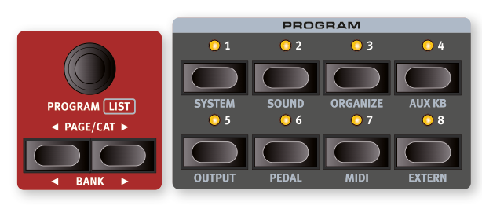

1. 按下顯示器下方的任意八個音色配置按鈕即可選擇音色配置。PAGE ◄/► 按鈕用於導覽音色配置頁面——每頁為一組 8 個音色配置。Nord Stage 4 上的每個音色配置音色庫組最多可包含 64 個音色配置，分為 8 個音色配置頁。  
   Programs are selected by pressing any of the eight PROGRAM buttons, located below the display. The PAGE ◄/► buttons are used to navigate program pages – a page being a group of 8 programs. A Program bank on the Nord Stage 4 can contain up to 64 programs divided into 8 program pages.

> **提示**：部分原廠音色配置標有 Whl 或 AT，表示調變輪或二段觸鍵感應在音色中有積極作用，邀請您使用這些演奏功能。  
> Some of the factory programs are labeled with Whl or AT. This indicates that the Mod Wheel or Aftertouch has an active part in the sound and invites you to use these performance features.

2. 也可以通過轉動音色配置控制旋鈕來導覽音色配置。  
   Programs can also be navigated by turning the PROGRAM dial.

---

## 面板控制器 / PANEL CONTROLS

### 控制旋鈕與電位器式旋鈕 / DIALS AND KNOBS

Nord Stage 4 上的控制旋鈕沒有固定起點或終點，可逐步切換參數與設定。本手冊中的 Dial 與 Encoder 均稱為控制旋鈕。

The dials on the Nord Stage 4 are knobs without fixed start or stop positions, used for navigating parameters and settings in a step-wise fashion. In this manual dials are sometimes also referred to as encoders.

> **提示**：按住音色配置區段中的 MONITOR 按鈕，同時轉動旋鈕，可在顯示器中查看參數的已儲存設定，而不會改變它。  
> Hold the MONITOR button – found in the Program section – and turn a knob to view the stored setting of a parameter in the display without changing it.

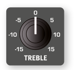

電位器式旋鈕用於 Nord Stage 4 上的大多數參數。載入音色配置時，這些旋鈕的物理位置在大多數情況下不會對應實際的參數值。但是，一旦轉動旋鈕，其關聯的參數值就會「跳到」旋鈕的位置。

Potentiometer-type knobs are used for most parameters on the Nord Stage 4. When a program is loaded the physical positions of these knobs will in most cases not correspond to the actual parameter values. As soon as a knob is turned however, its associated parameter value will "snap" to the knob's position.

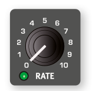

可作為 Morph 目標的旋鈕配備綠色 Morph LED，位於旋鈕左下方，當 Morph 指向該參數時會亮起。更多關於 Morph 的說明請參閱第 38 頁。

Knobs that can serve as a Morph destination are equipped with green Morph LEDs. These are located at the bottom left of the knob, and will light up if a Morph is targeting that parameter. Read more about Morphs on page 38.

### 音量推桿 / FADERS

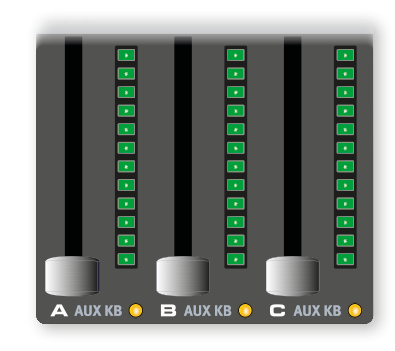

A/B/C 音層推桿由實體滑桿和 LED 顯示組成，提供該音層當前音量的視覺指示。

Layer A / B / C faders consist of a physical slider and an LED graph which provides a visual indication of the current volume level of a Layer.

### 按鈕 / BUTTONS

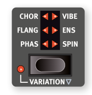

選擇按鈕用於在陣列中選擇設定，配有一組圓形或三角形 LED 指示燈，顯示目前設定。重複按下可循環切換選項。

Selector buttons are used for selecting a setting in an array. They have a set of round or triangular LEDs to indicate its current setting. Press the button several times to cycle through the possible options.

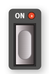

ON 按鈕用於啟用功能或一組特效，旁邊有 LED 指示開/關狀態。

ON buttons are used for activating a function or a group of functions such as effects and have a LED close to them to indicate the on/off status.

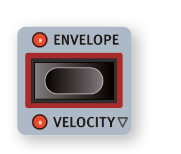

合成器功能按鈕——以紅色框標示——（紅框按鈕）利用合成器區段顯示器及其三個旋鈕進行設定。

Synth Function buttons – indicated with a red frame – such as those for all envelopes, utilize the Synth Section display and its three dials for making settings.

### SHIFT 按鈕 / THE SHIFT BUTTON

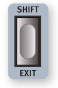

Nord Stage 4 上的許多面板控制器都有輔助功能，印在控制器正下方。按住 SHIFT 並操作控制器即可存取這些附加功能。

Many panel controls on the Nord Stage 4 have a secondary function, which is printed immediately below it. These additional functions are accessed by pressing and holding SHIFT while operating the control.

SHIFT 按鈕也用於退出選單或取消正在進行的儲存操作。

The Shift button is also used to EXIT a menu or to cancel an ongoing Store operation.

### 按住以使用 SHIFT 功能 / HOLD TO SHIFT FUNCTION

面板上的大多數 Shift 功能也可以通過按住按鈕片刻來啟動。此功能以按鈕文字旁的空心箭頭（►）標示。

Most Shift functions on the panel can also be activated by pressing down the button for a short while. This functionality is indicated by a non-filled arrow next to the button text.

### 按住與雙擊功能 / BUTTON HOLD AND DOUBLE TAP FUNCTIONS

某些按鈕（如主節拍時鐘按鈕）可以按住以存取功能或進行額外設定，以文字旁的向下箭頭（↓）標示。

Some buttons, such as that for the Master Clock, can be held down in order to access a function or make additional settings, indicated by the text being accompanied by a down arrow.

帶有雙箭頭（↕）的按鈕文字——如 Section Edit 和 Morph Assign——可以雙擊以保持功能在啟動狀態，無需持續按住按鈕。這有時稱為「鎖定」或「黏性」模式，可以再次按下按鈕或按 Shift/Exit 退出。

Button texts with double arrows, such as those for Section Edit and Morph Assign, can be double tapped in order to keep the function in its active state, without having to keep the button pressed down manually. This is sometimes referred to as "latch" or "sticky" mode, which can be exited by either pressing again on the button or on Shift/Exit.

### 清單檢視 / LIST VIEW

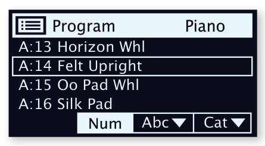

任何下方標有 LIST 文字的旋鈕——如音色配置控制旋鈕——都可用於存取實用的清單檢視。

Any dial that has LIST written below it - such as the Program dial - can be used to access a useful list view.

1. 按 SHIFT 並轉動 PROGRAM 控制旋鈕，進入所有音色配置的清單檢視。  
   Press SHIFT and turn the PROGRAM dial to enter a list view of all the Programs.

2. 使用 PROGRAM 控制旋鈕在 8 個音色庫組中瀏覽。  
   Browse to a Program in any of the 8 banks, using the PROGRAM dial.

3. 再次按 SHIFT 退出LIST VIEW。  
   Press SHIFT again to EXIT the List view.

> **提示**：鋼琴、預設音色庫和波形控制旋鈕的清單檢視功能方式完全相同。  
> List views for the Piano, Preset Library and Waveform dials function in just the same way.

### 音色配置檢視 / PROGRAM VIEW MODES

PROG VIEW（音色配置檢視 Program View）按鈕可讓您在三種不同的顯示模式之間切換，根據需求提供多或少的資訊。

The PROG VIEW (Program View) button lets you select between three distinct modes for what is shown in the Program display, providing more or less information as needed or desired.

按 Prog View 按鈕進行每種模式的測試：

Press the Prog View button to try out each of the modes:

1. 第一種檢視模式僅顯示音色庫組字母和音色配置編號以及音色配置名稱。顯示器下半部保留用於顯示操作面板控制器時的參數提示。  
   The first view mode shows only the Bank letter and Program number, as well as the Program name. The lower half of the display is reserved for parameter hints, shown when operating a panel control.

2. 第二種檢視模式顯示與第一種模式相同的資訊，但另加了一列關於風琴、鋼琴和合成器顯示區，顯示目前聚焦音層中內容的資訊。  
   The second view mode shows the same info as the first mode, but adds rows for the Organ, Piano and Synth Sections where information about what is loaded in the currently focused Layers is shown.

3. 第三種檢視模式顯示所有音層的資訊，音色配置(Program)名稱和位置以較小的字型顯示在顯示器頂部。  
   The third view mode shows information about all Layers, with the Program name and location in smaller print at the top of the display.

---

## 編輯音色配置 / EDIT A PROGRAM

編輯音色配置(PROGRAM)就像轉動旋鈕或按下按鈕改變現有設定一樣簡單。讓我們快速試試：

Editing a program is as easy as turning a knob or pressing a button, to change an existing setting. Let's give it a quick try:

1. 選擇音色配置 A:21（一個基於鋼琴的音色配置）進行練習。鋼琴區段的控制器位於面板上音色配置區段的左側。根據音色配置檢視模式，音色配置區段顯示器會顯示所選鋼琴音色的名稱，六向 PIANO SELECT 指示器設定為 Grand。  
   Select Program A:21 (a piano based program) for this exercise. The controls for the Piano Section are located immediately to the left of the Program area on the panel. Depending on Prog View mode the Program area display shows the name of the selected piano sound, and the six-way PIANO SELECT indicator is set to Grand.

### 選擇新的鋼琴音色 / SELECT A NEW PIANO SOUND

2. 轉動 PIANO SELECT 旋鈕瀏覽鋼琴音色。要切換不同類型的音色（Grand、Upright、Electric Piano 等），請使用 TYPE 按鈕。  
   Turn the PIANO SELECT dial to browse the piano sounds. To switch between sounds of different type (Grand, Upright, Electric Piano etc.) use the TYPE button.

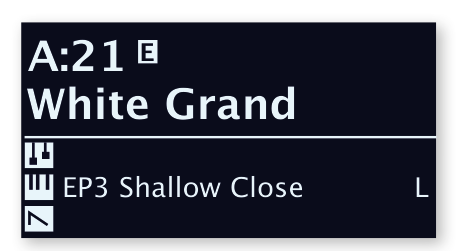

3. 試著從清單檢視(LIST view)中選擇鋼琴音色，按 SHIFT 並轉動 PIANO SELECT 旋鈕即可進入清單檢視。再次按 Shift 退出清單檢視。  
   Try selecting a piano sound from the LIST view, accessed by pressing SHIFT and turning the PIANO SELECT dial. Use Shift again to EXIT the list view.

請注意，更改 Nord Stage 4 面板上的任何參數都會導致螢幕中當前音色配置編號旁出現「E」。這表示音色配置已被編輯但尚未儲存到記憶體中。如果在執行儲存操作之前選擇了新音色配置，所有編輯都將丟失，音色配置在下次載入時將恢復其原始設定。

Note that changing any parameter on the Nord Stage 4 panel causes an "E" to appear next to the current program number in the display. This indicates that the program has been edited but not yet saved into memory. If a new program is selected prior to performing a Store operation any edits will be lost and the program will have its original settings the next time it is loaded.

### 關閉記憶體保護 / TURN OFF MEMORY PROTECTION

Nord Stage 4 出廠時記憶體受到保護，以防止意外覆蓋原始音色配置。記憶體保護可通過切換系統選單中的設定來關閉。

When the Nord Stage 4 is shipped from factory its memory is protected to prevent accidental overwriting of original programs. Memory protection can be turned off by toggling a setting located in the System menu.

1. 按住 SHIFT 並按下顯示器下方的 SYSTEM（Program 1）按鈕。  
   Hold SHIFT and press the SYSTEM (Program 1) button below the display.

2. 記憶體保護是系統選單的第一個設定。如果顯示器顯示不同的設定，請使用 Page◄ 按鈕導覽至記憶體保護設定。  
   Memory Protection is the first setting of the System menu. If the display shows a different setting, use the Page◄ button to navigate to the Memory Protection setting.

3. 通過轉動音色配置控制旋鈕將此設定更改為 Off。  
   Change this setting to Off by turning the PROGRAM dial.

4. 按 EXIT（Shift 按鈕）退出系統選單。  
   Press EXIT (Shift button) to exit the System menu.

> **注意**：此設定與所有其他系統設定一樣，將永久儲存直到再次更改。從第 57 頁開始閱讀更多關於選單設定的資訊。 
> This setting, like all other System settings, will be permanently stored until it is changed again. Read more about menu settings, starting on page 57.

### 儲存音色配置 / STORE A PROGRAM

1. 按一下顯示器左側的 STORE 按鈕，開始儲存當前音色配置的過程。  
   Press the STORE button to the left of the display once, to begin the process of storing the current program.

2. STORE LED 將開始閃爍，顯示器將詢問您要儲存音色配置的位置。  
   The STORE LED will begin to flash and the display will ask you for the location to where you want to store the program.

> **注意**：某些音色配置（如本例中的 A:21 White Grand）以鋼琴區段中的特定音色命名。請注意，如果您以不同的鋼琴儲存音色配置，此名稱不會更改，需要通過「另存為」操作或使用 Nord Sound Manager 手動設定。  
> Some Programs, such as A:21 White Grand in this example, are named after a specific sound in the Piano section. Note that this name does not change if you store the Program with a different Piano selected, but needs to be manually set through a Store As operation, or by using the Nord Sound Manager.

3. 如果想將編輯版本儲存到當前位置（替換原始版本），只需再次按 STORE。否則，使用旋鈕和/或 PAGE ◄/► 按鈕選擇不同的位置。  
   If you want to store the edited version to the current location, replacing the original, simply press STORE again. If not, use the dial and/or PAGE ◄/► buttons to select a different location.

> **提示**：所選位置的音色配置將在鍵盤上變為活躍狀態，允許在被儲存的音色配置替換之前試聽。  
> The program in the selected location becomes active on the keyboard, allowing it to be auditioned before it is replaced by the program being stored.

4. 找到合適的位置後，再次按 STORE 確認儲存操作。  
   When you have found a suitable location for your program, press STORE again to confirm the store operation.

> **提示**：如果改變主意，按一次 Shift/Exit 可以中止正在進行的儲存過程。  
> Press Shift/Exit once to abort an ongoing Store process if you change your mind.

在第 40 頁的音色配置章節中閱讀更多關於儲存和命名音色配置的資訊。

Read more about Store and how to name a program in the Program chapter, on page 40.

### 即時模式 / LIVE MODE

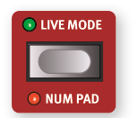

> 翻譯:簡單說就是設定會及時儲存在指定的Prog鈕  

八個即時音色配置(LIVE programs)與其他配置(programs)不同，對其所做的所有編輯都會立即儲存——無需手動執行儲存操作。

The eight LIVE programs differ from other programs in that all edits made to them are instantly stored – without the need for a manual Store operation.

1. 按 LIVE MODE 並使用音色配置按鈕導覽八個即時音色配置。  
   Press LIVE MODE and use the PROGRAM buttons to navigate the eight Live programs.

2. 對其中一個音色配置進行編輯，例如啟動效果區段之一。  
   Make an edit, such as activating one of the effects sections, to one of the programs.

3. 選擇另一個即時音色配置，然後返回剛才編輯的音色配置。注意編輯已自動儲存。  
   Select a different Live program and then return to the one that was edited. Note that the edit was automatically stored.

如果即時模式處於啟動狀態，您決定將設定永久儲存為音色配置音色庫組中的音色配置，可以使用標準儲存方法（見上文）進行操作。

If Live Mode is active and you decide to store the settings permanently as a program in one of the Program banks, you can do so using the standard Store methods (see above).

您也可以將音色配置儲存到八個即時模式記憶體位置的任意一個，在這種情況下，音色配置設定將替換該當前即時模式記憶體設定。

You can also store programs into any of the eight Live Mode memory locations, in which case the program settings will replace that current Live Mode memory setting.

再次按即時模式按鈕退出即時模式並返回音色配置音色庫組。

Press the Live Mode button again to exit Live Mode and return to the Program banks.

> **注意**：Nord Stage 4 出廠時，八個即時模式音色配置只是音色配置音色庫組中音色庫組 A 前八個音色配置的副本。  
> When the Nord Stage 4 is shipped the eight Live Mode Programs are simply copies of the first eight Programs in Bank A of the Program banks.

---

## 區段與音層 / SECTIONS AND LAYERS

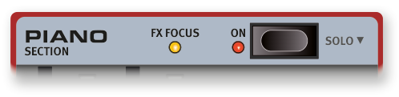

Nord Stage 4 上的「區段 SECTION」分別指面板上的 ORGAN（風琴）、PIANO（鋼琴）和 SYNTH（合成器）區域，包括各自的獨立音層。風琴和鋼琴區段各包含兩個音層，標記為 A 和 B，而合成器區段包含三個音層：A、B 和 C。

A Section on the Nord Stage 4 refers to the ORGAN, PIANO and SYNTH areas of the panel respectively, including their individual Layers. The Organ and Piano Sections contain two Layers each, labeled A and B, while the Synth Section contains three Layers; A, B and C.

整個區段可以通過按下區段 ON 按鈕來開啟或關閉。

Entire Sections can be turned On or Off by pressing the Section ON button.

### 開啟和關閉音層 / TURNING LAYERS ON AND OFF

在一個區段內，同時按下應啟動的音層的 ON/OFF 按鈕即可開啟音層。例如，當鋼琴 A 已開啟時，要添加鋼琴 B，同時按下兩個按鈕即可。要在兩個音層之間切換，按下未啟動的音層按鈕。

Within a Section, Layers are turned On by simultaneously pressing the ON/OFF buttons for Layers that should be active. As an example, to add Piano B when Piano A is already turned On, press down both buttons. To toggle between two Layers, press the non-active Layer button.

按下已啟動音層的按鈕可將其設為面板的焦點，使該音層的所有參數控制器可供編輯。

Pressing the button for an active Layer gives it focus on the panel, making all parameter controls for that Layer available for editing.

通過短暫按住音層按鈕來關閉音層（如「↓」符號所示）。

Layers are turned OFF by holding down a Layer button for a short moment, as indicated by the "↓" symbol.

### 音層效果 / LAYER EFFECTS

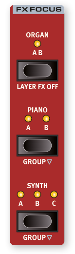

Nord Stage 4 有專用的音層效果區段，提供大量不同效果，可按音層應用於音源。兩個鋼琴音層（A 和 B）和所有三個合成器音層（A、B 和 C）都有各自完整的效果組。兩個風琴音層 A 和 B 共用一個效果鏈。

The Nord Stage 4 has a dedicated LAYER EFFECTS section, with a large selection of different effects that can be applied to sound sources on a per-Layer basis. Both PIANO Layers (A and B) and all three SYNTH Layers (A, B and C) have their own complete sets of effects. The two ORGAN Layers, A and B, share one effects chain.

通過按下 ON 按鈕可以開啟或關閉音層效果區段（關閉所有效果）。

The Layer Effects Section can be turned on or off, which bypasses all effects, by pressing its ON button.

FX FOCUS 區域中的 ORGAN、PIANO 和 SYNTH 按鈕可用於選擇哪個區段或音層處於效果編輯的焦點。

The ORGAN, PIANO and SYNTH buttons in the FX FOCUS area can be used for selecting which Section or Layer has focus for effects editing.

鋼琴和合成器效果可以按音層單獨使用，也可以通過按 GROUP（Shift+Piano/Synth）將它們組合在一起——共用相同的設定。

The Piano and Synth effects can either be used individually per Layer, or be grouped together – sharing the same settings – by pressing GROUP (Shift+Piano/Synth).

當通過再次按 Group（Shift+Organ/Piano/Synth）退出組合模式時，該區段內的所有音層將具有相同的效果設定，直到手動調整。

When exiting Group mode, by again pressing Group (Shift+Organ/Piano/Synth), all Layers within that Section will have the same effect settings until these are adjusted manually.

FX 焦點會自動跟隨風琴、鋼琴和合成器區段中音層按鈕的焦點。

The FX Focus automatically follows the focus of Layer buttons in the Organ, Piano and Synth sections, as they are pressed.

當前目標效果器由每個區段 On 按鈕旁的黃色 FX FOCUS LED 以及 FX Focus 區域的 LED 指示。

The current effect focus is indicated both by a yellow FX FOCUS LED next to each Section's On button, as well as by the LEDs in the FX Focus area.

### 啟用效果 / ACTIVATE AN EFFECT

在仍選擇音色配置 A:21 的情況下，試試以下步驟為乾淨的鋼琴音色添加效果：

With Program A:21 still selected, try out these steps to add effects to the clean Piano sound:

1. 確認鋼琴 A 在 FX Focus 區域中處於焦點。如果不是，按 FX Focus PIANO 按鈕使其聚焦。  
   Make sure that Piano A has focus in the FX Focus area. If not, press the FX Focus PIANO button so that it does.

2. 按 Reverb ON 按鈕啟動殘響。  
   Activate the reverb by pressing the Reverb ON button.

3. 用殘響區域中的旋鈕調整 DRY/WET 比例。  
   Adjust the DRY / WET balance with the knob in the Reverb area.

4. 按一次 ON/OFF 按鈕開啟延遲效果。  
   Turn on the Delay effect by pressing its ON/OFF button once.

5. 試試 RATE、FEEDBACK、FILTER、EFFECTS 和 DRY WET 控制器，改變延遲效果的特性和強度。  
   Try the RATE, FEEDBACK, FILTER, EFFECTS and DRY WET controls, to alter the character and intensity of the Delay effect.

### 載入預設音色 / LOAD A PRESET

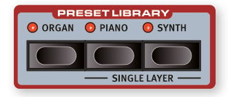

Nord Stage 4 預設音色庫(PRESET LIBRARY) 包含大量風琴、鋼琴和合成器區段的預設音色，可快速簡單地將包含效果的即用音色載入現有音效配置。在仍選擇音色配置 A:21 的情況下，讓我們嘗試從預設音色庫添加一個合成器音色：

The Nord Stage 4 PRESET LIBRARY comes with a large number of Preset sounds for the Organ, Piano and Synth sections, making it quick and easy to load ready-to-use sounds, including effects, into existing Programs. With Program A:21 still selected, let's try adding a Synth sound from the Preset Library:

1. 按預設音色庫區段的 SYNTH 按鈕，這將自動開啟合成器區段並打開預設瀏覽畫面。  
   Press the SYNTH button of the Preset Library section. This automatically turns the Synth section On and opens the Preset browse screen.

2. 使用旋鈕找到適合與鋼琴音色疊加的音色，也許是合成器鋪底（Synth Pad）音色。使用活躍音層的推桿調整音量。  
   Use the dial to find a suitable sound to layer with the Piano sound, perhaps a Synth Pad sound. Use the faders for the active Layers to adjust the sound levels appropriately.

> **提示**：如果需要，可以按類別瀏覽預設值，方法是按 Cat 軟按鈕並使用 Page 按鈕在類別之間切換。按住 Cat 軟按鈕可從清單中選擇所需類別。  
> Presets can be browsed by Category if desired. This is done by pressing the Cat soft button and using the Page buttons to switch between categories. Holding down the Cat soft button lets you select the desired Category from a list.

3. 找到所需音色後，再次按預設音色庫 Synth 按鈕，或按 Shift/Exit 確認並退出預設瀏覽畫面。  
   Once you have found your desired sound, press the Preset Library Synth button again, or Shift/Exit, to confirm and exit the Preset browse screen.

即使使用預設值作為起點，面板上的所有合成器參數也可以調整。這些參數的深入說明可在第 27 頁起的合成器章節中找到。

All Synth parameters on the panel can be adjusted, even when using a preset as a starting point. An in-depth description of these parameters can be found in the Synth chapter, starting on page 27.

### 載入單一音層預設音色 / LOAD A SINGLE LAYER PRESET

除了為整個區段載入預設音色（如上例），您還可以為單個音層載入預設音色。這在想要保留該區段其他音層中的音色不變時非常有用，例如將新音色與現有音層混合，或在同一音色配置中存取多種不同音色——使用音層推桿或音層場景功能在它們之間切換。

Apart from loading Presets for the entire Section, as in the previous example, you can also load Presets for single Layers. This is useful whenever you want to keep sounds in other Layers within that Section intact, for example when blending new sounds with existing Layers, or for having access to a number of different sounds within the same Program – using Layer faders or Layer Scene functionality to switch between them.

讓我們為鋼琴 B 添加一個單音層預設音色，與原聲大鋼琴音色疊加：

Let's add a Single Layer Preset to Piano B, for layering with the grand piano sound:

1. 同時按下鋼琴 A 和 B 按鈕以開啟兩個音層，確認音層 B 處於焦點（以閃爍的 LED 指示）。  
   Press the Piano A and B buttons simultaneously to turn both Layers On and make sure that Layer B has focus, indicated by the blinking LED.

2. 按 SHIFT + PIANO（在預設音色庫區域）打開單音層畫面。  
   Press SHIFT + PIANO in the PRESET LIBRARY area to open the SINGLE LAYER screen.

3. 轉動音色配置控制旋鈕為鋼琴 B 選擇一個音層預設音色，也許是一個電鋼琴音色。使用鋼琴 A 和 B 推桿調整兩個音色的平衡。  
   Turn the Program dial to select a Layer Preset for Piano B, perhaps an electric piano sound. Use the Piano A and B faders to adjust the balance of the two sounds.

4. 找到合適的音色後，按預設音色庫 Piano 按鈕返回。  
   Once you have found a suitable sound, press the Preset Library Piano button to return.

---

## 建立鍵盤分區 / CREATE A SPLIT

除了像上例那樣疊加音色，還可以使用分割功能將音色指定到鍵盤的不同區域。繼續使用上例的鋼琴和合成器組合，讓我們改為分割這些音色。

Apart from layering sounds, like in the previous example, it is also possible to assign sounds to different zones of the keyboard, by using the SPLIT functionality. Continuing on the Piano and Synth combination from the previous example, let's split these sounds instead.

1. 按一下位於音色配置區段顯示器上方頂排的 SPLIT ON/SET 按鈕，這將在鍵盤中間「C4」處啟動一個分區點。  
   Press once on the SPLIT ON/SET button, located in the top row above the Program area display. This activates a single split point in the middle of the keyboard, at "C4".

2. 要調整分區點的位置，按住 SPLIT ON/SET 按鈕。  
   To adjust the position of the Split point, press and hold the SPLIT ON/SET button.

3. 每個分區點有兩個設定：Note 和 xFade。通過按 Program 1 按鈕（對應顯示器中的 ◄/► 符號）確保游標在下排選擇 Note 列。使用旋鈕設定所需的 Mid 分區點。  
   There are two settings for each split point; Note and xFade. Make sure the Note row is selected by pressing the Program 1 button until the cursor is on the lower row. Set the desired Mid split point using the dial.

4. 確保其他兩個分區點（Low 和 High）設為「Off」。  
   Make sure that the other two split points (Low and High) are set to "Off".

鍵盤現在分為兩個區域，分區點以鍵盤上方的綠色 LED 指示。SPLIT ON/SET 按鈕上方的 M LED 也將亮起，表示鍵盤分區已開啟，且只有 Mid 分區點處於啟動狀態。

The keyboard is now divided into two zones, the split point being indicated with a green LED above the keyboard. The M LED above the SPLIT ON/SET button will also be lit, indicating both that Split is turned on, and that only the Mid split point is active.

### 將鋼琴指定到上方區域 / ASSIGN THE PIANO TO THE UPPER ZONE

5. 按鋼琴 A KB ZONE ◄/►（Shift+Octave Shift Up/Down），使只有最右邊的兩個 LED 亮起。  
   Press Piano A KB ZONE ◄/► (Shift+Octave Shift Up/Down) so that only the two rightmost LEDs are lit.

這將鋼琴 A 指定到鍵盤的上方區域。可以自由使用鋼琴區段中的 OCTAVE SHIFT ◄/► 按鈕來存取鋼琴音色的不同音域。

This assigns Piano A to the upper zone of the keyboard. Feel free to use the OCTAVE SHIFT ◄/► buttons in the Piano section for accessing a different range of the piano sound.

### 將合成器音色指定到下方區域 / ASSIGN THE SYNTH SOUND TO THE LOWER ZONE

按合成器 A KB ZONE ◄/►（Shift+Octave Shift Up/Down），使只有最左邊的兩個 LED 亮起。請注意，如果您使用多個音層載入或創建了合成器音色，可以在編輯 KB Zone 之前雙擊 Section Edit，這樣可以同時設定所有合成器音層的 KB Zone。

Press the Synth A KB ZONE ◄/► (Shift+Octave Shift Up/Down) so that only the two leftmost LEDs are lit. Note that if you have loaded or created a Synth sound using multiple Layers you can double-tap on Section Edit before editing KB Zone, which lets you set the KB Zone for all Synth Layers at once.

> **注意**：通過使用全部三個分區點（Low、Mid 和 High），可以將鍵盤分為最多四個不同區域，任何音層都可以自由指定到這些區域。  
> By using all three split points, Low, Mid and High, it is possible to divide the keyboard into a total of four distinct zones to which any Layer can be freely assigned.

### 添加風琴音層 / ADD AN ORGAN LAYER

讓我們為剛創建的合成器/鋼琴分割添加一個風琴音色。

Let's add an Organ sound to the Synth/Piano split we just created.

6. 按下 ON 按鈕開啟風琴區段。  
   Turn on the Organ Section by pressing its ON button.

7. 試試已載入的風琴音色並根據需要調整，或按預設音色庫 Organ 按鈕載入一個風琴預設音色並選擇預設音色（如上例）。  
   Try out the loaded Organ sound and adjust it as desired, or load an Organ Preset by pressing the Preset Library Organ button and selecting a Preset like in the previous Synth example.

> **提示**：調整音層音色時，可以通過按音色配置區段中的 SOLO 按鈕並按下該音層的按鈕使其聚焦，單獨監聽該音層。再次按 Solo 或按 Shift/Exit 退出 Solo 模式。  
> While adjusting the sound of a Layer it can be monitored on its own by pressing the SOLO button in the Program area and pressing the button for that Layer to give it focus. Solo is exited by pressing Solo again, or with Shift/Exit.

現在您應該有一個音色，包括指定到整個鍵盤的風琴，以及在分區點左側的合成器音色和右側的鋼琴音色疊加。

You should now have a sound which consists of the Organ assigned to the entire keyboard, layered with a Synth sound at the left side of the Split point and a Piano sound on the right side.

---

## 音層場景 II / LAYER SCENE II

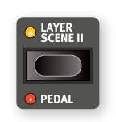

音層場景功能允許創建兩個獨立的音層配置，每個配置中的個別音層或區段可以自由開啟或關閉。使用現有的風琴、鋼琴和合成器組合，讓我們改為創建一個設置，在風琴和鋼琴/合成器組合之間切換：

The Layer Scene functionality allows for creating two independent Layer configurations where individual Layers or Sections can be turned On or Off as desired in each. Using our existing Organ, Piano and Synth combination, let's instead create a setup where we can switch between Organ and the Piano and Synth combination:

1. 確保音層場景 II 的 LED 未亮（表示我們在音層場景 I），關閉鋼琴和合成器區段。現在應該只有風琴音色指定到整個鍵盤。  
   Make sure that the Layer Scene II LED is unlit, meaning that we are on Layer Scene I, and turn the Piano and Synth Sections off. You should now have just the Organ sound, assigned to the entire keyboard.

2. 按音層場景 II 並開啟鋼琴和合成器區段。同時確保風琴區段已關閉。  
   Press Layer Scene II and turn the Piano and Synth sections On. Also make sure that the Organ section is turned Off.

3. 使用音層場景 II 按鈕在兩種音層配置之間切換。  
   Use the Layer Scene II button to toggle between the two Layer configurations.

音層場景 II 配置作為音色配置的一部分儲存，在需要在同一音色配置中切換兩種不同音層配置時非常有用。

The Layer Scene II configuration is stored as part of a Program, and is useful in scenarios where one wants to toggle between two distinct layer configurations while staying within the same Program.

> **提示**：連接的踏板——無論是腳踏開關還是 Nord Triple Pedal 的中間或左踏板——都可以用於在音層場景 I 和 II 之間切換。更多資訊請參閱第 60 頁。  
> An attached pedal, either the Foot Switch or the middle or left pedal of a Nord Triple Pedal can be used for switching between Layer Scene I and II. Read more about this on page 60.

---

## Morph 功能 / MORPHS

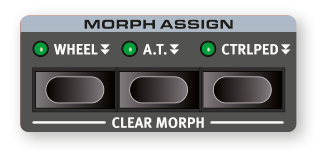

調變輪、控制踏板或鍵盤二段觸鍵感應可在演奏時改變一個或多個參數。這通過選擇 Morph 來源（物理控制器）、目標參數和要包含在 Morph 中的參數範圍來實現。我們再次從音色配置 A:21 的鋼琴音色配置開始。

The modulation wheel, a control pedal or the keyboard aftertouch can be used to alter one or more parameters while playing. This is achieved by selecting a morph source (the physical controller) a destination parameter and the parameter range to include in the morph. Again, we start out with the piano based Program at A:21.

1. 我們現在將創建一個疊加音色，並用滾輪控制鋼琴 B 的音量，因此首先確保鋼琴區段已開啟。  
   We will now create a layered sound and morph the Piano B Level with the Wheel, so start by making sure that the Piano Section is turned On.

2. 同時按下鋼琴 A 和 B 按鈕以啟動兩個音層。  
   Press both Piano A and B buttons at once to activate both Layers.

3. 按 B 按鈕聚焦鋼琴 B，使用鋼琴 Type 和 Model 控制器從 ELECTRIC 類別中選擇一個音色。現在應該有一個原聲大鋼琴音色與電鋼琴音色疊加。  
   Focus Piano B by pressing the B button and use the Piano Type and Model controls to select a sound from the ELECTRIC category. You should now have a grand piano sound layered with an electric piano sound.

4. 將鋼琴 B 推桿拉到最下方，只聽到音層 A 的原聲大鋼琴音色。  
   Drag the Piano B fader all the way down to hear only the grand piano sound in Layer A.

5. 按住音色配置區旋鈕上方 Morph Assign 組中的 WHEEL 按鈕。  
   Press and hold the WHEEL button in the Morph Assign group, above the Program area dial.

6. 在按住 WHEEL 按鈕的同時，將鋼琴 B 推桿推到最上方。  
   With the WHEEL button pressed, push the Piano B fader all the way up again.

7. 鬆開 Morph WHEEL 按鈕。演奏幾個音符或和弦，同時移動調變輪。  
   Let go of the Morph WHEEL button. Play a few notes or chords, while moving the modulation wheel.

當滾輪移動時，鋼琴 B 的音量增加，音色也相應改變。

As the wheel moves, the Piano B level increases and the sound changes accordingly.

> **提示**：一個 Morph 來源（滾輪、控制踏板或二段觸鍵感應）可以同時控制多個參數。  
> One Morph source (Wheel, Control Pedal or Aftertouch) can control several parameters at once.

> **提示**：Morph 來源可以同時增加一個參數的值並減少另一個參數的值，例如可以在樂器之間進行平滑淡出淡入。  
> A Morph source can increase one parameter's value while decreasing the value of another at the same time. This makes it possible, for example, to crossfade between instruments.

在第 38 頁閱讀更多關於 Morph 功能的資訊。

Read more about the Morph functionality on page 38.

## 合成器 / THE SYNTHESIZER

Nord Stage 4 合成器區段配備三個完整且獨立的合成器——音層 A、B 和 C——可作為單一音源或用於構建更複雜的疊加音色。

The Nord Stage 4 SYNTH Section features three complete and independent synthesizers – Layers A, B and C – which can be used as single sound sources or as building blocks for more complex, layered, sounds.

> **提示**：預設音色庫（見上頁）包含大量即用音色，可以直接使用，或通過合成器和音層效果控制器進一步調整。  
> The PRESET LIBRARY contains a large number of ready-to-play sounds that can be used as is, or be further tweaked using the Synth and Layer Effects controls.

讓我們了解 Stage 4 合成器的一些基本功能，從如何使用「類比」波形設置音色開始：

Let's have a look at some of the basic features of the Stage 4 synthesizer, beginning with how to set up a sound using "analog" waveforms.

1. 確保合成器區段已啟動（按合成器區段 ON 按鈕），且只有音層 A 處於活躍狀態。通過短暫按住對應按鈕來關閉音層。  
   Make sure the Synth section is active, by pressing the Synth Section ON button, and that only Layer A is active. Layers are turned Off by pressing down on the corresponding button for a short moment.

2. 為了從「空白狀態」開始，按 SOUND INIT（Shift+Waveform）將合成器初始化為預設設定。  
   In order to start off from a "blank slate", let's initialize the synthesizer to its default settings by pressing SOUND INIT (Shift+Waveform).

3. 關閉合成器區段所有已啟動的效果。  
   Turn off any active effects for the Synth section.

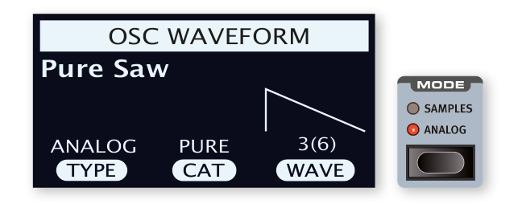

4. 確保合成器區段處於 ANALOG 模式（使用 MODE 選擇器）。使用顯示器下方的三個旋鈕，將 TYPE 設為 Analog，CAT（類別）設為 Pure，WAVE 設為 Sawtooth（鋸齒波）。  
   Make sure the Synth Section is in ANALOG Mode, using the MODE selector. Use the three dials under the display and set TYPE to Analog, CAT (Category) to Pure and WAVE to Sawtooth.

5. 現在使用的是基本單振盪器配置，這意味著 OSC CTRL 旋鈕對音色沒有影響。讓我們選擇不同的類別：  
   We are now using a basic, single oscillator, configuration which means that the OSC CTRL knob has no impact on the sound. Let's choose a different Category:

6. 轉動 CAT 控制旋鈕選擇 Multi 類別。WAVE 旋鈕可用於選擇多個鋸齒波的不同組合。選擇 Multi Saw x2，它由兩個相差一個八度的振盪器組成。  
   Turn the CAT dial to and select the Multi category. The WAVE dial can be used to select different combinations of multiple sawtooth waves. Let's stick with Multi Saw x2 which consists of two oscillators an octave apart.

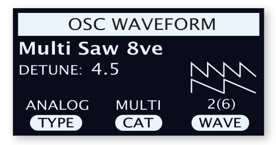

7. 轉動 OSC CTRL 旋鈕，改變顯示器中顯示的兩個振盪器的 Detune 參數，產生或多或少失調和活躍的音色。  
   Turn the OSC CTRL knob to alter the Detune parameter for the two oscillators, shown in the display, resulting in a more or less detuned and lively sound.

最後，讓我們轉向濾波器區段進行一些調整：

As a final step, let's turn to the Filter section for some adjustments:

1. 確保濾波器已開啟，暫時將 Filter ENV AMT（包絡線調變量）設為零。  
   Make sure the Filter is turned ON and turn the Filter ENV AMT (Envelope Amount) to zero for now.

2. 按 Filter TYPE 按鈕。在顯示器中，使用最左邊的 TYPE 控制旋鈕試用不同類型的濾波器。  
   Press the Filter TYPE button. In the display, use the leftmost TYPE dial to try out the different kinds of filters.

3. 向各個方向轉動 Filter FREQ 旋鈕，注意音色如何逐漸變暗或變亮，取決於使用的濾波器類型。對所有 TYPE 設定重複此操作，注意每種設定對音色塑造的不同效果。  
   Turn the Filter FREQ knob in each direction, and notice how the sound gets gradually darker or brighter, depending on which Type of filter is being used. Repeat this with all TYPE settings, paying attention to how they each have a different effect on how the sound is shaped.

> **注意**：從第 31 頁開始閱讀更多關於濾波器類型和其他設定的資訊。  
> Read more about the Filter Types, and other settings in the Filter section, beginning on page 31.

### 載入和調整取樣音色 / LOADING AND ADJUSTING A SAMPLE

現在讓我們改為基於取樣音色設置一個弦樂鋪底音色：

Now let's instead set up a string pad sound based on a sample:

1. 切換到合成器區段的音層 B，使用聲音初始化功能（Shift+Waveform）初始化它。  
   Switch to Layer B of the Synth Section, and initialize it using the Sound Init function (Shift+Waveform).

2. 按 MODE 按鈕並選擇 SAMPLES。  
   Press the MODE button and select SAMPLES.

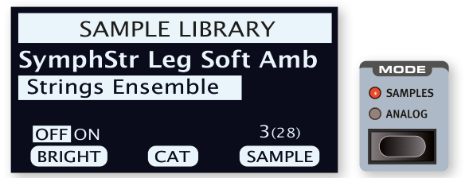

3. 使用顯示器下方的 CAT 控制旋鈕選擇 Strings Ensemble 類別。使用 SAMPLE 旋鈕選擇您喜歡的音色。  
   Use the CAT dial under the display to select the Strings Ensemble category. Use the SAMPLE dial to select a sound of your choice.

4. 演奏幾個音符。要將音色製作成鋪底效果，需要進行一些調整。按 AMP ENVELOPE 按鈕，打開顯示器中的振幅包絡線控制。  
   Play a few notes. To make a pad out of the sound we will want to do a few tweaks. Press the AMP ENVELOPE button, opening up the amplifier envelope controls in the display.

5. 在演奏的同時，調整 RELEASE 控制（顯示器下方的第三個旋鈕），直到放開音符時聽到適當長的尾音，也許約 1 秒的值。  
   While playing, adjust the RELEASE control (third dial under the display) until a suitably long tail is heard when releasing a note, perhaps at a value of around 1 second.

6. 類似地，使用 ATTACK 旋鈕創造更柔和、更漸進的音符起音。約 500 ms 的值可能合適。  
   Similarly, use the ATTACK dial to create a softer and more gradual onset of the notes you play. A value around 500 ms may be suitable.

7. 要完成弦樂鋪底，開啟濾波器，按 Filter TYPE 確認選擇了 LP（低通）選項之一，調整 Filter FREQ 給予音色更柔和的特性。約 2 kHz 的值可能是一個好的起點。  
   To finalize the string pad, turn the Filter ON, press Filter TYPE and check that one of the LP (low-pass) options is selected, and adjust the Filter FREQ to give the sound a softer character. A value of around 2 kHz could be a good starting point.

> **提示**：您可能需要將濾波器的 Env Amt 設為零，或者調整濾波器包絡線，它決定了濾波器隨時間的輪廓。  
> You may want to set Env Amt to zero for the Filter, or instead adjust the Filter ENVELOPE, which determines the contour of the Filter over time.

8. 要用不同的取樣音色試用鋪底音色，按住 WAVEFORM 按鈕並轉動 SAMPLE 旋鈕。正常轉動 Sample 旋鈕會關閉濾波器區段並為所選取樣音色設置預設的 Amp 包絡線值。  
   To try out the pad sound with a different sample, press and hold the WAVEFORM button and turn the SAMPLE dial. A normal turn of the Sample dial would turn off the Filter section and set the Amp Envelope to preset values for the selected sample.

進一步增強這個基本弦樂鋪底音色的方法有很多，例如添加調變或使用效果。在第 33 頁閱讀更多關於調變選項的資訊，從第 48 頁開始了解效果。

There are several ways to further enhance this basic string pad sound, for instance by adding modulation or by using effects. Read more about modulation options on page 33 and about effects, beginning on page 48.

> **提示**：可以使用 Nord Sound Manager 軟體為 Nord Stage 4 添加額外的取樣音色。  
> Additional samples can be added to the Nord Stage 4 by using the Nord Sound Manager software.

## 琶音器/節奏閘門 / THE ARPEGGIATOR/GATE

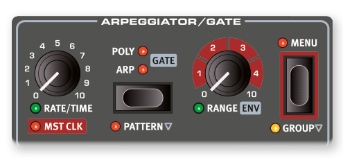

作為最後一個練習，讓我們使用合成器區段及其琶音器/節奏閘門（ARPEGGIATOR/GATE）創建一個音色。

As a final exercise, let's create a sound using the Synth section and its ARPEGGIATOR/GATE.

1. 確保只有合成器區段已開啟，執行聲音初始化（Shift+Waveform）。將 Amp Envelope ATTACK 時間設為 0，DECAY 設為約 500 ms，選擇鋸齒波並稍微打開濾波器，這將產生打擊性的音色。  
   Make sure that only the Synth Section is turned on and perform a SOUND INIT (Shift+Waveform). Set the Amp Envelope ATTACK time to 0, the DECAY to around 500 ms, select a sawtooth waveform and open up the filter a little bit. This will produce a percussive sound.

2. 按 ARP RUN，在鍵盤上演奏一個和弦並轉動琶音器 Rate 旋鈕。這將按照重複的方式依次演奏按住的音符。  
   Press ARP RUN, play a chord on the keyboard and turn the Arpeggiator Rate knob. This will play the notes that are held down, one after the other in a repeating fashion.

3. 按琶音器/節奏閘門 MENU 按鈕進行一些額外設定：轉動 DIRECTION 旋鈕試用不同設定。預設的 UP 設定從最低鍵向上演奏音符到最高鍵然後重新開始。其他方向有 DOWN（向下）、UP/DOWN 和 RANDOM（隨機）。  
   Press the Arpeggiator/Gate MENU button in order to make some additional settings: Turn the DIRECTION dial and try out the different settings. With the default UP setting notes are played from the lowest key and up to the highest and then it starts over again. The other directions are DOWN (down), UP/DOWN and RANDOM.

   啟動 ZIG ZAG（第二個旋鈕）後，演奏的音符將以給定方向跳兩步再退一步。  
   With ZIG ZAG (the second dial) activated, played notes will jump by two steps and then back one, in a given direction.

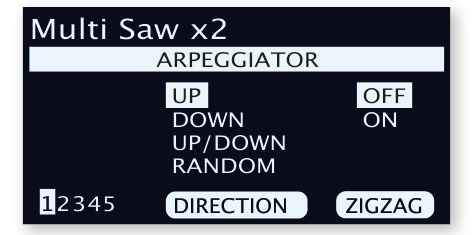

> **注意**：琶音器/節奏閘門選單的第 2-5 頁涉及 Pattern 模式，其設定只有在啟用 Pattern（Shift+Arp/Gate Mode）時才有效。  
> Pages 2-5 of the Arpeggiator/Gate menu concern the Pattern mode, their settings only having effect when Pattern (Shift+Arp/Gate Mode) is enabled.

> **提示**：琶音器/節奏閘門選單的頂行顯示當前波形或取樣音色選擇（例子中為「Multi Saw x 2」）。  
> The top row of the Arpeggiator/Gate menu indicates the current Waveform or Sample selection ("Multi Saw x 2" in the example).

4. 現在通過轉動 RANGE/ENV 旋鈕改變演奏琶音的音域範圍。範圍可以以 1/3 八度為步進調整，最多 4 個八度。  
   Now let's alter the range of the played arpeggio by turning the RANGE/ENV knob. The range can be adjusted up to 4 octaves in steps of 1/3 of an octave.

5. 按 KB HOLD 按鈕保持琶音進行，無需按住琴鍵。  
   Press the KB HOLD button to keep the arpeggio going without the need for pressing the keys.

> **提示**：在琶音器進行時，可以試試 POLY（複音）和 GATE 模式。在複音模式下，重複演奏按住和弦的轉位，而節奏閘門模式以節奏方式開關音符。請注意，在節奏閘門模式下，需要將 Amp 和 Filter Envelope Decay 設為較長的值，因為音符不像 Arp 和 Poly 模式那樣重複演奏。  
> Feel free to also try out the POLY (Polyphonic) and GATE modes while the arpeggiator is going. In Polyphonic mode, inversions of the held chord are played back repeatedly, while the Gate mode turns the sound off and on in a rhythmic fashion. Note that in Gate mode you will want to set the Amp and Filter Envelope Decay to longer values, since played notes are not repeated as in the Arp and Poly modes.

---

## 主節拍時鐘 / MASTER CLOCK

現在已有琶音進行中，讓我們試試主節拍時鐘功能來同步琶音並帶入一個效果。

Now that we have an arpeggio going, let's try the Master Clock feature to synchronize the arpeggio and to bring in an effect as well.

1. 按住 SHIFT 並轉動琶音器 RATE 旋鈕，將琶音鎖定到主節拍時鐘，MST CLK LED 亮起。按住音色配置區段的 Mst Clk TAP/SET 按鈕，使用音色配置控制旋鈕輸入速度，顯示器將顯示 BPM。將此練習的速度設為 130 BPM，然後按 SHIFT/EXIT 退出。  
   Hold SHIFT and turn the Arpeggiator RATE knob to lock the arpeggio to the Master Clock, the MST CLK LED lights up. Press down on the Mst Clk TAP/SET button in the Program area to dial in a tempo with the PROGRAM Dial. The display will indicate the BPM. Set this to 130 BPM for this exercise. Press SHIFT/EXIT to exit.

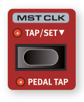

> **提示**：或者，至少點擊 Mst Clk 按鈕四次即可即時設定速度。也可以使用腳踏開關踏板，或 Nord Triple Pedal 的左或中踏板來點擊速度。設置詳情請參閱第 60 頁。 
> Alternatively, tap a minimum of four times on the Mst Clk button to set the tempo on the fly. You could also use a foot switch pedal, or the left or middle pedal of a Nord Triple Pedal to tap the tempo. See page 60 for details on how to set this up.

2. 轉動琶音 RATE 旋鈕選擇琶音應演奏的拍值（或音符值），設定將在旋鈕被轉動時顯示在音色配置區段顯示器中。注意 1/4 是 1/8 「速度」的一半。數字值後的「T」表示三連音。將細分設為 1/8。  
   Turn the Arpeggio RATE knob to select the meter subdivision (or note values) that the arpeggio should play. The setting is shown in the Program area display as the knob is being turned. Notice how 1/4 is half the "speed" of 1/8. A "T" after a numerical value indicates triplets. Set the subdivision to 1/8.

3. 開啟活躍合成器音層的延遲效果。如果您仔細調整延遲 TEMPO，可以使其與琶音的節奏相匹配，但還有另一種方法。讓我們將延遲同步到與琶音相同的時鐘：  
   Turn on the DELAY effect for the active Synth Layer. If you carefully adjust the delay TEMPO, you could match it to fit the rhythm of the arpeggio, but there is another way. Let's synchronize the delay to the same clock as the arpeggio:

4. 按住 SHIFT 並轉動延遲 TEMPO 旋鈕，為延遲啟動主節拍時鐘，MST CLK LED 亮起。  
   Hold SHIFT and turn the Delay TEMPO knob to activate Master Clock for the Delay. The MST CLK LED lights up.

5. 轉動延遲 TEMPO 旋鈕，再次參考音色配置區段顯示器監控設定。  
   Turn the Delay TEMPO knob and again refer to the Program area display to monitor the setting.

6. 試試 1/16，這將是琶音音符值的一半或兩倍「速度」。將 DRY WET 旋鈕調高但不超過 12 點鐘位置，以聽到延遲拍與琶音音符一起的效果。  
   Try 1/16, which will be half the note value or twice the "speed" of the arpeggio. Turn up the DRY WET knob up to but not beyond 12 o'clock to hear the delay taps together with the arpeggiated notes.

琶音器、合成器上的 LFO、延遲和 Mod 1 速率都可以以這種方式同步到主節拍時鐘。

The Arpeggio, the LFO on the synth, the Delay and the Mod 1 rate can be synchronized to the Master Clock in this fashion.

更重要的是，主節拍時鐘同時在所有音層上運作，因此您可以控制所有合成器音層上的琶音和 LFO，以及風琴和鋼琴區段的效果。

What's more, the Master Clock operates on all Layers simultaneously so you can control arpeggios and LFOs on all Synth Layers, and Effects for the Organ and Piano Sections as well.

部分配備主節拍時鐘的功能有大於 1/1 的除法設定，允許比一小節更長的掃描。當然，您也可以同步某些功能，同時讓其他功能自由運行。

Some of the Mst Clk equipped functions have division settings that are larger than 1/1 that allows for sweeps that are longer than one bar. And you can of course synchronize some functions, while leaving others free-running if you like.
