# 第四章：風琴區段 / Chapter 4: Organ Section

---

## 關於風琴區段 / ABOUT THE ORGAN SECTION

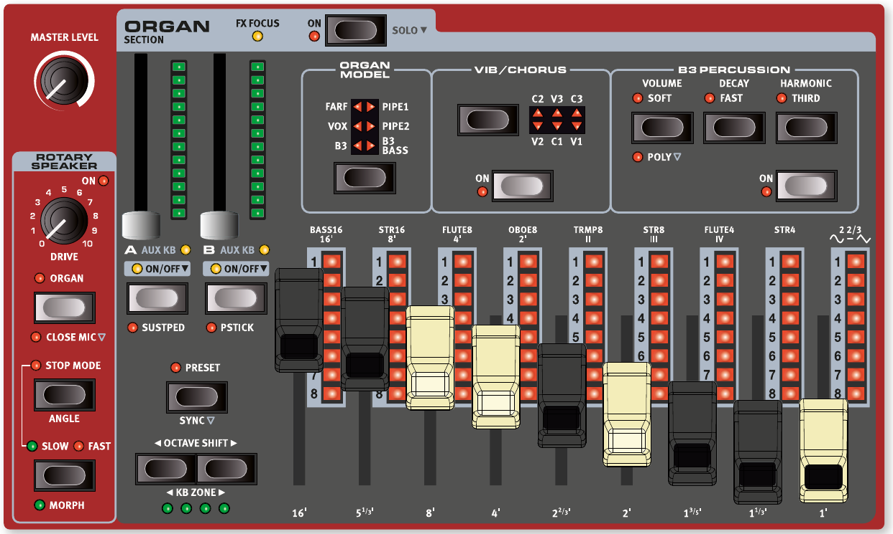

Nord Stage 4 內建六種風琴音色模型，全部以數位方式模擬：一種音輪式 B3 風琴（另附獨立的 B3 Bass 模式）、兩種電晶體風琴（Vox 和 Farfisa），以及兩種管風琴（Pipe Organ）模型。

> 💡 什麼是「數位模擬」？就是用電腦音色配置精確重現老式機械樂器的聲音特性，讓你不需要真的擁有那些昂貴的老樂器，也能奏出一模一樣的音色。

The Nord Stage 4 features six organ models, all digitally modeled; a tonewheel/B3 organ with a separate B3 Bass mode, two transistor organs (Vox and Farfisa) and two Pipe Organ models.

> 🔖 旋轉喇叭效果（Rotary Speaker）經常搭配風琴一起使用，相關設定請參閱效果章節第 52 頁。

> The Rotary Speaker effect, which is often combined with the Organ, is covered in the Effects chapter, see page 52.

---

## 開關與音量 / ON/OFF AND LEVEL

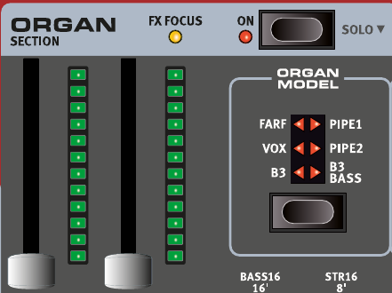

按下風琴區段的 **ON** 按鈕可以開啟或關閉整個風琴區段。每個風琴音層（Layer）各有一支可以推動的音量推桿，推桿本身也支援Morph 多參數控制（Morph）。

The Organ Section is turned On or Off by pressing its ON button. The morphable level faders control the output level of each Organ Layer.

長按 **ON** 按鈕約半秒，可以執行「獨奏（Solo）」操作——只保留風琴發聲，同時關閉鋼琴和合成器區段。這在你只想單獨試聽風琴音色時很方便。

Press the On button for roughly half a second to perform a SOLO operation, which activates only the Organ, turning off the Piano and Synth sections.

---

## 音層按鈕與目標效果器 / LAYER BUTTONS AND FX FOCUS

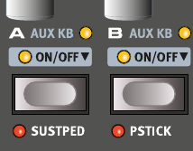

風琴區段有兩個音層（Layer——可以想像成兩台各自獨立的風琴），分別標示為 **A** 和 **B**。

> 💡 「音層」就像在同一台琴上疊加多個不同的聲音來源，你可以讓兩種風琴同時發聲，產生更豐富的音色。

There are two Organ Layers; A and B.

- 要同時開啟兩個音層，請**同時按下** A 和 B 兩個按鈕。
  Turning a second Layer On is done by pressing both Layer buttons simultaneously.
- 要關閉某個音層，**長按**該音層的按鈕約半秒即可。
  Turning a Layer Off is done by holding its button down for a short period of time.

在兩個音層都開啟的狀態下，目前正在操作的「焦點音層」會以**閃爍的 LED** 標示。

To toggle from one Layer to the other, press the non-active Layer button. With both Layers active, the focused Layer is indicated by a blinking LED above the Layer button.

按下音層按鈕時，風琴區段頂部的 **FX FOCUS** 指示燈也會亮起，表示目前正在編輯該音層的效果。

Pressing a Layer button also focuses the Organ Section effects for editing, indicated by the FX FOCUS LED at the top of the Organ section.

> ⚠️ 注意：風琴的兩個音層**共用同一套效果鏈**，這和鋼琴、合成器不同（後兩者的每個音層各有獨立效果）。

> Note that Both Organ Layers share the same effects chain, unlike the Piano and Synth Layers which each has its own set of effects.

---

## 八度移調與鍵盤區域 / OCTAVE SHIFT AND KB ZONE

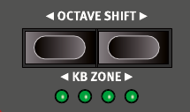

使用 **OCTAVE SHIFT** 按鈕可以將選定的風琴音層往上或往下移調，每次移動一個八度（±12 個半音）。指定到整個鍵盤時，可移調一個八度；指定到較小的分區時，可調範圍會有所不同，但始終能涵蓋風琴的完整音域。

Use OCTAVE SHIFT to transpose the selected Organ Layer up or down by octaves (+/- 12 semitones). When assigned to the entire keyboard it can be transposed one octave up or down. When assigned to a smaller zone the available transpose values will vary, but always provide access to the full range of the Organ.

按下 **KB ZONE**（Shift + 八度升/降鍵），可以將選定的風琴音層指定到任何已啟用的鍵盤區域。綠色 LED 指示燈會顯示目前音層被指定到哪個分區。關於分區設定，請參閱第 38 頁。

Press KB ZONE (Shift+Octave Down/Up), to assign the selected Organ Layer to any of the active keyboard zones. The green LEDs indicate which of the zones a Layer is assigned to. Read more about Split set-ups and keyboard zones on page 38.

---

## 延音踏板與音高控制桿 / SUSTPED AND PSTICK

**SUSTPED**（Shift + 音層 A 開關）可為選定的風琴音層啟用外接延音踏板。如何設定外接踏板，請參閱選單章節第 58 頁。

SUSTPED (Shift + Layer A On/Off) activates any attached sustain pedal for the selected Organ Layer. Read more on how to configure an attached pedal in the Menus chapter, on page 58.

**PSTICK**（Shift + 音層 B 開關）可為選定的音層開啟音高控制桿功能，讓你用音高控制桿（Pitch Stick）將風琴音色上下彎音 2 個半音。

PSTICK (Shift + Layer B On/Off) turns on pitch stick functionality for the selected Layer, in which case the Organ sound can be bent 2 semitones up and down, using the pitch stick.

---

## 選擇風琴模型 / SELECTING AN ORGAN MODEL

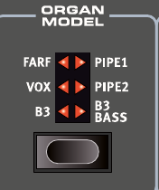

按下 **ORGAN MODEL** 選擇按鈕，可以挑選要使用的風琴模型。兩個音層 A 和 B 可以各自使用不同的模型——例如用 B3 疊加管風琴，或把 B3 主鍵盤和 B3 Bass 音栓拉桿分左右手演奏。

Use the ORGAN MODEL selector button to select an Organ Model to use. Note that different models can be used for Layers A and B, enabling various layered Organ sounds or a B3 manual combined with the B3 Bass drawbars as a split or with one Layer played over MIDI.

---

## 風琴預設音色 / ORGAN PRESETS

Nord Stage 4 內建大量完整的風琴預設音色（Preset——已經設定好、可以直接使用的音色組合，通常包含效果），可在音色配置區段中央的 **PRESET LIBRARY** 區域按下 **ORGAN** 按鈕來瀏覽和載入。你自己調整好的音色也可以儲存到預設音色庫，方便在任何音色配置（Program）中快速呼叫。

The Nord Stage 4 comes with a large selection of complete and ready-to-use Organ Presets, including effects. These are browsed and loaded using the ORGAN button in the PRESET LIBRARY area, of the central Program section. User-created sounds can be stored to the Preset Library as well, for quick and easy recall from within any Program.

詳細說明請參閱第 40 頁的預設音色庫章節。

Read more about the Preset Library on page 40.

---

## 音栓拉桿與 LED 顯示 / DRAWBARS AND LED GRAPHS

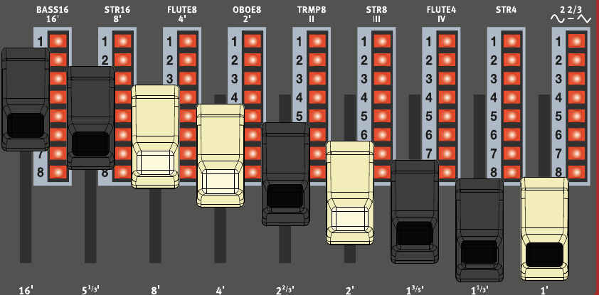

每支實體音栓拉桿（Drawbar——類似滑桿的控制器，拉出越多、該諧音聲音越大）旁邊都有一排 LED 指示燈顯示目前的設定值。載入音色配置時，LED 會顯示音色配置中儲存的音栓拉桿預設音色。

> 💡 「諧音」是聲音的組成成分。每支音栓拉桿代表不同的頻率成分，透過組合各音栓拉桿的位置，你就能調出各種不同特色的風琴音色——這正是風琴最有趣的地方！

The mechanical drawbars are accompanied by LED graphs. When a program is loaded the LED graphs show the stored settings for the drawbars, referred to as the Preset.

如果關閉預設音色（Preset Off），風琴就會進入「音栓拉桿即時模式（Drawbar Live）」，直接使用實體音栓拉桿的實際位置，此時 LED 指示燈全部熄滅。詳細說明請見後續章節。

If the Preset is turned Off, the Organ is in Drawbar Live mode for that Layer, meaning that the physical positions of the drawbars are used, in which case the LEDs are unlit. Read more about Preset and Drawbar Live further down.

> 💡 在預設音色模式下，音栓拉桿可以設定Morph 多參數控制（Morph）——例如透過調制輪或踏板大幅度地即時改變音栓拉桿位置，製造戲劇性的音色變化。

> The drawbars can be Morph controlled, in Preset mode, if you want to make dramatic changes with for example the Wheel or a control pedal.

---

## B3 電風琴模組 / THE B3 MODEL

B3 電風琴模組以經典機電式音輪風琴（Tonewheel Organ）為基礎，透過創新且精密的數位建模方式，重現原始樂器的每一個細節。以下是幾個建模的具體面向：

> 💡 Hammond B3 是 1950–60 年代最具代表性的電風琴（Electric Organ），常見於爵士樂、福音音樂和搖滾樂中，通常搭配 Leslie 旋轉喇叭使用。Nord 花費大量心力精確模擬了它機械結構的每個特性。

The B3 model is based on a digital model of the classic electro-mechanical tonewheel organ. This simulation utilizes innovative and advanced methods to capture every nuance of the original sound. Here are some examples:

- 極度精確的原始合聲與音高顫音掃描器數位模型。
  An extremely accurate digital model of the original chorus and vibrato scanner.
- 模擬每個諧音的接點彈跳特性。
  Modeling of the individual contact bounces for each harmonic.
- 模擬內建前置放大器獨特的頻率特性，這構成了聲音的「主體」。
  Modeling of the unique frequency characteristics of the built-in pre-amplifier, which forms the "body" of the sound.
- 模擬音輪之間的「能量搶奪」效應，產生典型的壓縮感。
  Simulation of the energy robbing on the tone wheels that results in the typical "compressed" sound.
- 依原始設計精確調音。
  Authentic tuning of the tonewheels according to the original design.
- 極快速的琴鍵響應。
  Extremely fast keyboard response.
- 完整複音（Full Polyphony）。
  Full polyphony.

---

### B3 音栓拉桿 / B3 DRAWBARS

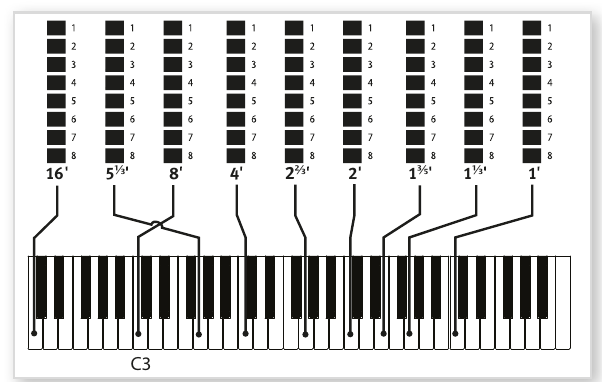

音輪風琴的諧音音程標示印在面板音栓拉桿下方。每支音栓拉桿代表一個固定諧音音程，與所彈奏的音符之間維持固定的音高關係。面板上的圖示顯示彈奏 C3 時，九支音栓拉桿各自的音高關係。請注意，5⅓′ 音栓拉桿實際上是基頻（8′）高五度的諧音，但在多數情況下聽起來反而像在它下方。

The harmonic intervals for the tonewheel organ are printed on the panel below the drawbars. Each drawbar represents a partial with a fixed harmonic interval in relationship with the played note. The illustration below shows the pitch interval among the nine drawbars when the key of C3 is played. Note that the 5⅓′ drawbar actually is a 5th above the fundamental harmonic (8′) but in most situations is perceived as sounding below it.

---

### 音高顫音與合聲 / VIBRATO & CHORUS

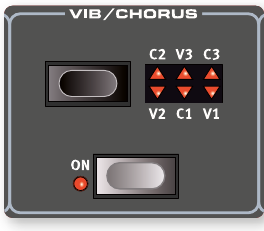

音輪風琴原本的音高顫音與合聲掃描器，是由一條調變延遲線與旋轉掃描器組合而成。音高顫音效果是對訊號施加相位偏移；合聲效果則是將相位調變後的訊號疊加到原始訊號上。

The original vibrato and chorus scanner in a tonewheel organ consists of a modulated delay line in combination with a rotating scanner. For the Vibrato effect, phase shift is applied to the signal. For the Chorus effect, the phase-modulated signal is added to the original signal.

共有三種合聲（C1–C3）和三種音高顫音（V1–V3）可供選擇。按下 **Vibrato/Chorus** 選擇按鈕來切換類型；每個音層的效果可以獨立開關。

Three different types of choruses (C1-C3) and three different types of vibratos (V1-V3) are available. Select one of these types by pressing the Vibrato/Chorus selector button. The effect can be activated/deactivated for each Layer individually by pressing the Vibrato/Chorus button for the Layer A and Layer B "manuals".

---

## 打擊音效 / PERCUSSION

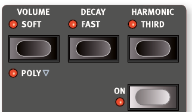

按下 **PERCUSSION ON** 按鈕，可以為 B3 音色加上一個短暫的起始衝擊感（Attack）——這是用一個包絡線產生器（Envelope Generator）控制第 2 或第 3 諧音所產生的效果。

> 💡 「打擊音效」就像在每個音符開頭加上一個輕微的「叩」聲，讓音色聽起來更有活力和節奏感。這是 B3 風琴的招牌特色之一。

Press the PERCUSSION ON button to add an extra attack to the B3 sound by having a single envelope generator controlling either the 2nd or 3rd harmonic.

按鍵時，包絡線會在音符開頭短暫「打開」一下。正常情況下，打擊音效是「單觸發非連奏（Single-triggered Non-legato）」模式：只有在沒有其他音符正在發聲時按鍵，才會觸發打擊音效。也就是說，如果你按住一個和弦再繼續疊加新的音符，新音符不會有打擊音效——需要放開所有琴鍵後重新按鍵才行。

The envelope "opens up" for a short moment at the beginning of the sound when you press the key(s). Normally, the percussion is a single-triggered non-legato effect. By "single-triggered" we mean that the percussion is only present when you hit the keys when no other note is sounding. In other words, if you play a note or a chord and then add more notes without releasing the previously pressed keys, there will be no percussion effect in the new notes. You have to release all keys to be able to play new notes with the percussion effect.

在 **POLY 模式**（Shift+Volume）下，打擊音效變為「複音（Polyphonic）」——每個新按下的音符都會觸發打擊音效，不管之前有沒有音符正在發聲。

In POLY mode (Shift+Volume), the Percussion is polyphonic, producing the percussive attack on each new stroke, regardless of how many keys are already pressed down.

- **VOLUME SOFT** 按鈕：在正常（Normal）和柔和（Soft）擊弦音量之間切換。
  The VOLUME SOFT button toggles between Normal and Soft percussion level.
- **DECAY FAST** 按鈕：在慢（Slow）和快（Fast）衰減時間之間切換。
  The DECAY FAST button toggles between Slow and Fast decay times.
- **HARMONIC THIRD** 按鈕：在第 2 諧音和第 3 諧音之間切換，作為打擊音效的來源。
  The HARMONIC THIRD button toggles between using the 2nd or 3rd partial as the source for the percussion effect.

> ⚠️ 打擊音效僅適用於 B3 風琴模型。

> The Percussion effect is only available for the B3 organ model.

---

## 按鍵咔嗒聲控制 / KEY CLICK CONTROL

按鍵咔嗒聲（Key Click）是原始 B3 樂器中由接點隨機彈跳產生的聲音特性，很快就成為音樂人喜愛的效果之一。點擊音量可以在音效選單中調整，詳見第 57 頁。

The key click produced by the random contact bounces is an important audio artifact in the original B3 instrument. This quickly became a desirable effect amongst musicians. The click level can be adjusted in the Sound menu, read more about this on page 57.

> 💡 別忘了試試音效選單中的三種音輪模式（Tonewheel Modes）——可以讓 B3 音色從「全新出廠」的清晰音質，一路調整到「老舊磨損」的復古音色。

> Do not forget to try out the three tonewheel modes that are also available in the Sound menu. These will change the sound of the B3 model from a factory new unit to a battered, old workhorse.

---

## Vox 模型 / THE VOX MODEL

原版 Vox 風琴大概是 1960 年代初期所有電晶體組合風琴中最著名的一款。電晶體技術讓製造小巧便攜的風琴成為可能。和音輪風琴強勁的音色相比，電晶體風琴整體偏細薄，但 Vox 獨特的音色個性加上輕巧的攜帶性，使它在當時大受歡迎。

The original Vox organ is probably the most famous of all the transistor based combo organs that emerged in the early 60's. Transistor technology made it possible to manufacture compact and portable organ instruments. Compared to the mighty sound of tonewheel based organs, transistor organs generally sounded reedier and weaker, but this one had a distinctive sound character which together with the portability made the instrument massively popular at the time.

### Vox 音栓拉桿 / VOX DRAWBARS

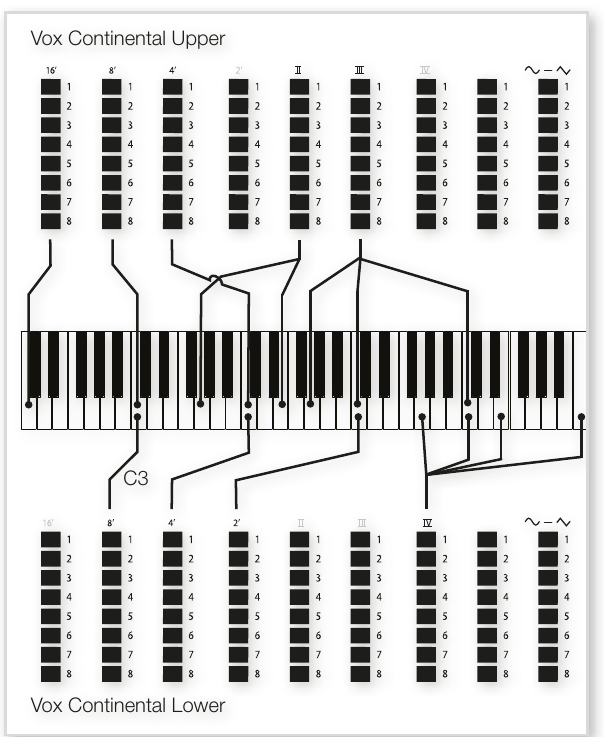

Vox 音栓拉桿的標籤印在音栓拉桿 LED 正上方的那一排。

The labels used for the Vox drawbars are printed on the row directly above the drawbar LEDs.

基本音栓拉桿操作請參閱第 19 頁「音栓拉桿與 LED 顯示」。左側七支音栓拉桿各自控制一個諧音的音量，每個諧音與彈奏音符之間維持固定的音高關係。最右側的音栓拉桿控制「柔和暗沉的濾波訊號」與「明亮強烈的未濾波訊號」之間的混音比例。

For basic drawbar operation, please refer to "Drawbars and LED Graphs" on page 19. The seven drawbars to the left control the level of each partial. Each partial has a fixed harmonic interval relating to the played note. The rightmost drawbar controls the mix between a filtered signal sounding soft and dark, and an unfiltered signal sounding bright and intense.

### 音高顫音 / VIBRATO

Vox 模型提供多種音高顫音和合聲類型，透過音高顫音區段的 ON 按鈕啟用。**V3** 是最接近原版樂器的設定。Vox 模型的音高顫音設定和開關狀態由音層 A 和 B 共用。

There are several types of vibrato and choruses available for the Vox model, which is activated using the ON button in the Vibrato section. The V3 setting is the one that is modeled after the original instrument. The Vox model's Vibrato setting and On/Off state is shared by Layer A and Layer B.

---

## Farf 模型 / THE FARF MODEL

這款復古樂器典型的「嗡嗡（Buzzy）」音色，是有史以來最獨特、最易辨認的風琴音色之一——但你其實也可以從中調出相當多樣的聲音。請注意，各音色的名稱（如長笛、雙簧管、小號等）並不代表真正模仿那些樂器的聲音，而是用來描述音色的基本特質：長笛（Flute）= 柔和、雙簧管（Oboe）= 蘆葦感、小號（Trumpet）= 銅管感，以此類推。

The typical "buzzy" sound of this vintage instrument is one of the most distinct and easily recognizable organ sounds ever created; yet it is actually possible to get quite a wide range of sounds out of the instrument. Note that the voices aren't supposed to replicate the instruments they are named after, but rather to describe the basic tonal characteristic of the voice: Flute = soft, Oboe = reedy, Trumpet = brassy etc.

### Farf 音栓 / FARF REGISTERS

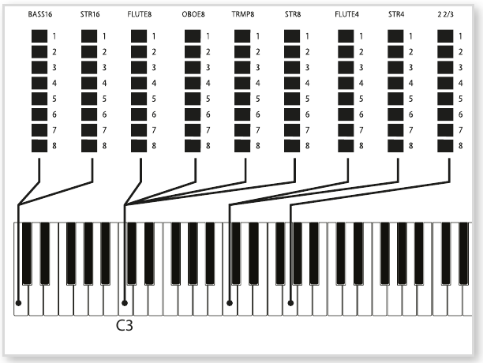

Farf 音栓拉桿／音栓的標籤印在音栓拉桿 LED 上方的一排。

The labels used for the FARF drawbars/registers are printed on the upper row, above the drawbar LEDs or drawbars.

在 Farf 模型下，音栓拉桿的作用是**開關切換器**（或稱「音栓選擇器」），而非連續調整音量。原版樂器使用搖桿開關來選擇不同的音色（實際上是不同的濾波設定），分佈在各個音程（八度）範圍內。

The drawbars act as on/off switches, or "register selectors" when the Farf model is selected. Instead of drawbars, the original instrument used rocker switches for selecting instrument voices (in reality different filter settings) in various footage (octave) ranges.

> 💡 音栓拉桿 LED 5–8 亮起表示該音色**已啟用**；LED 1–4 亮起則表示**未啟用**。將音栓拉桿拉出超過一半，就可以啟用該音栓。

Drawbar LEDs 5-8 are lit up for an activated voice, and drawbar LEDs 1-4 are lit up for a deactivated voice. Pulling a drawbar more than half way out will activate that register.

依據音色配置檢視（Prog View，見第 41 頁），音色配置區段的顯示器會顯示目前風琴區段的音栓拉桿設定。下表列出各音栓拉桿對應的原版音栓名稱：

Depending on Prog View mode (see page 41), the Program section display will show current drawbar settings for the Organ section. The table below shows the original register name.

| 音栓拉桿 | 音色 | 面板名稱 |
|------|------|----------|
| 1 | Bass 16（低音 16 呎） | BASS16 |
| 2 | Strings 16（弦樂 16 呎） | STR16 |
| 3 | Flute 8（長笛 8 呎） | FLUTE8 |
| 4 | Oboe 8（雙簧管 8 呎） | OBOE8 |
| 5 | Trumpet 8（小號 8 呎） | TRMP8 |
| 6 | Strings 8（弦樂 8 呎） | STR8 |
| 7 | Flute 4（長笛 4 呎） | FLUTE4 |
| 8 | Strings 4（弦樂 4 呎） | STR4 |
| 9 | 比基頻高一個八度又五度的明亮音色 | 2 2/3 |

> 💡 「呎數」是管風琴傳統術語，代表音管的長度。管越長，聲音越低沉；16 呎是低音，1 呎是超高音。

| Drawbar | Voice | Panel Name |
|---------|-------|------------|
| 1 | Bass 16 | BASS16 |
| 2 | Strings 16 | STR16 |
| 3 | Flute 8 | FLUTE8 |
| 4 | Oboe 8 | OBOE8 |
| 5 | Trumpet 8 | TRMP8 |
| 6 | Strings 8 | STR8 |
| 7 | Flute 4 | FLUTE4 |
| 8 | Strings 4 | STR4 |
| 9 | A bright voice, an octave and a fifth above the fundamental | 2 2/3 |

雖然部分音色的音高相同，但各自的音色特質不同。

Though some voices have the same pitch, they differ in tonal character.

### 音高顫音 / VIBRATO

Farf 原版樂器有「輕（Light）」和「重（Heavy）」兩種基本音高顫音模式，各有不同的速率。Nord Stage 4 的 Farf 模型提供更多音高顫音和合聲類型，透過音高顫音區段的 ON 按鈕啟用。**V1、V2 和 C3** 是最接近原版樂器的設定。Farf 的音高顫音由兩個音層共用。

The original instrument has two basic vibrato modes; "Light" and "Heavy", with different rates for each mode. There are several types of vibrato and choruses available for the Farf model on the Nord Stage 4, which are activated using the ON button in the Vibrato section. The V1, V2 and the C3 settings are the ones that are modeled after the original instrument's. Note that the Farf vibrato is common for both Layers.

---

## 管風琴 / PIPE ORGAN

### 管風琴 1（Pipe 1）/ PIPE 1

管風琴 1 模型並非模仿某台特定的真實樂器，而是提供一種實用的「萬用型」管風琴音色，不管搭不搭配旋轉喇叭效果都好用。某種程度上它的聲音類似 B3——但沒有那些電機械特性和音色雜質。

The PIPE1 organ model does not emulate an existing instrument, but provides a useful "all-purpose" organ, working equally well with or without Rotary Speaker. In some ways its sound is similar to that of the B3 organ – but without any of its electromechanical behaviors and artifacts.

### 管風琴 2（Pipe 2）/ PIPE 2

管風琴 2 模型忠實重現「主音管（Principal Pipe）」音管組——這是由金屬音管構成的音管組，通常是教堂管風琴的核心音色。與其他試圖模仿別種樂器（長笛、小號、弦樂等）的音管組不同，主音管音色是管風琴所獨有的、不模仿任何其他樂器的原創音色。

The PIPE2 organ model faithfully recreates a principal pipe section - the sets of metal pipes, or ranks, that commonly make up the backbone of a pipe or church organ. While other ranks may attempt to recreate the sounds of other instruments (flutes, trumpets, strings etc.) the principal sound is non-imitative and unique to the pipe organ.

### 管風琴音高顫音／合聲 / PIPE VIBRATO/CHORUS

為管風琴啟用 **VIBRATO/CHORUS** 後，模型會切換到音準精確度較低的版本，產生合聲般的效果和輕微的不和諧感，組合多個音栓時增添真實感。

Activating VIBRATO/CHORUS for the Pipe organs switches to a model which is tuned with less precision. This produces chorus-like effects, slight dissonances and adds realism when combining registers.

### 管風琴 1 和 2 的音栓 / PIPE 1&2 REGISTERS

兩種管風琴模型可用的音管長度與 B3 模型相同，從 16 呎到 1 呎都有。

The pipe lengths available for both Pipe models correspond to those of the B3 model, ranging from 16 feet to 1 foot.

---

## B3 Bass 電風琴模組 / B3 BASS

B3 Bass 電風琴模組提供傳統 B3 低音的 16′ 和 8′ 兩支音栓拉桿。除了單獨使用外，也可以搭配鍵盤左側分區，或透過 MIDI 的 Aux KB 功能由外接鍵盤或踏鍵演奏。

> 💡 這個模式適合雙鍵盤演奏設定——右手操作主要的 B3 音色，左手或腳踩踏板控制專屬的低音音栓拉桿，重現傳統雙層鍵盤 B3 的演奏方式。

The B3 BASS model provides the two traditional B3 Bass 16′ and 8′ drawbars. Apart from using them on their own they could be used on the left side of a keyboard split, or be controlled from an external keyboard or pedal keys over MIDI, using the Aux KB feature.

分區（Split）相關說明請參閱第 38 頁，Aux KB 相關說明請參閱第 54 頁。

Read more about splits on page 38 and about Aux KB on page 54.

---

## 預設音色與音栓拉桿即時模式 / PRESET AND DRAWBAR LIVE

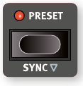

預設音色（Preset）預設為開啟，表示音色配置中儲存的音栓拉桿值、打擊音效和合聲/音高顫音開關狀態都會被使用。關閉預設音色後，風琴進入「音栓拉桿即時（Drawbar Live）」模式，直接使用實體音栓拉桿的物理位置；此時所有音栓拉桿 LED 指示燈都會熄滅。

> 💡 簡單說：**Preset 開啟** = 音色配置記憶的設定；**Drawbar Live** = 音栓拉桿實際位置。如果你推動了音栓拉桿但 LED 燈沒變，請確認 Preset 是否已關閉。

By default the PRESET is turned On, meaning that the values stored in the Program are used for the drawbars, Percussion, and Chorus/Vibrato On/Off. When the Preset is turned Off the Organ is in "Drawbar Live" mode, using the actual positions of the physical drawbars. In Drawbar Live mode the drawbar LEDs are all unlit.

### 同步 / SYNC

按下 **SYNC**（Shift+Preset）或長按 **PRESET** 按鈕，可以將儲存的預設值與實體音栓拉桿的現有位置同步。

> 💡 當你在 Preset 模式下移動了音栓拉桿，但想把當前的物理位置「存入」預設時，就用這個功能。

Press SYNC (Shift+Preset) or press-hold PRESET to synchronize the Preset settings with the physical positions of the drawbars.

---

## 風琴表情踏板 / SWELL PEDAL

Swell（音量漸變）是風琴的經典功能，用連續型踏板來控制。它不只是單純的音量控制——對 B3 來說，Swell 還會改變音色的特質。要在 Nord Stage 4 上使用 Swell，只需將標準風琴表情踏板（Expression Pedal）插入後面板的 **Organ Swell** 插孔，並在踏板選單（Pedal Menu）中設定即可（見第 58 頁）。

> 💡 「風琴表情踏板」就是那種連續可調的踏板，就像鋼琴踩踏板一樣，踩越深效果越強。和延音踏板（只有開/關兩種狀態）不同。

Swell is a characteristic organ feature, controlled from a continuous pedal. Swell is not only a volume control – for the B3 it also changes the character of the sound in a special way. To use Swell control on the Nord Stage 4, simply plug in a standard expression pedal to the Organ Swell input on the rear panel and configure the pedal in the Pedal Menu (see page 58).

接在 Organ Swell 插孔的風琴表情踏板，對所有風琴模型都有效。

An expression pedal connected to the Organ Swell input will control Swell for all organ models.

> ⚠️ 和原版樂器相同，在 B3 或 B3 Bass 模式下，Swell 踏板不會把音量降到零；其他風琴模型的 Swell 踏板則可以完全靜音。

> Like on the original instrument, the Swell pedal does not lower the volume all the way to zero when in B3 or B3 Bass mode. For other Organ models the Swell pedal takes the volume all the way down.

如果你只有一支風琴表情踏板，可以將它接到 Control Pedal 插孔，同時控制Morph 多參數控制（Morph）和 Swell——這也是在踏板選單中設定的。

If you have only one expression pedal, it can be used to control both Morphs and Swell, when attached to the Control Pedal jack. This is also set up in the Pedal Menu.

---

## 旋轉喇叭 / ROTARY SPEAKER

旋轉喇叭效果的詳細設定，請參閱效果章節第 52 頁。

The Rotary Speaker settings are described in detail in the Effects chapter on page 52.

原文整頁參考

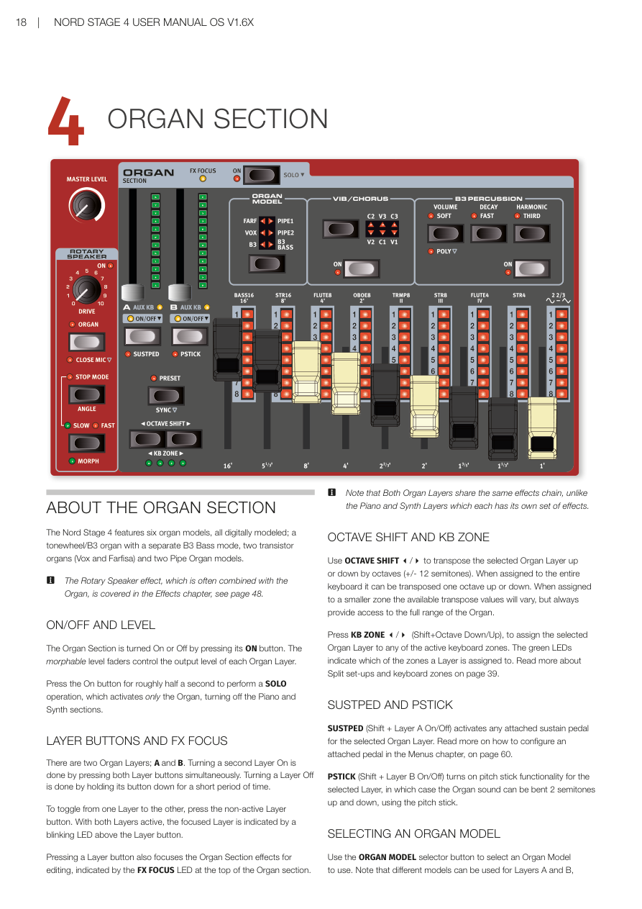

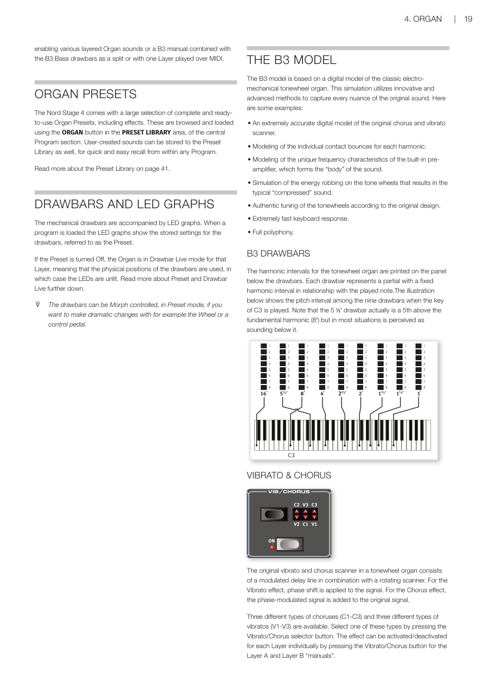

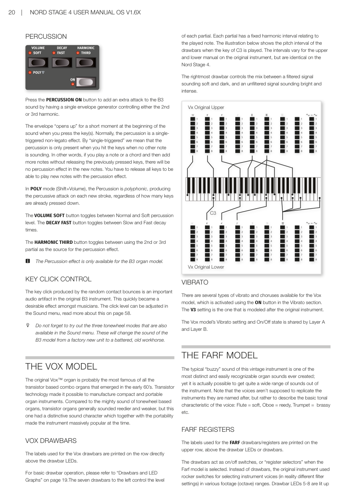

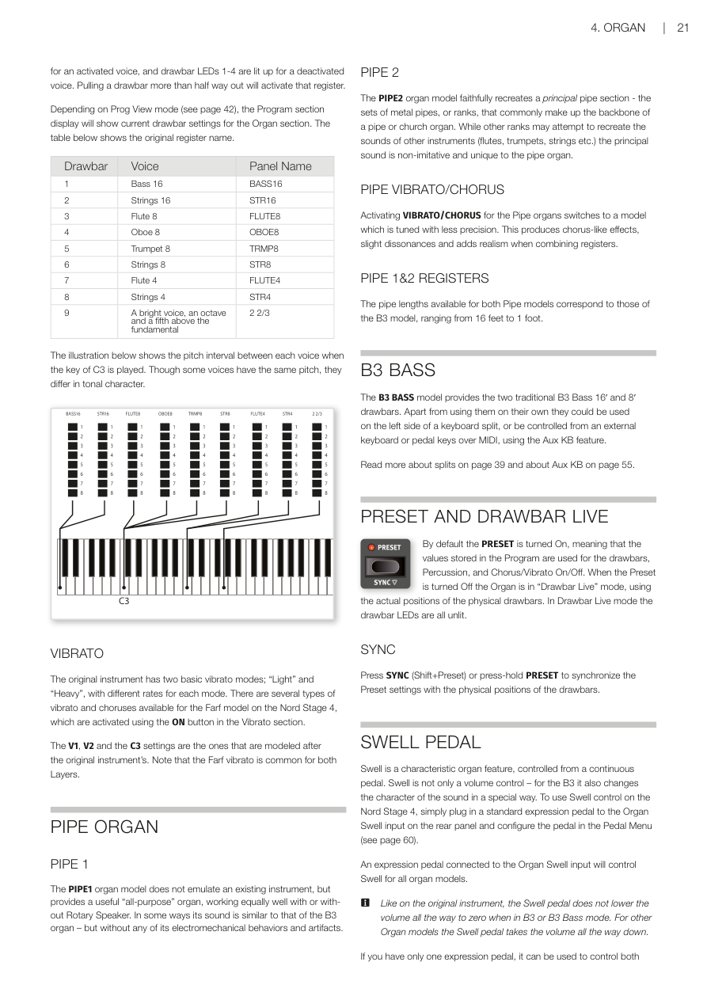

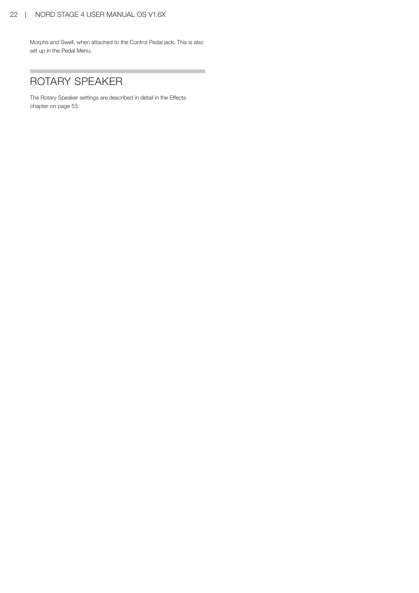

