# 第九章：音層效果 / Chapter 9: Layer Effects

---

## 概覽 / OVERVIEW

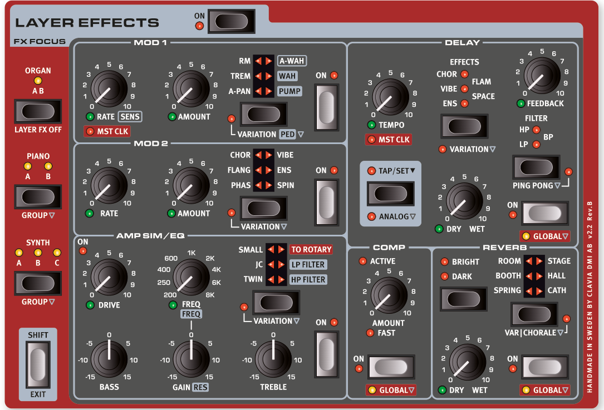

Nord Stage 4 的每個音層（Layer）都有一套獨立的效果器（Effects）。唯一的例外是風琴區段的 A 和 B 兩個音層，它們共用同一組效果鏈。也就是說，每個音色配置（Program）裡最多有六套獨立的效果設定，每套都可以有不同的參數。

Each Layer on the Nord Stage 4 has its own complete set of effects, apart from the two Organ Layers (A and B) which share the same effects chain. This means there are six instances of each effects unit for every Program, each of which can have its own settings.

旋轉喇叭（Rotary Speaker）效果器位在面板最左側，比較特別——每個音色配置只有一個旋轉喇叭，但任何音層都可以路由進去。不過旋轉速度和驅動量的設定是共用的，所有通過它的聲音都會套用相同的設定。

The Rotary Speaker, placed at the far left of the panel is different from other effects in that it comes in one single instance per Program. Any Layer can be routed to the Rotary Speaker, but its speed and drive settings are common for all sounds passing through it.

按下 **Layer Effects ON** 按鈕可以一次開關所有效果器。

All effects can be turned On or Off at once by pressing Layer Effects ON.

---

## 目標效果器 / FX FOCUS (EFFECTS FOCUS)

目標效果器（FX Focus）會自動跟著你在面板上按的音層按鈕走。比方說你按了鋼琴區段的 Layer A，效果區段的焦點就會自動切換到那個音層的效果。

The focus for the Layer Effects section automatically follows the focus of Layer buttons in the Organ, Piano and Synth sections, as they are pressed on the panel.

你也可以手動切換焦點：直接按 **ORGAN**、**PIANO** 或 **SYNTH** 按鈕，就能把目標效果器指定到那個區段。

Focusing the effects for a particular Layer or Section for editing can also be done manually, by pressing the ORGAN, PIANO or SYNTH button.

目前的目標效果器會用黃色 **FX FOCUS LED** 顯示，在各區段 On 按鈕旁邊，以及目標效果器區塊的 LED 上都可以看到。

The current FX Focus is indicated both by the yellow FX FOCUS LED next to each Section's On button, as well as by LEDs in the FX Focus section.

---

## 群組模式 / GROUP MODE

鋼琴和合成器區段的效果，可以設成每個音層各自獨立，也可以設成整個區段所有音層共用同一套效果。按 **GROUP**（Shift + Piano/Synth FX Focus）可以在這兩種模式之間切換。群組模式下，該區段所有 LED 都會亮起；音層模式下，只有目前焦點音層的 LED 亮著。

The effects for the Piano and Synth sections can either be independent per Layer or set to be shared for all its Layers. Pressing GROUP (Shift+Piano/Synth FX Focus) toggles between these two modes. In Group mode all LEDs for that Section are lit. In Layer mode, only the LED for the currently focused Layer is lit.

> 💡 切換到群組模式時，系統會把目前焦點音層的效果設定套用到該區段所有音層。離開群組模式後，所有音層會繼續共用同一套設定，直到你手動修改為止。

When entering Group mode, the settings for the currently focused Layers are applied to all Layers of that Group. When exiting Group mode all Layers will share the same settings for that effect, until modified manually.

---

## 開啟效果與全域模式 / ACTIVATING EFFECTS AND GLOBAL MODE

按效果器的 **ON** 按鈕就能啟用它。延遲（Delay）、壓縮器（Compressor）和殘響（Reverb）還有一個特殊的 **GLOBAL 全域模式**，開啟後這個效果會同時套用到所有區段的所有音層。開啟方式：按住 Shift 再按該效果的 On 按鈕。

To enable an effect, press its ON button. The Delay, Compressor and Reverb effects can be set to GLOBAL mode, which applies the effect to all Layers of all Sections. This is done by pressing Shift+On for that effect. When turning Global mode off all Layers will share the same settings for that effect, until modified manually.

> 💡 全域模式很適合用在殘響上——讓整台樂器所有聲音都通過同一個殘響空間，聽起來更有整體感。

---

---

## MOD 1（調變效果 1）/ MOD 1

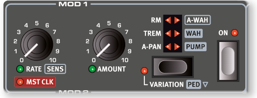

MOD 1 提供六種調變效果（Modulation Effects——用來讓聲音產生週期性變化的效果），用選擇按鈕切換。每種效果都有一個 **VARIATION（變奏）** 或 **PED（踏板）** 功能，按住 Shift 再按選擇按鈕就能啟用。

The MOD 1 unit offers six different types of modulation effects and its selector button is used to switch between them. For each effect there is a VARIATION or PED (Pedal) function, activated by pressing Shift+Selector button.

---

### A-PAN（自動聲像擺動）/ A-PAN (AUTO PAN)

A-PAN 是自動聲像擺動效果，讓聲音在左右聲道之間平滑來回移動，製造立體感的律動。用 **RATE** 旋鈕控制速度，**AMOUNT** 旋鈕控制左右移動的幅度。

The A-PAN is an automatic panning modulation that smoothly pans the signal between the Left and Right outputs in the stereo panorama. The rate and the amount of panning are controlled with the RATE and AMOUNT knobs.

VARIATION 模式會切換成更硬的波形形狀，做出電鋼琴經典的「顫音（vibrato）」感。

The VARIATION for the A-Pan effect is a harder pan waveform shape, providing the classic electric piano "vibrato" character.

---

### TREM（音量顫音）/ TREM (TREMOLO)

TREM 是音量顫音效果（Tremolo——讓音量週期性變化，聽起來像在「抖動」），電鋼琴上很常用。**RATE** 控制速度，**AMOUNT** 控制深度。注意：Amount 設為零時，音量反而是最大值。

TREM (Tremolo) provides a volume modulation that continuously varies the volume of the output signal. Tremolo is a very common effect to use with electric pianos. Use the RATE and AMOUNT knobs to control the Tremolo rate and its depth. Note that the output volume is at maximum level at zero Amount setting.

VARIATION 會切換成方波形狀，音量變化更生硬明顯，適合做「gate」斷音效果，或在高 Amount 設定下用作「切片（slicer）」效果。

The VARIATION for the Tremolo switches to a square wave shape, which gives a harder and more distinct volume modulation. Useful for gate-like sounds or as a "slicer" effect at high amounts.

---

### RM（環形調變）/ RM (RING MODULATION)

環形調變（Ring Modulation——把兩個訊號相乘，產生不和諧的金屬鐘聲感）是一種特殊的調變方式。Nord Stage 4 裡，樂器訊號會跟一個正弦波相乘。**Rate** 旋鈕調整正弦波的音高，**Amount** 控制效果的強弱。

Ring Modulation (RM) is a type of modulation where two signals are multiplied with each other, resulting in an in-harmonic "bell like" sound. In the Nord Stage 4 the instrument signal is multiplied with a sine wave. The pitch of the sine wave is set with the Rate knob and the amount of ring modulation with the Amount knob.

VARIATION 提供立體聲版本的環形調變效果。

The VARIATION mode provides a stereo version of the Ring Modulation effect.

---

### A-WAH（自動哇哇音）/ A-WAH

A-WAH（Auto-Wah——跟著演奏力度自動變化的哇哇音效果）跟下面介紹的 Wah-Wah 是親戚，差別在於它用訊號的音量大小（包絡線追蹤器）來驅動濾波器掃描，所以彈得越用力，哇哇音效果越明顯。**SENS（Rate）** 旋鈕控制靈敏度和掃描範圍，**Amount** 控制效果的乾/濕混合比例。

A-WAH (Auto-Wah) is a close relative to the Wah-Wah effect described below. The A-Wah uses the signal's amplitude (envelope follower) to control the filter sweep range, making the effect velocity sensitive. The sensitivity and range of the effect is controlled with the SENS (Rate) knob and the wet/dry mix with the Amount knob.

VARIATION 採用不同的模型，產生截然不同的音色特性。

The VARIATION of the A-Wah works in the same way, but is based on a different model which produces a distinctly different character.

---

### WAH（哇哇）/ WAH

WAH（Wah-Wah——用共振低通濾波器掃描頻率範圍，產生「哇～哇～」聲的效果器）在預設的非踏板模式下，**RATE** 旋鈕控制 LFO（低頻振盪器——用來產生週期性調變的振盪器）的速度，做出循環的哇哇感，可以模擬踩踏板的上下動作，或做慢速濾波器掃描。**AMOUNT** 旋鈕控制乾濕比例。

The WAH (Wah-Wah) modulation effect is a type of resonant lowpass filter that can be swept across the frequency range. During the sweep, the filter's characteristics also changes. In the default non-pedal mode the RATE knob controls the rate of an LFO, which provides a cyclic version of the classic Wah effect. The dry/wet mix of the effect is controlled with the AMOUNT knob.

在 **PED 踏板模式**下，可以接上控制踏板（Ctrl Ped 插孔）來手動控制哇哇位置。沒有踏板時，Rate 旋鈕控制濾波器的靜止位置。

In PED mode the Wah-Wah can be controlled by an expression pedal attached to the Ctrl Ped jack. With no expression pedal connected the Rate knob controls the static position of the filter. When a pedal is connected the filter position is instead controlled by the pedal.

> 💡 PED 模式下，Rate（頻率）仍然可以用變形（Morph）功能控制，可以設定踏板的掃描範圍，或讓其他來源控制它。

When set to PED, the Rate (frequency) of the effect can still be morphed, either for setting up a custom range for the pedal sweep or for control from other sources.

---

### PUMP

PUMP 效果提供一種振幅調變（Amplitude Modulation），效果類似壓縮器被外部側鏈訊號觸發的感覺：音量快速「壓下去」，然後慢慢恢復。在預設非踏板模式下，**RATE** 旋鈕控制 LFO 速度。

The PUMP effect provides a type of amplitude modulation which is otherwise achieved through the use of a compressor effect, often triggered by an external control signal through its side-chain input. The result is a quick "duck" in level, followed by a slower recovery phase.

> 💡 常見用法：把 PUMP 同步到主節拍時鐘（Master Clock），設定速率為四分音符（1/4），做出舞曲常用的「側鏈壓縮」感。

A common application for the Pump effect would be to synchronize it to the Master Clock and set the rate to quarter notes (1/4).

在 **PED 踏板模式**下，PUMP 效果可以用腳踏板手動控制，例如配合大鼓節奏踩踏。可以用 Nord Triple Pedal 的左側或中間踏板，或接在 Foot Switch 插孔的踏板。

In PED mode the Pump effect can be controlled from a foot pedal, and "played" manually, for instance in sync with a kick drum.

---

### 與主節拍時鐘同步 / MASTER CLOCK

選擇 A-Pan、Trem、LFO-Wah 或 Pump 效果時，把 **RATE** 旋鈕往右轉到底，就可以把 Mod 1 的速率同步到主節拍時鐘（Master Clock——全局節奏控制器）。在 MST CLK 模式下，速率會以主節拍時鐘節拍的細分值來顯示。

With the A-Pan, Trem, LFO-Wah or Pump effect selected, turning the RATE dial clockwise synchronizes the Mod 1 Rate with the Master Clock. In MST CLK mode, the Rate is presented as subdivisions of the Master Clock tempo.

---

---

## MOD 2（調變效果 2）/ MOD 2

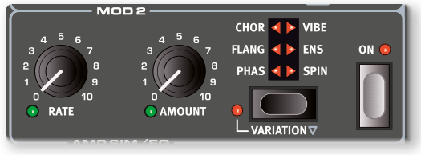

MOD 2 提供多種經典和創新的調變效果，每種都有 VARIATION，按住 Shift 再按選擇按鈕啟用。**RATE** 旋鈕控制速率，**AMOUNT** 旋鈕（支援變形 Morph）控制強度。

MOD 2 provides a selection of both classic and innovative modulation effects, each with a VARIATION, which is activated by pressing Shift + the Selector button. Each effect has its rate controlled by the RATE knob, and its amount by the likewise morphable AMOUNT knob.

---

### PHASER（相位效果）/ PHASER

相位效果（Phaser——通過移動音訊訊號的相位，產生「掃頻」的沙沙感）常用在電鋼琴音色上。標準設定基於經典的 Small Stone 效果器，Amount 最小時 feedback 為零，調大 Amount 可增加 feedback 和音色「顏色」。

The PHASER effect produces a characteristic "sweep" effect, commonly used with electric piano sounds. The standard Phaser setting is based on the classic Small Stone effect, and has zero feedback at the minimum amount setting. The Amount knob increases the feedback and "color" of the effect.

VARIATION 模擬經典的 Bi-Phase 效果。

The Phaser VARIATION is an emulation of the classic Bi-Phase effect, with zero feedback at the minimum Amount.

---

### FLANGER（鑲邊效果）/ FLANGER

鑲邊效果（Flanger——把訊號和一個微小延遲的副本疊加，產生「梳狀濾波」的金屬掃頻感）能讓聲音聽起來很「飄」，帶有共鳴感。Amount 為零時，只有靜態的共鳴峰。VARIATION 是單聲道版本。

The FLANGER produces a dramatic comb filter effect, giving the sound a "swooshy" and resonant quality. At zero amount the effect provides a set of static resonant peaks. The VARIATION is a mono version of the Flanger effect.

---

### VIBE

VIBE 效果靈感來自經典腳踏板效果器，同時結合音高彎曲和相位的特性，音色獨特。它是透過一系列錯位的相位濾波器模型製作，跟一般相位效果有所不同。VARIATION 是單聲道版本。

The VIBE effect draws its inspiration from a classic foot pedal effect and produces a sound with both pitch-bending and phasing qualities. The VARIATION is a mono version of the Vibe effect.

---

### CHORUS（合聲效果）/ CHORUS

合聲效果（Chorus——把聲音複製多份並稍微調音，讓音色聽起來更厚、更寬廣）讓聲音更豐富。Amount 超過 50% 後還會加入延遲線，聲音更複雜。VARIATION 基於一款老式效果踏板，可以從豐潤的立體加寬感，調到高速率、高 Amount 下明顯的顫音（vibrato）效果。

The versatile CHORUS effect gives the impression of "widening", or with more extreme settings severely detuning, the sound. The VARIATION of the Chorus effect is based on a vintage effects pedal which can go from a lush stereo widening effect to a distinctive vibrato character at higher Rate and Amount settings.

---

### ENSEMBLE（合奏效果）/ ENSEMBLE

合奏效果（Ensemble——模擬多人演奏同一個音符時的微小音高差異感）是仿照老式 Eminent 風琴效果器設計的。聲音被送進三條獨立、相互交叉連接的調變延遲線，形成非常有特色的音色。VARIATION 是單聲道版本。

The ENS (Ensemble) effect is modeled after a vintage Eminent organ effect. The very characteristic sound comes from feeding the audio into three separate, modulated delay lines, that are cross-connected with each other. In VARIATION mode the Ensemble effect is in mono.

---

### SPIN（旋轉效果）/ SPIN

SPIN 跟旋轉喇叭（Rotary Speaker）類似，也是模擬旋轉喇叭的感覺，但音色更中性，沒有低音鼓和高音號的分離感。速率變化時會漸進式地改變速度，很自然。VARIATION 模式下，旋轉效果從主要影響高頻，改為主要影響低頻。

Like the Rotary Speaker, the SPIN effect emulates the sound of a rotating speaker, but with a more neutral character and without the separate rotor and horn components. In VARIATION mode the movement of the Spin effect is shifted from mostly affecting the treble range to instead affect lower frequencies.

---

## 延遲 / DELAY

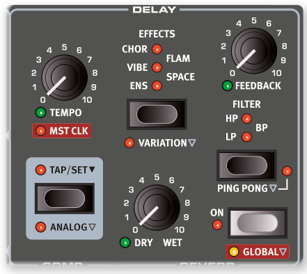

延遲（Delay——讓聲音產生回聲/重複效果的效果器）用 **TEMPO** 旋鈕設定延遲時間。按住 Shift 再按 On 可設為全域（GLOBAL）模式，讓延遲套用到所有區段所有音層。

The DELAY unit produces echo/repeat effects. The Delay time is set with the TEMPO knob. The Delay can be set to GLOBAL mode (Shift + On) which applies it to all Layers of all three Sections.

如果主節拍時鐘（MST CLK）已啟用，Tempo 會改以主節拍時鐘節拍的細分值表示。

If MST CLK (Master Clock) is active, the Tempo will instead be expressed in subdivisions of the tempo set for the Master Clock.

**FEEDBACK** 旋鈕控制重複次數：最小值只有一次回聲，最大值則是很長的回聲尾巴。**DRY WET** 旋鈕調整乾音和延遲訊號的比例。

The FEEDBACK knob controls the number of delay repeats. The DRY WET knob adjusts the balance between the dry signal and the delay repeats.

---

### PING PONG（乒乓延遲）/ PING PONG

按 **PING PONG**（Shift + Filter）啟用乒乓模式：延遲的回聲會在左右聲道之間交替出現。短延遲時間下，這些回聲會很「不對稱」，聽起來像殘響單元裡的早期反射聲。

Press PING PONG (Shift + Filter) to activate Ping Pong mode. This causes delay repeats to alternate between the left and right channels.

---

### TAP TEMPO（拍速輸入）/ TAP TEMPO

用 **TAP TEMPO** 按鈕配合歌曲節奏敲擊數次，延遲時間就會自動對齊。就算開了 Analog 模式，敲擊也不會改變目前正在響的回聲音高。

Use TAP TEMPO to set a delay time matching the tempo of a song. Simply tap the Tap Tempo button in the tempo you wish the delay to sync to a number of times. Tapping will never result in a pitch change of current repeats, even if Analog mode is activated.

---

### 延遲內建效果 / DELAY EFFECTS

用選擇按鈕可以選擇延遲回授迴路裡的效果。這些效果只作用在延遲訊號上，不影響乾音；隨著每次回聲，效果會越來越強。

Use the selector button to select one of the effects available for the Delay feedback loop. These effects do not affect the sound of the Dry signal, but only the sound fed into the delay, becoming increasingly intense with each delay tap.

- **ENS（合奏）、VIBE、CHOR（合唱）**：與 MOD 2 效果單元裡的對應效果相同。
- **FLAM**：立體聲乒乓延遲，左右聲道時間稍微錯開，適合做空間感或複雜音色。VARIATION 把兩聲道的時間差從 20ms 加倍到 40ms。
- **SPACE**：加入類似殘響的擴散感，每次回聲越來越濃。標準模式下，效果訊號和乾音各佔 50%；VARIATION 模式下效果訊號為 100% 效果音。

The ENS (Ensemble), VIBE and CHOR (Chorus) effects are based on their counterparts in the MOD 2 effects unit. The stereo FLAM effect produces a ping pong delay with offset left and right channels. The SPACE effect introduces reverb-like diffusion, increasing in intensity with each tap.

---

### 延遲濾波器 / DELAY FILTERS

延遲濾波器區段的濾波器用來塑造延遲的音色，特別適合在大量 feedback 時使用，讓每次回聲的聲音越來越被濾波。

The filters in the delay FILTER section are great tools for shaping the delay sound, especially when large feedback amounts are used.

- **LP（低通）**：過濾高頻，讓回聲越來越暗。
- **HP（高通）**：過濾低頻，讓長延遲尾巴不那麼混濁。
- **BP（帶通）**：同時過濾高低頻，讓聲音變得細而窄。

With the LP setting, all delay taps are passed through a Low Pass filter. The HP setting provides a High Pass filter. The BP setting adds a Band Pass filter.

---

### 類比模式 / ANALOG MODE

延遲有兩種模式：普通模式和 **ANALOG（類比）模式**（Shift + Tap/Set）。類比模式下，如果改變 Tempo，正在響的回聲音高也會跟著改變——就像老式類比延遲器的感覺。另外，每次回聲也會帶有輕微失真，且各濾波器設定的音色特性跟普通模式稍有不同。

There are two different delay modes, the normal mode, and the ANALOG (Shift+Tap/Set). In Analog Mode the pitch of any sounding repeats is altered if the tempo is changed – much like with a vintage analog delay. A slight distortion is also introduced into the delay line with each tap.

---

### 延遲與主節拍時鐘同步 / DELAY MASTER CLOCK

把 **MST CLK**（Shift + Tempo 旋鈕）往右轉到底，延遲就會同步到音色配置區段設定的主節拍時鐘節奏。延遲 Tempo 會以主節拍時鐘節拍的細分值表示，從 1/2 到 1/32 拍，另外還有 swing（S）、三連音（T）和附點（D）可以選擇。

The Master Clock feature for the Delay section is activated by turning MST CLK (Shift + Tempo knob) clockwise. The Delay tempo will now be expressed in subdivisions of the Master Clock tempo, ranging from 1/2 to 1/32 notes, with swing (S), triplet (T) and dotted (D) options.

---

---

## 擴大機模擬/等化器 / AMP SIM/EQ

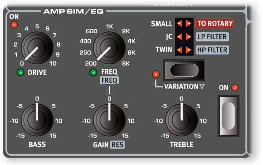

AMP SIM/EQ 效果單元結合了三段等化器（EQ——調整不同頻率的音量）和精密的擴大機與喇叭箱模擬，另外還有共振式 24dB 低通和高通濾波器。如果沒有選擇 Amp 模型或濾波器，這個區段就是一個中性的等化器加上電子管風格的過載（overdrive）。

The AMP SIM/EQ effects unit combines a three-band equalizer with sophisticated amplifier and speaker cabinet simulations. It also includes resonant 24 dB low-pass and high-pass filters. When no Amp Model or filter is selected, the Amp Sim/EQ section provides a neutral EQ and tube style overdrive.

---

### 過載 / DRIVE

可支援變形（Morph）的 **DRIVE** 旋鈕提供電子管風格的過載效果，或在選擇了 Amp 模型時控制過載量。Drive LED 亮起時代表過載已啟用。

The morphable DRIVE provides a tube style overdrive effect or, if an Amp model is selected, controls the amount of overdrive for the selected Amp model. The Drive LED indicates that the overdrive is active.

---

### 等化器區段 / EQ SECTION

三段等化器包含低音（Bass）、可掃頻的中音（Mid）和高音（Treble）控制。低音頻率固定在 100 Hz，高音固定在 4 kHz，中音頻率（支援 Morph）可用 **FREQ** 旋鈕調整，範圍 200 Hz 到 8 kHz。增益/衰減範圍 ±15 dB。

A three band equalizer with Bass, sweepable Mid and Treble controls. The BASS frequency is 100 Hz, the TREBLE frequency is 4 kHz and the morphable MID frequency can be set between 200 Hz to 8 kHz. The boost/cut range is +/- 15 dB.

---

### 擴大機模型 / AMP MODEL

用 Amp Model 區段的選擇按鈕可切換三種不同的擴大機/喇叭箱模擬：

The three different amplifier/speaker simulations are selected with the Selector button in the Amp Model section:

| 模型 | 描述 |
|------|------|
| **TWIN** | 經典電子管擴大機和喇叭箱的模擬。VARIATION 改變頻率響應，高音提升較少，中頻特性也不同。 |
| **JC** | Jazz Chorus 喇叭箱加電子管擴大機的模擬。VARIATION 降低高音，改變中頻響應。 |
| **SMALL** | Wurlitzer 200A 內建喇叭加電子管擴大機的模擬。VARIATION 模擬更小的擴大機和喇叭。 |

| Model | Description |
|-------|-------------|
| TWIN | A simulation of a classic tube amplifier and speaker cabinet. VARIATION changes the frequency response to a version with less treble boost. |
| JC | A simulation of a Jazz Chorus speaker cabinet, powered by a tube amp. VARIATION reduces treble and changes the mid-range response. |
| SMALL | A simulation of a Wurlitzer 200A internal speaker, powered by a tube amp. VARIATION represents an even smaller amp and speaker model. |

> 💡 TWIN 和 JC 模型會大幅提升高頻，視音色而定可能需要用 EQ 來平衡。

---

---

## 路由至旋轉喇叭 / TO ROTARY

**TO ROTARY** 設定會把目前焦點音層的訊號路由到旋轉喇叭效果器（位在面板最左側）。其他效果仍可照常使用。一般情況下，旋轉喇叭位於效果鏈末端；全域殘響則位於旋轉喇叭之後，詳見本章「全域模式與殘響位置」。

The TO ROTARY setting sends the focused Layer to the Rotary Speaker effect, which has its controls placed at the far left of the panel (see further down).

Other effects can still be used as usual, but note that the Rotary Speaker is the last effect unit in the effects chain, so any other effects that are applied to the Layer will be placed before the Rotary Speaker.

> 譯註：原文此處的「最後一個效果單元」須搭配下方 Global Reverb 的例外說明閱讀。

---

## LP 24 濾波器 / LP 24 FILTER

LP24 是一個共振式低通濾波器（Low Pass Filter——只讓低於截止頻率的聲音通過），每倍頻程衰減 24 dB，坡度很陡。**FREQ** 旋鈕（支援 Morph）調整截止頻率，**RES** 旋鈕控制截止點附近的共鳴量。

The LP24 filter is a resonant 24 dB per octave low-pass filter. Use the morphable FREQ knob to adjust the cutoff frequency, and the RES knob to set the amount of resonance.

> 💡 LP24 可以當踏板哇哇音效果來用：用控制踏板（Control Pedal）來 Morph 截止頻率，再調整共鳴到喜歡的感覺。

---

## HP 24 濾波器 / HP 24 FILTER

HP24 是共振式高通濾波器（High Pass Filter——只讓高於截止頻率的聲音通過），每倍頻程衰減 24 dB。**FREQ** 旋鈕（支援 Morph）調整截止頻率，**RES** 旋鈕控制共鳴量。

The HP24 filter is a resonant 24 dB per octave high-pass filter. The morphable FREQ knob adjusts the cutoff frequency, and the RES knob controls the amount of resonance.

低音和高音等化器，以及過載效果，在 HP24 和 LP24 兩種設定下都可以使用。

The Bass and Treble equalizer bands, as well as the Drive effect are available for both the HP24 and the LP24 effect settings.

---

## 壓縮器 / COMPRESSOR

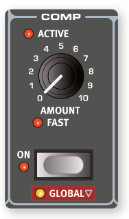

壓縮器（Compressor——縮小聲音的動態範圍，讓小聲的部分更大聲、大聲的部分更安靜）讓聲音聽起來更緊湊有力，現場演出時整體音量也更好控制。按 **ON** 按鈕啟用，**AMOUNT** 旋鈕控制壓縮量。

The COMPRESSOR effect reduces the dynamic range of the sound, making low levels louder and high sound levels more quiet. This produces a tight, punchy sound. The Compressor is activated with its ON button. The AMOUNT knob controls the amount of compression applied.

壓縮器可以設為全域（GLOBAL）模式（Shift + On），套用到所有區段所有音層。

The Compressor can be set to GLOBAL mode (Shift + On) which applies it to all Layers of all three Sections.

---

### 快速模式 / FAST MODE

**FAST 模式**（Shift + Amount 旋鈕）讓壓縮器觸發後恢復更快。搭配高 Amount 設定，會製造出明顯的「pumping（脈衝）」壓縮感。

The FAST mode (Shift + Amount knob) makes the Compressor recover quicker after being triggered. With high Compressor Amount this will create a "pumping" and more obviously compressed sound.

---

## 殘響 / REVERB

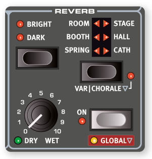

殘響（Reverb——模擬聲音在各種空間中的自然反射效果）提供六種不同長度和密度的殘響類型，用六段選擇器的 LED 指示。

The REVERB unit simulates the natural sound reflections in various acoustic environments. There are six Reverb Types of various lengths and densities.

左側三種類型有 VARIATION；右側三種可設定 **CHORALE（合唱）模式**，增加殘響訊號裡的音高調變，讓聲音更有活力。按住 Shift 再按選擇按鈕啟用 Variation/Chorale。

Reverb Types on the left side of the selector all have a VARIATION. Types on the right side can all be set to CHORALE, which increases the pitch modulation in the Reverb signal. Variation/Chorale is activated with Shift+Selector button.

支援 Morph 多參數控制的 **DRY/WET** 旋鈕可調整未經處理的乾音與處理後的殘響訊號之間的比例。

The morphable DRY/WET control sets the balance between the unprocessed and the processed signal.

> 💡 DRY/WET 轉至最大值時會輸出完全效果音（fully wet），可用於 Morph 效果或音層混合。
>
> The Dry/Wet control provides a fully wet Reverb signal at its max position, a sound which can be useful both for morph effects, or when blending Layers.

### 全域模式與殘響位置 / GLOBAL MODE AND REVERB PLACEMENT

殘響可設為 **GLOBAL** 模式（Shift + On），套用到三個區段的所有音層。設為全域模式時，殘響效果位於**旋轉喇叭與各音層音量推桿之後**。

The Reverb can be set to GLOBAL mode (Shift+On) which applies it to all Layers of all three Sections. When set to Global mode, the Reverb effect is placed after both the Rotary Speaker and the Volume Level fader of each Layer.

---

### 殘響類型 / REVERB TYPES

| 類型 | 說明 |
|------|------|
| **SPRING（彈簧殘響）** | 重現傳統彈簧殘響槽的聲音，常見於音輪風琴、吉他擴大機等設備。VARIATION 提供不同特性，殘響時間更長。 |
| **BOOTH（小室）** | 極短衰減時間的小空間感。VARIATION 增加前置延遲時間，即使高 Amount 也能保留清晰的音符發音。 |
| **ROOM（房間）** | 衰減時間較短的房間感殘響。VARIATION 同樣增加前置延遲時間。 |
| **STAGE（舞台）** | 中等衰減時間，自然的室內空間感。CHORALE 模式增加音高調變，讓殘響更有活力。 |
| **HALL（大廳）** | 寬廣大廳的衰減和音色，衰減時間較長。CHORALE 模式增加音高調變。 |
| **CATH（大教堂）** | 超大型空間，衰減時間非常長。CHORALE 模式增加音高調變。 |

| Type | Description |
|------|-------------|
| SPRING | Reproduces the sound of a spring reverb tank. VARIATION provides a different character and longer reverb time. |
| BOOTH | Small room with very short decay time. VARIATION increases the pre-delay time. |
| ROOM | Room with relatively short decay time. VARIATION adds a longer pre-delay time. |
| STAGE | Medium length decay time and natural room ambience. CHORALE increases pitch modulation. |
| HALL | Spacious hall with long decay. CHORALE increases pitch modulation. |
| CATH | Very large immersive reverb with very long decay. CHORALE increases pitch modulation. |

所有類型都可以選擇 **BRIGHT（明亮）** 或 **DARK（暗沉）** 模式：BRIGHT 模式保留更多高頻；DARK 模式衰減高頻。

The BRIGHT or DARK mode can be used for all Types to alter the frequency response of the Reverb.

---

---

## 旋轉喇叭 / ROTARY SPEAKER

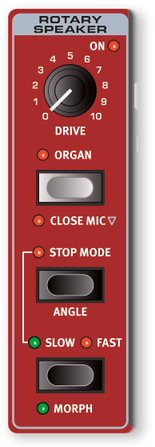

旋轉喇叭效果重現旋轉高頻號角與低頻轉子的聲音，並模擬原始旋轉喇叭內建擴大機的特性。

The Rotary Speaker effect accurately reproduces the sound of the rotating horn and bass rotor, as well as the characteristics of the built-in amplifier of the original rotary construction.

- 搭配風琴：按下旋轉喇叭區段的 **ORGAN** 按鈕。
- 搭配鋼琴或合成器：在該音層的 Amp/EQ 效果中啟用 **TO ROTARY**。
- 按下 **SLOW/STOP–FAST** 按鈕，切換慢速與快速。要停止轉子，先啟用 **STOP MODE**，再將速度設為 **SLOW/STOP**。
- 啟用 Stop Mode 後，可按 **ANGLE**（Shift + Stop Mode）選擇轉子停止時的位置；**Free** 表示不固定位置。
- 低頻轉子與高頻號角的速度及加減速特性可在 Sound Menu 設定，詳見第 58 頁。
- 旋轉速度可由 Morph 多參數控制來源連續控制。設定時，按住任一 Morph Assign 按鈕並按下 Rotary Speed 按鈕；MORPH LED 亮起表示已有 Morph 指派。
- **CLOSE MIC**（Shift + Organ）模擬麥克風更靠近高頻號角，可產生更明顯的立體聲效果與旋轉聲感。此設定隨音色配置儲存。

The most common use for the Rotary Speaker would be to combine it with an Organ sound, which is achieved by pressing ORGAN in the Rotary Speaker section. To use the Rotary Speaker with sounds from the Piano and Synth sections, activate TO ROTARY in the Amp/EQ effects unit for the Layer that should be sent to the Rotary Speaker.

Switch between fast and slow rotor speeds by pressing the SLOW/STOP-FAST button. To stop the rotors, press the STOP MODE button and set the speed to SLOW/STOP. To have the speaker sound exactly the same every time Stop Mode is active, select ANGLE by pressing Shift+Stop Mode and choose one of the positions from the list. This way the rotor and horn will always stop at the same positions. With the default Free setting, the Stop Mode sound will vary depending on the angles at which the horn and rotor have stopped.

The rotor and horn acceleration rates, i.e. the time it takes to go from slow to fast and vice versa, can be adjusted in the Sound menu, read more on page 58.

The Rotary speed can be continuously controlled with a Morph source, making it possible to set the rotary at speeds other than just fast, slow or stopped. Set this up by holding down any of the Morph Assign buttons and pressing the Rotary speed button. An active morph is indicated by the MORPH LED being lit.

Pressing CLOSE MIC (Shift+Organ) switches to a version of the Rotary Speaker which is modelled with the microphones placed closer to the horn speaker. This produces a more pronounced stereo effect and an increased sense of motion. This setting is stored per program.

**DRIVE** 旋鈕控制前級擴大機的過載量。可透過接在 Rotor Pedal 輸入的延音踏板或腳踏開關控制旋轉速度；Compact 型號也可使用 Nord Half Moon Switch。踏板設定詳見第 61 頁。

The DRIVE knob controls the amount of overdrive. This simulates the pre-amplifier overdrive of the original rotary speakers. A sustain pedal or a foot switch that is connected to the Rotor pedal input can control the rotor speed. On the Nord Stage 4 Compact model, the optional Nord Half Moon Switch can be used for switching Rotary speed in an even more traditional fashion. Read more about rotor control on page 61.

> 原文提示：Rotary Drive 的作用程度會受輸入音層的音量影響。音層音量較低時，可產生的失真也較少。

### 旋轉喇叭與殘響 / ROTARY SPEAKER AND REVERB

一般模式下，路由至旋轉喇叭的音層會先經過殘響，再進入旋轉喇叭。**若殘響設為 Global 模式，順序相反：殘響位於旋轉喇叭之後。**

On any Layer that is routed to the Rotary Speaker, the Reverb, like all other effects, is applied before the Rotary Speaker unless the Reverb is set to Global mode, in which case the Reverb is placed after the Rotary Speaker.

### 旋轉喇叭選單設定 / ROTARY MENU SETTINGS

Sound Menu 提供旋轉喇叭行為與聲音特性的詳細設定，請見第 58 頁。

There are several parameters in the Sound Menu that allow for detailed adjustments of the behavior and sound of the Rotary Speaker. Read more about this on page 58.

1.6x 原文整頁參考

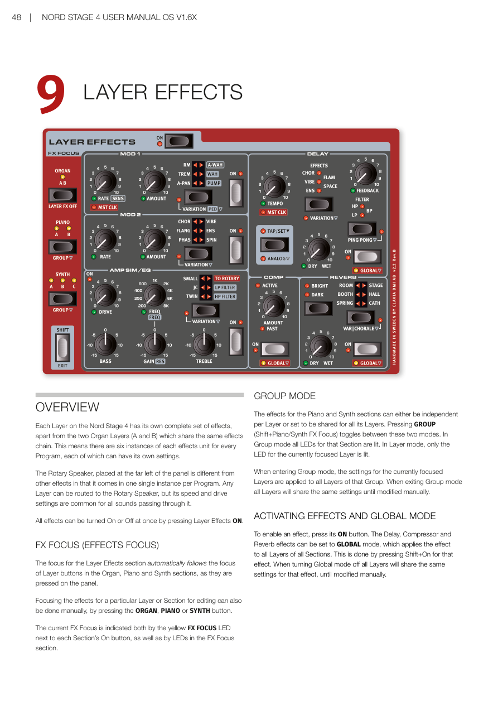

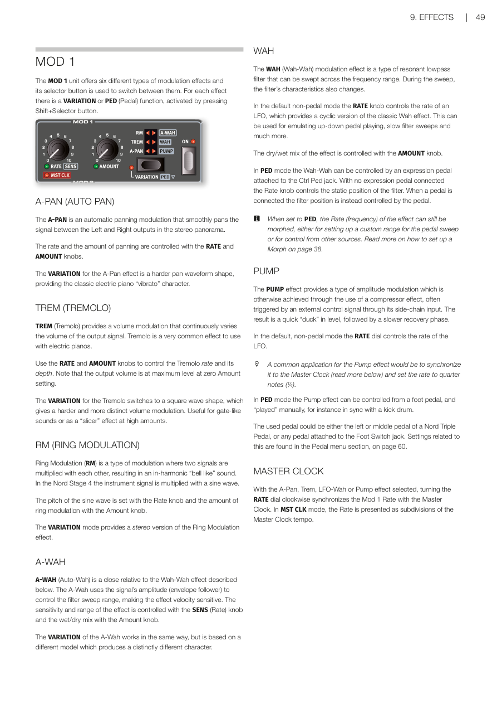

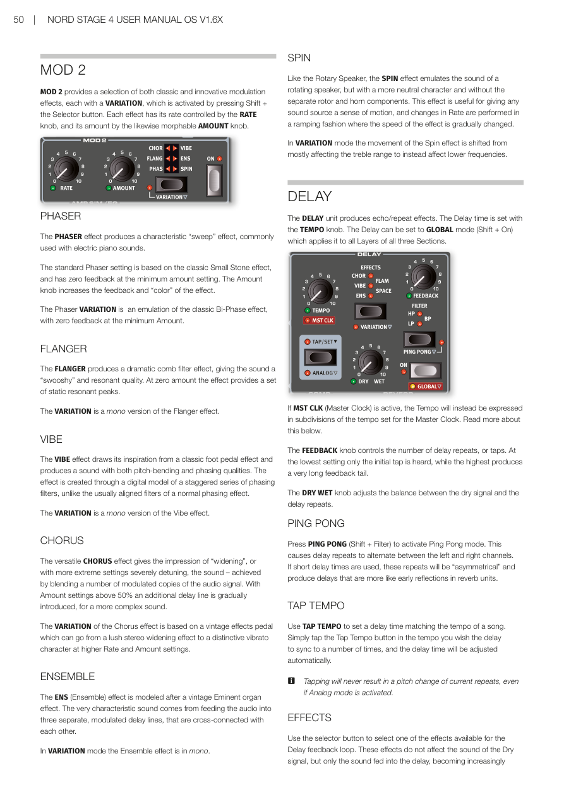

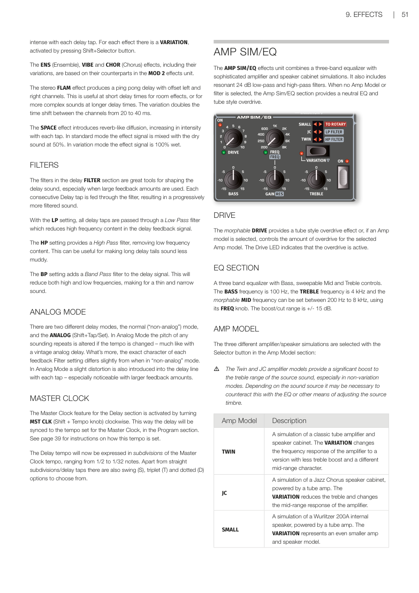

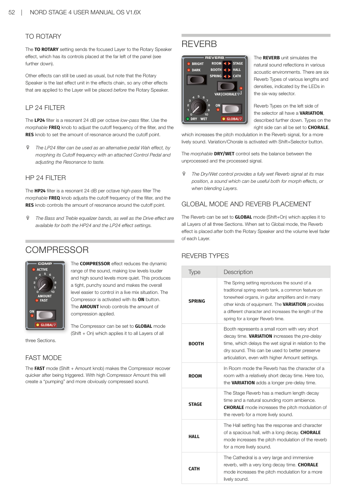

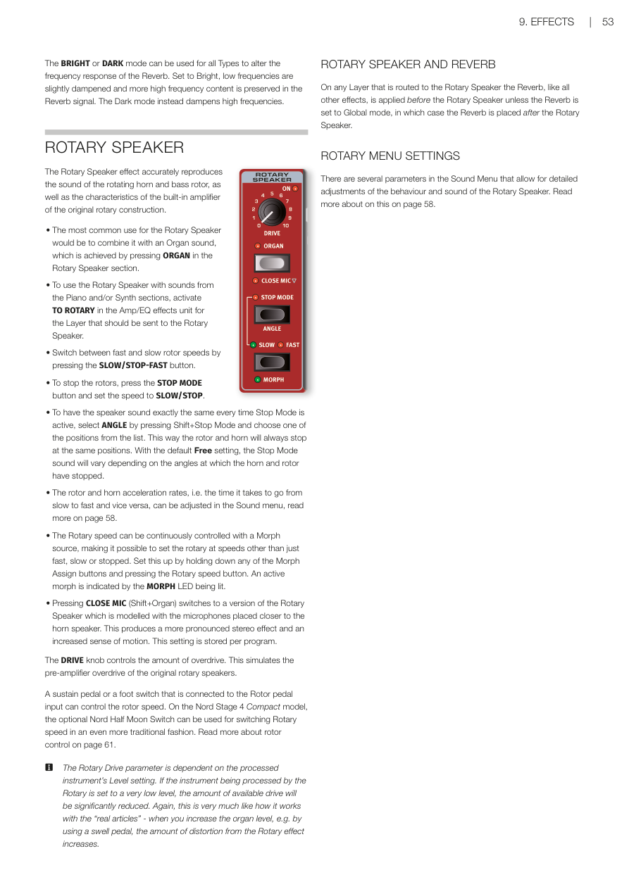

