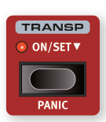
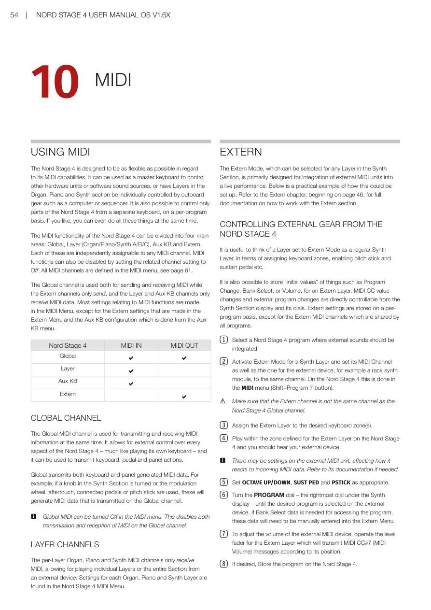
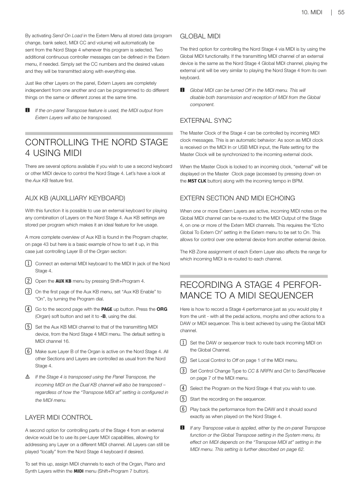
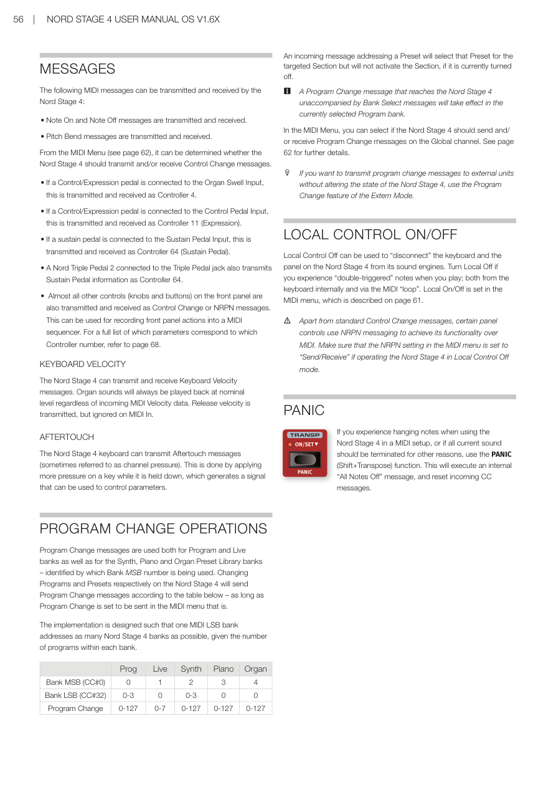

# 第十章：MIDI / Chapter 10: MIDI

---

## 使用 MIDI / USING MIDI

Nord Stage 4 在 MIDI 功能方面設計得盡可能靈活，可用作主控鍵盤來控制其他硬體裝置或軟體音源，或讓風琴、鋼琴和合成器區段中的各音層由外部裝置（如電腦或編曲機）個別控制，也可以在每個音色配置的基礎上，讓另一台鍵盤只控制 Nord Stage 4 的部分功能，甚至可以同時做所有這些事情。

The Nord Stage 4 is designed to be as flexible as possible in regard to its MIDI capabilities. It can be used as a master keyboard to control other hardware units or software sound sources, or have Layers in the Organ, Piano and Synth section be individually controlled by outboard gear such as a computer or sequencer. It is also possible to control only parts of the Nord Stage 4 from a separate keyboard, on a per-program basis. If you like, you can even do all these things at the same time.

Nord Stage 4 的 MIDI 功能分為四個主要區域：**全域（Global）**、**音層（Layer，風琴/鋼琴/合成器 A/B/C）**、**輔助鍵盤（Aux KB）**和**外部 MIDI（Extern）**。每個都可以獨立指定到任意 MIDI 通道。將相關通道設定為 Off 也可以停用 MIDI 功能。所有 MIDI 通道都在 MIDI 選單中定義，詳見第 61 頁。

The MIDI functionality can be divided into four main areas: Global, Layer (Organ/Piano/Synth A/B/C), Aux KB and Extern. Each of these are independently assignable to any MIDI channel. All MIDI channels are defined in the MIDI menu, see page 61.

全域通道用於同時發送和接收 MIDI；Extern 通道只發送；音層和 Aux KB 通道只接收 MIDI 資料。大多數 MIDI 相關設定在 MIDI 選單中進行，Extern 設定在 Extern 選單中，Aux KB 設定在 Aux KB 選單中。

The Global channel is used both for sending and receiving MIDI while the Extern channels only send, and the Layer and Aux KB channels only receive MIDI data.

---

## 全域通道 / GLOBAL CHANNEL

**全域 MIDI 通道（Global MIDI Channel）**同時用於發送和接收 MIDI 資訊，讓外部裝置可以完全控制 Nord Stage 4——就像在自己的鍵盤上演奏一樣——也可以用於發送鍵盤、踏板和面板操作。

The Global MIDI channel is used for transmitting and receiving MIDI information at the same time. It allows for external control over every aspect of the Nord Stage 4 – much like playing its own keyboard – and it can be used to transmit keyboard, pedal and panel actions.

全域通道同時發送鍵盤和面板產生的 MIDI 資料。例如，轉動合成器區段的旋鈕或使用調變輪、二段觸鍵感應、連接的踏板或音高控制桿，都會產生在全域通道上傳輸的 MIDI 資料。

Global transmits both keyboard and panel generated MIDI data. For example, if a knob in the Synth Section is turned or the modulation wheel, aftertouch, connected pedals or pitch stick are used, these will generate MIDI data transmitted on the Global channel.

> 💡 全域 MIDI 可以在 MIDI 選單中關閉，這會同時停用全域通道上 MIDI 的發送和接收。

Global MIDI can be turned Off in the MIDI menu. This disables both transmission and reception of MIDI on the Global channel.

---

## 音層通道 / LAYER CHANNELS

每個音層的風琴、鋼琴和合成器 MIDI 通道**只接收** MIDI，讓外部裝置可以演奏個別音層或整個區段。每個風琴、鋼琴和合成器音層的設定都在 Nord Stage 4 MIDI 選單中找到。

The per-Layer Organ, Piano and Synth MIDI channels only receive MIDI, allowing for playing individual Layers or the entire Section from an external device.

---

## 外部 MIDI 控制（Extern）/ EXTERN

**外部 MIDI 控制（Extern）**模式可以為合成器區段中的任意音層選擇，主要設計用於將外部 MIDI 裝置整合到現場演出中。詳見第 46 頁開始的外部控制章節。

The Extern Mode, which can be selected for any Layer in the Synth Section, is primarily designed for integration of external MIDI units into a live performance. Refer to the Extern chapter, beginning on page 46, for full documentation.

---

## 從 Nord Stage 4 控制外部裝置 / CONTROLLING EXTERNAL GEAR FROM THE NORD STAGE 4

把設定為 Extern 模式的音層想成一個普通的合成器音層，在分配鍵盤分區、啟用音高控制桿和延音踏板等方面都是一樣的。也可以為 Extern 音層儲存音色配置切換、音色庫組選擇或音量等的「初始值」。

It is useful to think of a Layer set to Extern Mode as a regular Synth Layer, in terms of assigning keyboard zones, enabling pitch stick and sustain pedal etc.

**設定步驟**：

1. 選擇一個需要整合外部音色的 Nord Stage 4 音色配置。/ Select a Nord Stage 4 program where external sounds should be integrated.
2. 為合成器音層啟用 Extern 模式，並將其 MIDI 通道以及外部裝置（例如機架合成器模組）的 MIDI 通道設定為相同通道。在 Nord Stage 4 上，這在 MIDI 選單（Shift + Program 7 按鈕）中設定。/ Activate Extern Mode for a Synth Layer and set its MIDI Channel as well as the one for the external device to the same channel in the MIDI menu (Shift+Program 7 button).

   > ⚠️ 確保 Extern 通道與 Nord Stage 4 全域通道不同。

3. 將 Extern 音層指定到所需的鍵盤分區。/ Assign the Extern Layer to the desired keyboard zone(s).
4. 在 Nord Stage 4 上，在為 Extern 音層定義的分區內演奏，應該可以聽到外部裝置發聲。/ Play within the zone defined for the Extern Layer and you should hear your external device.
5. 適當設定 OCTAVE UP/DOWN、SUST PED 和 PSTICK。/ Set OCTAVE UP/DOWN, SUST PED and PSTICK as appropriate.
6. 轉動合成器顯示幕下方最右側的 PROGRAM 控制旋鈕，直到在外部裝置上選到所需的音色配置。如果存取音色配置需要音色庫組選擇資料，這些資料需要手動輸入 Extern 選單。/ Turn the PROGRAM dial until the desired program is selected on the external device.
7. 若要調整外部 MIDI 裝置的音量，操作 Extern 音層的音量推桿，它會根據位置發送 MIDI CC#7（MIDI Volume）訊息。/ To adjust the volume of the external MIDI device, operate the level fader for the Extern Layer which will transmit MIDI CC#7 (MIDI Volume) messages.
8. 如需要，在 Nord Stage 4 上儲存音色配置。/ Store the program on the Nord Stage 4 if desired.

---

---

在 Extern 選單中啟用「Send On Load（載入時發送）」後，每次選取這個音色配置時，所有儲存的資料（音色配置切換、音色庫組選擇、MIDI CC 和音量）都會自動從 Nord Stage 4 發送。如需要，可以在 Extern 選單中定義兩個額外的連續控制器訊息。

By activating Send On Load in the Extern Menu all stored data (program change, bank select, MIDI CC and volume) will automatically be sent from the Nord Stage 4 whenever this program is selected.

和面板上的其他音層一樣，Extern 音層彼此完全獨立，可以音色配置化為同時在相同或不同分區進行不同的操作。

Just like other Layers on the panel, Extern Layers are completely independent from one another and can be programmed to do different things on the same or different zones at the same time.

> 💡 如果使用面板上的移調功能，Extern 音層的 MIDI 輸出也會被移調。

---

## 使用 MIDI 控制 Nord Stage 4 / CONTROLLING THE NORD STAGE 4 USING MIDI

### 輔助鍵盤（Aux KB）/ AUX KB (AUXILIARY KEYBOARD)

透過此功能，可以使用外部鍵盤演奏 Nord Stage 4 上的任意音層組合。Aux KB 設定每個音色配置獨立儲存，使其非常適合現場演出使用。Aux KB 的完整概覽在第 43 頁的音色配置章節，以下是基本設定示範（僅控制風琴區段的音層 B）：

With this function it is possible to use an external keyboard for playing any combination of Layers on the Nord Stage 4. Here is a basic example of how to set it up, in this case just controlling Layer B of the Organ section:

1. 將外部 MIDI 鍵盤連接到 Nord Stage 4 的 MIDI In 插孔。/ Connect an external MIDI keyboard to the MIDI In jack of the Nord Stage 4.
2. 按 Shift + Program 4 開啟 AUX KB 選單。/ Open the AUX KB menu by pressing Shift+Program 4.
3. 在 Aux KB 選單的第一頁，將「Aux KB Enable」設定為「On」。/ On the first page of the Aux KB menu, set "Aux KB Enable" to "On".
4. 用 PAGE 上移按鈕到第二頁。按 ORG（風琴）功能鍵並用旋鈕設定為「-B」。/ Go to the second page. Press the ORG (Organ) soft button and set it to -B, using the dial.
5. 在 Nord Stage 4 MIDI 選單中，將 Aux KB MIDI 通道設定為發送 MIDI 裝置的通道（預設為 MIDI 通道 16）。/ Set the Aux KB MIDI channel to that of the transmitting MIDI device from the Nord Stage 4 MIDI menu. Default is MIDI channel 16.
6. 確認風琴的音層 B 在 Nord Stage 4 上是活躍的。其他所有區段和音層照常從 Nord Stage 4 控制。/ Make sure Layer B of the Organ is active on the Nord Stage 4.

> ⚠️ 如果 Stage 4 使用面板移調功能，輔助鍵盤（Aux KB）通道上傳入的 MIDI 也會被移調——無論 MIDI 選單中的「Transpose MIDI at」設定如何。

If the Stage 4 is transposed using the Panel Transpose, the incoming MIDI on the Dual KB channel will also be transposed – regardless of the "Transpose MIDI at" setting.

### 音層 MIDI 控制 / LAYER MIDI CONTROL

從外部裝置控制 Stage 4 部分功能的第二個選項是使用每個音層的 MIDI 能力，允許在不同 MIDI 通道上定址任意音層。如需要，所有音層仍可在 Nord Stage 4 鍵盤上「本地」演奏。

A second option is to use per-Layer MIDI capabilities, allowing for addressing any Layer on a different MIDI channel. All Layers can still be played "locally" if desired.

在 MIDI 選單（Shift + Program 7 按鈕）中為每個風琴、鋼琴和合成器音層指定 MIDI 通道。

To set this up, assign MIDI channels to each of the Organ, Piano and Synth Layers within the MIDI menu (Shift+Program 7 button).

### 全域 MIDI 控制 / GLOBAL MIDI

透過 MIDI 控制 Nord Stage 4 的第三個選項是使用全域 MIDI 功能。如果外部裝置的發送 MIDI 通道與 Nord Stage 4 的全域 MIDI 通道相同，演奏外部裝置就非常類似在 Nord Stage 4 自己的鍵盤上演奏。

If the transmitting MIDI channel of an external device is the same as the Nord Stage 4 Global MIDI channel, playing the external unit will be very similar to playing the Nord Stage 4 from its own keyboard.

---

## 外部同步 / EXTERNAL SYNC

Stage 4 的主節拍時鐘可以接收傳入的 MIDI 時鐘訊息控制。這是自動行為：一旦在 MIDI In 或 USB MIDI 輸入上接收到 MIDI 時鐘，主節拍時鐘的速率設定就會同步到傳入的外部時鐘。

The Master Clock of the Stage 4 can be controlled by incoming MIDI clock messages. This is automatic: once MIDI clock is received, the Rate setting for the Master Clock will be synchronized to the incoming external clock.

當主節拍時鐘鎖定到傳入時鐘時，主節拍時鐘頁面（按住 MST CLK 按鈕訪問）會顯示「external」以及以 BPM 表示的傳入速度。

When the Master Clock is locked to an incoming clock, "external" will be displayed on the Master Clock page along with the incoming tempo in BPM.

---

## 外部 MIDI 控制區段與 MIDI 轉送 / EXTERN SECTION AND MIDI ECHOING

當一個或多個 Extern 音層處於活躍狀態時，全域 MIDI 通道上傳入的 MIDI 音符可以被重新導向到 Stage 4 的 MIDI 輸出，發送到一個或多個 Extern MIDI 通道。這需要將 Extern 選單中的「Echo Global To Extern Ch」設定設為 On。

When one or more Extern Layers are active, incoming MIDI notes on the Global MIDI channel can be re-routed to the MIDI Output on one or more of the Extern MIDI channels. This requires the "Echo Global To Extern Ch" setting in the Extern menu to be set to On.

每個 Extern 音層的鍵盤分區指定也影響哪些傳入 MIDI 被重新導向到每個通道。

The KB Zone assignment of each Extern Layer also affects the range for which incoming MIDI is re-routed to each channel.

---

## 將 Stage 4 演奏錄製到 MIDI 編曲機 / RECORDING A STAGE 4 PERFORMANCE TO A MIDI SEQUENCER

以下是如何將 Stage 4 的完整演奏（包含所有踏板動作、Morph 多參數控制和其他操作）錄製到 DAW 或 MIDI 編曲機——最好使用全域 MIDI 通道：

Here is how to record a Stage 4 performance to a DAW or MIDI sequencer. Best achieved using the Global MIDI channel:

1. 將 DAW 或編曲機軌道設定為路由全域通道上傳入的 MIDI。/ Set the DAW or sequencer track to route back incoming MIDI on the Global Channel.
2. 在 MIDI 選單第 1 頁將 Local Control 設定為 Off。/ Set Local Control to Off on page 1 of the MIDI menu.
3. 在 MIDI 選單第 7 頁將 Control Change Type 設定為「CC & NRPN」，Ctrl 設定為「Send/Receive」。/ Set Control Change Type to CC & NRPN and Ctrl to Send/Receive on page 7 of the MIDI menu.
4. 在 Nord Stage 4 上選擇要使用的音色配置。/ Select the Program on the Nord Stage 4.
5. 在編曲機上開始錄製。/ Start the recording on the sequencer.
6. 從 DAW 播放演奏，聲音應與在 Nord Stage 4 上演奏時完全相同。/ Play back the performance from the DAW and it should sound exactly as when played on the Nord Stage 4.

> 💡 如果套用了任何移調值（無論是面板移調功能還是系統選單中的全域移調設定），其對 MIDI 的影響取決於 MIDI 選單中的「Transpose MIDI at」設定（詳見第 62 頁）。

---

---

## MIDI 訊息 / MESSAGES

Nord Stage 4 可以發送和接收以下 MIDI 訊息：

The following MIDI messages can be transmitted and received by the Nord Stage 4:

- **Note On / Note Off**：音符開始和結束訊息（發送和接收）/ Note On and Note Off messages are transmitted and received.
- **Pitch Bend**：音高彎音（發送和接收）/ Pitch Bend messages are transmitted and received.
- 在 MIDI 選單中可以決定 Nord Stage 4 是否應發送和/或接收控制變更訊息（CC）訊息。/ From the MIDI Menu, it can be determined whether the Nord Stage 4 should transmit and/or receive Control Change messages.
- 連接到 Organ Swell 輸入的控制/表情踏板，以控制器 4 發送和接收。/ Control/Expression pedal connected to the Organ Swell Input: transmitted/received as Controller 4.
- 連接到 Control Pedal 輸入的控制/表情踏板，以控制器 11（表情）發送和接收。/ Control/Expression pedal connected to the Control Pedal Input: transmitted/received as Controller 11 (Expression).
- 連接到 Sustain Pedal 輸入的延音踏板，以控制器 64（延音踏板）發送和接收。/ Sustain pedal connected to Sustain Pedal Input: transmitted/received as Controller 64 (Sustain Pedal).
- 連接到 Triple Pedal 插孔的 Nord Triple Pedal 2 也以控制器 64 發送延音踏板資訊。/ A Nord Triple Pedal 2 connected to the Triple Pedal jack also transmits Sustain Pedal information as Controller 64.
- 面板上幾乎所有其他控制器（旋鈕和按鈕）也以控制變更訊息或 NRPN 訊息發送和接收，可用於將面板操作錄製到 MIDI 編曲機。請參閱第 67 頁的完整對應列表。/ Almost all other controls are also transmitted and received as Control Change or NRPN messages. Refer to page 67 for a full list.

---

## 觸鍵感應力度 / KEYBOARD VELOCITY

Nord Stage 4 可以發送和接收觸鍵感應力度訊息。無論傳入的 MIDI 力度資料為何，管風琴音色始終以標準音量播放。發送離鍵力度，但在 MIDI In 上忽略。

The Nord Stage 4 can transmit and receive Keyboard Velocity messages. Organ sounds will always be played back at nominal level regardless of incoming MIDI Velocity data.

---

## 二段觸鍵感應 / AFTERTOUCH

Nord Stage 4 鍵盤可以發送二段觸鍵感應訊息（有時稱為「通道壓力」）。按住琴鍵時施加更多壓力即可觸發二段觸鍵感應，產生可用於控制參數的訊號。

The Nord Stage 4 keyboard can transmit Aftertouch messages (channel pressure). This is done by applying more pressure on a key while it is held down.

---

## 音色配置切換操作 / PROGRAM CHANGE OPERATIONS

音色配置切換訊息用於音色配置和即時模式音色庫，以及合成器、鋼琴和風琴預設音色庫——由使用的 Bank MSB 編號來識別。

Program Change messages are used both for Program and Live banks as well as for the Synth, Piano and Organ Preset Library banks – identified by which Bank MSB number is being used.

| | Prog | Live | Synth | Piano | Organ |
|---|---|---|---|---|---|
| Bank MSB (CC#0) | 0 | 1 | 2 | 3 | 4 |
| Bank LSB (CC#32) | 0-3 | 0 | 0-3 | 0 | 0 |
| Program Change | 0-127 | 0-7 | 0-127 | 0-127 | 0-127 |

傳入的預設音色選擇訊息會選擇該預設音色，但如果目標區段目前關閉，不會啟用該區段。

An incoming message addressing a Preset will select that Preset for the targeted Section but will not activate the Section, if it is currently turned off.

> 💡 未伴隨音色庫組選擇訊息的音色配置切換訊息，會在目前選取的音色配置音色庫中生效。

A Program Change message without Bank Select messages will take effect in the currently selected Program bank.

> 💡 如果您想向外部裝置發送音色配置切換訊息而不改變 Nord Stage 4 的狀態，請使用 Extern 模式的音色配置切換功能。

---

## 本機控制開啟/關閉 / LOCAL CONTROL ON/OFF

**本機控制關閉（Local Control Off）**可以「斷開」Nord Stage 4 的鍵盤和面板與其音色引擎的連接。如果您在演奏時遇到「雙重觸發」音符（同時來自鍵盤內部和通過 MIDI「回路」），請關閉本機控制。本機控制的開啟/關閉在 MIDI 選單中設定（詳見第 61 頁）。

Local Control Off can be used to "disconnect" the keyboard and the panel on the Nord Stage 4 from its sound engines. Turn Local Off if you experience "double-triggered" notes when you play. Local On/Off is set in the MIDI menu, see page 61.

> ⚠️ 除標準控制變更訊息訊息外，某些面板控制器使用 NRPN 訊息來實現其 MIDI 功能。如果在本機控制關閉模式下操作 Nord Stage 4，確保 MIDI 選單中的 NRPN 設定為「Send/Receive」。

---

## 緊急停音（MIDI 相關）/ PANIC

如果在 MIDI 設定中遇到音符持續發聲，或其他原因需要終止所有當前聲音，請使用 PANIC（Shift + Transpose）功能。這會執行內部的「All Notes Off」訊息，並重置傳入的 CC 訊息。

If you experience hanging notes when using the Nord Stage 4 in a MIDI setup, use the PANIC (Shift+Transpose) function. This will execute an internal "All Notes Off" message, and reset incoming CC messages.

1.6x 原文整頁參考

