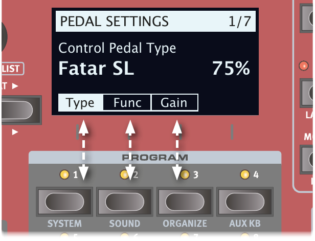
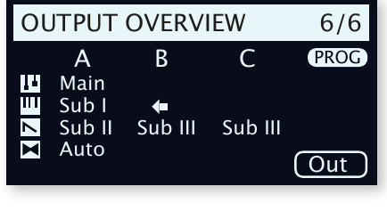
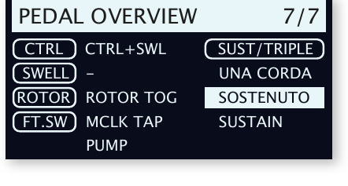
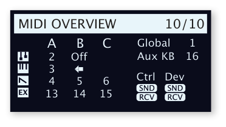
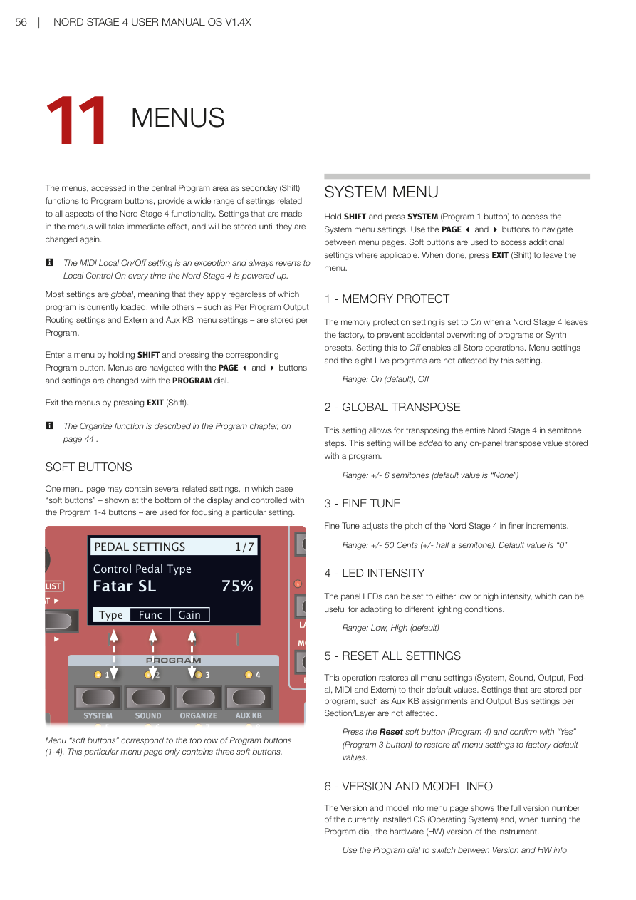
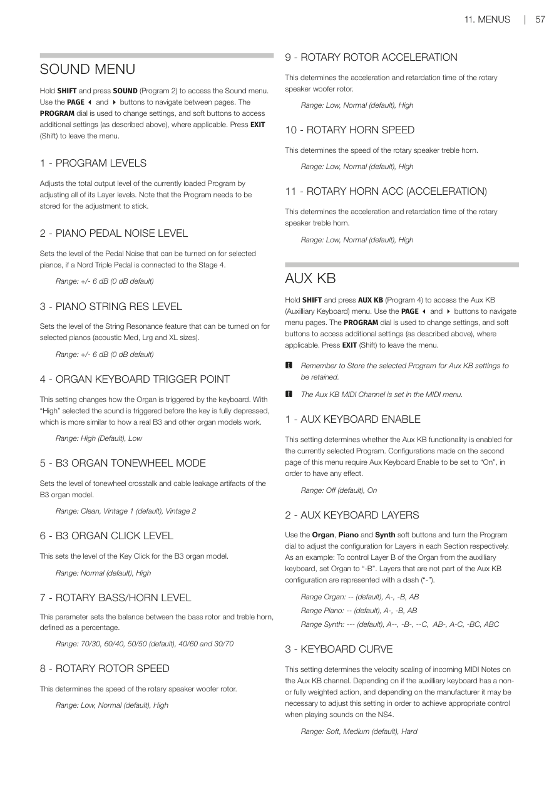
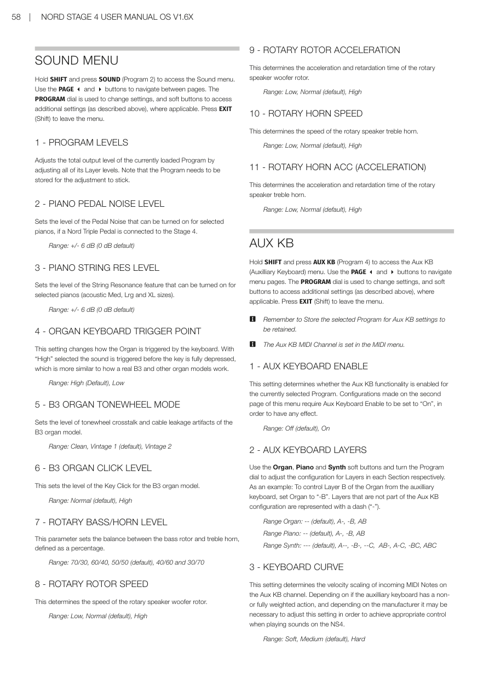
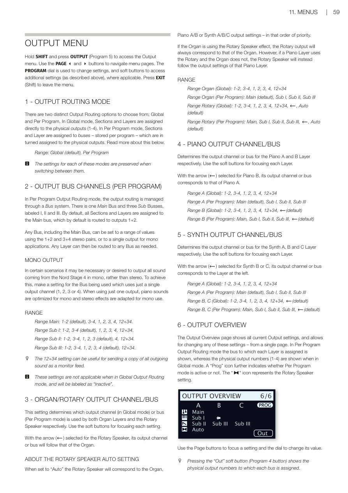
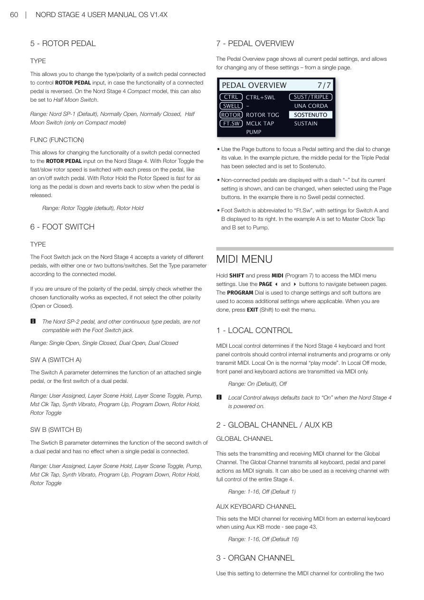
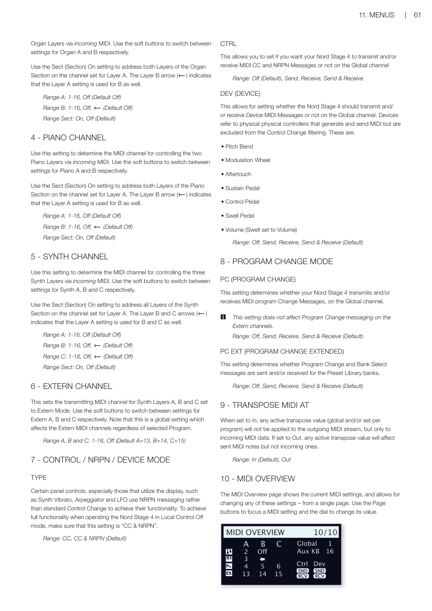

# 第十一章：選單 / Chapter 11: Menus

---

## 選單概覽 / OVERVIEW

選單透過按住 SHIFT 再按對應的音色配置按鈕（1-8）來存取，提供與 Nord Stage 4 所有功能相關的廣泛設定。在選單中所做的設定會立即生效，並儲存直到再次更改為止。

The menus provide a wide range of settings related to all aspects of the Nord Stage 4 functionality. Settings made in the menus will take immediate effect, and will be stored until they are changed again.

> 💡 MIDI 本機控制的開啟/關閉設定是例外，每次 Nord Stage 4 開機時都會恢復為本機控制開啟（Local Control On）。

The MIDI Local On/Off setting always reverts to Local Control On every time the Nord Stage 4 is powered up.

大多數設定是全域性的（無論目前載入哪個音色配置都適用），而其他設定——例如每音色配置輸出訊號路由設定、Extern 和 Aux KB 選單設定——則每個音色配置獨立儲存。

Most settings are global, while others – such as Per Program Output Routing settings and Extern and Aux KB menu settings – are stored per Program.

**進入選單**：按住 SHIFT 再按對應的音色配置按鈕。用 PAGE 3 和 4 按鈕瀏覽頁面，用 PROGRAM 控制旋鈕更改設定。按 EXIT（Shift）離開選單。

Enter a menu by holding SHIFT and pressing the corresponding Program button. Navigate with PAGE 3 and 4 buttons. Exit by pressing EXIT (Shift).

---

## 系統選單 / SYSTEM MENU

**進入方式**：按住 SHIFT + SYSTEM（Program 1 按鈕）

Access: Hold SHIFT and press SYSTEM (Program 1 button)

### 1 - 記憶體保護 / MEMORY PROTECT

Nord Stage 4 出廠時記憶體保護設定為「開啟（On）」，以防止意外覆蓋音色配置或合成器預設音色。設定為「關閉（Off）」可啟用所有儲存操作。選單設定和八個即時音色配置不受此設定影響。

The memory protection setting is set to On when a Nord Stage 4 leaves the factory. Setting this to Off enables all Store operations.

**範圍**：On（預設）、Off

### 2 - 全域移調 / GLOBAL TRANSPOSE

此設定允許以半音為單位移調整個 Nord Stage 4。此設定會加到音色配置中儲存的面板移調值上。

This setting allows for transposing the entire Nord Stage 4 in semitone steps. This setting will be added to any on-panel transpose value stored with a program.

**範圍**：±6 半音（預設值為「None」）

### 3 - 精細調音 / FINE TUNE

精細調音以更精細的增量調整 Nord Stage 4 的音高。

Fine Tune adjusts the pitch of the Nord Stage 4 in finer increments.

**範圍**：±50 音分（預設值為「0」）

### 4 - LED 亮度 / LED INTENSITY

面板 LED 可以設定為低亮度或高亮度，適應不同的照明條件。

The panel LEDs can be set to either low or high intensity, useful for adapting to different lighting conditions.

**範圍**：Low、High（預設）

### 5 - 重置所有設定 / RESET ALL SETTINGS

此操作將所有選單設定（系統、音色、輸出、踏板、MIDI 和 Extern）恢復為預設值。每音色配置儲存的設定（如 Aux KB 指定和每區段/音層的輸出匯流排設定）不受影響。

This operation restores all menu settings to their default values. Settings stored per program are not affected.

按重置功能鍵（Program 4），然後按「Yes」（Program 3 按鈕）確認，將所有選單設定恢復為原廠預設音色。

Press the Reset soft button (Program 4) and confirm with "Yes" (Program 3 button) to restore all menu settings to factory default values.

### 6 - 版本和型號資訊 / VERSION AND MODEL INFO

版本和型號資訊選單頁面顯示目前安裝的作業系統（OS）的完整版本號，轉動 Program 旋鈕可查看樂器的硬體（HW）版本。

The Version and model info menu page shows the full version number of the currently installed OS and, when turning the Program dial, the hardware (HW) version of the instrument.

---

---

## 音色選單 / SOUND MENU

**進入方式**：按住 SHIFT + SOUND（Program 2 按鈕）

Access: Hold SHIFT and press SOUND (Program 2)

### 1 - 音色配置音量 / PROGRAM LEVELS

透過調整所有音層音量來調整目前載入音色配置的總輸出音量。注意：需要儲存音色配置才能保留調整。

Adjusts the total output level of the currently loaded Program by adjusting all of its Layer levels. Note that the Program needs to be stored for the adjustment to stick.

### 2 - 鋼琴踏板機械聲音量 / PIANO PEDAL NOISE LEVEL

設定踏板機械聲的音量，此功能在連接了 Nord Triple Pedal 後，可為特定鋼琴音色開啟。

Sets the level of the Pedal Noise that can be turned on for selected pianos, if a Nord Triple Pedal is connected.

**範圍**：±6 dB（預設 0 dB）

### 3 - 鋼琴琴弦共鳴音量 / PIANO STRING RES LEVEL

設定可為特定鋼琴（原聲 Med、Lrg 和 XL 尺寸）開啟的琴弦共鳴功能音量。

Sets the level of the String Resonance feature that can be turned on for selected pianos (acoustic Med, Lrg and XL sizes).

**範圍**：±6 dB（預設 0 dB）

### 4 - 風琴鍵盤觸發點 / ORGAN KEYBOARD TRIGGER POINT

此設定更改風琴由鍵盤觸發的方式。選擇「High」時，聲音在琴鍵完全按下之前觸發，更接近真實 B3 和其他風琴型號的工作方式。

This setting changes how the Organ is triggered by the keyboard. With "High" selected the sound is triggered before the key is fully depressed, which is more similar to how a real B3 and other organ models work.

**範圍**：High（預設）、Low

### 5 - B3 風琴音輪模式 / B3 ORGAN TONEWHEEL MODE

設定 B3 風琴模型的音輪串擾和電纜洩漏噪音的程度。

Sets the level of tonewheel crosstalk and cable leakage artifacts of the B3 organ model.

**範圍**：Clean、Vintage 1（預設）、Vintage 2

### 6 - B3 風琴按鍵咔嗒聲 / B3 ORGAN CLICK LEVEL

設定 B3 風琴模型的按鍵咔嗒聲音量。

Sets the level of the Key Click for the B3 organ model.

**範圍**：Normal（預設）、High

### 7 - 旋轉喇叭低/高頻平衡 / ROTARY BASS/HORN LEVEL

設定低頻轉子和高頻號角之間的平衡，以百分比定義。

Sets the balance between the bass rotor and treble horn, defined as a percentage.

**範圍**：70/30、60/40、50/50（預設）、40/60、30/70

### 8 - 旋轉喇叭低頻轉子速度 / ROTARY ROTOR SPEED

決定旋轉喇叭低音喇叭轉子的速度。

Determines the speed of the rotary speaker woofer rotor.

**範圍**：Low、Normal（預設）、High

### 9 - 旋轉喇叭低頻轉子加速度 / ROTARY ROTOR ACCELERATION

決定旋轉喇叭低音喇叭轉子的加速和減速時間。

Determines the acceleration and retardation time of the rotary speaker woofer rotor.

**範圍**：Low、Normal（預設）、High

### 10 - 旋轉喇叭高頻號角速度 / ROTARY HORN SPEED

決定旋轉喇叭高頻號角的速度。

Determines the speed of the rotary speaker treble horn.

**範圍**：Low、Normal（預設）、High

### 11 - 旋轉喇叭高頻號角加速度 / ROTARY HORN ACCELERATION

決定旋轉喇叭高頻號角的加速和減速時間。

Determines the acceleration and retardation time of the rotary speaker treble horn.

**範圍**：Low、Normal（預設）、High

---

## 輔助鍵盤選單 / AUX KB MENU

**進入方式**：按住 SHIFT + AUX KB（Program 4 按鈕）

Access: Hold SHIFT and press AUX KB (Program 4)

> 💡 記得儲存選取的音色配置，以保留 Aux KB 設定。Aux KB MIDI 通道在 MIDI 選單中設定。

Remember to Store the selected Program for Aux KB settings to be retained. The Aux KB MIDI Channel is set in the MIDI menu.

### 1 - 輔助鍵盤啟用 / AUX KEYBOARD ENABLE

決定目前選取的音色配置是否啟用 Aux KB 功能。第二頁的配置設定需要將此設定為「On」才能生效。

Determines whether the Aux KB functionality is enabled for the currently selected Program.

**範圍**：Off（預設）、On

### 2 - 輔助鍵盤音層 / AUX KEYBOARD LAYERS

使用風琴、鋼琴和合成器功能鍵，轉動音色配置控制旋鈕調整每個區段各音層的配置。例如：要從輔助鍵盤控制風琴的音層 B，將風琴設定為「-B」。不屬於 Aux KB 配置的音層以破折號「-」表示。

Use the Organ, Piano and Synth soft buttons and turn the Program dial to adjust the configuration for Layers in each Section. Example: To control Layer B of the Organ from the auxiliary keyboard, set Organ to "-B".

**風琴範圍**：--（預設）、A-、-B、AB
**鋼琴範圍**：--（預設）、A-、-B、AB
**合成器範圍**：---（預設）、A--、-B-、--C、AB-、A-C、-BC、ABC

### 3 - 觸鍵力度曲線 / KEYBOARD CURVE

決定 Aux KB 通道傳入 MIDI 音符的力度縮放。根據輔助鍵盤是否具有非配重或全配重琴鍵，以及製造商的不同，可能需要調整此設定以在演奏 NS4 音色時獲得適當控制。

Determines the velocity scaling of incoming MIDI Notes on the Aux KB channel.

**範圍**：Soft、Medium（預設）、Hard

---

---

## 輸出選單 / OUTPUT MENU

**進入方式**：按住 SHIFT + OUTPUT（Program 5 按鈕）

Access: Hold SHIFT and press OUTPUT (Program 5)

### 1 - 輸出訊號路由模式 / OUTPUT ROUTING MODE

有兩種不同的輸出訊號路由選項：**全域（Global）**和**每音色配置（Per Program）**。在全域模式下，區段和音層直接指定到實體輸出（1-4）。在每音色配置模式下，區段和音層指定到每音色配置儲存的匯流排，再由匯流排指定到實體輸出。

There are two distinct Output Routing options: Global and Per Program. In Global mode, Sections and Layers are assigned directly to the physical outputs (1-4). In Per Program mode, Sections and Layers are assigned to buses – stored per program.

**範圍**：Global（預設）、Per Program

### 2 - 輸出匯流排通道（每音色配置）/ OUTPUT BUS CHANNELS (PER PROGRAM)

在每音色配置輸出訊號路由模式下，輸出訊號路由透過匯流排系統管理。有一個主匯流排（Main Bus）和三個子匯流排，標記為 I、II 和 III。預設情況下，所有區段和音層指定到主匯流排，主匯流排預設路由到輸出 1+2。

In Per Program Output Routing mode, output routing is managed through a Bus system with one Main Bus and three Sub Busses (I, II, III).

**單聲道輸出**：若需要單聲道輸出，將使用中的匯流排設定為使用單一輸出通道（1、2、3 或 4），鋼琴音色會針對單聲道優化，立體聲效果也會調整為單聲道使用。

**主匯流排範圍**：1-2（預設）、3-4、1、2、3、4、12+34
**子匯流排 I 範圍**：1-2、3-4（預設）、1、2、3、4、12+34
**子匯流排 II 範圍**：1-2、3-4、1、2、3（預設）、4、12+34
**子匯流排 III 範圍**：1-2、3-4、1、2、3、4（預設）、12+34

> 💡 12+34 設定對於將所有輸出聲音的副本作為監聽訊號非常有用。

### 3 - 風琴/旋轉喇叭輸出通道/匯流排 / ORGAN/ROTARY OUTPUT CHANNEL/BUS

此設定決定兩個風琴音層和旋轉喇叭分別使用哪個輸出通道（全域模式）或匯流排（每音色配置模式）。

Determines which output channel (Global mode) or bus (Per Program mode) is used by both Organ Layers and the Rotary Speaker.

為旋轉喇叭選擇箭頭（←）時，其輸出通道或匯流排將跟隨風琴。設定為「Auto」時，旋轉喇叭對應風琴、鋼琴 A/B 或合成器 A/B/C 的輸出設定——按優先順序排列。

With arrow (←) selected for the Rotary Speaker, its output follows the Organ. When set to "Auto" the Rotary Speaker corresponds to the Organ, Piano A/B or Synth A/B/C output settings – in that order of priority.

### 4 - 鋼琴輸出通道/匯流排 / PIANO OUTPUT CHANNEL/BUS

決定鋼琴 A 和 B 音層各自的輸出通道或匯流排。為鋼琴 B 選擇箭頭（←）時，其輸出通道或匯流排對應鋼琴 A 的設定。

Determines the output channel or bus for the Piano A and B Layer. With arrow (←) selected for Piano B, its output corresponds to that of Piano A.

### 5 - 合成器輸出通道/匯流排 / SYNTH OUTPUT CHANNEL/BUS

決定合成器 A、B 和 C 音層各自的輸出通道或匯流排。為合成器 B 或 C 選擇箭頭（←）時，其輸出通道或匯流排對應左側音層。

Determines the output channel or bus for the Synth A, B and C Layer. With arrow (←) selected for Synth B or C, its output corresponds to the Layer at the left.

### 6 - 輸出概覽 / OUTPUT OVERVIEW

輸出概覽頁面顯示所有目前的輸出設定，並允許從單一頁面更改任何這些設定。在每音色配置輸出訊號路由模式下顯示每個音層指定的匯流排，在全域模式下顯示實體輸出編號（1-4）。

The Output Overview page shows all current Output settings, allowing for changing any of them from a single page.

---

---

## 踏板選單 / PEDAL MENU

**進入方式**：按住 SHIFT + PEDAL（Program 6 按鈕）

Access: Hold SHIFT and press PEDAL (Program 6)

### 1 - 控制踏板 / CONTROL PEDAL

**類型（TYPE）**：Nord Stage 4 透過 CONTROL PEDAL 輸入接受許多常見的表情踏板。選擇與使用的踏板相匹配的設定。

The Nord Stage 4 accepts many commonly available expression pedals through its CONTROL PEDAL input.

**範圍**：Roland（預設）、Yamaha、Korg、Fatar（和 Studiologic）、Nord SP-2

> 💡 當此選單頁面開啟時操作連接的踏板，會顯示百分比，可用於確定所接踏板的範圍——在為未明確支援的踏板尋找合適設定時非常有用。

**功能（FUNC）**：決定連接到 Control Pedal 輸入的踏板功能。兩個設定為「Control」（與 Morph 功能一起使用）和「Ctrl + Swell」（結合 Morph 控制和風琴 Swell）。

**範圍**：Control（預設）、Ctrl + Swell

**增益（GAIN）**：允許為踏板輸出添加增益，當踏板無法達到最大設定時非常有用。

**範圍**：1-10

### 2 - 風琴表情踏板 / SWELL PEDAL

**類型（TYPE）**：配置連接到 ORGAN SWELL 插孔的踏板。

**範圍**：Roland（預設）、Yamaha、Korg、Fatar（和 Studiologic）

**功能（FUNC）**：設定 Swell 踏板的目標。設為「Swell」讓踏板作為風琴的 Swell 踏板；設為「Volume」讓其控制所有 Nord Stage 4 音色引擎的音量；設為「Wheel Morph」讓 Swell 踏板鏡像調變輪的 Morph 功能。

**範圍**：Swell（預設）、Volume、Wheel Morph

**增益（GAIN）**：**範圍**：1-10

### 3 - 延音踏板 / SUSTAIN PEDAL

**類型（TYPE）**：此設定需要與連接到 SUSTAIN PEDAL 插孔的踏板類型相符，才能使延音功能正常工作。

Depending on the selected Type, one or three vertical bars are shown in the display, filling up as pedals are pressed.

**範圍**：Nord SP-1（預設）、Nord SP-2、Nord TP-1、Normally Open、Normally Closed

**功能（FUNC）**：延音踏板也可以透過設定其功能為「Sus+Rotor Hold」或「Sus+Rotor Toggle」來改變旋轉喇叭的速度。

**範圍**：Sustain（預設）、Sus+Rotor Hold、Sus+Rotor Toggle

### 4 - 三踏板功能 / TRIPLE PEDAL FUNCTION

連接的三踏板（無論是連接到 Sustain Pedal 插孔的 Nord Triple Pedal 1，還是連接到 Triple Pedal 插孔的 Nord Triple Pedal 2）可以設定多種方式來控制多個不同功能。右踏板始終控制延音（或可選擇延音+旋轉保持/旋轉切換），左踏板和中間踏板各自可以控制更大範圍的參數。

A connected Triple Pedal can be set up in a variety of ways for controlling a number of different features. The Right pedal always controls Sustain.

**關於「用戶指定（User Assigned）」設定**：設定為「User Assigned」時，左踏板或中間踏板用於以下在 Nord Stage 4 面板上活躍的功能：主節拍時鐘踏板拍速輸入、音層場景 II 踏板、合成器音高顫音踏板、踏板模式下的 Pump 效果。

**左踏板範圍**：Una Corda（預設）、User Assigned、Layer Scene Hold/Toggle、Pump、Mst Clk Tap、Synth Vibrato、Program Up/Down、Rotor Hold/Toggle
**中間踏板範圍**：Sostenuto（預設）、User Assigned、Layer Scene Hold/Toggle、Pump、Mst Clk Tap、Synth Vibrato、Program Up/Down、Rotor Hold/Toggle
**右踏板範圍**：Sustain（預設）、Sus+Rotor Hold、Sus+Rotor Toggle

---

---

### 5 - 旋轉喇叭控制踏板 / ROTOR PEDAL

**類型（TYPE）**：允許更改連接到 ROTOR PEDAL 輸入的開關踏板的類型/極性，以防連接踏板的功能相反。在 Nord Stage 4 Compact 型號上，也可以設定為 Half Moon Switch。

**範圍**：Nord SP-1（預設）、Normally Open、Normally Closed、Half Moon Switch（僅 Compact 型號）

**功能（FUNC）**：允許更改連接到 ROTOR PEDAL 輸入的開關踏板功能。Rotor Toggle：每次按踏板時切換快速/慢速轉子速度；Rotor Hold：踏板按下時保持快速，放開時恢復慢速。

**範圍**：Rotor Toggle（預設）、Rotor Hold

### 6 - 腳踏開關 / FOOT SWITCH

**類型（TYPE）**：腳踏開關插孔接受各種不同踏板，可帶一個或兩個按鈕/開關。根據連接的型號設定 Type 參數。

**範圍**：Single Open、Single Closed、Dual Open、Dual Closed

> 💡 Nord SP-2 踏板和其他連續類型踏板與腳踏開關插孔不相容。

**SW A（開關 A）**：決定單踏板或雙踏板第一個開關的功能。
**SW B（開關 B）**：決定雙踏板第二個開關的功能，連接單踏板時無效。

**範圍**：User Assigned、Layer Scene Hold/Toggle、Pump、Mst Clk Tap、Synth Vibrato、Program Up/Down、Rotor Hold/Toggle

### 7 - 踏板概覽 / PEDAL OVERVIEW

踏板概覽頁面顯示所有目前的踏板設定，並允許從單一頁面更改任何這些設定。用 Page 按鈕聚焦踏板設定，用旋鈕更改數值。

The Pedal Overview page shows all current pedal settings and allows for changing any of them from a single page.

---

## MIDI 選單 / MIDI MENU

**進入方式**：按住 SHIFT + MIDI（Program 7 按鈕）

Access: Hold SHIFT and press MIDI (Program 7)

### 1 - 本機控制 / LOCAL CONTROL

MIDI 本機控制決定 Nord Stage 4 的鍵盤和面板控制器是否應控制內部樂器和音色配置，或只發送 MIDI。Local On 是正常的「演奏模式」。在 Local Off 模式下，面板和鍵盤動作只通過 MIDI 傳送。

MIDI Local control determines if the Nord Stage 4 keyboard and front panel controls should control internal instruments and programs or only transmit MIDI.

**範圍**：On（預設）、Off

> 💡 本機控制在 Nord Stage 4 開機時始終預設為「On」。

### 2 - 全域通道 / 輔助鍵盤 / GLOBAL CHANNEL / AUX KB

**全域通道**：設定全域通道的 MIDI 發送和接收通道。全域通道以 MIDI 訊號發送所有鍵盤、踏板和面板動作，也可作為接收通道，完整控制整個 Stage 4。

**範圍**：1-16、Off（預設 1）

**輔助鍵盤通道（AUX KEYBOARD CHANNEL）**：設定在使用 Aux KB 模式時接收來自外部鍵盤 MIDI 的通道（詳見第 43 頁）。

**範圍**：1-16、Off（預設 16）

### 3 - 風琴通道 / ORGAN CHANNEL

用此設定決定透過傳入 MIDI 控制兩個風琴音層的 MIDI 通道。用功能鍵切換風琴 A 和 B 的設定。使用 Sect（區段）On 設定可在音層 A 設定的通道上定址風琴區段的兩個音層。

**A 範圍**：1-16、Off（預設 Off）
**B 範圍**：1-16、Off、←（預設 Off）
**Sect 範圍**：On、Off（預設）

### 4 - 鋼琴通道 / PIANO CHANNEL

與風琴通道設定相似，用於控制兩個鋼琴音層的 MIDI 通道。

**A 範圍**：1-16、Off（預設 Off）；**B 範圍**：1-16、Off、←（預設 Off）；**Sect 範圍**：On、Off（預設）

### 5 - 合成器通道 / SYNTH CHANNEL

用此設定決定透過傳入 MIDI 控制三個合成器音層的 MIDI 通道。

**A 範圍**：1-16、Off（預設 Off）；**B 範圍**：1-16、Off、←（預設 Off）；**C 範圍**：1-16、Off、←（預設 Off）；**Sect 範圍**：On、Off（預設）

### 6 - Extern 通道 / EXTERN CHANNEL

設定設定為 Extern 模式的合成器音層 A、B 和 C 的發送 MIDI 通道。用功能鍵切換 Extern A、B 和 C 的設定。注意：這是全域設定，無論選取哪個音色配置都會影響 Extern MIDI 通道。

**A、B、C 範圍**：1-16、Off（預設 A=13、B=14、C=15）

### 7 - 控制器/NRPN/裝置模式 / CONTROL / NRPN / DEVICE MODE

**類型（TYPE）**：某些面板控制器（尤其是使用顯示幕的控制器，如合成器音高顫音、琶音器和 LFO）使用 NRPN 訊息而非標準控制變更訊息。在本機控制關閉模式下操作 Nord Stage 4 時，確保此設定為「CC & NRPN」以實現完整功能。

**範圍**：CC、CC & NRPN（預設）

**CTRL（控制器）**：設定 Nord Stage 4 是否在全域通道上發送和/或接收 MIDI CC 和 NRPN 訊息。

**範圍**：Off（預設）、Send、Receive、Send & Receive

**DEV（裝置）**：設定 Nord Stage 4 是否在全域通道上發送和/或接收裝置 MIDI 訊息。裝置是指產生和發送 MIDI 但不受控制變更訊息濾波影響的物理控制器，包括：音高彎音、調變輪、二段觸鍵感應、延音踏板、控制踏板、表情踏板、音量（Swell 設為 Volume）。

**範圍**：Off、Send、Receive、Send & Receive（預設）

### 8 - 音色配置切換模式 / PROGRAM CHANGE MODE

**PC（音色配置切換）**：決定 Nord Stage 4 是否在全域通道上發送和/或接收 MIDI 音色配置切換訊息。

> 💡 此設定不影響 Extern 通道上的音色配置切換訊息。

**範圍**：Off、Send、Receive、Send & Receive（預設）

**PC EXT（擴展音色配置切換）**：決定預設音色庫音色庫的音色配置切換和音色庫組選擇訊息是否被發送和/或接收。

**範圍**：Off、Send、Receive、Send & Receive（預設）

### 9 - 移調 MIDI 位置 / TRANSPOSE MIDI AT

設定為「In」時，任何活躍的移調值（全域和/或每音色配置設定的）不會套用到傳出的 MIDI 資料流，只套用到傳入的 MIDI 資料。設定為「Out」時，移調值影響發送的 MIDI 音符但不影響傳入的音符。

**範圍**：In（預設）、Out

### 10 - MIDI 概覽 / MIDI OVERVIEW

MIDI 概覽頁面顯示所有目前的 MIDI 設定，並允許從單一頁面更改任何這些設定。

The MIDI Overview page shows the current MIDI settings and allows for changing any of them from a single page.

---

---

## Extern 選單 / EXTERN MENU

**進入方式**：按住 SHIFT + EXTERN（Program 8 按鈕）

Access: Hold SHIFT and press EXTERN (Program 8)

> 💡 Extern 選單上的大多數項目在 Extern 音層 A、B 和 C 有各自的條目，使用對應的功能鍵在它們之間切換。大多數 Extern 選單設定會隨音色配置儲存，唯一例外是 MIDI 選單中的「Extern MIDI A/B/C Channel」設定。

Most items on the Extern menu have separate entries for Extern Layers A, B and C. Use the corresponding soft buttons to switch between them. Most settings from the Extern menu are saved with a Program.

### 1 - 轉送全域至 Extern 通道 / ECHO GLOBAL TO EXTERN CH

傳入的與全域通道相符的 MIDI，如果 Extern 模式在目前音色配置中活躍，可以被重新路由，從 Extern 通道輸出。此設定決定是否應套用此重新路由。

Incoming MIDI that matches the Global channel can be re-routed to go out on the Extern channel if the Extern mode is active.

**範圍**：Off（預設）、On

### 2 - 觸鍵感應力度 A/B/C / KEYBOARD VELOCITY A/B/C

此設定決定在 Extern MIDI 通道上發送資料時，每個面板的觸鍵感應力度曲線。Soft 設定使產生高力度值更容易，Hard 設定使其更難。

**範圍**：Soft、Mid（預設）、Hard

### 3-5 - 音色庫組選擇/音色配置切換 A/B/C / BANK SELECT / PROG CHANGE A/B/C

完整的音色配置切換訊息由三部分組成：音色庫組選擇 MSB 值、音色庫組選擇 LSB 值和音色配置切換值。音色配置切換值也可以在合成器顯示幕中用最右側的旋鈕設定。

A "complete" Program Change message consists of Bank Select MSB value, a Bank Select LSB value and a Program Change value.

> 💡 如果「Send On Load」設定設為「On」，當載入音色配置時，Nord Stage 4 可以自動發送音色庫組選擇/音色配置切換訊息。

**音色配置切換 MSB 範圍**：0-127、--（關閉）（預設 --）
**音色配置切換 LSB 範圍**：0-127、--（關閉）（預設 --）
**PC 範圍**：0-127（預設 0）

### 6-7 - MIDI CC#1, CC#2 A/B/C

可以為每個 Extern 音層定義兩個獨立的控制變更訊息（CC）編號。其值從合成器顯示幕使用左側和中間旋鈕控制和儲存。

Two separate Control Change (CC) numbers can be defined for each Extern Layer.

**範圍**：0-119（預設 2）

### 8-12 - 裝置 MIDI A/B/C / DEVICE MIDI A/B/C

對於每個 Extern 音層，可以決定是否發送由調變輪、二段觸鍵感應、控制踏板、表情踏板和音量踏板產生的資料。如果任何設備不應產生 MIDI 資料，將其設定為 Off。

For each Extern Layer it can be determined whether to send data generated by the Modulation Wheel, Aftertouch, Control Pedal, Swell Pedal and Volume Pedal.

**範圍**：On（預設）、Off

> 💡 音高控制桿和延音踏板的 MIDI 使用合成器/Extern 區段中的 PSTICK（Shift+音層 B）和 SUSTPED（Shift+音層 A）控制器來開啟或關閉。

### 13 - 載入時發送 A/B/C / SEND ON LOAD A/B/C

此設定切換 Extern 模式中的音色配置切換（PC）、音量（Vol）或用戶自定義 MIDI CC（UsrCC）訊息設定，是否應在選取音色配置時自動發送。

Toggles if PC, Vol or user defined MIDI CC messages in Extern mode should be automatically transmitted when a program is selected.

**範圍**：Off（預設）、On

原文整頁參考

