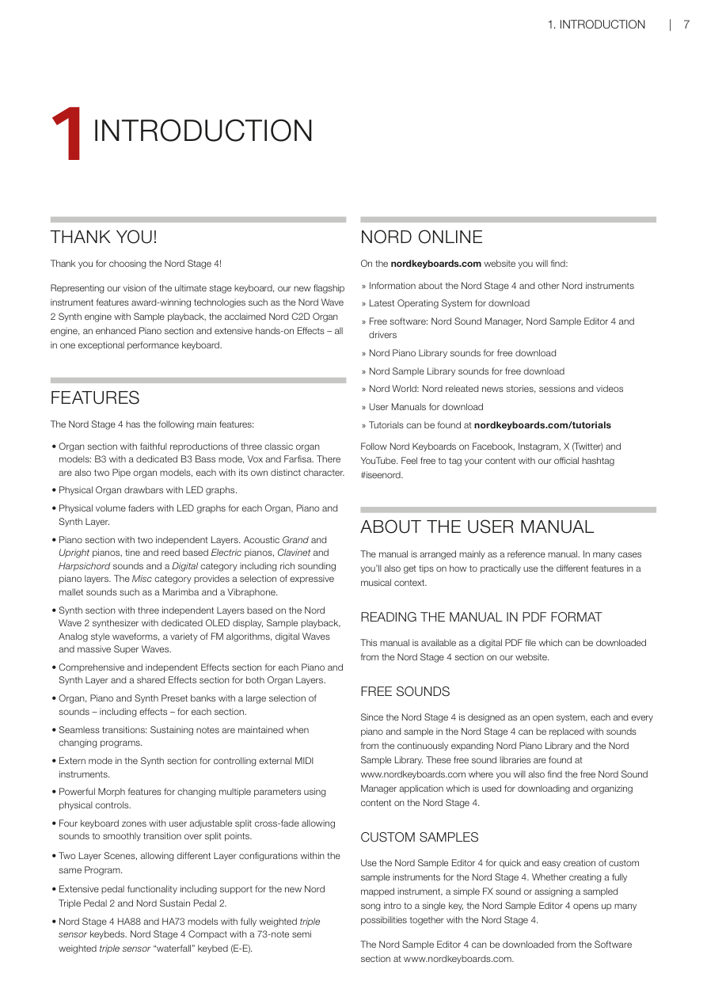
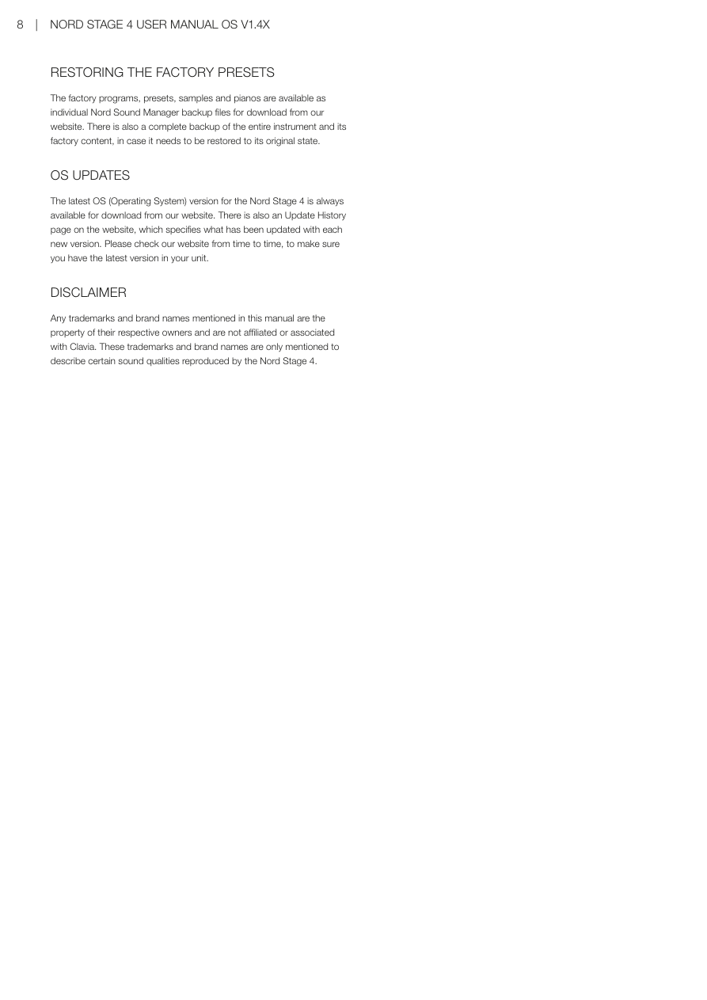

# 第一章：介紹 / Chapter 1: Introduction

---

## 感謝您！/ THANK YOU!

感謝您選擇 Nord Stage 4！作為我們對終極舞台鍵盤的願景實現，我們的全新旗艦樂器搭載了多項獲獎技術——包括支援取樣音色播放的 Nord Wave 2 合成引擎、廣受好評的 Nord C2D 風琴引擎、強化的鋼琴區，以及豐富的即時效果——全部整合於一台卓越的演出鍵盤中。

Thank you for choosing the Nord Stage 4! Representing our vision of the ultimate stage keyboard, our new flagship instrument features award-winning technologies such as the Nord Wave 2 Synth engine with Sample playback, the acclaimed Nord C2D Organ engine, an enhanced Piano section and extensive hands-on Effects – all in one exceptional performance keyboard.

---

## 主要功能 / FEATURES

Nord Stage 4 具備以下主要功能：

The Nord Stage 4 has the following main features:

- **風琴區**：忠實重現三款經典風琴音色：B3（含專用 B3 Bass 模式）、Vox 和 Farfisa。另有兩款管風琴音色，各具獨特音色特性。  
  **Organ section** with faithful reproductions of three classic organ models: B3 with a dedicated B3 Bass mode, Vox and Farfisa. There are also two Pipe organ models, each with its own distinct character.

- **實體風琴音栓拉桿**，配備 LED 顯示。  
  **Physical Organ drawbars** with LED graphs.

- **每個風琴、鋼琴及合成器音層均配備實體音量推桿**，配備 LED 顯示。  
  **Physical volume faders** with LED graphs for each Organ, Piano and Synth Layer.

- **鋼琴區**，含兩個獨立音層：原聲大鋼琴與直立式鋼琴、音叉式與簧片式電鋼琴、Clavinet 與大鍵琴音色、數位類別（包含豐富的鋼琴音層）。Misc 類別提供多種富表現力的槌擊樂器音色，如馬林巴琴和顫音琴。  
  **Piano section** with two independent Layers. Acoustic Grand and Upright pianos, tine and reed based Electric pianos, Clavinet and Harpsichord sounds and a Digital category including rich sounding piano layers. The Misc category provides a selection of expressive mallet sounds such as a Marimba and a Vibraphone.

- **合成器區**，含三個基於 Nord Wave 2 合成器的獨立音層，配備專用 OLED 顯示器，支援取樣音色播放、類比波形、多種 FM 演算法、數位波形及超級波形。  
  **Synth section** with three independent Layers based on the Nord Wave 2 synthesizer with dedicated OLED display, Sample playback, Analog style waveforms, a variety of FM algorithms, digital Waves and massive Super Waves.

- **完整且獨立的效果區**，適用於每個鋼琴和合成器音層，兩個風琴音層共用一個效果區。  
  **Comprehensive and independent Effects section** for each Piano and Synth Layer and a shared Effects section for both Organ Layers.

- **風琴、鋼琴及合成器預設音色庫**，每個區均有豐富的音色選擇（含效果）。  
  **Organ, Piano and Synth Preset banks** with a large selection of sounds – including effects – for each section.

- **無縫切換**：切換音色配置（Program）時延音音符持續發聲。  
  **Seamless transitions**: Sustaining notes are maintained when changing programs.

- **合成器區的外部模式**，用於控制外部 MIDI 樂器。  
  **Extern mode** in the Synth section for controlling external MIDI instruments.

- **強大的 Morph 功能**，可透過實體控制器同時調整多個參數。  
  **Powerful Morph features** for changing multiple parameters using physical controls.

- **四個鍵盤區域**，可調整分區點平滑淡出淡入，讓音色在分區點之間平滑過渡。  
  **Four keyboard zones** with user adjustable split cross-fade allowing sounds to smoothly transition over split points.

- **兩個音層場景（Layer Scenes）**，允許在同一個音色配置中使用不同的音層配置。  
  **Two Layer Scenes**, allowing different Layer configurations within the same Program.

- **豐富的踏板功能**，支援全新 Nord Triple Pedal 2 和 Nord Sustain Pedal 2。  
  **Extensive pedal functionality** including support for the new Nord Triple Pedal 2 and Nord Sustain Pedal 2.

- **Nord Stage 4 HA88 和 HA73 型號**配備全配重三感應器鍵盤。**Nord Stage 4 Compact** 配備 73 鍵半配重三段感應「瀑布式」琴鍵（E-E）。  
  **Nord Stage 4 HA88 and HA73 models** with fully weighted triple sensor keybeds. Nord Stage 4 Compact with a 73-note semi weighted triple sensor "waterfall" keybed (E-E).

---

## Nord 官方網站 / NORD ONLINE

在 nordkeyboards.com 網站上，您可以找到：

On the nordkeyboards.com website you will find:

- Nord Stage 4 及其他 Nord 樂器的相關資訊 / Information about the Nord Stage 4 and other Nord instruments
- 最新韌體下載 / Latest Operating System for download
- 免費軟體：Nord Sound Manager、Nord Sample Editor 4 及驅動程式 / Free software: Nord Sound Manager, Nord Sample Editor 4 and drivers
- Nord Piano Library 免費音色下載 / Nord Piano Library sounds for free download
- Nord Sample Library 免費音色下載 / Nord Sample Library sounds for free download
- Nord World：Nord 相關新聞、演出和影片 / Nord World: Nord releated news stories, sessions and videos
- 使用手冊下載 / User Manuals for download
- 教學影片：nordkeyboards.com/tutorials / Tutorials can be found at nordkeyboards.com/tutorials

在 Facebook、Instagram、X（Twitter）和 YouTube 上關注 Nord Keyboards，歡迎使用我們的官方標籤 **#iseenord** 標記您的內容。

Follow Nord Keyboards on Facebook, Instagram, X (Twitter) and YouTube. Feel free to tag your content with our official hashtag #iseenord.

---

## 關於使用手冊 / ABOUT THE USER MANUAL

本手冊主要作為參考手冊使用。在許多情況下，您也會獲得如何在音樂情境中實際運用各種功能的技巧。

The manual is arranged mainly as a reference manual. In many cases you'll also get tips on how to practically use the different features in a musical context.

### 以 PDF 格式閱讀手冊 / READING THE MANUAL IN PDF FORMAT

本手冊提供數位 PDF 版本，可從我們網站的 Nord Stage 4 專區下載。

This manual is available as a digital PDF file which can be downloaded from the Nord Stage 4 section on our website.

---

## 免費音色 / FREE SOUNDS

由於 Nord Stage 4 採用開放系統設計，每一個鋼琴和取樣音色都可以替換為來自持續擴充的 Nord Piano Library 和 Nord Sample Library 的音色。這些免費音色庫可在 www.nordkeyboards.com 找到，同時也提供免費的 Nord Sound Manager 應用程式，用於下載和管理 Nord Stage 4 的內容。

Since the Nord Stage 4 is designed as an open system, each and every piano and sample in the Nord Stage 4 can be replaced with sounds from the continuously expanding Nord Piano Library and the Nord Sample Library. These free sound libraries are found at www.nordkeyboards.com where you will also find the free Nord Sound Manager application which is used for downloading and organizing content on the Nord Stage 4.

---

## 自訂取樣音色 / CUSTOM SAMPLES

使用 Nord Sample Editor 4 可以快速輕鬆地為 Nord Stage 4 建立自訂取樣音色樂器。無論是建立完整對應的樂器、簡單的音效，還是將取樣的歌曲前奏指定到單一琴鍵，Nord Sample Editor 4 與 Nord Stage 4 結合後開創了無限可能。

Use the Nord Sample Editor 4 for quick and easy creation of custom sample instruments for the Nord Stage 4. Whether creating a fully mapped instrument, a simple FX sound or assigning a sampled song intro to a single key, the Nord Sample Editor 4 opens up many possibilities together with the Nord Stage 4.

Nord Sample Editor 4 可從 www.nordkeyboards.com 的軟體區下載。

The Nord Sample Editor 4 can be downloaded from the Software section at www.nordkeyboards.com.

---

---

## 恢復原廠預設音色 / RESTORING THE FACTORY PRESETS

原廠音色配置、預設值、取樣音色和鋼琴音色可作為個別的 Nord Sound Manager 備份檔從我們的網站下載。另外也提供整台樂器及其原廠內容的完整備份，以便在需要時將其恢復至原始狀態。

The factory programs, presets, samples and pianos are available as individual Nord Sound Manager backup files for download from our website. There is also a complete backup of the entire instrument and its factory content, in case it needs to be restored to its original state.

---

## 韌體更新 / OS UPDATES

Nord Stage 4 的最新韌體（OS）版本始終可從我們的網站下載。網站上也有更新歷程頁面，說明每個新版本的更新內容。請不時查看我們的網站，確保您的設備安裝了最新版本。

The latest OS (Operating System) version for the Nord Stage 4 is always available for download from our website. There is also an Update History page on the website, which specifies what has been updated with each new version. Please check our website from time to time, to make sure you have the latest version in your unit.

---

## 免責聲明 / DISCLAIMER

本手冊中提及的任何商標和品牌名稱均為其各自所有者的財產，與 Clavia 無任何關聯。提及這些商標和品牌名稱僅為描述 Nord Stage 4 所重現的某些音色特性。

Any trademarks and brand names mentioned in this manual are the property of their respective owners and are not affiliated or associated with Clavia. These trademarks and brand names are only mentioned to describe certain sound qualities reproduced by the Nord Stage 4.

1.4x 原文整頁參考

