

# 第五章：鋼琴區 / Chapter 5: Piano Section

---

## 開關與音量 / ON/OFF AND LEVEL

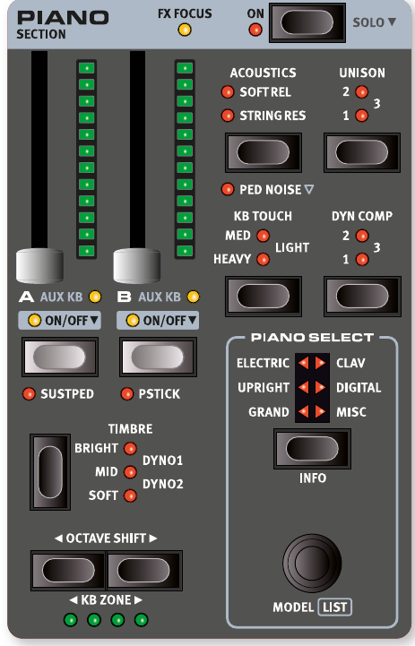

按下 **ON** 按鈕，可以開啟或關閉整個鋼琴區。每個音層（Layer——可以想像成同時疊加播放的不同樂器聲音）都有一個可推動的音量推桿，可以控制該音層的輸出音量。這些推桿也支援**Morph 多參數控制（Morph）**，意思是可以用滑輪或踏板來即時改變音量大小。

The Piano SECTION is turned On or Off by pressing its ON button. The morphable faders control the output level of each Piano Layer.

長按 ON 按鈕約半秒，就會執行 **SOLO** 功能——只保留鋼琴發聲，同時關閉風琴和合成器區。這在你只想單獨試聽鋼琴音色時非常方便。

Press the On button for roughly half a second to perform a SOLO operation, which activates only the Piano, turning off the Organ and Synth sections.

---

## 音層按鈕與效果器設定目標 / LAYER BUTTONS AND FX FOCUS

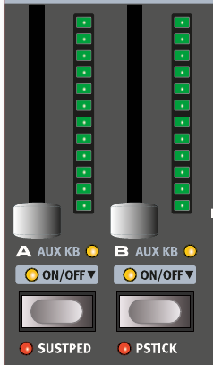

鋼琴區有兩個音層：**A** 和 **B**。要同時開啟兩個音層，只要同時按下 A 和 B 兩個按鈕即可。若要關閉某個音層，長按該音層按鈕片刻就行了。

There are two Piano Layers; A and B. Turning a second Layer On is done by pressing both Layer buttons simultaneously. Turning a Layer Off is done by holding its button down for a short period of time.

兩個音層都開啟時，「正在編輯」的那個音層按鈕上方的 LED 會閃爍，代表目前的焦點在哪個音層。

To toggle from one Layer to the other, press the non-active Layer button. With both Layers active, the focused Layer is indicated by a blinking LED above the Layer button.

按下音層按鈕，也會將該音層選為效果器設定目標。鋼琴區頂部的 **FX FOCUS** LED 會亮起，表示可編輯該音層的效果器。

Pressing a Layer button also focuses that Layer's effects for editing, indicated by the FX FOCUS LED at the top of the Piano Section.

---

## 八度移調與鍵盤區域 / OCTAVE SHIFT AND KB ZONE

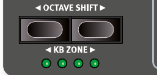

**OCTAVE SHIFT（八度移調）**按鈕可以讓選定的音層往上或往下移動一個八度（即 ±12 個半音）。整個鍵盤範圍可移調一個八度；如果音層只分配在某個小分區，可移調的幅度會有所不同，但始終能涵蓋鋼琴的完整音域。

Use OCTAVE SHIFT to transpose the selected Piano Layer up or down by octaves (+/- 12 semitones). When assigned to the entire keyboard it can be transposed one octave up or down. When assigned to a smaller zone the available transpose values will vary, but always provide access to the entire range of the Piano.

按下 **KB ZONE**（Shift + 八度移調上/下），可以把目前的鋼琴音層分配到特定的**鍵盤區域（KB Zone）**。綠色 LED 會顯示該音層目前分配在哪些分區。關於分區設定的詳細說明，請參考第 38 頁。

Press KB ZONE (Shift+Octave Down/Up), to assign the focused Piano Layer to any of the active keyboard zones. The green LEDs indicate which of the zones a Layer is assigned to. Read more about Split set-ups and keyboard zones on page 38.

---

## 延音踏板與音高控制桿 / SUSTPED AND PSTICK

**SUSTPED**（Shift + 音層 A）可以為鋼琴區啟用外接的**延音踏板（Sustain Pedal——踩下後，鬆開琴鍵後音符仍持續發聲）**。踏板的詳細設定請參考第 58 頁的選單章節。

SUSTPED (Shift + Layer A) activates any attached sustain pedal for the Piano section. Read more on how to configure attached pedals in the Menus chapter, on page 58.

**PSTICK**（Shift + 音層 B）開啟音高控制桿功能，讓你可以用音高控制桿（Pitch Stick）把鋼琴音色上下彎音 2 個半音，做出滑音效果。

PSTICK (Shift + Layer B) turns on pitch stick functionality for the Piano, in which case the Piano sound can be bent 2 semitones up and down, using the pitch stick.

---

## 關於鋼琴音色 / ABOUT THE PIANO SOUNDS

Nord Stage 4 的鋼琴音色分成六大類型，每種類型底下可以有多個不同的樂器模型。你可以到 www.nordkeyboards.com 下載更多鋼琴音色，再用 Nord Sound Manager 軟體載入琴中。

The Pianos in the Nord Stage 4 are organized into six types. Each type can contain several instrument models. New piano sounds can be downloaded from the www.nordkeyboards.com website and added to the Nord Stage 4 by using the Nord Sound Manager.

Nord Stage 4 為鋼琴音色提供了 2 GB 的記憶體空間，出廠就包含了豐富且精心挑選的各類鋼琴。為了讓每台鋼琴的觸感和音色都盡可能貼近原始樂器，每個鋼琴都錄製了大量不同的力度層次——彈輕了輕柔，彈重了雄渾，聽起來格外真實。

The Nord Stage 4 has 2 GB of memory for Piano sounds and provides an extensive collection of carefully selected pianos of all types, right out of the box. Much effort was made to ensure a nuanced response and sound, matching the original models as closely as possible. Each piano has been sampled with a vast amount of velocity levels, which is one

reason why they all sound and feel so authentic.

用 Nord Sound Manager 下載鋼琴音色後，系統會自動把它放進對應的類型分類中，不需要手動整理。

When you download piano sounds with the Nord Sound Manager, these are automatically placed into their corresponding Type.

如果某個音色配置（Program）所使用的鋼琴音色目前沒有安裝在琴中，對應的類型 LED 會閃爍，螢幕也會顯示「Piano not found」。這時你可以選擇其他已安裝的鋼琴音色來代替，或是用 Nord Sound Manager 下載缺少的音色。

If a Program references a piano that is currently not downloaded onto the Nord Stage 4, the type LED will flash, and the display will read "Piano not found". If this happens, you can either navigate to another instrument Model of the selected (or any other) type and select to use this piano instead, or use the Nord Sound Manager application to download the missing instrument.

---

## 關於鋼琴音色的大小 / ABOUT PIANO SIZE

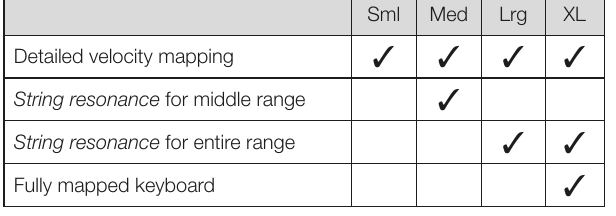

Nord Piano Library 的音色有最多四種不同的檔案大小，大小不同功能也不同。下表是大鋼琴和直立式鋼琴各尺寸的功能比較：

Nord Piano Library sounds come in up to four different sizes. Below is an overview of how Grand and Upright piano sounds differ in functionality depending on size:

| 尺寸 | 詳細力度分層 | 中音域弦共鳴 | 全音域弦共鳴 | 完整鍵位對應 |
|------|------------|------------|------------|------------|
| Size | Detailed velocity mapping | String resonance for middle range | String resonance for entire range | Fully mapped keyboard |
| Sml | ✓ | | | |
| Med | ✓ | ✓ | | |
| Lrg | ✓ | ✓ | ✓ | |
| XL  | ✓ | ✓ | ✓ | ✓ |

**小（Sml）**：檔案最小，不包含任何踩下延音踏板時的弦共鳴取樣。

Small (Sml) piano files use the least amount of space in the piano memory as they do not contain any pedal-down String Resonance samples at all.

**中（Med）**：加入了中音域的踏板弦共鳴取樣，聽起來更自然。

The Medium (Med) versions include pedal-down String Resonance samples for the important middle region of the range.

**大（Lrg）**：涵蓋全鍵盤範圍的踏板弦共鳴取樣。

The Large (Lrg) versions have the pedal-down String Resonance samples all across the keyboard.

**超大（XL）**：「完整鍵位對應」版本，每一個琴鍵都對應原始樂器的真實錄音，音色最細緻，但檔案也最大。

Many pianos are also available in an Extra Large (XL) version. These are "fully mapped" across the keyboard, meaning that each key on the Nord matches its exact equivalent on the original instrument. This naturally results in a significant increase in size.

> 💡 如果記憶體空間有限，可以先從 Med 或 Lrg 版本開始，大部分演出場合都已非常夠用。

---

## 鋼琴預設音色 / PIANO PRESETS

Nord Stage 4 內建大量完整的**預設音色（Preset——包含音色設定和效果，一鍵載入即可使用）**，可在音色配置區的 PRESET LIBRARY 區域按下 **PIANO** 按鈕來瀏覽和載入。你自己調好的音色也可以儲存到預設音色庫，方便日後在任何音色配置中快速叫出。

The Nord Stage 4 comes with a large selection of complete and ready-to-use Piano Presets, including effects. These are browsed and loaded using the PIANO button in the PRESET LIBRARY area of the Program section. User created sounds can be stored to the Preset Library as well, for quick and easy recall regardless of which Program is loaded.

詳細說明請參考第 40 頁的預設音色庫章節。

Read more about the Preset Library on page 40.

---

## 選擇鋼琴音色 / PIANO SELECT

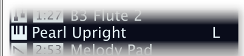

### 類型與型號 / TYPE AND MODEL

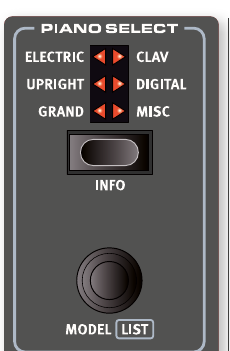

按下 **TYPE** 按鈕可以選擇鋼琴的類型（大分類），共有六種類型：

Use the TYPE button for selecting the desired type, or category, of piano sound. These are the six types into which all piano sounds are placed:

| 類型 / TYPE | 說明 / DESCRIPTION |
|------------|------------------|
| Grand（平台鋼琴） | 原聲及電子平台鋼琴 / Acoustic and electric grand pianos |
| Upright（直立式鋼琴） | 直立式鋼琴 / Upright pianos |
| Electric（電鋼琴） | 電鋼琴（音叉式與簧片式）/ Electric Pianos (tine and reed based) |
| Clav（Clavinet/大鍵琴） | Clavinet 和大鍵琴 / Clavinets and Harpsichords |
| Digital（數位鋼琴） | 數位鋼琴及音層鋼琴 / Digital and Layer piano sounds |
| Misc（其他） | 其他樂器音色 / Miscellaneous sounds |

選好類型後，轉動 **PIANO SELECT** 旋鈕就可以在該類型中挑選音色。鋼琴區的 LED 指示燈會顯示目前選定的類型。

Use the PIANO SELECT dial to choose a piano sound within the selected Type. The Piano Select LEDs indicate the Type of the currently selected piano model. Depending on Prog View mode (see page 41), which governs what info is shown in the display, the name of the selected model may also be shown in the Program area display.

---

### 關於 Clavinet / ABOUT THE CLAVINET

原版 Clavinet D6 用幾個搖桿開關來切換不同的拾音器組合，Nord Stage 4 完整模擬了這個設計，所有原版的拾音器選擇都可以使用：

On the original Clavinet D6, different pick-up combinations were selected by pressing a number of rocker switches. This functionality is faithfully simulated by the Nord Stage 4, which means that all original Clavinet D6 pickup selections are available.

| 型號 / PICK-UP TYPE | 說明 / DESCRIPTION |
|-------------------|------------------|
| Clav Model A | 只用「琴頸」拾音器，音色溫暖、較不明亮 / Only the "neck" pick-up; a warmer, less bright sound. |
| Clav Model B | 只用「琴橋」拾音器，音色明亮 / Only the "bridge" pick-up; a bright sound. |
| Clav Model C | 兩個拾音器同相位同時開啟，音色非常飽滿 / Both pick-ups on and in phase; a very full sound. |
| Clav Model D | 兩個拾音器相位相差 180 度，基頻幾乎被抵消，音色變得纖細 / Both pick-ups 180 degrees out of phase; the fundamental is almost cancelled out and the sound becomes thin. |

Clavinet 也有專屬的音色設定（Timbre），對應原始樂器的 EQ 選項，詳情見後文。

The Clavinet also has its unique set of Piano Timbre settings, corresponding to EQ options of the original instrument.

---

## 清單檢視 / LIST VIEW

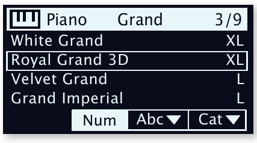

按住 **SHIFT** 並轉動 **PIANO SELECT** 旋鈕，會進入鋼琴音色的清單檢視，方便你瀏覽所有音色。列表頂部會顯示目前的類型名稱、該類型的音色數量，以及目前選到第幾個音色。

Pressing SHIFT and turning the PIANO SELECT dial activates the LIST view for piano sounds. The Piano list top row displays the current type name ("Grand" in this case), the number of models of that type (9), and the index of the currently selected model (3).

---

## 鋼琴資訊 / PIANO INFO

按下 **INFO**（Shift + Piano Select）可以查看目前選定音色的詳細資訊，例如版本號碼和確切的檔案大小。

Pressing INFO (Shift + Piano Select) displays some additional info about the currently selected model, such as its version number and its exact size.

---

## 觸鍵力度反應 / KB TOUCH

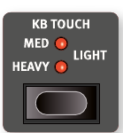

Nord Piano Library 的鋼琴音色動態範圍非常寬廣，你可以用 **KB TOUCH** 來調整鍵盤的觸感靈敏度，讓它更符合你的演奏習慣。

Pianos from the Nord Piano Library typically have a very wide dynamic range, and their dynamic response can be adjusted according to what fits your preferences or the context of your performance.

- **HEAVY（重）**：模擬較重的鋼琴鍵盤，彈輕音時更有控制感
  HEAVY setting represents a heavy piano action, which facilitates playing softly yet expressively.
- **MEDIUM / LIGHT**：依次讓發出大聲所需的力道越來越小
  With each increment of the Touch setting (MEDIUM and LIGHT) less effort is required to play loudly.

> 💡 如果你發現彈再輕都很大聲，可以試著調高觸感設定（往 HEAVY 方向）。

---

## 動態壓縮 / DYNAMIC COMPRESSION

**DYN COMP（動態壓縮）**可以提高鋼琴音色的最低音量，縮小輕重觸之間的動態差距。有 1、2、3 三個等級，3 是最強的壓縮。這個功能適合在現場演出時，確保每個音符都清晰可聽，尤其是彈奏非常輕柔或動態起伏很大的段落時特別有用。音色的音質特性不會被改變。

DYN COMP (Dynamic Compression) reduces the dynamic range of a piano sound by raising its minimum sound level. Choose between the 1, 2 and 3 settings, where 3 provides the most compression. This feature is useful for maintaining an audible performance and even sound level, even when playing very softly or dynamically. The dynamic range in terms of timbre remains intact.

> 💡 DYN COMP 和效果區中的 Compressor（壓縮器效果）不同：Compressor 會改變音符的起音輪廓，而 DYN COMP 只是提高最低音量，不影響音色特質。

Unlike the Compressor (Comp) effect in the Effects section, which affects the attack and contour of the sound (often desired traits when using compression as an effect) the Dyn Comp feature does not alter the character of the selected piano.

注意：DYN COMP 只適用於第 6 版的鋼琴音色。可以按 INFO（Shift + Piano Select）確認目前音色的版本。

The Dyn Comp feature is compatible with version 6 piano sounds only. The version of a selected piano sound can be checked by pressing INFO (Shift + Piano Select button).

---

## 鋼琴聲音特性 / ACOUSTICS

### 柔和釋音 / SOFT RELEASE

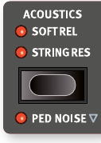

開啟 **SOFT RELEASE** 後，原聲鋼琴音色鬆開琴鍵後的尾音會稍微延長，聽起來更自然柔和，就像調整了原始鋼琴的制音器張力一樣。每個音符的釋音長度會根據你彈奏的力道而有所不同。電鋼琴音色則相反，開啟後釋音會明顯縮短。

Activating SOFT RELEASE will add a slightly longer and less pronounced release to acoustic piano sounds, equivalent to what happens when you adjust the damper tension on an acoustic instrument. The added release is individual for every note and responds dynamically to the force with which you play. Electric Piano sounds instead have their release sound dampened significantly.

注意：Clavinet 和大鍵琴等類型不支援 Soft Release，遇到這類音色時功能會自動停用。

Some Piano types, such as Clavinets and Harpsichords do not support the Soft Release feature. In these cases the function will be disabled.

---

### 弦共鳴 / STRING RESONANCE

**STRING RES（弦共鳴——按下一個琴鍵時，其他弦也會因物理共振而跟著振動，模擬真實鋼琴的聲學現象）**由兩個部分組成：

The STRING RES (String Resonance) feature is made up of two distinct components:

1. **踏板取樣**：Med、Lrg 和 XL 大小的大鋼琴/直立鋼琴包含「踩下延音踏板時錄製」的取樣，重現了踩踏板時鋼琴箱體自然共鳴的氛圍。
   The dedicated pedal down samples, activated when pressing the sustain pedal, included in the Med, Lrg and XL sizes of Grand and Upright piano sounds. These were sampled with the sustain pedal pressed down, capturing the natural ambience and acoustics of the original instrument.

2. **模擬交感共振**：當你按住某些音符時，彈奏其他音符會讓這些被按住弦產生共鳴，就像在真實鋼琴上一樣。
   The simulated "sympathetic" String Resonance which occurs when strings of held notes are caused to vibrate at their fundamental or harmonic frequencies as other notes are being played.

模擬弦共鳴的強度可以在音效選單中調整，詳見第 57 頁。

The amount of "sympathetic" String Resonance can be adjusted in the Sound Menu, see page 57.

注意：小（Sml）版本的鋼琴以及電鋼琴不支援弦共鳴功能，選到這類音色時功能會自動停用。

If a piano is selected that isn't compatible with the String Resonance feature, this function is disabled. This applies to e.g. the small (Sml) versions of the grand pianos and uprights and the electric pianos.

---

### 踏板機械聲 / PED NOISE (PEDAL NOISE)

**PED NOISE（踏板機械聲——真實鋼琴踩踏板時會發出的機械聲音）**（Shift + Soft Release/String Res）需要連接 Nord Triple Pedal 或 Nord Single Pedal 2 才能使用。開啟後，踩下延音踏板時的機械聲音會被重現，踩踏的力道越大，聲音也越明顯。

PED NOISE (Pedal Noise, Shift + Soft Release/String Res) is available if a Nord Triple Pedal or a Nord Single Pedal 2 is connected to the Nord Stage 4 (see below). When activated, the mechanical noise that occurs with the sustain pedal on an acoustic or electric piano will be recreated. The Pedal Noise responds dynamically to the force used when the sustain pedal is operated.

踏板機械聲的音量可在音效選單中調整，詳見第 57 頁。若目前的鋼琴音色不支援此功能，它會自動停用。

The level of the Pedal Noise can be adjusted in the Sound Menu, see page 57. If the selected piano is not compatible with the Pedal Noise feature, this function is disabled.

---

## Nord 三踏板 / NORD TRIPLE PEDAL

Nord Stage 4 相容 **Nord Triple Pedal 1（Nord TP-1）**和 **Nord Triple Pedal 2（Nord TP-2）**。TP-2 要插在背面專用的 **TRIPLE PEDAL** 插孔；TP-1 則插在 **SUSTAIN PEDAL** 插孔。

The Nord Stage 4 is compatible with the Nord Triple Pedal 1 (Nord TP-1) and the Nord Triple Pedal 2 (Nord TP-2), the latter of which is attached to a dedicated jack labeled TRIPLE PEDAL. The Nord Triple Pedal 1 (Nord TP-1) is attached to the SUSTAIN PEDAL jack.

三踏板組合（三個踏板合為一組）不只解鎖鋼琴區的額外功能，也提供許多與鋼琴無關的實用選項。相關設定在踏板選單中，詳見第 58 頁。

The Nord Triple Pedals are comprised of three pedals in one unit and unlock additional features both within the Piano section of the Nord Stage 4 as well as a number of highly useful options that are not specifically related to Piano playing. Settings for these options are found in the Pedal menu, see page 58 for more details.

TP-2 插上後不需要額外設定即可使用。若使用的是插在 SUSTAIN PEDAL 插孔的踏板，請確認踏板選單中的「Sustain Pedal Type」設定符合你的踏板型號。

The Nord TP-2 requires no additional settings when attached to its dedicated jack. For pedals attached to the Sustain Pedal jack, make sure that the Sustain Pedal Type setting in the Pedal menu is set to the specific type or model that is being used.

> 💡 如果 TP-1 和 TP-2 同時接上，TP-1 的左踏板和中間踏板會失效，踏板選單會顯示「Sustain Only」。

If both the Nord TP-1 and TP-2 are attached to the Nord Stage 4, the left and middle pedal of the TP-1 unit will be non-functional, as indicated by the "Sustain Only" text in the Pedals menu.

---

### 延音踏板與半踏板技巧 / SUSTAIN AND HALF PEDALING

**右踏板**永遠是**延音踏板（Sustain Pedal）**。使用 Nord Triple Pedal 或 Nord Single Pedal 2 時，支援**半踩（Half Pedaling）**技巧——踏板只踩一半時，制音器只提升一半，聲音是半延音狀態，非常接近真實鋼琴的感覺。

The right pedal always functions as sustain pedal. With the Nord Triple Pedals as well as the Nord Single Pedal 2 (Nord SP-2) this can be used with half pedaling techniques, achieved by pressing the pedal half way down. In this case the (virtual) dampers are only half-raised, for a partially dampened sound.

---

### 特定音延音踏板 / SOSTENUTO

**中間踏板**預設是**特定音延音踏板（Sostenuto——只讓踩下踏板當下已按住的音符延音，之後彈的音不受影響）**。先按住幾個音符，再踩下 Sostenuto 踏板，這些音符會持續延音；之後彈的其他音符則正常發聲和停止。

The middle pedal of the Nord Triple Pedals is by default the Sostenuto pedal. Using this, selected notes can be sustained while other notes remain unaffected. Notes that are already held down when the pedal is operated will sustain while subsequent notes, played while the pedal down is, will not be sustained.

中間踏板還有其他可選功能，詳見第 59 頁。

There are a number of optional functions for the middle pedal, see page 59 for further details.

---

### 柔音踏板 / SOFT PEDAL

**左踏板**預設是**柔音踏板（Soft Pedal，又稱 Una Corda）**。踩下後，所有發聲的音符音量會稍微降低，音色也會變得較為柔和內斂。

The left pedal on the Nord Triple Pedals is by default the soft pedal, also known as the Una Corda. When it is pressed down, all played notes will be slightly lower in volume and also have a slightly more subdued tone quality.

左踏板也有其他可選功能，詳見第 59 頁。

There are a number of optional functions for the left pedal, see page 59 for further details.

---

## 音色特性 / TIMBRE

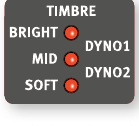

用 **TIMBRE** 設定可以快速調整目前鋼琴音色的頻率特性和整體音色風格。

Use the Piano TIMBRE settings to quickly alter the frequency response and character of the selected piano sound.

### 原聲鋼琴音色設定 / ACOUSTIC PIANO TIMBRE SETTINGS

- **SOFT（柔和）**：壓低高頻、強調低頻，音色變得沉穩、溫暖。
  The SOFT setting gives the sound a subdued and intimate quality by dampening high frequency content and emphasizing the low end.
- **MID（中頻）**：同時壓低高低兩端，突出中頻，音色集中有穿透力。
  The MID mode de-emphasizes both high and low frequency ranges, making for a focused and cutting sound with a prominent mid-range.
- **BRIGHT（明亮）**：強調高頻，音色明亮清脆。
  The BRIGHT mode emphasizes the high frequency range, producing a very bright and brilliant sound.

### 電鋼琴音色設定 / ELECTRIC PIANO TIMBRE SETTINGS

當選擇電鋼琴音色時，音色設定會換成專門針對電鋼琴調整的選項：

When an Electric Piano is selected, the Timbre settings are tailored specifically to suit these sounds.

- **SOFT**：減少高頻和鈴鐺感，保留集中有力的音色。
  The SOFT setting reduces the treble and bell sound, while retaining a focused and punchy sound.
- **MID**：提升中高頻，增加「存在感」和穿透力。
  The MID setting boosts the upper mid-range, adding "presence" and cut to the sound.
- **BRIGHT**：提升中高頻並增加高頻亮度，兼具存在感和清晰度。
  The BRIGHT setting boosts the upper mid-range and adds brilliance/treble, giving both presence and clarity to the selected piano sound.
- **DYNO 1 / DYNO 2**：模擬 70-80 年代常見的電鋼琴專用前置放大器和 EQ，大幅強化電鋼琴特有的「鈴鐺感」。DYNO 2 還額外提升低頻，產生明顯的中頻下凹音色。
  The DYNO 1 and DYNO 2 settings are both based on sounds produced by a custom preamp and EQ, which was a common addition to tine based electric pianos in the 70's and early 80's. Both settings greatly enhance the inherent "bell" sound of the electric piano sound. The Dyno 2 setting also boosts the bass register, resulting in a distinctly "mid scooped" sound.

### Clavinet 設定 / CLAV SETTINGS

原版 Clavinet 內建 4 個搖桿開關控制 EQ，Nord Stage 4 提供了這些開關大部分的組合選項。

An original Clavinet is equipped with 4 rocker switches which control the onboard EQ. Most of the combinations produced by these switches are available on the Nord Stage 4.

可用設定：Soft、Treble、Soft+Treble、Brilliant、Soft+Brilliant、Treble+Brilliant、Soft+Treble+Brilliant。

Available settings are: Soft, Treble, Soft+Treble, Brilliant, Soft+Brilliant, Treble+Brilliant, Soft+Treble+Brilliant.

---

## 齊奏效果 / UNISON

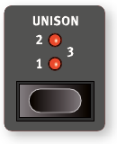

**UNISON（齊奏——利用相鄰琴鍵的聲音稍微移調後疊加，產生立體寬廣感）**功能可以讓鋼琴或電鋼琴音色聽起來更有空間感和厚度。最高設定下音高偏移量較大，效果更明顯。共有 1、2、3 三個強度，從細緻的立體感到明顯的去諧音效都有。

The UNISON feature uses transposed voices from neighbouring keys to create a stereo Unison effect. This can be used for stereo widening of mono sources such as electric pianos or for adding width and chorus-like shimmer to acoustic pianos. At the highest setting larger degrees of detune is applied. There are three different degrees of Unison, 1, 2 and 3, ranging from a subtle stereo effect to more obvious detuning.

> 💡 在電鋼琴上開啟 UNISON 1 或 2，可以讓原本較為單薄的音色立刻變得豐厚有層次，非常適合流行樂或 R&B 曲風。

1.4x 原文整頁參考

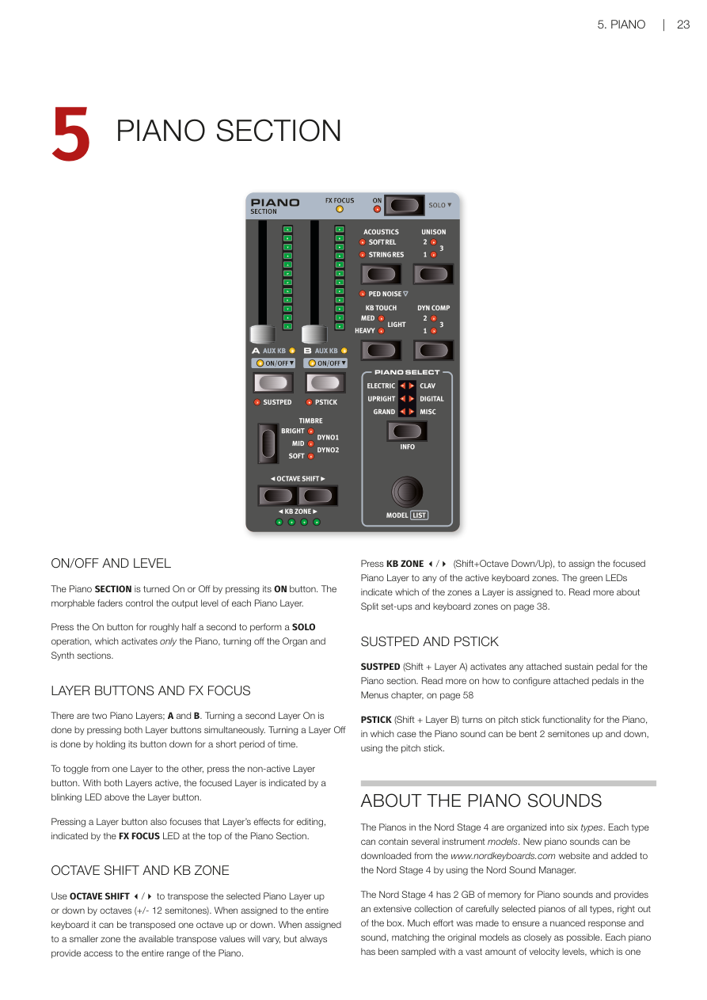

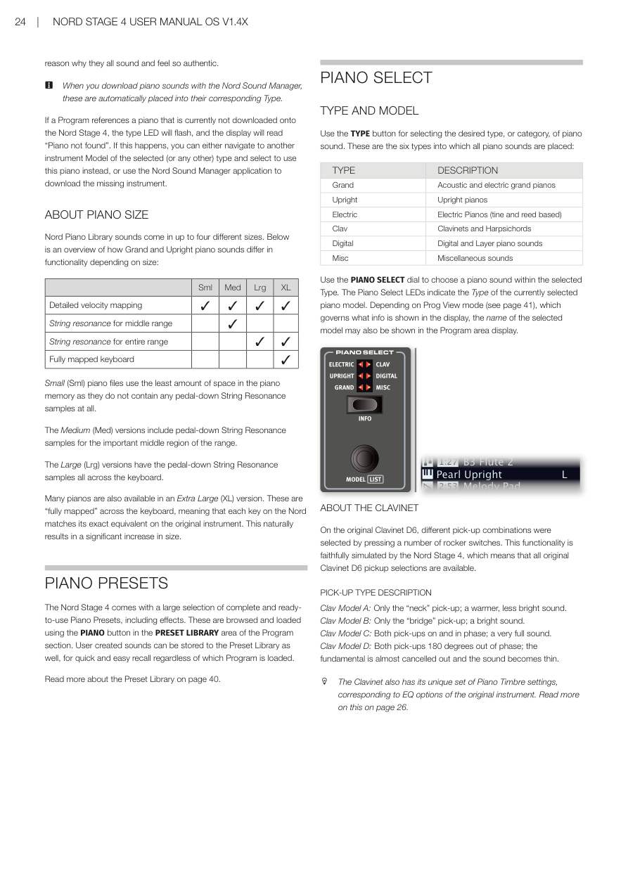

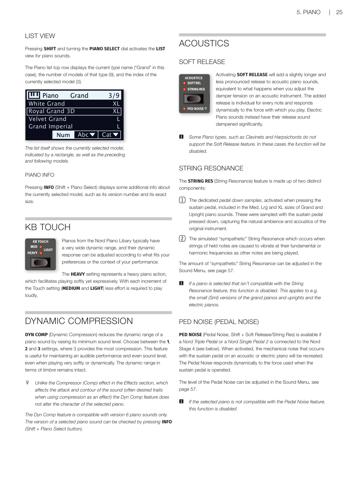

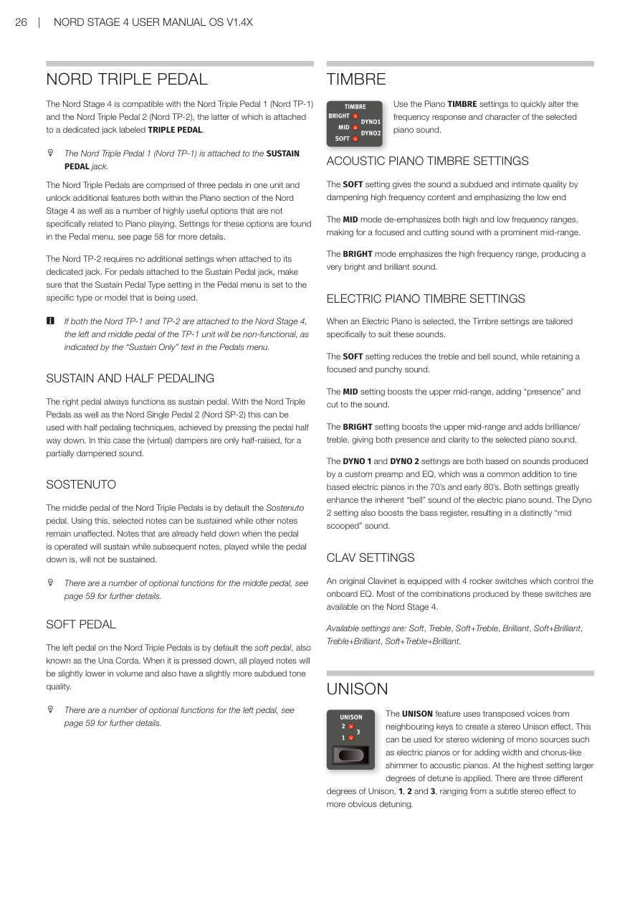

