

# 第六章：合成器區 / Chapter 6: Synth Section

---

## 關於合成器區 / ABOUT THE SYNTH SECTION

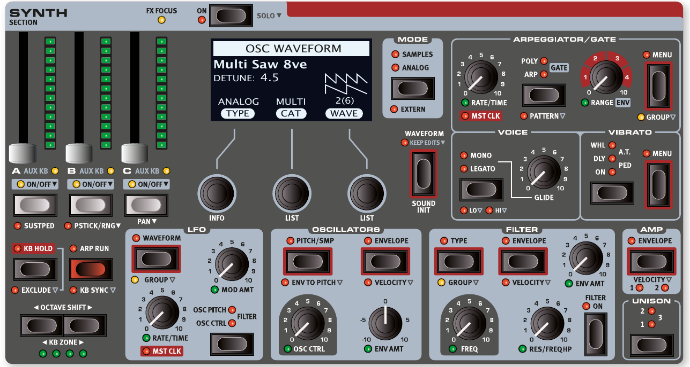

Nord Stage 4 合成器區共有三個音層（Layer——可以想像成同時疊加播放的不同合成器聲音），每個音層都能產生各種經典類比波形（Analog Waveform）、豐富的數位波形，以及 FM 演算法和取樣音色。

Each of the three Layers in the Nord Stage 4 Synth Section provides a wide array of both classic analog waveforms and rich digital waves, as well as FM algorithms and samples.

透過齊奏（Unison）模式和／或多重（Multi）、超級（Super）類比波形，可以同時使用大量振盪器（Oscillator——合成器中產生聲音波形的核心元件）——而且完全不會減少複音數。

Using the Unison modes and/or the Multi or Super analog waveforms, sounds utilizing a large number of oscillators can be used – without any loss of polyphony.

合成器區專用的顯示螢幕及下方三個旋鈕，同時用於瀏覽波形與取樣音色，以及設定包絡線（Envelope）、濾波器（Filter）等合成器參數。面板上附有紅色外框的按鈕，表示其設定會透過顯示螢幕來操作。

The dedicated Synth display and its three dials are used both for browsing Waveforms and Samples, as well as for making Envelope, Filter or other Synth settings. Functions that utilize the display for its settings are indicated with a red frame around the corresponding button.

將合成器區切換至外部模式（Extern mode）時，顯示螢幕和旋鈕會改為控制外部設備的音色配置與參數變更。詳見第 45 頁的外部模式章節。

With the Synth Section set to Extern mode, the display and its dials are used for controlling Program and Parameter changes on external gear. Read more about the Extern mode on page 45.

---

## 開關與音量 / ON/OFF AND LEVEL

按下 ON 按鈕可開啟或關閉合成器區。每個合成器音層的輸出音量，由可進行Morph 多參數控制（Morph）的音量推桿來調整。

The Synth section is turned On or Off by pressing its ON button. The morphable faders control the sound output level of each Synth Layer.

長按 ON 按鈕約半秒，可執行獨奏（SOLO）操作，僅保留合成器發聲，同時關閉風琴和鋼琴區。

Press the On button for roughly half a second to perform a SOLO operation, which activates only the Synth, turning off the Organ and Piano sections.

---

## 音層按鈕與效果器設定目標 / LAYER BUTTONS AND FX FOCUS

合成器區共有三個獨立音層：A、B、C。要開啟某個音層，需同時按下已啟用的音層按鈕與要開啟的按鈕。要關閉某個音層，則長按其按鈕片刻即可。

There are three independent Synth Layers; A, B and C. Turning a Layer on is done by pressing all Layer buttons that are already active simultaneously with the one that should be turned On. Turning a Layer Off is done by holding its button down for a short period of time.

要切換到另一個音層，按下未啟用的音層按鈕即可。有多個音層啟用時，目前聚焦的音層按鈕上方的 LED 會閃爍。

To toggle from one Layer to the other, press a non-active Layer button. With multiple Layers active, the focused Layer is indicated by a blinking LED above the Layer button.

按下音層按鈕，也會將該音層選為效果器設定目標。合成器區頂部的 **FX FOCUS** LED 會亮起，表示已選取該區的效果器供編輯。

Pressing a Layer button also focuses that Layer's effects for editing. The FX FOCUS LED at the top of the Synth Section indicates that its effects are focused for editing.

---

## 八度移調與鍵盤區域 / OCTAVE SHIFT AND KB ZONE

使用 OCTAVE SHIFT 可將選定的音層上下移調八度（+/- 12 半音）。當音層指派到整個鍵盤時，可移調一個八度。指派到較小分區時，可用的移調範圍會有所不同，但始終能存取合成器的完整音域。

Use OCTAVE SHIFT to transpose the selected Layer up or down by octaves (+/- 12 semitones). When assigned to the entire keyboard it can be transposed one octave up or down. When assigned to a smaller zone the available transpose values will vary, but always provide access to the entire range of the Synth.

按下 KB ZONE（Shift+八度移調上下鍵），可將音層指派到任何啟用的鍵盤區域。綠色 KB ZONE LED 會顯示該音層目前指派的分區。關於分區設定，請見第 38 頁。

Press KB ZONE (Shift+Octave Shift Down/Up) to assign a Layer to any of the active keyboard zones. The green KB ZONE LEDs indicate which of the zones the Layer is assigned to. Read more about Split set-ups and keyboard zones on page 38.

---

---

## 延音踏板與音高控制桿 / SUSTPED AND PSTICK

SUSTPED（Shift+音層 A）可為合成器區啟用外接延音踏板。踏板的設定方式請見第 58 頁的選單章節。

SUSTPED (Shift+Layer A) activates an attached sustain pedal for the Synth section. Read more on how to configure pedals in the Menus chapter, on page 58.

PSTICK/RNG（音高控制桿／範圍，Shift+音層 B）可為選定音層開啟音高控制桿功能。音高控制桿的彎音範圍可以半音為單位設定，按住按鈕並從顯示列表中選擇數值即可。

PSTICK/RNG (Pitch Stick/Range, Shift+Layer B) turns on pitch stick functionality for the selected Layer. The bend range for the Pitch Stick can be set in semitone steps by pressing down the button and selecting a value from the displayed list.

---

## 合成器區模式 / SYNTH SECTION MODES

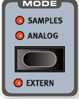

Nord Stage 4 合成器區有三種操作模式：**SAMPLES（取樣音色）**、**ANALOG（類比）**和 **EXTERN（外部）**。外部模式（Shift+Mode）可對外部設備進行進階 MIDI 控制，詳見第 45 頁的專屬章節。

The Nord Stage 4 Synth Section can be used in three distinct modes: SAMPLES, ANALOG or EXTERN. The Extern functionality (Shift+Mode) allows for advanced MIDI control of external units and is described in its own chapter, starting on page 45.

---

## 合成器預設音色 / SYNTH PRESETS

Nord Stage 4 內建大量多音層和單音層的合成器預設音色（包含效果）。透過音色配置區中央 PRESET LIBRARY 區域的 SYNTH 按鈕，即可瀏覽和載入這些音色。

The Nord Stage 4 comes with a large selection of multi- and single-Layer Synth Presets, including Effects. These are browsed and loaded using the SYNTH button in the PRESET LIBRARY area, of the central Program section.

預設音色當然可以手動微調，並儲存為音色配置的一部分。修改後或自製的音色也可以儲存到預設音色庫，方便在任何音色配置中快速調用。詳見第 40 頁的預設音色庫說明。

Presets can of course be further tweaked manually and be stored as part of a Program. Modified or user created sounds can also be stored to the Preset Library, for quick and easy recall from within any Program. Read more about the Preset Library on page 40.

---

## 取樣音色模式 / SAMPLES

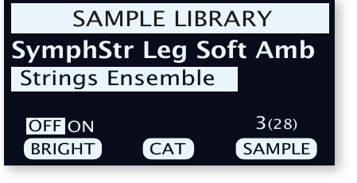

Nord Stage 4 內建了大量來自 Nord Sample Library 4 的取樣音色，涵蓋多種類別。

The Nord Stage 4 comes with a large selection of samples from the Nord Sample Library 4, covering a wide range of categories.

取樣音色記憶體容量為 1 GB，可從 www.nordkeyboards.com 下載更多取樣音色。也可使用 Nord Sample Editor 4 軟體建立自訂取樣音色並下載到 Nord Stage 4。詳見第 63 頁。

There is 1 GB of memory for samples, and additional samples can be downloaded from www.nordkeyboards.com. Custom samples can also be created and downloaded to the Nord Stage 4 using the Nord Sample Editor 4 software. Read more about this on page 63.

按下 WAVEFORM 按鈕，再使用合成器顯示螢幕下方的 CAT 和 SAMPLE 旋鈕，即可瀏覽和選擇取樣音色。

Browsing and selecting samples is done by pressing WAVEFORM and then using the CAT and SAMPLE dials, under the Synth display.

動態亮度濾波器（BRIGHT filter）——將旋鈕轉到 On 即可啟用——可快速增強取樣音色樂器的高頻成分，讓某些聲音更突出，特別是在與其他取樣音色或合成器音色疊加時。

The dynamic BRIGHT filter, activated by turning its dial to On, provides a quick way of enhancing high frequencies in a sample instrument. This can be useful for making certain sounds "pop" more, for instance when layering with other samples or synth sounds.

按下 SHIFT 並轉動 Cat 或 Sample 旋鈕，可進入清單檢視模式，方便全覽取樣音色庫的內容。

Pressing SHIFT and turning the Cat or Sample dial enters the LIST view mode, providing excellent overview of the Sample Library.

按下 INFO（Shift+左側旋鈕），可切換畫面顯示取樣音色的詳細資訊，例如大小和版本號。

Turning INFO (Shift+left dial) toggles the screen to show information about the sample, such as its size and version, in place of the category name.

### 取樣音色預設值 / SAMPLE PRESETS

Nord Sample Library 4 的取樣音色附帶特定合成器參數的預設音色，讓取樣音色載入後即可立即演奏。這包括 Amp 包絡線和觸鍵感應力度（Velocity）設定，通常在載入時會套用取樣音色本身定義的數值；同時，濾波器會關閉，LFO 設定也會停用。

Samples from the Nord Sample Library 4 come with a set of preset values for certain Synth parameters, in order to make them instantly playable. These include Amp Envelope and Velocity settings, which are normally set to values defined in the Sample itself when loaded. Furthermore, the Filter is turned Off and active LFO settings are deactivated.

> 💡 如果你想在不套用預設音色的情況下載入取樣音色（保留所有已編輯的合成器參數），按住 WAVEFORM 按鈕的同時轉動 SAMPLE 旋鈕即可，面板標示為「KEEP EDITS」。

To load samples without their preset settings, keeping all edited Synth parameters intact, hold down the Waveform button while turning the Sample dial, as indicated by the KEEP EDITS label.

### NATURAL、NO DYN、FAST ATK

在 PITCH/SMP 選單中，第三個旋鈕提供更多取樣音色自訂選項：

Some further options for Sample customization can be found by entering the PITCH/SMP menu and using the third dial:

- **Natural（自然）**：取樣音色使用取樣音色預設值所定義的內建動態行為，可能包含力度控制的濾波器響應等機制。
  Natural. The Sample uses the built-in dynamic behaviour defined by the Sample Preset.

- **No Dyn（無動態）**：停用上述內建動態行為。
  No Dyn (No Dynamics). The built-in dynamic behaviours described above are deactivated.

- **Fast Atk（快速起音）**：使用取樣音色的替代起點，跳過大部分或全部的自然起音階段。
  Fast Atk (Fast Attack). An alternate starting point is used for the Sample, bypassing most or all of the natural sample attack phase.

---

## 類比模式 / ANALOG

在類比模式下，合成器區可存取各種經典類比波形、豐富的波表（Wavetable），以及多種不同的 FM 演算法。另外還有涵蓋各類噪音和鈴聲演算法的雜項波形。

In Analog mode the Synth Section gives access to a wide array of both Classic analog waveforms and rich Wavetables, as well as a number of different FM algorithms. There is also a selection of Miscellaneous waveforms covering various types of Noise and a Bell algorithm.

### 振盪器控制（OSC CTRL） / OSC CTRL

振盪器控制（OSC CTRL）可根據目前選擇的波形以不同方式改變聲音。OSC CTRL 參數可由振盪器包絡線或 LFO（低頻振盪器——產生緩慢週期性波動，用來讓音色隨時間搖擺變化）調變，也可進行Morph 多參數控制，讓你即時用調變輪、二段觸鍵感應或踏板來控制音色。

Oscillator Control, OSC CTRL, is used to alter the sound in various ways depending on the currently selected waveform. The Osc Ctrl parameter can be modulated by the Oscillator Envelope or the LFO, and morph controlled, allowing real-time use of the wheel, aftertouch or pedal for controlling the sound.

### 波形選擇 / WAVEFORM SELECTION

在類比模式下，按下 Waveform Select 按鈕，使用左側 Type 控制旋鈕可選擇以下類型：

In Analog mode pressing the Waveform Select button presents a number of Types, selected with the left Type dial:

- **Analog（類比）**：涵蓋基本單振盪器到雙重／多重振盪器配置，以及噪音等雜項波形的類比風格波形。
  Analog: Analog style waveforms ranging from basic single oscillator configurations to common dual and multi oscillator setups, as well as Noise and other miscellaneous waveforms.

- **FM-H（頻率調變－諧波）**：使用 FM（頻率調變）合成的演算法集合。FM-H 模式中，調變振盪器與載波的關係為諧波，適合音調性較強的傳統聲音。
  FM-H (FM Harmonic): A collection of algorithms using FM (Frequency Modulation) synthesis. In FM-H mode the relationship between the modulator and the carrier is harmonic, making this mode suitable for more tonal and traditional sounds.

---

---

- **FM-I（頻率調變－非諧波）**：與 FM-H 提供相同的演算法，但調變振盪器與載波的關係大多為非諧波，適合更不協調、更具實驗性的音色。
  FM-I (FM Inharmonic): Provides the same algorithms as the FM-H mode, but with a mostly inharmonic relationship between the modulator and the carrier, suitable for more dissonant and experimental timbres.

- **Wave（數位波形）**：複雜的數位波形，涵蓋廣泛的音色特性。
  Wave: Complex, digital waveforms covering a wide range of tonal characteristics.

中間的 Category（類別）旋鈕用於在指定振盪器類型內選擇類別，右側的 Waveform 控制旋鈕則用於選擇具體波形。按下 Shift 並轉動 Waveform 控制旋鈕可進入清單檢視模式。

The middle Category dial is used for choosing a category within the specified oscillator Type and the right Waveform dial selects the specific waveform to be used. Use the LIST command (Shift+Waveform dial) to display a list view of the waveforms or samples in your current selection.

### 類比基本波形（PURE） / ANALOG - PURE

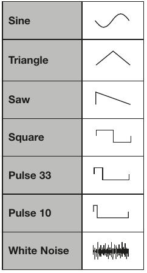

Pure 類別包含一系列不受 OSC CTRL 參數影響的波形：

The Pure category contains a selection of waveforms which are not affected by the Osc Ctrl parameter:

**Sine（正弦波）**、**Triangle（三角波）**、**Saw（鋸齒波）**、**Square（方波）**、**Pulse 33（脈衝波 33%）**、**Pulse 10（脈衝波 10%）**、**White Noise（白噪音）**

> 💡 這些是最基礎的合成器波形。正弦波最圓潤，鋸齒波最豐富飽滿，方波帶點空洞感，白噪音則是全頻雜訊。

### 次振盪器（SUB OSC） / SUB OSC

Sub Osc 類別包含一系列雙振盪器波形，OSC CTRL 參數決定基音與鎖相次振盪器波形的混合比例。

The Sub Osc category contains a selection of dual-oscillator waveforms where the OSC CTRL parameter determines the mix of the fundamental and a phase locked sub oscillator waveform.

- **Square Sub Saw**：鋸齒波，搭配低一個八度的方波。A sawtooth waveform with a square waveform one octave below.
- **Pulse Sub Saw**：鋸齒波，搭配低兩個八度的 25% 脈衝波。A sawtooth waveform with a 25% pulse waveform two octaves below.
- **Sine Sub Saw**：鋸齒波，搭配低一個八度的正弦波。A sawtooth waveform with a sine waveform one octave below.

### 同步（SYNC） / SYNC

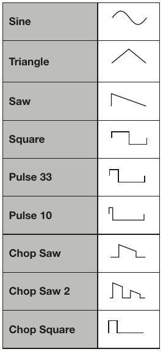

「振盪器同步」是指用一個振盪器的信號來重新啟動另一個振盪器。啟用同步後，振盪器 1 的基本音高會鎖定在振盪器 2（「同步」振盪器）的音高上。當同步振盪器的相對音高改變時，音色會產生顯著變化。

"Oscillator Synchronization" involves using the signal from one oscillator to restart another oscillator. When sync is applied, the basic pitch of Oscillator 1 is locked to that of Oscillator 2 (the "sync" oscillator). As the relative pitch of the synchronized oscillator is varied, this will be perceived as a dramatic change in timbre.

使用振盪器同步時，建議讓 OSC CTRL 由Morph 多參數控制源或振盪器包絡線調變，可產生持續變化諧波的信號。

With Oscillator Sync, it can be useful to have the OSC CTRL amount modulated from one of the Morph sources, or by the Oscillator Envelope. This generates a signal with continuously varied harmonic content.

此類別中的「Chop」波形會對同步波形套用鋸齒波或方波「窗口」，產生獨特且相對柔和、帶有人聲質感的聲音。

The "Chop" waveforms in this category apply a sawtooth or square "window" to the synced waveforms which gives a unique and comparitively soft, vocal quality to the produced sound.

波形：**Sine、Triangle、Saw、Square、Pulse 33、Pulse 10、Chop Saw、Chop Saw 2、Chop Square**

### 波形塑形（SHAPE） / SHAPE

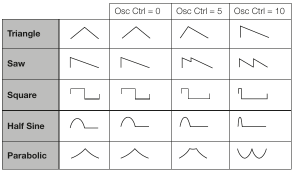

Shape 類別中，OSC CTRL 參數決定波形的形狀。

The Shape category contains waveforms where the Osc Ctrl parameter determines the shape.

波形：**Triangle、Saw、Square、Half Sine、Parabolic**

> 💡 Square 波形可以從方波（50% 脈衝）漸變成非常窄的脈衝波，非常適合使用 LFO 或振盪器包絡線調變 OSC CTRL 來做脈衝寬度調變（PWM）效果。

The Square waveform can be transformed from a square (50% pulse) to a very narrow pulse wave, making it suitable for Pulse Width Modulation (PWM) sounds, using the LFO or Oscillator Envelope to modulate the Osc Ctrl parameter.

### 正弦波塑形（SHAPE SINE） / SHAPE SINE

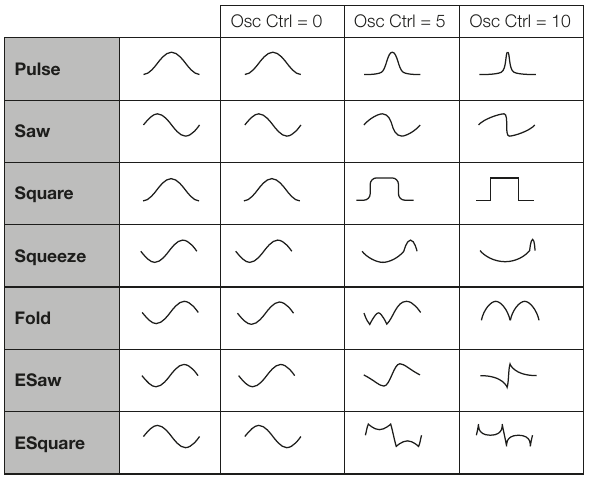

Shape Sine 類別中的波形，可用 OSC CTRL 旋鈕從純正弦波逐漸變形成所選波形。

Waveforms in the Shape Sine category can all be gradually transformed from a pure sine wave to the selected waveform, using the Osc Ctrl knob.

波形：**Pulse、Saw、Square、Squeeze、Fold、ESaw、ESquare**

---

---

### 多重（MULTI） / MULTI

Multi 類別包含一系列多振盪器波形，OSC CTRL 參數決定振盪器之間的失諧（Detune）程度。

The Multi category contains a selection of multi-oscillator waveforms. In all instances, the OSC CTRL parameter determines the amount of Detune between the oscillators.

- **Multi Saw**：兩個相同音高的鋸齒波。Two sawtooth waveforms at the same pitch.
- **Multi Saw 8ve**：兩個相差一個八度的鋸齒波。Two sawtooth waveforms tuned an octave apart.
- **Multi Saw 5th**：兩個相差五度的鋸齒波。Two sawtooth waveforms where one is tuned a fifth above the other.
- **Multi Saw 5th+**：兩個相差一個八度加五度的鋸齒波。Two sawtooth waveforms where one is tuned an octave and a fifth above the other.
- **Multi Saw 8ve 8ve+**：三個各相差一個八度的鋸齒波。Three sawtooth waveforms, each separated by an octave.
- **Multi Saw 8ve 5th+**：兩個相差一個八度加五度的鋸齒波，加上低一個八度的次振盪器鋸齒波。Two sawtooth waveforms where one is tuned an octave and a fifth above the other, with an added sub octave sawtooth waveform below the fundamental.

### 超級（SUPER） / SUPER

**Super Saw、Super Square、Super Bright、Super Organ**：同時發聲的振盪器數量非常多，產生極其豐富飽滿的聲音。在齊奏模式下，振盪器數量和立體聲寬度都會增加。

Super Saw, Super Square, Super Bright, Super Organ: A large number of simultaneously sounding oscillators, producing a very rich and full sound. The number of oscillators and the stereo width is increased in Unison mode.

> 💡 Super 波形是製作大型墊音（Pad）和層次豐富合成音的利器，只需轉動 OSC CTRL 即可調整失諧寬度。

### 雜項（MISC） / MISC

雜項類別包含兩種額外的噪音產生器，以及一個鈴聲波形振盪器：

The Miscellaneous category contains two additional types of noise generators, as well as a Bell waveform oscillator:

- **Pink Noise（粉紅噪音）**：頻譜密度隨頻率升高而降低，聽起來比白噪音更柔和。A noise signal where the spectral density decreases with higher frequency, making it "softer" than the White Noise option.
- **Red Noise（紅色噪音）**：低頻能量更多，高頻比粉紅噪音更弱。A noise signal with more energy in the low frequencies, and more dampened high frequencies than the Pink Noise option.
- **Bell（鈴聲）**：使用振幅調變產生複雜的鈴聲波形。OSC CTRL 控制調變振盪器的音高，進而影響諧波內容和音色特性。Amplitude modulation is used to create a complex bell-like waveform.

### 數位波形（WAVE） / WAVE

這些波形經過精心設計和挑選，提供豐富多樣的音色，適合用其他振盪器類型無法達到的聲音。北歐使用先進合成技術在整個鍵盤範圍內完美重現這些波形。

These waveforms have been carefully designed and selected to provide rich and interesting timbres with great variety, for those sounds that cannot be reached with the other oscillator types.

注意：OSC CTRL 參數對 Wave 波形無效。

The OSC CTRL parameter has no effect on the Wave waveforms.

可用類別涵蓋各種音色特性的數位波形——有些來自聲學樂器，有些是多重頻譜的組合，還有些極度明亮、基音比眾多泛音還要柔和。

The available categories contain digital waveforms covering a wide range of tonal characteristics. Some of the waveforms are distilled from acoustic instruments while some are combinations of several overlapping spectra.

### 頻率調變（FM） / FM

FM 合成的基本原理是：一個正弦振盪器（調變振盪器）調變另一個振盪器（載波）的頻率。載波也可以反過來調變另一個振盪器，以此類推。產生的波形比原始正弦波富含更多諧波，改變調變量可產生音色的巨大變化。

The basic principle behind frequency modulation (FM) synthesis is that one sine oscillator (the modulator) modulates the frequency of another (the carrier). The resulting waveform is far more rich in harmonics than the original Sine waveform, and drastic changes in tonal character are provided by altering the amount of modulation.

> 💡 FM 合成聽起來可能複雜，但只要轉動 OSC CTRL 旋鈕，就能聽到音色從簡單到複雜的變化——非常直觀！

傳統上，FM 振盪器稱為「運算子（Operators）」。Nord Stage 4 的 FM 類別提供 2、3、4 個運算子的演算法（使用齊奏設定時實際上最多 8 個）。

Traditionally, FM oscillators are referred to as operators, and the FM categories of the Nord Stage 4 provide algorithms with 2, 3 and 4 operators (in reality 8 operators when using the Unison settings).

OSC CTRL 參數控制所有 FM 類別的頻率調變量。

The OSC CTRL parameter controls the amount of frequency modulation for all FM categories.

**FM-H 諧波演算法** — Partial 參數決定調變振盪器與載波的關係（以根頻的倍數表示）。可用 Partial 範圍：0.5 至 24。

- **FM Harmonic A**：2 個運算子，比例 P:1。2-OP algorithm at ratio P:1.
- **FM Harmonic B**：3 個運算子，比例 P:1:1，第一調變階段調變量較大。3-OP algorithm at ratios P:1:1.
- **FM Harmonic C**：3 個運算子，比例 P:3:1。3-OP algorithm at ratios P:3:1.
- **FM Harmonic D**：3 個運算子，比例 P:1:1，第二調變階段調變量較大。3-OP algorithm at ratios P:1:1.
- **FM Harmonic E**：4 個運算子，兩對分別為 P:1 和 1:1，特別適合鈴聲和電鋼琴音色。4-OP algorithm especially suited for bell and electric piano type sounds.

**FM-I 非諧波演算法** — Pitch 參數決定調變振盪器與載波的關係（以半音為單位）。可用音高範圍：-12 至 48。

- **FM Inharmonic A**：2 個運算子，比例 P:1。
- **FM Inharmonic B**：3 個運算子，比例 P:1:1，第一調變階段調變量較大。
- **FM Inharmonic C**：3 個運算子，比例 P:3:1。
- **FM Inharmonic D**：3 個運算子，比例 P:1:1，第二調變階段調變量較大。
- **FM Inharmonic E**：4 個運算子，兩對分別為 P:1 和 1:1。

---

---

## 濾波器區 / FILTER SECTION

濾波器（Filter——控制哪些頻率可以通過，讓聲音變暗或變亮的裝置）是塑造音色的關鍵元件，也可由濾波器包絡線及 LFO 調變。

The FILTER is a crucial component in shaping the timbre of the sound and can also be modulated by the Filter Envelope as well as the LFO.

大多數濾波器共享相同的參數：**FREQ（頻率）** 控制截止頻率，**RES（共鳴）** 控制濾波器共振。例外是組合 LP+HP 濾波器——其 Res 旋鈕控制的是 HP 濾波器的截止頻率。

Most filters share the same parameters: FREQ (Frequency) controls the cut-off frequency and RES (Resonance) controls the filter resonance. The one exception to this is the combined LP+HP filter, for which the Res knob controls the HP filter cut-off frequency.

### 濾波器類型 / FILTER TYPE

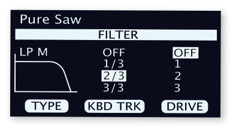

濾波器類型、鍵盤音高追蹤和濾波器過載，均透過合成器顯示螢幕設定。按下 Filter TYPE 按鈕，使用下方三個旋鈕進行設定。

Filter Type, along with Filter Keyboard Tracking and Filter Drive is selected using the Synth display. Press the Filter TYPE button and use the three dials under the display to set these parameters as desired.

**LP 24 & LP 12（低通濾波器）**

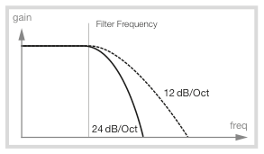

高於截止頻率的頻率會被衰減，低於截止頻率的頻率不受影響。

Frequencies above the Filter Frequency setting will be attenuated, frequencies below are not affected.

- **LP12**：12 dB/八度的低通濾波器（2 極），保留較多諧波。12 dB/octave low-pass filter (2-pole), which retains more harmonics.
- **LP24**：24 dB/八度，是更經典的「合成器濾波器」，截止效果更明顯。A 4-pole, 24 dB/octave classic "synth filter".

> 💡 LP12 聲音更自然開放，LP24 截止更乾淨銳利，是大多數 EDM 和合成音樂常用的類型。

**LP M（Moog 式濾波器）**

LP M 濾波器模擬了知名 Mini 合成器的原始電晶體濾波器，由 Robert A. Moog 博士於 1960 年代設計並申請專利。這是一款 4 極、24 dB/八度的共振低通濾波器，其特點是保留更多低頻信號，使聲音更溫暖。

The LPM filter setting provides an emulation of the original transistor filter from the famous Mini. The M filter is a 4-pole, 24 dB/octave, resonating low-pass filter that leaves more of the low end of the signal.

**LP+HP（低通＋高通組合濾波器）**

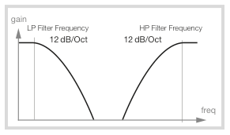

低通＋高通組合濾波器由 12 dB 低通和 12 dB 高通濾波器並聯組成。FREQ 旋鈕控制低通截止頻率，RES 旋鈕控制高通截止頻率。

The combined low-pass/high-pass filter (LP+HP) consists of a 12 dB low-pass and a 12 dB high-pass filter in parallel. The Filter Freq knob controls the cut-off frequency of the LP filter and the Resonance knob controls the cut-off frequency for the HP filter.

**HP（高通濾波器）**

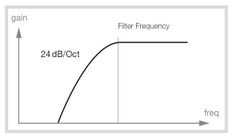

高通濾波器讓高頻通過、衰減低頻。頻率設定越高，聲音會越細薄。

If HP (high-pass) is used, frequencies below the Filter Frequency setting will be attenuated, frequencies above the cutoff are not affected.

**BP（帶通濾波器）**

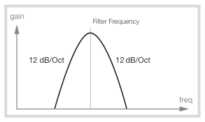

帶通濾波器只讓接近截止頻率的頻率通過，可用於製作窄帶、鼻音感或「受控制」的聲音。

The BP (band-pass) filter allows frequencies close to the Filter Frequency setting to pass, while frequencies above and below the cutoff are attenuated.

### 鍵盤音高追蹤 / KEYBOARD TRACKING

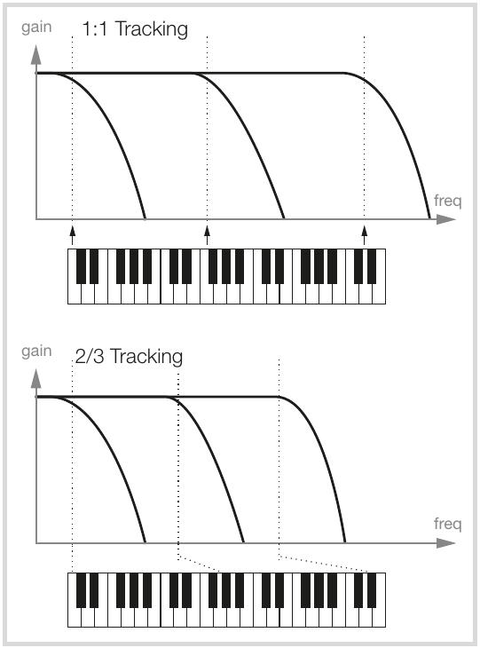

鍵盤音高追蹤（KBD Track）也從濾波器類型顯示畫面設定，使用中間旋鈕調整。

The Keyboard Track (KBD Track) parameter is also set from the Filter Type display, using the middle dial.

這個參數的原理是：當音高升高時，諧波頻率也會自然升高。如果截止頻率固定不變，彈奏越高的音會越顯得「混濁」。使用 KBD TRACK 可避免這種情況。

If the pitch of a waveform is raised, the harmonics naturally raise in frequency as well. If the cutoff frequency is constant, the sound will be perceived as getting "muddier" the higher up the keyboard you play. To avoid this effect, use KBD TRACK.

| 設定 / Setting | 說明 / Description |
|---|---|
| Off | 截止頻率不隨音符改變 / Not altered by the note played |
| 1/3 | 截止頻率以 1:3 比例跟蹤鍵盤 / Tracks keyboard in a 1:3 relationship |
| 2/3 | 截止頻率以 2:3 比例跟蹤鍵盤 / Tracks keyboard in a 2:3 relationship |
| 1 | 截止頻率以 1:1 比例跟蹤鍵盤 / Tracks keyboard at a 1:1 ratio |

---

---

### 濾波器過載 / FILTER DRIVE

啟用 DRIVE 會為濾波器階段增加失真效果。設定 1、2、3 分別代表低、中、高過載量。

Activating DRIVE adds distortion to the Filter stage. The 1, 2 and 3 settings represent low, medium and high amounts of drive respectively.

> 💡 在高共鳴設定下使用過載可以產生有趣而充滿特色的效果——值得嘗試！

Using Drive with high Filter Resonance settings can yield interesting and fun results.

### 群組 / GROUP

按下 GROUP（Shift+Type），可將目前的濾波器設定套用到所有合成器音層，並使後續編輯保持同步。

Pressing GROUP (Shift+Type) applies the current Filter settings to all Synth Layers and keeps further edits in sync between them.

### 濾波器頻率 / FILTER FREQUENCY

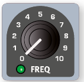

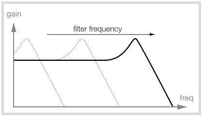

可進行Morph 多參數控制的 FREQ 旋鈕用於設定截止頻率點——即濾波器開始處理頻率的位置。實際效果取決於所選的濾波器類型。

The morphable filter FREQ knob is used for setting the cut-off frequency point. The actual result of this processing depends on the type of filter used.

### 濾波器共振 / FILTER RESONANCE

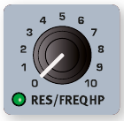

可進行Morph 多參數控制的 RES（共鳴）參數用於進一步調整濾波器特性。增加共鳴會強調截止頻率附近的頻率，使聲音變細薄。

The morphable Resonance (RES) parameter is used to further adjust the characteristics of the filter. Increasing the Resonance will emphasize frequencies around the cutoff frequency, making the sound thinner.

共鳴繼續提高，會使聲音進入自振狀態並產生鳴響音高。當使用 LP+HP 濾波器設定時，RES 旋鈕改為控制高通截止頻率（如 FREQ HP 文字所示）。

Further raising the Resonance will make the sound resonant to a point where the filter starts to self-oscillate and produce a ringing pitch.

### 包絡線調變量（ENV AMT） / ENV AMT (ENVELOPE AMOUNT)

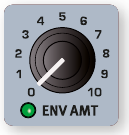

ENV AMT 旋鈕控制濾波器包絡線對濾波器頻率的調變量，決定濾波器頻率如何隨時間變化。

The ENV AMT knob governs the amount of modulation to the filter frequency by the filter envelope, which determines how the filter frequency is altered over time.

---

---

## 包絡線 / THE ENVELOPES

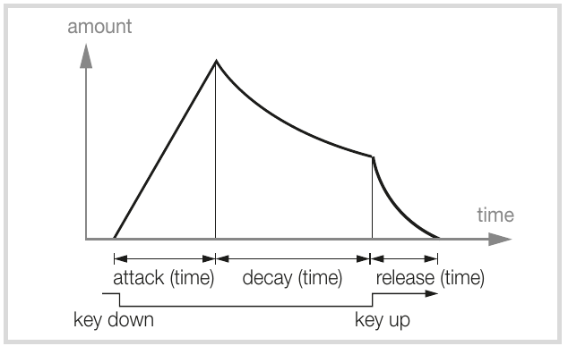

包絡線（Envelope——控制聲音「從無到有再消失」的時間曲線）用於塑造聲音隨時間的變化——從按下琴鍵到放開琴鍵後的整個過程。

The envelopes are used for shaping the sound over time, from when you first play a key to after it has been released.

合成器區有三個獨立的包絡線，分別透過振盪器、濾波器和 AMP 區域的 ENVELOPE 按鈕來存取。

The Synth section has three separate envelopes, each accessed by pressing the ENVELOPE button in the OSCILLATORS, FILTER and AMP areas respectively.

所有包絡線都在合成器顯示螢幕上視覺化呈現，下方三個旋鈕分別用於設定起音（Attack）、衰減（Decay）和釋音（Release）時間。

All envelopes are visualized by the Synth display, and the three dials below it are used for setting the Attack, Decay and Release times respectively.

> 💡 可以這樣理解包絡線：Attack 是聲音「淡入」的時間，Decay 是聲音從峰值下降的時間，Release 是放開琴鍵後聲音「淡出」的時間。

### 起音、衰減與釋音 / ATTACK, DECAY AND RELEASE TIMES

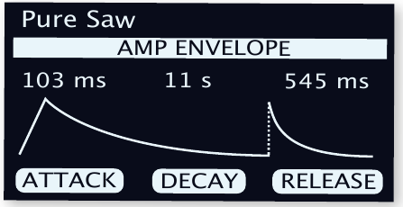

**起音（ATTACK）**

起音設定從按下琴鍵後，包絡線達到最大值所需的時間。順時針轉動 ATTACK 旋鈕可增加起音時間。

Attack sets the time it takes for the envelope to reach maximum level after a key has been pressed. Turning the ATTACK dial clockwise increases the Attack time.

**衰減（DECAY）**

起音階段結束後，只要琴鍵仍然按住，包絡線調變量會開始下降至零。使用 DECAY 旋鈕設定所需時間。若衰減時間設為最大值，包絡線會進入持續階段（Sustain）模式，維持固定值直到放開琴鍵。

When the attack phase is over, and the key is still held down, the envelope amount begins dropping down to zero again. If the Decay time is set to maximum, the envelope will be in Sustain mode.

**釋音（RELEASE）**

放開琴鍵後，包絡線進入釋音階段。釋音時間決定包絡線降至最小值所需的時間，以 RELEASE 旋鈕設定。

When the key is released, the envelope enters the release stage. The release time determines how long it takes for the envelope to reach its minimum value.

### 振盪器包絡線 / OSCILLATOR ENVELOPE

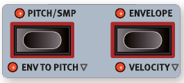

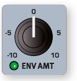

振盪器包絡線預設套用在 OSC CTRL 參數上，也可透過啟用 ENV TO PITCH（Shift+Pitch/Smp）來改為調變振盪器音高。

The Oscillator ENVELOPE is by default applied to the Osc Ctrl parameter, but can also be set to alter the pitch of the oscillator, by activating ENV TO PITCH (Shift+Pitch/Smp).

**觸鍵感應力度（VELOCITY）**：開啟 VELOCITY（Shift+Envelope）後，振盪器包絡線的振幅會受演奏力度控制。彈得越用力，包絡線對目標參數的調變量越大。

With VELOCITY (Shift+Envelope) turned on, the amplitude of the Oscillator Envelope is controlled by the velocity with which the keys are played.

**ENV AMT（包絡線調變量）**：這個可進行Morph 多參數控制的參數決定振盪器包絡線對 OSC CTRL（或音高，當 Env To Pitch 啟用時）的調變量。此旋鈕是雙極性的（12 點鐘位置為零），順時針增加調變，逆時針則反轉調變方向。

The morphable ENV AMT parameter determines the amount of modulation applied to the OSC CTRL parameter by the Oscillator envelope. The Env Amt knob is bi-polar, with zero position at 12 o'clock.

### 濾波器包絡線 / FILTER ENVELOPE

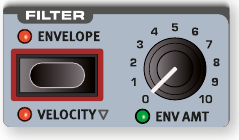

濾波器包絡線用於隨時間調變濾波器截止頻率（FREQ）。調變量由 Env Amt 控制器決定。

The Filter ENVELOPE is used for modulating the Filter cut-off Frequency (FREQ) over time. The amount of modulation is determined by the Env Amt control.

**觸鍵感應力度（VELOCITY）**：開啟後，濾波器包絡線的振幅會隨演奏力度變化。

Turn VELOCITY (Shift + Envelope) on to have the amplitude of the Filter Envelope respond to the velocity with which the keys are played.

### 振幅包絡線（AMP Envelope） / AMP ENVELOPE

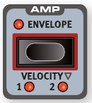

合成器信號鏈的最後階段是擴大機（AMP），用於控制音量。透過包絡線調變這個擴大機，聲音就有了基本的「時間形狀」。音量形狀是我們識別聲音的最重要因素之一——設定好包絡線可以讓聲音變「柔和」、「硬朗」、「彈撥感」或「靜態」等。

The final stage of the Synth signal chain consists of an amplifier (AMP) for controlling the volume. By modulating this amplifier with an envelope, the sound is given its basic "shape" over time.

**觸鍵感應力度（VELOCITY）**：啟用後，合成器的輸出音量由演奏力度控制。共有四個設定，提供逐漸增加的力度靈敏度。

With VELOCITY (Shift+Envelope) active, the output level of the Synth will be controlled by the velocity with which the keyboard is played. There are four settings giving an increasing amount of velocity sensitivity.

---

---

## LFO（低頻振盪器） / LFO

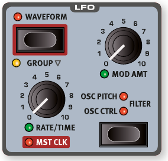

LFO（低頻振盪器——產生緩慢週期性波動，用來讓音色隨時間搖擺變化）可產生循環波形，速率通常非常低，不會產生可聽見的音高。LFO 的輸出用於調變其他功能，例如 OSC CTRL 參數或濾波器頻率。LFO 的速率由可進行Morph 多參數控制的 RATE/TIME 旋鈕設定。

The LFO or Low Frequency Oscillator produces cyclic waveforms at very low frequencies. Instead the output from the LFO is used for modulating other functions, such as the Osc Ctrl parameter or the Filter frequency. The rate of the LFO is set with the morphable RATE/TIME knob.

可進行Morph 多參數控制的 MOD AMT 旋鈕控制 LFO 調變的振幅，可指派到以下目標：

The morphable MOD AMT knob controls the amplitude of the LFO modulation, which can be assigned to one of these destinations:

- **OSC CTRL**：根據選擇的波形類型，效果各有不同。Depending on which Waveform Type is selected, this will have different effects.
- **PITCH（音高）**：用 LFO 調變音高，可產生從細微的音高顫音到誇張的音高效果。Can create anything from subtle Vibrato effects to more extreme Pitch effects.
- **FILTER（濾波器）**：調變所選濾波器的截止頻率。Modulates the cut-off frequency of the selected Filter.

將目標設定為無 LED 亮起，可在保留其他設定的情況下關閉 LFO。

The LFO can be turned Off, while keeping its other settings intact, by setting the destination such that none of its LEDs are lit.

**同步主節拍時鐘（MST CLK）**：按住 Shift 並順時針轉動 RATE/TIME 旋鈕，可將 LFO 速率同步到主節拍時鐘。同步後，Rate 旋鈕用於選擇主節拍時鐘拍速的細分值（1/2 = 二分音符，1/4 = 四分音符，1/8 = 八分音符）。

Press Shift and turn the RATE/TIME dial clockwise to sync the rate of the LFO to the master clock.

### LFO 波形 / LFO WAVEFORM

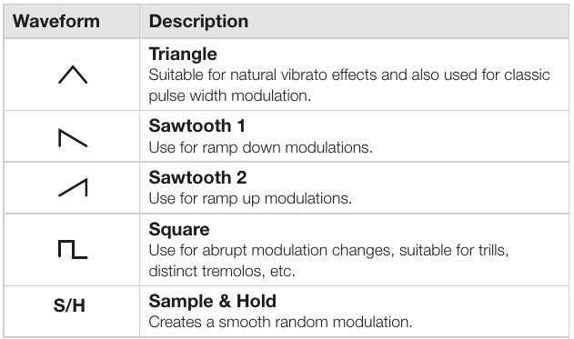

按下 LFO WAVEFORM 按鈕選擇 LFO 產生的波形：

Press LFO WAVEFORM to select which waveform should be generated by the LFO:

- **Triangle（三角波）** — 適合自然的音高顫音效果，也常用於脈衝寬度調變。Suitable for natural vibrato effects and also used for classic pulse width modulation.
- **Sawtooth 1（鋸齒波 1）** — 用於向下坡形調變。Use for ramp down modulations.
- **Sawtooth 2（鋸齒波 2）** — 用於向上坡形調變。Use for ramp up modulations.
- **Square（方波）** — 用於突然的調變變化，適合音高顫音、明顯的抖音等。Use for abrupt modulation changes, suitable for trills, distinct tremolos, etc.
- **Sample & Hold（取樣保持）** — 產生平滑的隨機調變。Creates a smooth random modulation.

按下 GROUP（Shift+Waveform），可將目前的 LFO 設定套用到所有合成器音層，並同步所有 LFO 的相位和控制。

Press GROUP (Shift+Waveform) to apply the current LFO settings to all Synth Layers and synchronize the phase and control of all LFOs.

---

---

## 聲部模式 / VOICE

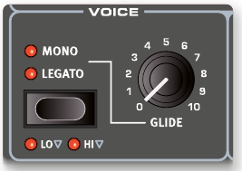

Nord Stage 4 合成器提供多種聲部模式，可選擇單音或複音演奏。

The Nord Stage 4 synthesizer has a number of different voice modes for monophonic or polyphonic playing.

### 單音與連奏模式 / MONO AND LEGATO

MONO 和 LEGATO 模式每次只能演奏一個音符，就像傳統的單音合成器一樣。兩者的主要差異在於連奏（legato，重疊按鍵）時，包絡線的反應方式不同：

In both MONO and LEGATO mode only one note is played at a time. The main difference is in how the envelopes act when one is playing legato:

- **Mono 模式**：包絡線從與前一個音符電平相同的起音點重新開始。Both envelopes restart from the point in the attack phase where the level is equal to the previous note.
- **Legato 模式**：只要連奏，衰減後包絡線不會重新進入起音階段。The envelopes do not move to the attack phase once the decay point has been reached, as long as one is playing legato.

另一個差異是：Legato 模式中，只有連奏時才會啟動滑音（Glide）效果。

Another difference is that in Legato mode, glide is active only when you play legato.

當 Mono 和 Legato LED 均未亮起時，合成器處於預設的複音模式。

When none of the Mono and Legato LEDs are lit, the Synth section is in its default polyphonic mode.

### 低音優先與高音優先模式 / LO AND HI PRIORITY MODES

**LO（低音優先）**：啟用後，高於最低按住或延音音符的所有音符都不會發聲。可用於演奏和弦的同時保持單音貝斯音。

With the LO note priority setting active, notes above the lowest key being held or sustained will not be played at all.

**HI（高音優先）**：與 LO 相反——低於最高按住音符的所有音符都不會發聲，可用於從和弦中取出最高音演奏旋律。

Inversely, with note priority set to HI, active notes below the highest key currently being held or sustained will not produce sound.

注意：Lo 和 Hi 設定只適用於 Mono 和 Legato 聲部模式。

The Lo and Hi settings are only applicable to the Mono and Legato Voice modes.

### 滑音（GLIDE） / GLIDE

GLIDE 功能讓音高在演奏時從一個音「滑」到另一個音（傳統上稱為 Portamento），僅在 Legato 和 Mono 模式下有效。順時針轉動 Glide 旋鈕可增加滑音速率（速率越大，滑動越快）。

The GLIDE function makes the pitch "glide" from one note to the next when playing (traditionally often referred to as portamento) and is available in Legato and Mono modes only.

### 齊奏（UNISON） / UNISON

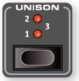

Nord Stage 4 振盪器可增加額外的振盪器，疊加在基本聲音上，製造那種厚實飽滿的經典合成器聲音。使用齊奏不會減少複音數。

- **UNISON 1**：經典的雙振盪器輕微失諧效果，立體聲寬度較窄。A classic dual oscillator de-tuning effect with only subtle stereo width.
- **UNISON 2 & 3**：增加更多振盪器，立體聲音場更寬廣。Add even more oscillators and further widens the stereo image.

**齊奏與取樣音色**：在取樣音色模式下，齊奏功能專門設計來提供逼真的合奏感效果，透過組合多個輕微失諧、並進行立體聲定位的鄰近取樣音色來實現。

In Samples mode, the Unison function is specifically tailored to provide a realistic and ensemble-like sound.

---

## 琶音器 / 節奏閘門 / ARPEGGIATOR/GATE

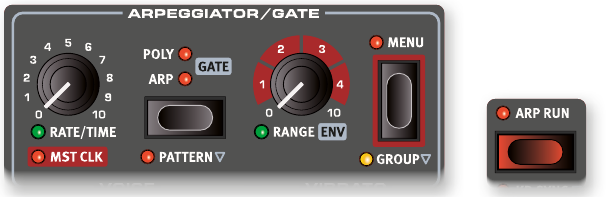

按下 ARP RUN 按鈕開啟琶音器（Arpeggiator——自動依序演奏你按住的音符的功能）／節奏閘門。按下 GROUP（Shift+Menu）可讓所有音層共用相同設定。

The ARPEGGIATOR/GATE is turned on by pressing the ARP RUN button. Activating GROUP (Shift + Menu) allows all Layers to share the same settings.

Nord Stage 4 琶音器／節奏閘門區有三種模式：

There are three available modes for the Arpeggiator/Gate section:

- **ARP（琶音器）**：依序演奏按住的音符，呈現和弦的輪廓。In Arp mode, held notes are played back consecutively, outlining the played chord.
- **POLY（複音琶音器）**：反覆同時演奏所有音符。在較大的 Range 設定下，會依據 Direction 設定依序演奏按住和弦的轉位。In Poly mode, notes are played back repeatedly, together.
- **GATE（節奏閘門）**：根據速率設定，對延音音符的音量進行節奏性的開關。When set to Gate, the sound level of sustained notes is gated rhythmically.

### 節奏型（PATTERN） / PATTERN

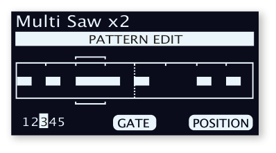

三種模式都可以使用 PATTERN 設定（Shift+琶音器模式）。開啟後，琶音或節奏閘門的步驟會按照所選型式的節奏進行。

All three modes can use the PATTERN setting. With Pattern On, the notes or steps conform to the rhythm defined by the selected pattern.

除了現有的預設型式外，還可以建立自訂長度的型式。型式的選擇和定義在琶音器選單中進行。

Apart from the available set of preset patterns, custom patterns of varying length can be created.

### 音域 / 包絡線（RANGE / ENV） / RANGE / ENV

RANGE 旋鈕決定琶音跨越的音域範圍（0 至 4 個八度）。

The range which an arpeggio spans is determined by the RANGE knob.

在 GATE 模式下，此旋鈕控制節奏閘門的包絡線（ENV）——零位置時節奏閘門非常柔和，最大位置時節奏閘門非常「硬」（聲音完全開關）。

When the GATE is active this knob controls the envelope (ENV) of the Gate.

### 琶音器選單 / ARPEGGIATOR MENU

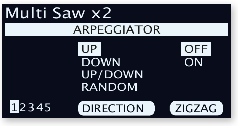

琶音器選單共有五頁，使用左側旋鈕在頁面間切換：

The Arpeggiator MENU has five pages:

1. **方向與鋸齒形（Direction & Zig Zag）**：方向預設為向上。其他選項：向下、上下、隨機。啟用鋸齒形後，音符會跳兩步再退一步。Default Direction is Up; other options: Down, Up/Down, Random.
2. **型式預設與長度（Pattern Presets & Length）**：選擇預設型式，設定 2 至 16 步的型式長度。Select preset patterns and set pattern length from 2 to 16 steps.
3. **型式編輯（Pattern Edit）**：使用位置和節奏閘門旋鈕編輯型式步驟。Use Position and Gate dials to edit pattern steps.
4. **型式重音（Pattern Accent）**：為選定步驟添加重音（需要觸鍵感應力度啟用才有效果）。Add accents to selected steps.
5. **型式聲像（Pattern Pan）**：在左、中、右之間移動選定步驟的立體聲位置。Move selected steps between Left, Center and Right.

### 琶音器速率 / 時間 / ARPEGGIATOR RATE/TIME

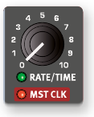

RATE/TIME 旋鈕以四分音符每分鐘（BPM）設定速率。注意：琶音器以給定拍速演奏八分音符。

The RATE/TIME knob sets the rate in quarter note BPM. Note that the arpeggiator plays 1/8 notes in the given tempo.

**同步主節拍時鐘**：按住 SHIFT 並順時針轉動 RATE/TIME 旋鈕，可將琶音器或節奏閘門同步到主節拍時鐘。

Press SHIFT and turn the Arpeggiator RATE/TIME knob clockwise to sync the Arpeggiator or Gate with the Master Clock.

---

---

## 音符保持（KB HOLD） / KB HOLD

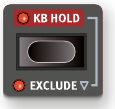

在 KB HOLD（音符保持）模式下，即使手指離開琴鍵，音符也會持續發聲。這對於讓琶音持續運行而不需按住琴鍵，或在雙手演奏其他內容時維持和弦或持續音，非常實用。

In KB HOLD (Keyboard Hold) mode, notes keep sounding even if all fingers are lifted from the keys. This is useful both for keeping an arpeggio running without keeping keys pressed down, or for having chords or drones sustained while playing something else using both hands.

預設情況下，KB Hold 影響合成器區的所有音層。若某個音層不應包含在 KB Hold 功能中，對該音層按下 EXCLUDE（Shift+KB Hold）即可排除。

By default KB Hold affects all Layers of the Synth Section. If a Layer should not be included in the KB Hold functionality, press EXCLUDE (Shift+KB Hold) for that Layer.

KB Hold 開啟時，即使合成器區已關閉，其 LED 仍會保持亮起。這在音層場景切換時（合成器在其中一個場景中為關閉狀態）非常有用。

When KB Hold is turned On, its LED remains lit even if the Synth Section has been turned Off.

---

## 音高顫音（VIBRATO） / VIBRATO

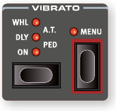

音高顫音（VIBRATO）調變振盪器的音高，以產生自然的音高顫音效果。

VIBRATO modulates the pitch of the oscillator to produce natural sounding vibrato effects.

有五種控制合成器音高顫音的方式：

There are five methods for controlling the Synth Vibrato:

- **ON**：一按下琴鍵就立即套用音高顫音。Vibrato will be applied as soon as a note is played.
- **DLY（延遲）**：演奏音符後短暫延遲才引入音高顫音。The vibrato is introduced a short amount of time after a note is played.
- **WHL（調變輪）**：音高顫音量由調變輪控制。The vibrato amount is controlled with the Modulation Wheel.
- **A.T.（二段觸鍵感應）**：按壓已按住的琴鍵來控制音高顫音。Vibrato is controlled by pressing down held notes on the keyboard.
- **PED（踏板）**：由腳踏開關或 Nord Triple Pedal 的左側或中間踏板控制音高顫音。The Vibrato is controlled by a foot switch or the left or middle pedal of a Nord Triple Pedal.

### 音高顫音選單 / VIBRATO MENU

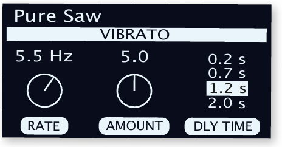

音高顫音選單提供速率（Rate，2.0–8.0 Hz）、量（Amount，0–10）和延遲時間（Dly Time，0.2、0.7、1.2 或 2.0 秒）的設定。

The Vibrato MENU provides settings for Rate (2.0–8.0 Hz), Amount (0–10), and Dly Time (0.2, 0.7, 1.2 or 2.0 seconds).

### 音高顫音與取樣音色 / VIBRATO AND SAMPLES

Nord Sample Library 4 的取樣音色附帶預定義的音高顫音設定。一般而言，取樣音色的音高顫音設計為盡可能自然和逼真。

Samples from the Nord Sample Library 4 come with predefined settings which determine the exact nature of the Vibrato.

---

## 鍵盤同步觸發（KB SYNC） / KB SYNC

在 KB SYNC 模式（Shift+Arp Run）下，每次所有琴鍵放開後再按下新音符時，琶音器或節奏閘門都會重置。

In KB SYNC mode (Shift+Arp Run), the arpeggiator or gate will be reset any time a new note is played after all keys have been lifted.

當主節拍時鐘（MST CLK）啟用時，KB Sync 參數決定是否重置主節拍時鐘。這會影響整個音色配置中所有同步到主節拍時鐘的參數。

When MST CLK is active, this KB Sync parameter determines whether the Master Clock is reset. This affects all parameters synced to the Master Clock in the entire program.

> 💡 你可以為每個音層分別設定 KB Sync，例如讓鍵盤左側分區的琶音音層在演奏時重置時鐘，而右側的旋律音層不重置。

---

## 音色初始化（SOUND INIT） / SOUND INIT

按下 SOUND INIT（Shift+Waveform），可重置所有合成器參數（除了合成器模式和已選波形／取樣音色之外）——非常適合從空白狀態開始設計音色。

Pressing SOUND INIT (Shift+Waveform) allows for initializing all synthesizer parameters except for the Synth Mode and selected waveform/sample.

此操作可透過按下 UNDO 撤銷。

The Sound Init operation can be undone by pressing UNDO.

1.4x 原文整頁參考

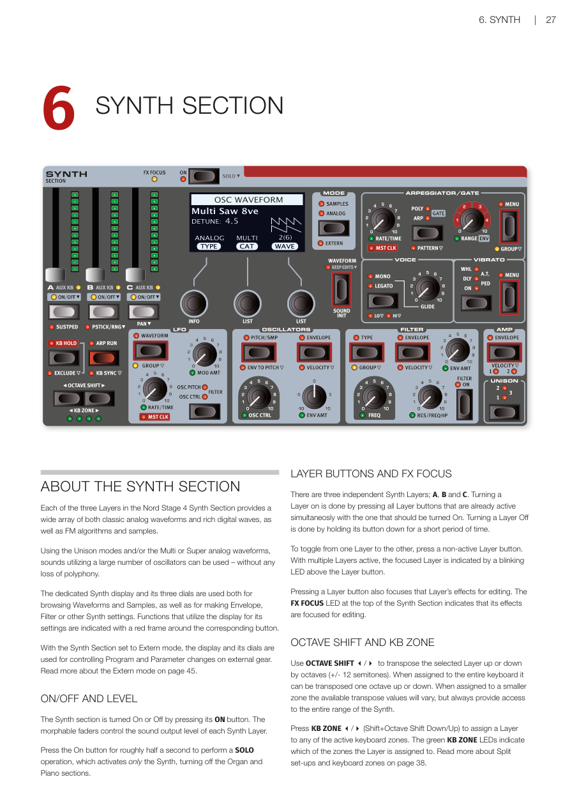

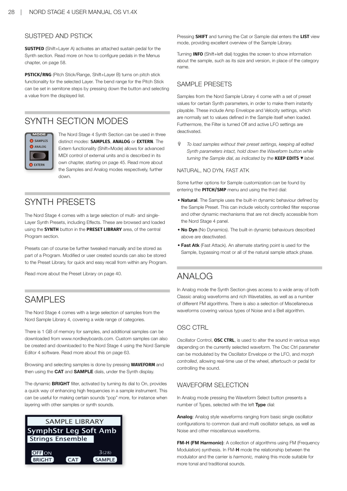

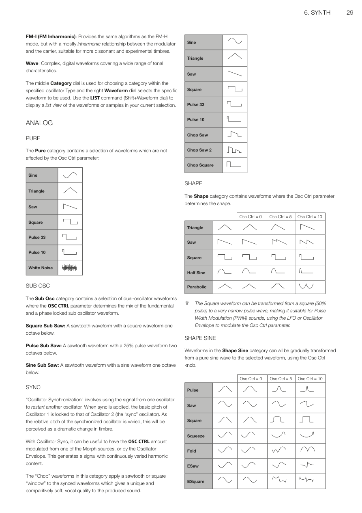

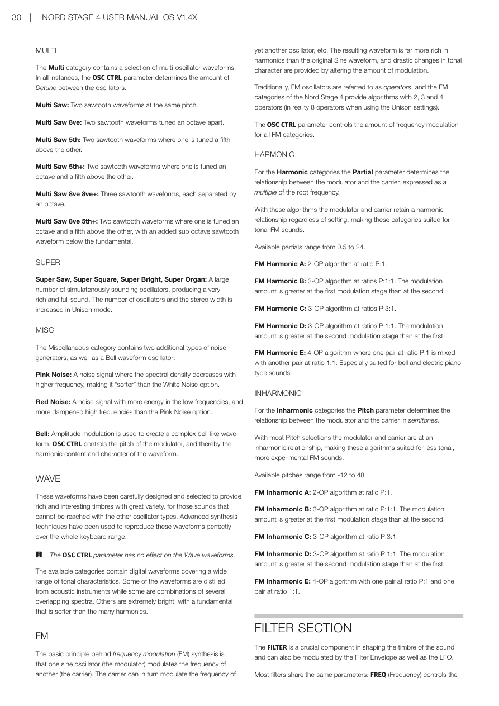

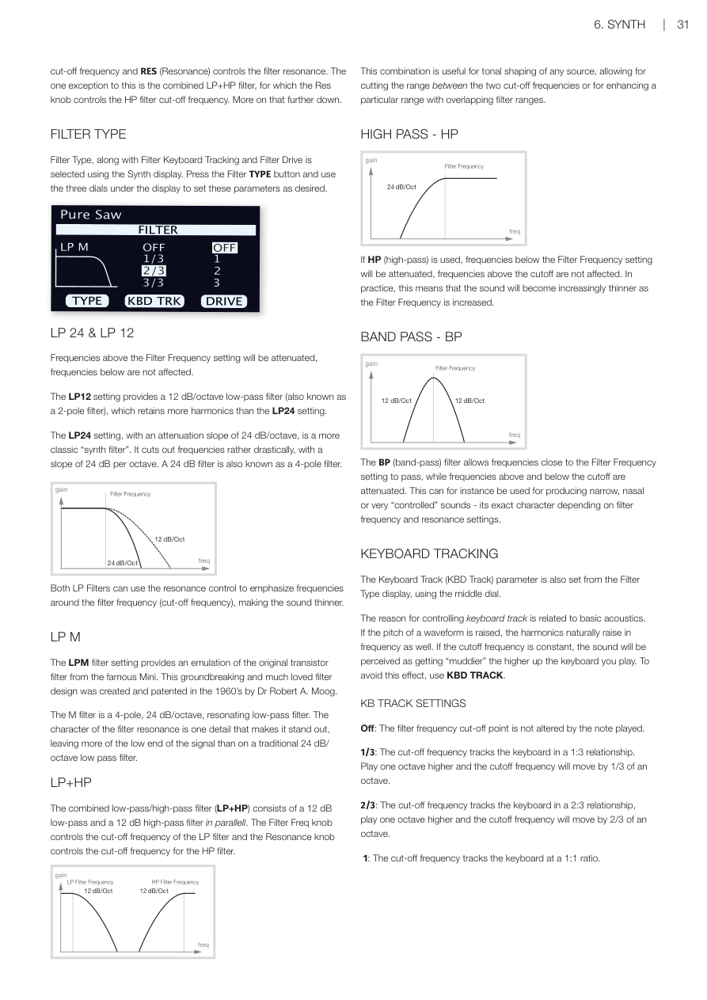

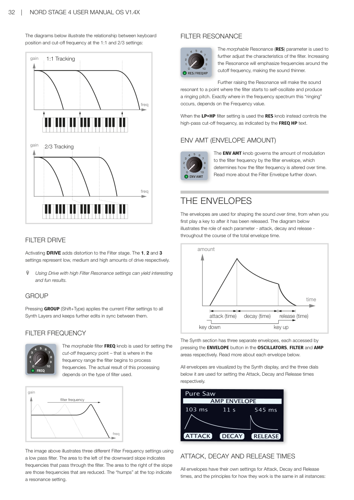

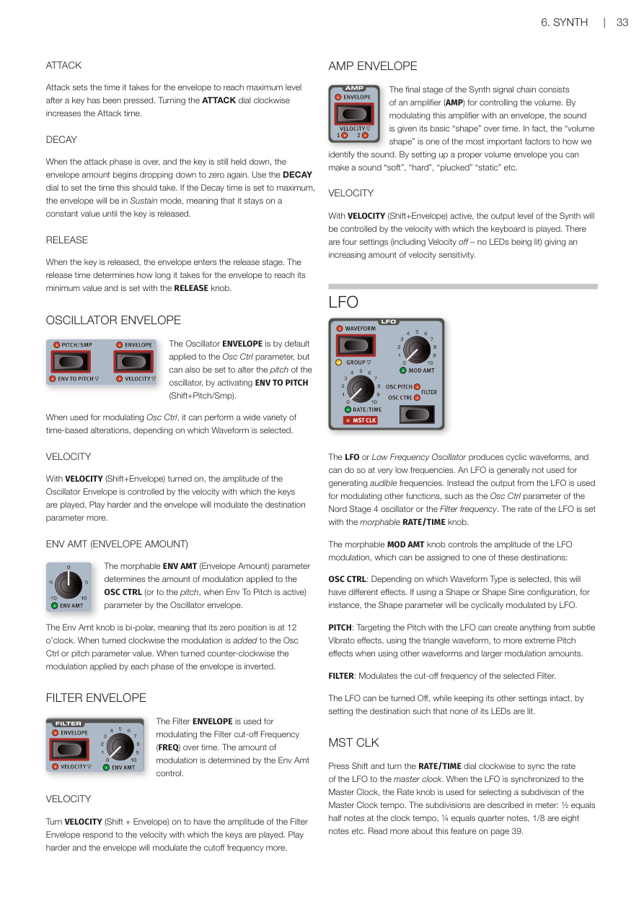

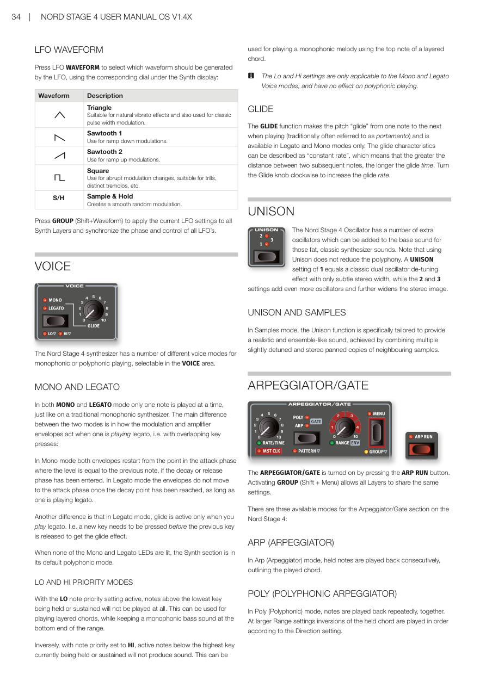

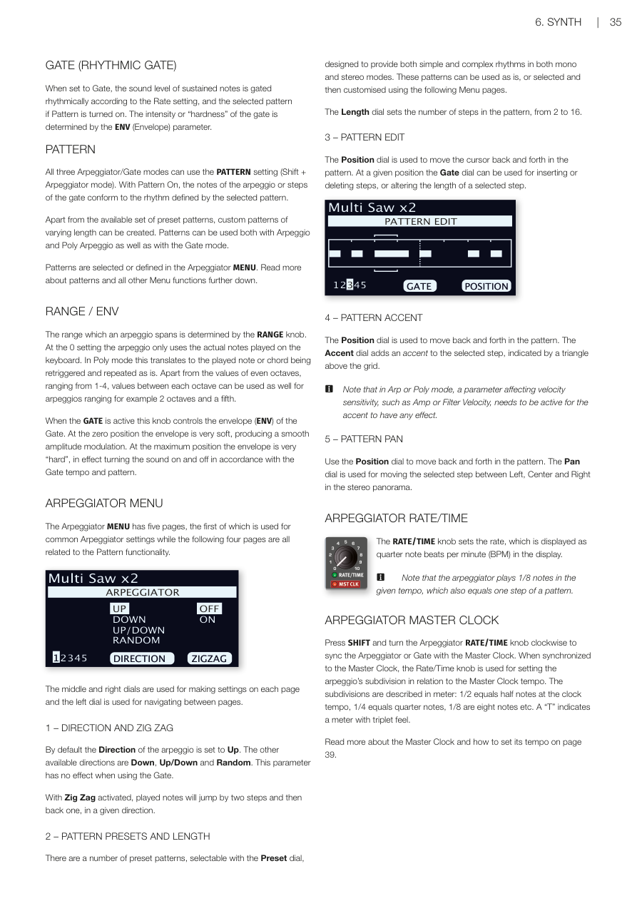

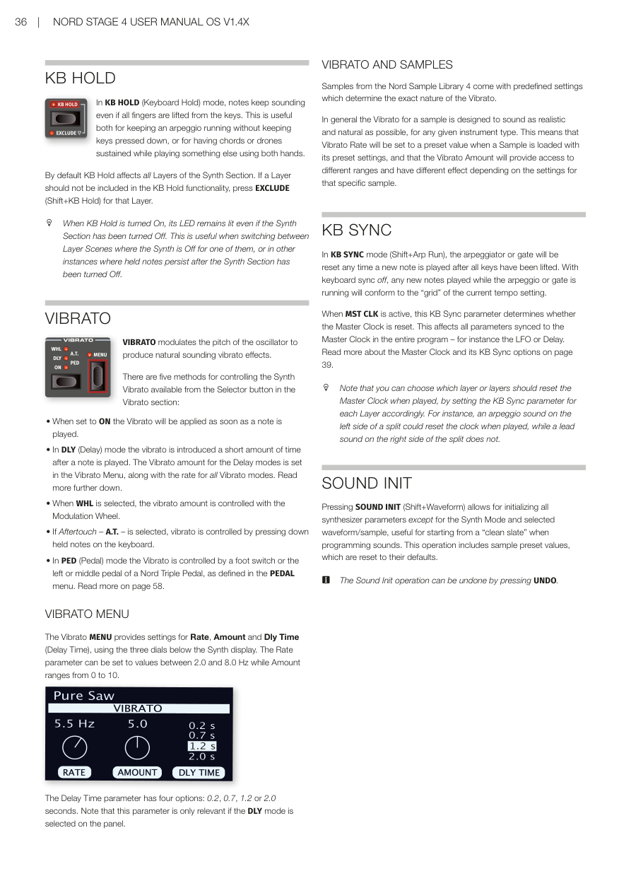

