

# 第七章：音色配置區 / Chapter 7: Program

---

## 音色配置區概覽 / PROGRAM OVERVIEW

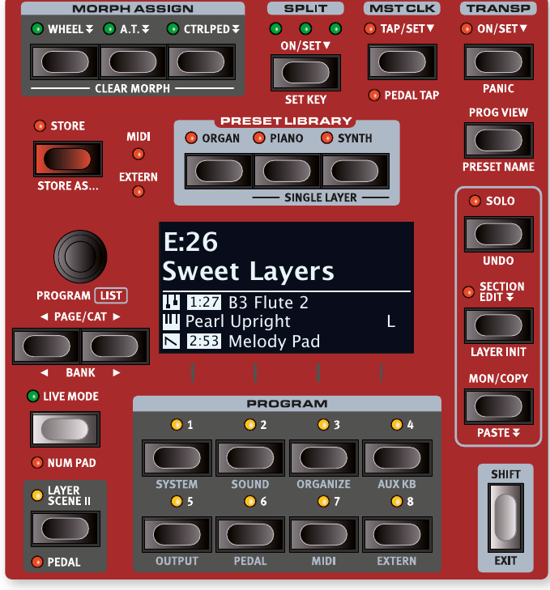

中央的**音色配置區（Program Area）**是整台琴的操作核心，讓你載入和儲存音色配置（Program——Nord Stage 4 用來保存所有設定的記憶單位）、使用即時模式（Live Mode）、音層場景（Layer Scene）、鍵盤分區（Split）等功能。

The central PROGRAM area provides access to performance functions such as loading and storing Programs, access to the Live Mode, Layer Scene, Keyboard Split functionality and more.

音色配置區也包含**預設音色庫（Preset Library）**，讓你可以將各區或個別音層的完整音色載入到音色配置中。用戶自訂的音色也可以儲存到預設音色庫。詳情請見第 40 頁。

The Program area is also home to the PRESET LIBRARY, from where complete sounds for each Section or individual Layers can be loaded into a Program. User sounds can also be stored to the Preset Library. Read more about the Preset Library on page 40.

此外，系統、音色、MIDI 等重要設定選單也在這裡存取。選單設定的詳細說明從第 56 頁開始。整理（Organize）和輔助鍵盤（Aux KB）功能也在本章後面介紹。

This is also where the various menus for making System, Sound, MIDI and other important settings are found. All menus and their settings are covered in a separate chapter, starting on page 56. The Organize and Aux KB functions are described further on in this chapter.

---

## 什麼是音色配置？/ WHAT IS A PROGRAM?

**音色配置**儲存了面板上幾乎所有的設定，唯一例外是主音量（Master Level）以及獨奏（Solo）和區編輯（Section Edit）等臨時模式。音色配置也包含分區、音層場景、鍵盤分區和Morph 多參數控制的設定。從預設音色庫載入的預設音色也會存在音色配置裡。

A Program stores and contains all settings made on the panel except for the Master Level and temporary editing modes such as Solo and Section Edit. The Program also includes Splits, Layer Scene, Keyboard Zones and Morph configurations. Presets loaded into a Program from the Preset Library (see below) are also stored as part of the Program.

音色配置也儲存了輔助鍵盤（Aux KB）和外部 MIDI（Extern）選單中的所有設定。

A program also contains all settings from the Aux KB and Extern menus.

> 💡 可以透過電腦上的 Nord Sound Manager 軟體來存取和整理音色配置及其他內容，詳見第 62 頁。

Programs and other content can be accessed and organized from a computer using the Nord Sound Manager application, see page 62 for more information.

---

## Morph 多參數控制指定 / MORPH ASSIGN

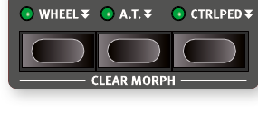

**Morph 多參數控制（Morph——讓你用一個動作同時控制多個參數的強大功能）**是非常實用的演奏工具，讓你用單一控制來源同時調整多個參數。

The Morph is a very powerful tool, which allows for controlling multiple parameters at once using one control "source".

> **譯註：Morph 是什麼？**  
> Morph 可理解為「多參數連動控制」：先為各參數設定變化的起點與終點，演奏時再用調變輪、控制踏板或二段觸鍵感應（Aftertouch），以一個動作控制這些變化。  
> 例如，可以設定推動調變輪時，同時讓鋼琴音量逐漸降低、弦樂音層音量逐漸提高，並增加殘響效果的乾濕比。這些變化需要事先指定；各參數的變化方向與範圍可以不同。

三個 **MORPH ASSIGN** 按鈕——WHEEL（調變輪）、A.T.（二段觸鍵感應 Aftertouch）、CTRLPED（控制踏板）——代表三種可用的Morph 多參數控制來源。

The three MORPH ASSIGN buttons, WHEEL, A.T., CTRLPED, represent the three available Morph sources: the modulation wheel, keyboard aftertouch, and control pedal.

> 💡 調變輪的Morph 多參數控制也可以用連接到 ORGAN SWELL 插孔的表情踏板來鏡像控制。設定方式請見第 58 頁。

The Wheel morph can be mirrored by an expression pedal attached to the ORGAN SWELL jack. See page 58 for details on how to set this up.

**設定Morph 多參數控制的方法**：按住 Morph Assign 按鈕，同時將參數控制器（例如旋鈕或音栓拉桿）從起始位置移到結束位置。建議先把控制器調到想要的起始位置，再按下 Morph Assign 按鈕。設定過程中顯示幕會顯示起始和結束數值。

A Morph is set up by holding down one of the Morph Assign buttons, while at the same time moving a parameter control (for example a knob or a drawbar) from the point where the morph should start to the point where it should end. It is a good practice to have the control set to the desired start position before pressing down the morph assign button. The display will show the start and stop values as the morph is set up.

按住 Morph Assign 按鈕時可以同時調整多個參數，也可以在已設定變形後繼續新增更多目標參數。

Multiple parameters can be adjusted while pressing down a Morph Assign button, and additional morph destinations can be added after a morph has been assigned.

---

### 可用的Morph 多參數控制目標參數 / MORPH DESTINATIONS

| 區 / Section | 可控制的參數 / Parameters |
|---|---|
| 風琴 / Organ | 音層音量 Layer Level、音栓拉桿 Drawbars、旋轉喇叭速度 Rotary speed |
| 鋼琴 / Piano | 音層音量 Layer Level |
| 合成器 / Synth | 音層音量 Layer Level、LFO 速率 LFO Rate、LFO 量 LFO Amount、振盪器控制 Osc Ctrl、濾波頻率 Filter Freq、濾波共鳴 Filter Resonance、琶音/閘速率 Arp/Gate Rate、驅動量 Drive Amount |
| 效果 / Effects | Mod 1 速率 Mod 1 Rate、Mod 1 量 Mod 1 Amt、Mod 2 量 Mod 2 Amt、延遲速度 Delay Tempo、延遲回饋 Delay Feedback、延遲乾濕比 Delay Dry/Wet、EQ 中頻/濾波頻率 EQ Mid / Filter Freq、殘響乾濕比 Reverb Dry/Wet |

快速雙擊 Morph Assign 按鈕可以進入鎖定模式（latch mode），讓你不用一直按著按鈕就能設定Morph 多參數控制。按 EXIT 離開鎖定模式。

Double-tapping a Morph Assign button activates morph assign latch mode, allowing for assigning morphs without keeping that button pressed down. Press EXIT to leave latch mode.

Morph 多參數控制可以從一個來源複製到另一個來源，詳見第 42 頁。

Morphs can be copied from one control source to another, see page 42.

---

### Morph 多參數控制指示燈 / MORPH INDICATORS

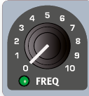

所有可設定Morph 多參數控制的參數都有某種方式來顯示是否已指定了變形，或者目前正在執行變形。

All morphable parameters are equipped with some means of showing that a morph has been assigned to it, or that a morph is being performed.

**LED 推桿**——風琴、鋼琴和合成器音層的音量控制具有實體推桿和 LED 圖表，可清楚顯示變形的起始和結束點。

LED FADERS — The level controls of the Organ, Piano and Synth Layers feature a physical fader and an LED graph. These provide a clear indication of the morph start and end points as the morph is set up.

**變形 LED**——大多數可設定變形的參數都有一個「變形 LED」，指定了變形來源後會亮起綠燈。

MORPH LEDS — Most morphable parameters are equipped with a "morph LED" which will be lit with a green light after a morph source has been assigned to the parameter.

**音栓拉桿 LED**——如果音栓拉桿被選為變形目標，音栓拉桿 LED 會隨著變形執行而相應調整。

DRAWBAR LEDS — If a drawbar has been selected as a morph destination, the drawbar LEDs will adjust accordingly as a morph is being performed.

> 💡 注意：在音栓拉桿即時模式（Drawbar Live mode）下，Morph 多參數控制無法作用於音栓拉桿。

Note that morphs are not applicable in Drawbar Live mode.

---

### 清除Morph 多參數控制 / CLEARING A MORPH

按住 SHIFT 再按 MORPH ASSIGN 按鈕，可以**清除**該來源的所有變形設定（所有音層）。若要清除特定的變形指定，按住 Morph Assign 按鈕，再操作對應控制器，消除儲存值與變形設定值之間的差距即可。

Hold SHIFT and press a MORPH ASSIGN button to CLEAR all Morphs for this source – for all Layers. To clear a particular assignment, hold the Morph Assign button and operate the control to remove the "gap" between the stored setting and the Morph setting.

---

## 鍵盤分區 / SPLIT

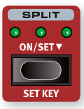

Nord Stage 4 的鍵盤可以分割成最多四個**鍵盤分區（Split——把琴鍵盤分成幾個區域，讓不同區域發不同的聲音）**（1、2、3、4），由三個分區點分隔：Low（低音）、Mid（中間）和 High（高音）。任何風琴、鋼琴或合成器音層都可以自由指定到任一或多個分區。

The Nord Stage 4 keyboard can be split in up to four keyboard zones; 1, 2, 3 and 4, separated by the three available split points, Low (L), Mid (M) and High (H). Any Organ, Piano or Synth Layer can then be freely assigned to any or all of these zones.

單按 SPLIT ON/SET 按鈕可開啟或關閉分區功能。長按此按鈕可在顯示幕上開啟鍵盤分區設定畫面。

A single press of the Split ON/SET button will turn the split function on or off. Pressing and holding the button will open the Keyboard Split screen in the display.

按 SHIFT+SET KEY 可移動目前選取的分區點位置。

Pressing SHIFT and SET KEY shifts the position of the currently selected split point.

### 鍵盤分區設定 / KEYBOARD SPLIT SETTINGS

啟用分區後，使用各區八度移調按鈕下方的 KB ZONE 控制（需按住 SHIFT）來將音層指定到一個或多個分區。四個分區 LED 指示每個音層被指定到哪些分區。

After a split has been activated, use the KB ZONE controls (accessed with SHIFT) below each section's Octave Shift buttons to assign a Layer to one or more zones. The four Zone LEDs indicate which zone(s) each Layer is assigned to.

### 選擇分區點位置 / CHOOSING A SPLIT POSITION

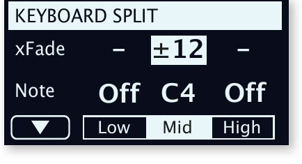

在鍵盤分區頁面，可以將三個分區點各自指定到一個鍵盤位置，或停用某個分區點。共有 11 個可用的鍵盤分割位置，從 C2 到 C7。

The Keyboard Split page allows for assigning each of the three split points to a keyboard position, or for deactivating a split point. There are 11 possible keyboard split positions, ranging from C2 to C7.

### 分區點平滑淡出淡入設定 / SPLIT XFADE SETTINGS

通常兩個鍵盤分區之間的切換是即時的，沒有重疊。透過調整分區點的 xFade（平滑淡出淡入）設定，可以讓兩個區域的聲音在分區點周圍平滑過渡，而非突然切換。

Normally the transition between two keyboard zones is immediate, with no overlap. By adjusting the xFade setting for a split point, the sounds can instead be "cross-faded" across the split point, giving a smoother transition.

- **「–」設定**：不套用平滑淡出淡入。/ With the – setting no cross-fade is applied.
- **「±6」設定**：分區點兩側各 6 個半音的漸變寬度。/ The ±6 setting represents a width of 6 semitones on each side of the split point.
- **「±12」設定**：分區點兩側各 12 個半音的漸變寬度。/ The ±12 setting provides a width of 12 semitones below the split point and 12 above it.

---

## 主節拍時鐘 / MST CLK

**主節拍時鐘（Master Clock）**可以讓你同步琶音器/閘、合成器 LFO、延遲效果和 Mod 1 速率。

The Master Clock lets you synchronize the Arpeggiator/Gate, the Synth LFO, the Delay and Mod 1 Rate on the Nord Stage 4.

至少連續點擊 TAP/SET 按鈕四次來設定速度（以 BPM，即每分鐘拍數為單位）。

Tap the TAP/SET button a minimum of four times to set a tempo, expressed in BPM (beats per minute).

---

長按 TAP/SET 按鈕可開啟主節拍時鐘速度和設定頁面。用音色配置控制旋鈕調整速度。按 EXIT（Shift）完成設定。設定的速度會隨音色配置一起儲存，前提是有執行儲存操作。

Press down on the TAP/SET button to bring up the Master Clock tempo and settings page. Use the PROGRAM dial to set the tempo. Press EXIT (Shift) when finished. The set tempo will be stored with the program, as long as a Store operation is performed.

### 外部同步 / EXTERNAL SYNC

Stage 4 的主節拍時鐘可以接收外部 MIDI 時鐘訊號來控制。這是自動行為：只要 Stage 4 在 MIDI 或 USB MIDI 輸入端接收到 MIDI 時鐘訊號，主節拍時鐘就會自動同步到外部時鐘。

The Master Clock on the Stage 4 can be controlled by incoming MIDI clock messages. This is automatic: As soon as the Stage 4 receives MIDI clock on the MIDI input or the USB MIDI input, the Master Clock will be synchronized to the incoming external clock.

### 鍵盤同步觸發 (KBS) / (KBS) KEYBOARD SYNC

在主節拍時鐘速度設定頁面，可以選擇鍵盤同步觸發（Keyboard Sync）的行為：

On the Master Clock tempo/settings page, Keyboard Sync behavior can be selected:

- **Off**：彈奏琴鍵不會重置時鐘。/ The Clock is not reset by playing the keyboard.
- **On**：放開所有琴鍵後再彈奏時，時鐘會重置。/ The Clock is reset after lifting all keys and then playing the keyboard again.
- **Soft**：只有在放開所有琴鍵後等待超過一個四分音符的時間再彈奏，才會重置時鐘。/ The Master Clock will only be reset if waiting longer than one quarter note to play the keyboard, after all keys have been lifted.

### 踏板拍速輸入 / PEDAL TAP

按 Shift+Mst Clk 啟用 **PEDAL TAP** 功能。啟用後，可以用連接的踏板反覆踩踏來調整主節拍時鐘速度。

Press Shift+Mst Clk to enable PEDAL TAP. When active, an attached pedal can be used for adjusting the master clock tempo by pressing it repeatedly.

---

## 移調 / TRANSPOSE ON/SET

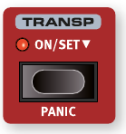

Nord Stage 4 可以對每個音色配置進行移調（Transpose——將所有音層的音高同步上移或下移），範圍為 +6/-6 個半音。按住 TRANSP 按鈕，同時轉動 Value Dial 來設定移調量。再次按下按鈕可取消移調。

The Nord Stage 4 can be transposed in semitone steps on a per-program basis, with a range of +6/-6 semitones. Hold the TRANSP button and set the transposition by turning the Value Dial. Press the button again to de-activate a transposition.

移調設定會隨音色配置一起儲存和調用，且永遠影響音色配置的所有音層。

Transpose settings are saved and recalled as part of a program, and always affect all Layers.

> 💡 若要設定影響所有音色配置的移調，請使用系統選單中的 Global Transpose 設定。

To set up a transpose that affects all programs, use the Global Transpose setting in the System Menu.

---

## 緊急停音 / PANIC

按 PANIC（Shift+Transp）發送「All Notes Off」訊號並重置部分演奏參數。當 MIDI 演奏或現場演出中出現卡音（音符持續發聲不停）時，這個功能非常有用。

Press PANIC (Shift+Transp) to execute an internal "All Notes Off" message. This can be used if notes get stuck during a MIDI or live performance.

---

## 儲存音色配置 / STORE

**STORE** 按鈕用於將已編輯的音色配置或預設音色儲存到音色配置庫或預設音色庫的某個位置。儲存時會覆蓋該記憶位置中原有的資料。

The STORE button is used for storing an edited program or preset to a location in the program or preset banks. Storing a program or preset will overwrite the existing data in the selected memory location.

> 💡 Nord Stage 4 出廠時記憶體是受保護的，以防意外覆蓋原廠音色配置。若要儲存音色配置，需要先到系統選單（System Menu）將 Memory Protect 設定為「Off」。

When the Nord Stage 4 is shipped from factory its memory is protected, to avoid accidental overwriting. Memory Protect needs to be set to "Off" in the System menu to be able to store Programs.

### 儲存音色配置的步驟 / STORING A PROGRAM

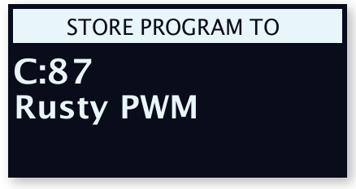

1. 按一次 STORE 按鈕。STORE 燈開始閃爍，顯示幕會顯示音色配置名稱和位置。

   Press the STORE button once. The Store button will start blinking, and the display will show the name of the program and its location.

2. 用旋鈕和/或 PAGE/BANK 按鈕選擇儲存位置。若要取消，按 SHIFT/EXIT。

   To select a store location use the dial and/or PAGE/BANK buttons. To cancel, press SHIFT/EXIT.

3. 選好位置後，再按一次 STORE 確認。

   When a suitable location has been selected, press STORE again to confirm.

按下 STORE 後，也可以按 LIVE MODE 按鈕將音色配置儲存到八個即時模式（Live Mode）位置之一。

A program can also be stored to one of the eight Live program locations by pressing LIVE MODE after having pressed Store.

---

### 另存新音色配置並命名 / STORE AS

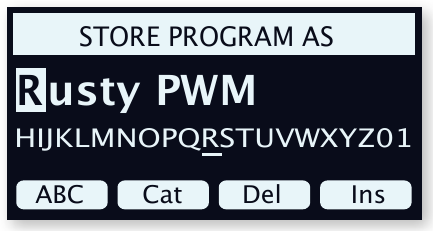

1. 按 STORE AS（Shift + Store）以儲存並命名音色配置。

   Press STORE AS (Shift + Store) to store and name your program.

2. 長按 ABC 功能鍵調出字母數字字元，用旋鈕選擇字元。放開 ABC 鍵後游標自動移到下一個位置。

   Hold down the ABC soft button to bring up alphanumeric characters and use the dial to select a character. Letting go of the ABC button moves the cursor to the next position.

3. 按 Cat 功能鍵並從清單中選擇類別，可以為音色配置設定分類，方便日後尋找。

   To assign a category, press the Cat soft button and select a category from the list.

4. 按 STORE 顯示「Store Program To」畫面，用旋鈕和/或 PAGE/BANK、Program 按鈕選擇位置。

   Press STORE to bring up the Store Program To screen. Use the dial and/or PAGE/BANK and Program buttons to select a location.

5. 找到合適位置後，再按一次 STORE。

   When a suitable location has been found, press STORE again.

---

## 音色配置控制旋鈕 / PROGRAM DIAL

**音色配置控制旋鈕**用於選取音色配置和預設音色、設定選單參數值，以及在命名音色配置時輸入字元。按住 SHIFT 轉動旋鈕可進入清單（LIST）檢視模式。

The PROGRAM dial is used for selecting Programs and Presets, for setting menu parameter values and for entering characters in program names. Pressing SHIFT while turning the dial activates the LIST view.

**清單排序選項**：數字排序（Num）、字母排序（Abc）、類別排序（Cat）。

LIST OPTIONS: Numeric (Num), Alphabetical (Abc), and Category (Cat) sort modes.

---

## 分頁按鈕 / PAGE BUTTONS

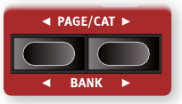

用 PAGE 按鈕來切換音色配置分頁。每個音色配置庫（Bank）包含 8 個分頁，每頁 8 個音色配置。按 BANK（Shift + Page 按鈕）在音色配置庫之間切換。

Program pages are navigated by pressing the PAGE buttons. Each Bank holds 8 pages, with 8 Programs on each page. Press BANK (Shift + Page buttons) to switch between program banks.

---

## MIDI 和外部 MIDI 指示燈 / MIDI AND EXTERN INDICATORS

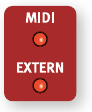

**MIDI LED** 在接收到 MIDI 訊號時閃爍。**EXTERN LED** 在三個外部 MIDI 頻道中有任一頻道傳送 MIDI 時閃爍。

The MIDI LED blinks as incoming MIDI messages are received. The EXTERN LED blinks when MIDI is going out on any of the three Extern MIDI channels.

---

## 預設音色庫 / PRESET LIBRARY

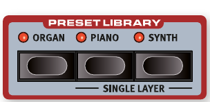

Nord Stage 4 附有豐富的預設音色庫，涵蓋風琴、鋼琴和合成器區，讓你可以將包含效果設定的完整音色載入現有音色配置。用戶自訂音色也可以儲存到預設音色庫中。

The Nord Stage 4 comes with extensive Preset banks for the Organ, Piano and Synth sections, letting you load complete sounds, including their effect configurations, into an existing Program. Custom sounds can also be stored to the Preset banks.

### 瀏覽和載入預設音色 / BROWSING AND LOADING PRESETS

鋼琴和合成器區有兩種不同的載入方式：為整個區載入，或為單一音層載入（保持其他音層不變）。

For the Piano and Synth sections there are two distinct methods: loading for an entire Section, or for a single Layer (which keeps other Layers intact).

**為整個區載入**：在 PRESET LIBRARY 區域按 ORGAN、PIANO 或 SYNTH 按鈕。轉動旋鈕時，所選預設音色中的音層就會被載入。

LOADING PRESETS FOR A SECTION: To browse and load Presets for a Section press the ORGAN, PIANO or SYNTH buttons in the PRESET LIBRARY area. When turning the dial the Layers contained in the selected Preset are loaded.

---

預設音色可以按類別排序（按 Cat 鍵）。找到目標預設音色後，按 Shift/Exit 或對應的預設音色庫按鈕離開。按 Cancel 則會恢復到進入預設音色庫前的音色。

Presets can be sorted by Category by pressing Cat. Once the desired Preset has been found, press Shift/Exit or the corresponding Preset Library button to leave the Preset screen. Pressing Cancel instead reverts to the sound that was loaded prior to entering the Preset Library.

**為單一音層載入**：先聚焦要載入預設的鋼琴或合成器音層，再按 SINGLE LAYER（Shift + Piano/Synth 預設音色庫）。

LOADING SINGLE LAYER PRESETS: Loading Presets for individual Layers is done by focusing the Piano or Synth Layer for which a Preset should be loaded and then pressing SINGLE LAYER (Shift + Piano/Synth Preset Library).

### 儲存預設音色到預設音色庫 / STORING PRESETS TO THE PRESET LIBRARY

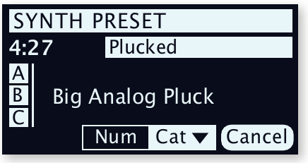

1. 按 STORE，顯示「Store Program To」畫面。

   Press STORE – which will show the "Store Program To" screen.

2. 按 ORGAN、PIANO 或 SYNTH 預設音色庫按鈕，改為進入「Store Preset To」畫面。

   Press the ORGAN, PIANO or SYNTH Preset Library button to instead enter the "Store Preset To" screen.

3. 用旋鈕和/或 PAGE/BANK 按鈕選擇儲存位置。若要取消，按 EXIT。

   Select a store location using the dial and/or PAGE/BANK buttons. To cancel, press EXIT.

4. 選好位置後，再按一次 STORE 確認。

   When a suitable location has been selected, press STORE again.

---

## 音色配置檢視 / PROG VIEW

**音色配置顯示（PROG VIEW）**按鈕可在四種顯示模式之間切換：

The Program View (PROG VIEW) button switches between four distinct view modes:

1. **模式一**：只顯示音色配置名稱和編號，下半部顯示參數提示。/ First mode: Shows only the Program name and number, with parameter hints in lower half.
2. **模式二**：顯示音色配置名稱和目前聚焦音層的音色資訊。/ Second mode: Shows Program name and current Layer selection info.
3. **模式三**：顯示完整音色配置設定，包含所有區和音層。/ Third mode: Shows complete Program configuration including all Sections and Layers.
4. **模式四**：同時顯示目前分頁的所有八個音色配置。/ Fourth mode: Shows all eight Programs of the current Page.

### 預設音色名稱 / PRESET NAME

載入預設音色後，顯示幕會顯示其位置和名稱。若要改為顯示音源（風琴型號、鋼琴、波形或取樣音色），按 PRESET NAME（Shift+Prog View）。

When a Preset is loaded, its location and name will be shown in the display. To bypass this and see the sound source instead, press PRESET NAME (Shift+Prog View).

---

## 獨奏 / SOLO

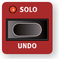

啟用**獨奏（Solo）**後，每次只能聽到一個音層，非常適合在調整音色時單獨監聽各個元素。用各區的音層按鈕選擇要聆聽的音層。按 Shift/Exit 或 Solo 按鈕離開獨奏模式。

When SOLO is active only one Layer is heard at a time, useful for monitoring individual elements. Use the Layer buttons of each Section for selecting which Layer should be heard. Exit Solo mode by pressing Shift/Exit or the Solo button.

> 💡 獨奏模式的狀態不會儲存在音色配置裡。

---

## 復原 / UNDO

可以使用**復原（Undo）**（Shift+Solo）復原的操作包括：載入預設音色、LFO/濾波器/琶音器/效果的群組功能、全域效果開關、關閉所有效果、清除Morph 多參數控制、複製/貼上、合成器初始化、音層初始化、從已編輯音色配置切換音色配置。

Undoable operations include: Loading Presets, Group function (LFO/Filter/Arp/Effects), Global mode, All FX Off, Clearing Morphs, Copy/Paste, Synth Init, Layer Init, Program change from an edited Program.

---

按 Undo 後，顯示幕會顯示可以復原的操作。按 UNDO 功能鍵確認復原，或按 Shift/Exit 取消。注意：復原會回到執行該操作之前的音色配置狀態，這意味著該操作之後的其他編輯也會一併復原。

When Undo is pressed, the display will show which operation is possible to undo. Press the UNDO soft button to go through with the operation, or Shift/Exit to cancel.

---

## 區編輯 / SECTION EDIT

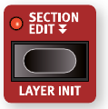

按住 **SECTION EDIT**（區編輯）時，對某個參數所做的編輯會同時套用到該區的所有音層。這對於同步多個合成器音層的參數，或為整個區設定相同的效果非常有用。

While SECTION EDIT is pressed, edits done to a parameter are performed on all Layers of that Section. The Section Edit button can be double-tapped to enter "sticky" mode.

> 💡 快速雙擊 Section Edit 按鈕可以進入「鎖定」模式，不需要一直按著按鈕就能持續編輯。再按一次 Section Edit 或 Shift/Exit 可以退出。

---

## 音層初始化 / LAYER INIT

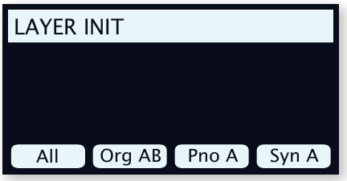

**LAYER INIT**（Shift+Section Edit）可以快速初始化整個音色配置或個別音層：

The LAYER INIT (Shift+Section Edit) functions initialize the entire Program or individual Layers:

- **All**：初始化整個音色配置，只留 Piano A 為啟用狀態，所有效果關閉。/ Initializes the entire Program so that only Piano A is active, with no effects.
- **Organ AB**：初始化兩個風琴音層為 B3 音色，音層 A 開啟，所有風琴效果重置並關閉（旋轉喇叭除外，保持開啟）。/ Initializes both Organ Layers to a B3 sound with Layer A On. All Organ effects reset, except Rotary Speaker which is On.
- **Piano A/B**：初始化聚焦的鋼琴音層為預設鋼琴音色，所有效果關閉並重置。/ Initializes the focused Layer to the default Piano sound and parameters.
- **Synth A/B/C**：初始化聚焦的合成器音層為預設波形，所有效果關閉並重置。/ Initializes the focused Layer to the default Synth Waveform and resets parameters.

---

## 音層場景 II / LAYER SCENE II

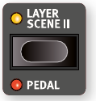

**音層場景（Layer Scene）**功能讓你在同一個音色配置中建立兩套獨立的音層設定（每個音層或區可以分別開啟或關閉），並能即時無縫切換。這樣就不需要切換音色配置，也能在演奏中快速改變音色組合。

The Layer Scene functionality allows for creating two independent Layer configurations where individual Layers or Sections can be turned On or Off as desired in each. This lets you instantly and seamlessly switch between different sound combinations within the same Program.

> 💡 每個音層可以同時存在於兩個場景中，也可以只在其中一個場景開啟。

Each Layer can be active in one or both of the Scenes.

### 設定音層場景 / SETTING UP LAYER SCENES

按 LAYER SCENE II 按鈕可在音層場景 I 和 II 之間切換。在各個場景中分別開啟或關閉所需的區和音層來設定每個場景。

Pressing the LAYER SCENE II button switches from Layer Scene I to II or vice versa. Each Layer Scene is configured by turning Sections and Layers On or Off as desired.

### 音層場景與預設音色 / LAYER SCENES AND PRESETS

- 為整個區載入預設音色時，該區在非活動場景中會被關閉。/ When loading a Preset for an entire Section, that Section will be turned off in the non-active Layer Scene.
- 使用單一音層載入預設音色時，非活動場景中該音層的開/關狀態不會改變。/ When loading a Single Layer Preset, the On/Off state for the loaded Layer is not altered for the non-active Layer Scene.

---

## 監控 / 複製 / 貼上 / MONITOR / COPY / PASTE

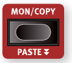

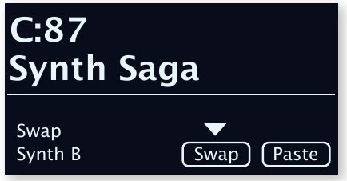

按住 **MON/COPY**（監控/複製）按鈕，同時轉動參數旋鈕，可以在不改變數值的情況下查看當前設定值。

Hold the MON/COPY (Monitor/Copy) button and turn a parameter knob to display its value without changing it.

**複製選項**：

COPY options:
- 複製音層：按住 MON/COPY + 按任意音層 A、B 或 C 按鈕 / Copy a Layer: hold MON/COPY + press any Layer A, B or C button
- 複製效果：按住 MON/COPY + 按任意效果 ON 按鈕 / Copy an Effect: hold MON/COPY + press any Effect ON button
- 複製Morph 多參數控制：按住 MON/COPY + 按 WHEEL、A.T. 或 CTRLPED 按鈕 / Copy a Morph: hold MON/COPY + press WHEEL, A.T. or CTRLPED button
- 複製音色配置：按住 MON/COPY + 按任意 PROGRAM 1-8 按鈕 / Copy a Program: hold MON/COPY + press one of the PROGRAM 1-8 buttons

**貼上**：按住 PASTE（Shift + Mon/Copy），再按目標按鈕。在同一音色配置中將音層貼到另一個音層時，可以選擇「Swap」（互換）來替代「Paste」（貼上）。

PASTE: Hold PASTE (Shift + Mon/Copy) and press the target button. When pasting a Layer to another Layer in the same Program, you can Swap instead of Paste.

---

## 輔助鍵盤 / AUX KB

**輔助鍵盤（AUX KB——Auxiliary Keyboard，讓外部鍵盤連接後能控制 Nord Stage 4 的特定音層）**功能允許透過連接到 MIDI 輸入的外部鍵盤來演奏和控制任意音層或音層組合。在現場演出中，這讓第二台鍵盤可以作為控制器來演奏部分 Nord Stage 4 的音色。

The AUX KB (Auxiliary Keyboard) feature allows for playing and controlling any Layer or combination of Layers from an external keyboard connected to the MIDI input. This can be handy in live situations where a secondary keyboard is used as a controller.

### 輔助鍵盤設定 / AUX KB SETTINGS

在 AUX KB 選單（Shift+Program 4）的第一頁，將 Aux KB Enable 設定為 On。第 2 頁讓你設定哪些音層應歸屬 Aux KB 設定。

To use Aux KB, set the Aux KB Enable setting to On, on the first page of the AUX KB menu (Shift+Program 4). Page 2 lets you assign which Layers should be part of the Aux KB configuration.

當一個音層處於 Aux KB 模式時，音層推桿下方的 Aux KB LED 會亮起，表示該音層由外部鍵盤控制，不受內部鍵盤影響。

When a Layer is in Aux KB mode its Aux KB LED, below the Layer fader, is lit.

> 💡 Aux KB 的 MIDI 頻道設定在 MIDI 選單中進行。

The MIDI Channel for Aux KB is set in the MIDI Menu.

---

## Shift / Exit 按鈕 / SHIFT / EXIT BUTTONS

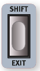

許多按鈕和旋鈕都有按住 SHIFT 才能存取的次要功能。Shift 也作為選單的 EXIT（退出）功能，以及取消儲存操作使用。

Many buttons and knobs have a secondary function accessed by holding SHIFT. Shift is also used as an EXIT function for menus and for cancelling Store operations.

Nord Stage 4 上有兩個功能相同的 Shift 按鈕。

There are two Shift buttons on the Nord Stage 4 with the same functionality.

### 長按啟動 Shift 功能 / HOLD TO SHIFT FUNCTION

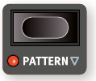

大多數 Shift 功能也可以透過長按對應按鈕來啟動，面板上以空心箭頭（↓）符號標示。

Most Shift functions can also be activated by pressing down the corresponding button for a short while.

---

## 即時模式 / LIVE MODE

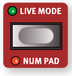

Nord Stage 4 有八個方便存取的**即時模式（Live Mode）音色配置（Live Program——一種自動儲存的音色配置，調整後不需要手動存檔）**位置。對即時模式音色配置的任何編輯，在離開或關機時都會自動儲存，省去手動存檔的步驟。

The Nord Stage 4 has eight easy-to-access Live program locations. Any edits to Live programs are automatically stored when leaving or powering off.

按 LIVE MODE，再按 1-8 任一按鈕即可選取即時音色配置。

To select a Live Program, press LIVE MODE and then any of the 1-8 buttons.

### 數字鍵盤模式 / NUM PAD (NUMERIC PAD)

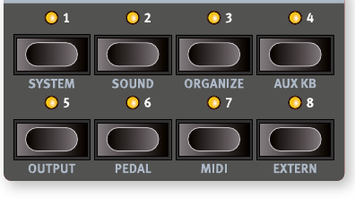

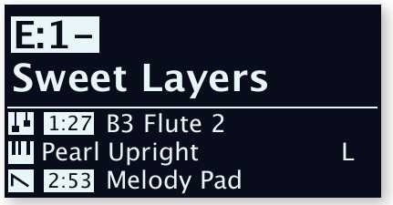

按 NUM PAD（Shift+Live Mode）啟用數字鍵盤模式。在此模式下，Program 1-8 按鈕用於輸入當前音色配置庫中的音色配置編號（11-88），而非直接切換分頁中的音色配置。

Activated by pressing NUM PAD (Shift+Live Mode). In Numeric Pad mode the Program 1-8 buttons are used for entering any program number (11-88) within the current bank.

> 💡 範例：要選取音色配置 12，先按 Program 1，再按 Program 2。

Example: to select program 12, press Program button 1 then Program button 2.

---

## 選單 / MENUS

PROGRAM 1-8 按鈕配合 SHIFT 按鈕使用，可以存取各種選單設定。

The PROGRAM 1-8 buttons are used for accessing the menus when used in conjunction with SHIFT.

---

## 整理音色配置順序 / ORGANIZE

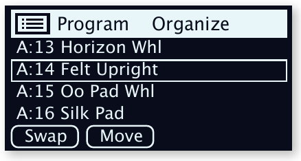

音色配置和預設音色的排列順序可以使用**整理（Organize）**（Shift+Program 3）的 Swap（互換）和 Move（移動）功能來重新排列。

The order of Programs and Presets can be rearranged using the Swap and Move ORGANIZE functions (Shift+Program 3).

- **SWAP**（互換）：交換兩個音色配置的位置。/ Interchanges the positions of two programs.

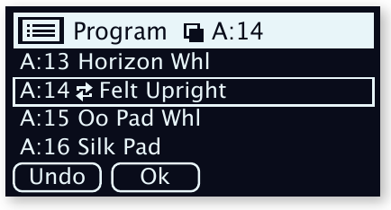

- **MOVE**（移動）：將音色配置移到另一個位置；來源和目的地之間的音色配置會上移或下移一格。/ Moves a program to another location; programs between source and destination are shifted one step.

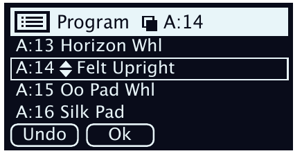

> 💡 也可以透過 Nord Sound Manager 軟體在電腦上整理音色配置。

Content can also be organized using the Nord Sound Manager.

---

## 音色配置音量 / PROGRAM LEVELS

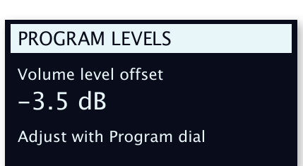

**音色配置音量（Program Levels）**功能提供一個快速調整整個音色配置總音量的方法，讓你在不調整主音量的情況下調高或調低某個音色配置的整體音量——在準備現場演出的音色配置時特別實用。此功能在 SOUND 選單（Shift+Program 2）的第一頁。轉動音色配置控制旋鈕可以等量調整所有區所有音層的音量。

The Program Levels function provides a shortcut for adjusting the total volume level of an entire program. Found on the first page of the SOUND menu (Shift+Program 2 button). Turning the Program dial adjusts the levels of all Layers, for all Sections, by an equal amount.

1.4x 原文整頁參考

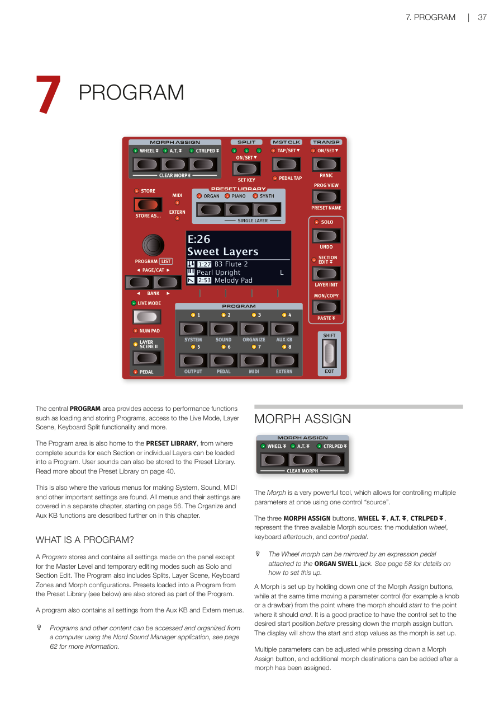

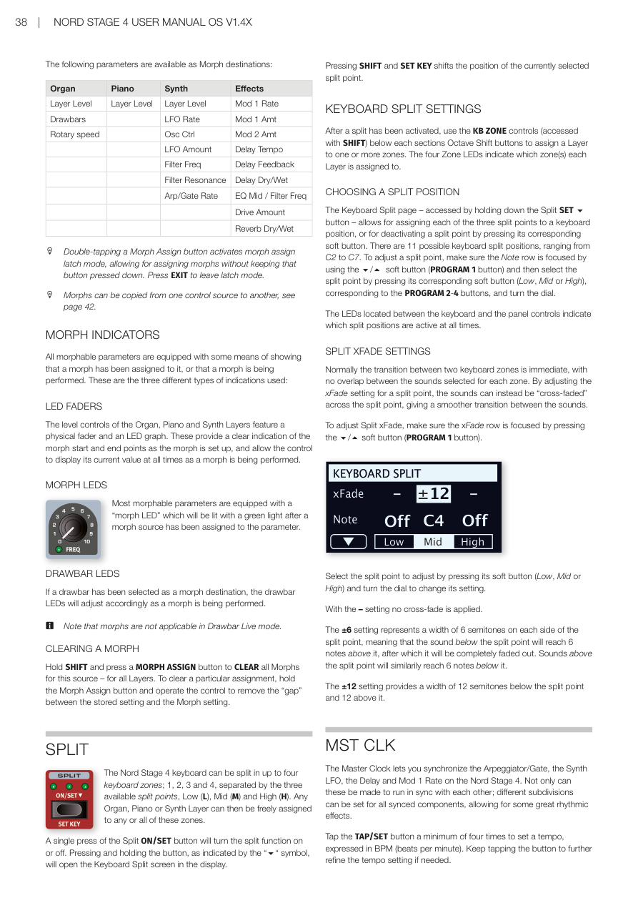

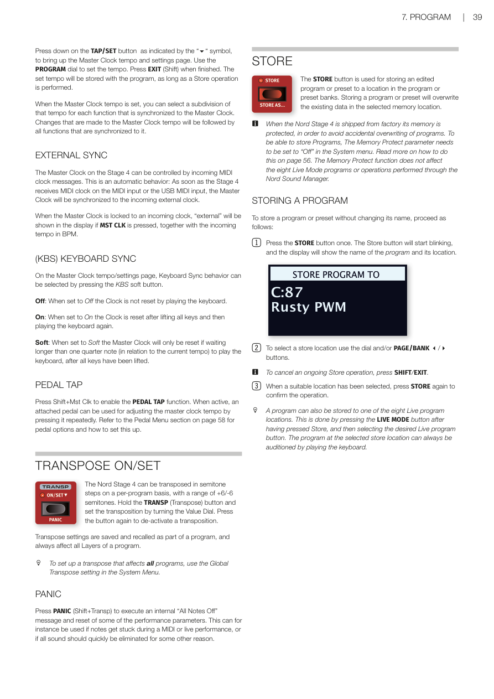

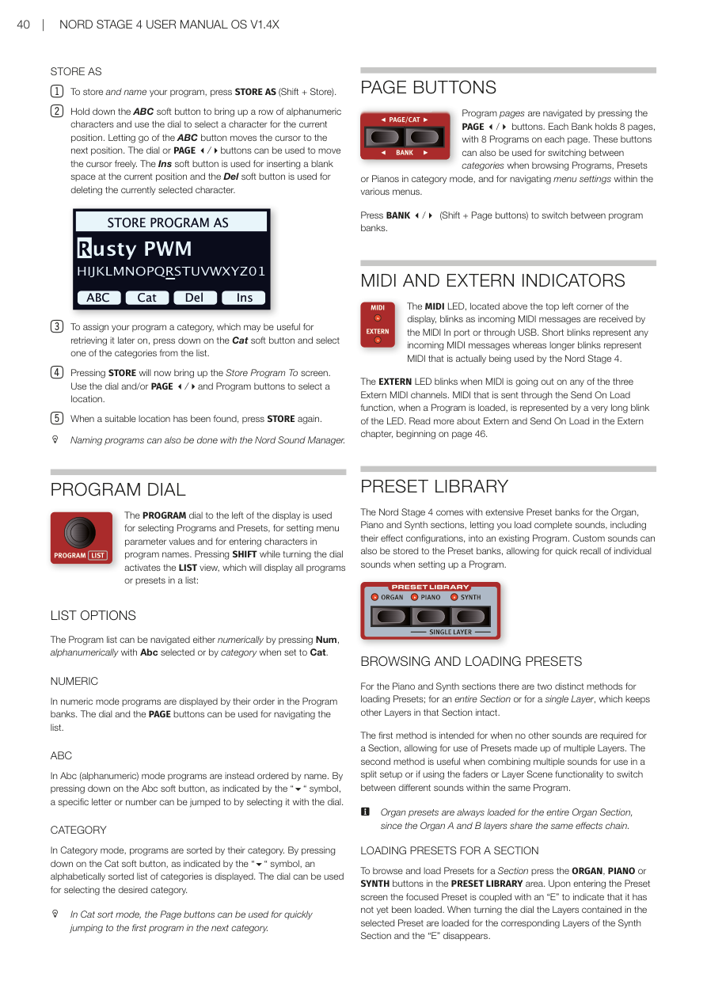

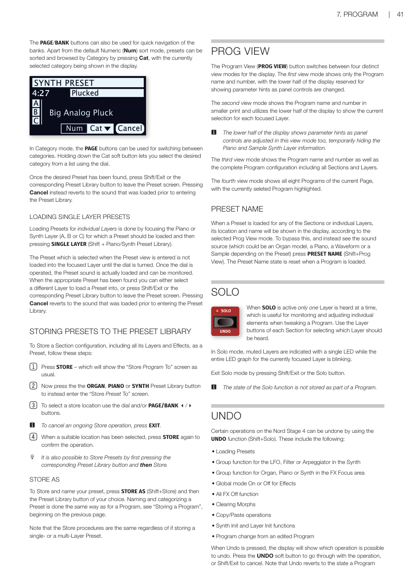

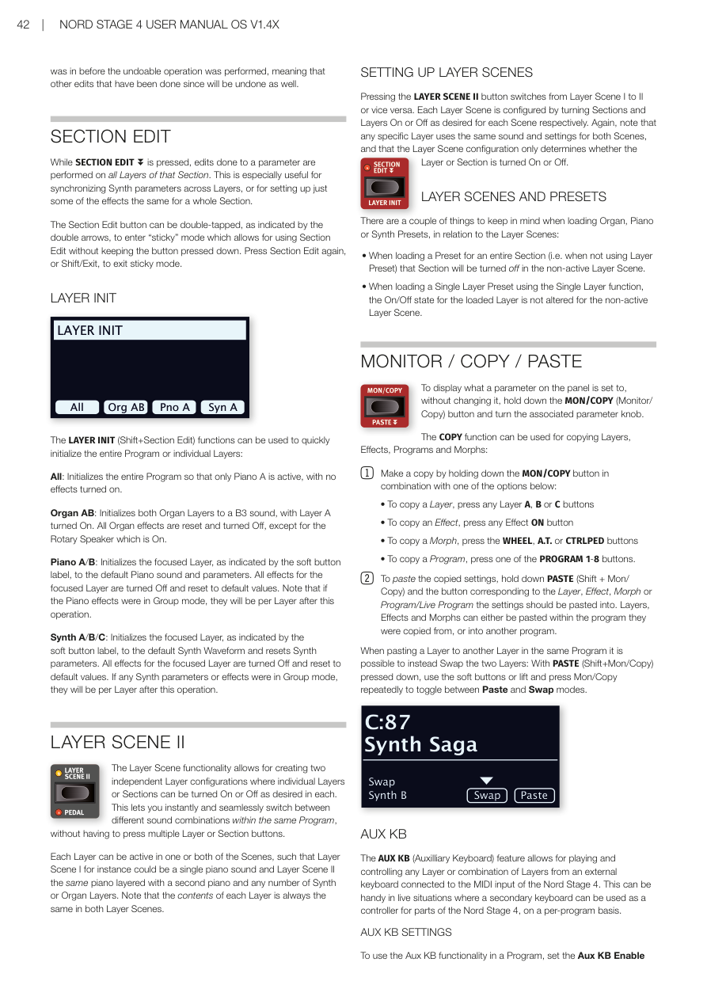

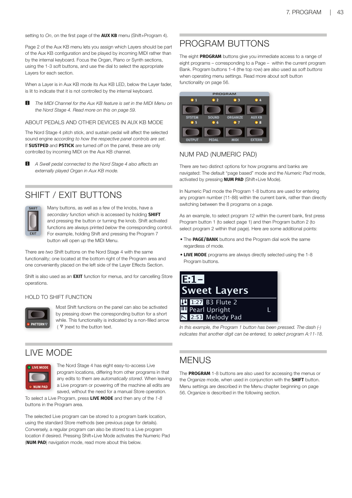

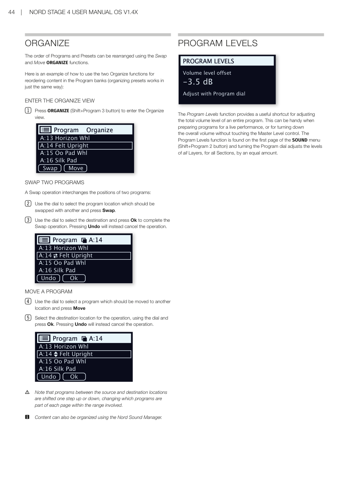

