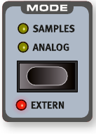
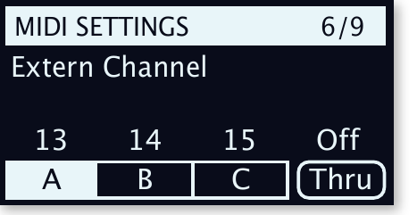
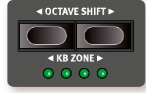
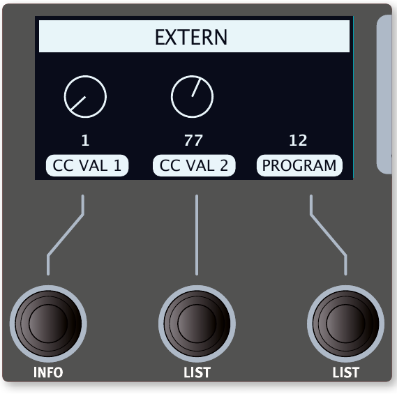
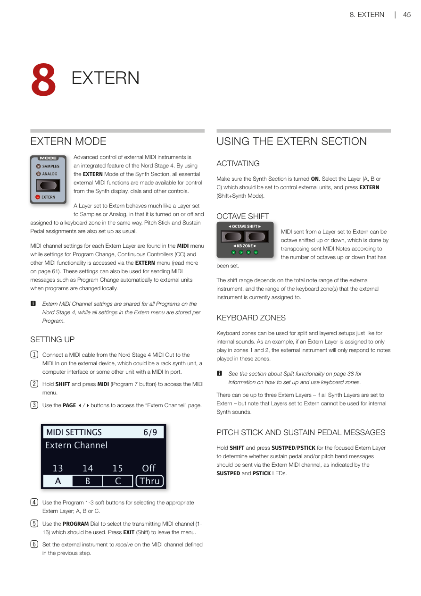
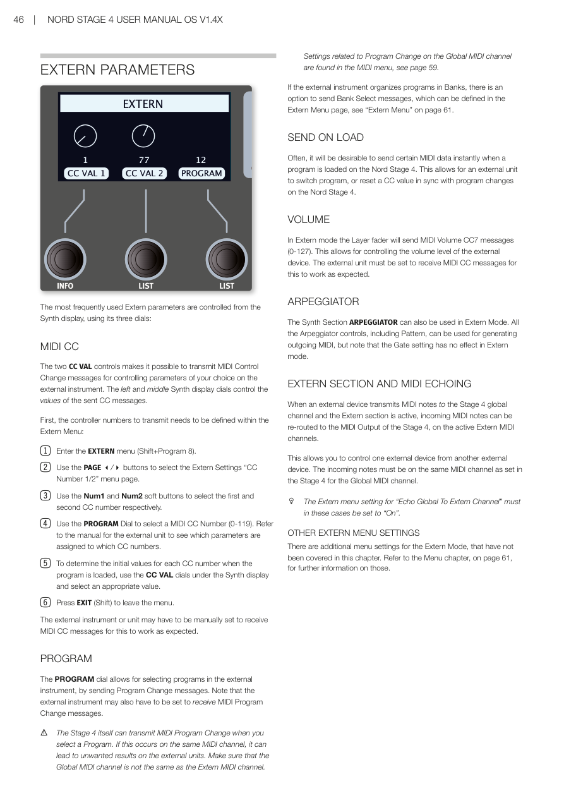

# 第八章：外部 MIDI 控制 / Chapter 8: Extern

---

## 外部 MIDI 控制模式 / EXTERN MODE

**外部 MIDI 控制（Extern Mode——讓 Nord Stage 4 透過 MIDI 訊號來控制外部合成器或其他 MIDI 裝置）**是 Nord Stage 4 的內建功能。透過將合成器區中的某個音層設定為 Extern 模式，就可以用合成器的顯示幕、旋鈕和其他控制器來使用所有常用的外部 MIDI 功能。

Advanced control of external MIDI instruments is an integrated feature of the Nord Stage 4. By using the EXTERN Mode of the Synth Section, all essential external MIDI functions are made available for control from the Synth display, dials and other controls.

設定為 Extern 的音層，其開啟/關閉和鍵盤分區的操作方式，與設定為取樣音色或類比合成器的音層完全相同。音高控制桿和延音踏板也以相同方式設定。

A Layer set to Extern behaves much like a Layer set to Samples or Analog, in that it is turned on or off and assigned to a keyboard zone in the same way. Pitch Stick and Sustain Pedal assignments are also set up as usual.

每個 Extern 音層的 MIDI 通道設定在 MIDI 選單中，而音色配置切換（Program Change）、連續控制器（CC）和其他 MIDI 功能的設定則在 EXTERN 選單中存取（詳見第 61 頁）。這些設定也可用於在本機切換音色配置時，自動向外部裝置發送 MIDI 音色配置切換訊息。

MIDI channel settings for each Extern Layer are found in the MIDI menu while settings for Program Change, Continuous Controllers (CC) and other MIDI functionality is accessed via the EXTERN menu (read more on page 61). These settings can also be used for sending MIDI messages such as Program Change automatically to external units when programs are changed locally.

> 💡 Extern 的 MIDI 通道設定在所有音色配置中共用，而 Extern 選單中的所有設定則是每個音色配置獨立儲存的。

Extern MIDI Channel settings are shared for all Programs on the Nord Stage 4, while all settings in the Extern menu are stored per Program.

---

## 設定步驟 / SETTING UP

1. 用 MIDI 連接線將 Nord Stage 4 的 MIDI Out 接到外部裝置的 MIDI In（外部裝置可以是機架式合成器模組、電腦介面或其他有 MIDI In 插孔的裝置）。

   Connect a MIDI cable from the Nord Stage 4 MIDI Out to the MIDI In on the external device, which could be a rack synth unit, a computer interface or some other unit with a MIDI In port.

2. 按住 SHIFT 再按 MIDI（Program 7 按鈕）進入 MIDI 選單。

   Hold SHIFT and press MIDI (Program 7 button) to access the MIDI menu.

3. 用 PAGE 3/4 按鈕切換到「Extern Channel」頁面。

   Use the PAGE 3/4 buttons to access the "Extern Channel" page.

4. 用 Program 1-3 功能鍵選擇對應的 Extern 音層：A、B 或 C。

   Use the Program 1-3 soft buttons for selecting the appropriate Extern Layer; A, B or C.

5. 用音色配置控制旋鈕選擇要使用的發送 MIDI 通道（1-16）。按 EXIT（Shift）離開選單。

   Use the PROGRAM Dial to select the transmitting MIDI channel (1-16) which should be used. Press EXIT (Shift) to leave the menu.

6. 將外部裝置設定為接收上一步指定的 MIDI 通道。

   Set the external instrument to receive on the MIDI channel defined in the previous step.

---

## 使用外部 MIDI 控制區 / USING THE EXTERN SECTION

### 啟用 / ACTIVATING

確認合成器區已開啟。選擇要用來控制外部裝置的音層（A、B 或 C），然後按 EXTERN（Shift + Synth Mode）。

Make sure the Synth Section is turned ON. Select the Layer (A, B or C) which should be set to control external units, and press EXTERN (Shift+Synth Mode).

### 八度移調 / OCTAVE SHIFT

從設定為 Extern 的音層發出的 MIDI 訊號可以上移或下移八度，方法是根據設定的八度數量來移調發送的 MIDI 音符。

MIDI sent from a Layer set to Extern can be octave shifted up or down, which is done by transposing sent MIDI Notes according to the number of octaves up or down that has been set.

移調範圍取決於外部裝置的總音域範圍，以及外部裝置目前指定的鍵盤分區範圍。

The shift range depends on the total note range of the external instrument, and the range of the keyboard zone(s) that the external instrument is currently assigned to.

### 鍵盤區域 / KEYBOARD ZONES

鍵盤區域可以像內部音色一樣用於分區和疊加設定。例如，如果 Extern 音層只指定在分區 1 和 2 中演奏，外部裝置只會回應這些分區中彈奏的音符。

Keyboard zones can be used for split and layered setups just like for internal sounds. As an example, if an Extern Layer is assigned to only play in zones 1 and 2, the external instrument will only respond to notes played in these zones.

> 💡 關於如何設定和使用鍵盤區域，請參閱第 38 頁的分區功能說明。

See the section about Split functionality on page 38 for information on how to set up and use keyboard zones.

最多可以有三個 Extern 音層（當所有合成器音層都設定為 Extern 時），但請注意，設定為 Extern 的音層無法用於內部合成器音色。

There can be up to three Extern Layers – if all Synth Layers are set to Extern – but note that Layers set to Extern cannot be used for internal Synth sounds.

---

---

### 音高控制桿和延音踏板訊息 / PITCH STICK AND SUSTAIN PEDAL MESSAGES

按住 SHIFT 再按 SUSTPED/PSTICK，可以決定當前聚焦的 Extern 音層是否要透過 Extern MIDI 通道發送延音踏板和/或音高彎音訊號，狀態由 SUSTPED 和 PSTICK 指示燈顯示。

Hold SHIFT and press SUSTPED/PSTICK for the focused Extern Layer to determine whether sustain pedal and/or pitch bend messages should be sent via the Extern MIDI channel, as indicated by the SUSTPED and PSTICK LEDs.

---

## 外部控制參數 / EXTERN PARAMETERS

最常用的 Extern 參數可以透過合成器顯示幕的三個旋鈕來控制：

The most frequently used Extern parameters are controlled from the Synth display, using its three dials:

### MIDI CC 控制器 / MIDI CC

兩個 **CC VAL** 控制可以發送 MIDI 控制變更訊息（Control Change）訊息，用來控制外部裝置上你選擇的參數。左邊和中間的合成器顯示幕旋鈕分別控制發送的 CC 訊息數值。

The two CC VAL controls makes it possible to transmit MIDI Control Change messages for controlling parameters of your choice on the external instrument. The left and middle Synth display dials control the values of the sent CC messages.

首先需要在 Extern 選單中定義要發送的控制器編號：

First, the controller numbers to transmit needs to be defined within the Extern Menu:

1. 進入 EXTERN 選單（Shift + Program 8）。

   Enter the EXTERN menu (Shift+Program 8).

2. 用 PAGE 3/4 按鈕選擇 Extern Settings 中的「CC Number 1/2」選單頁面。

   Use the PAGE 3/4 buttons to select the Extern Settings "CC Number 1/2" menu page.

3. 用 Num1 和 Num2 功能鍵分別選擇第一和第二個 CC 編號。

   Use the Num1 and Num2 soft buttons to select the first and second CC number respectively.

4. 用音色配置控制旋鈕選擇 MIDI CC 編號（0-119）。請參閱外部裝置的說明書，了解哪些參數對應哪些 CC 編號。

   Use the PROGRAM Dial to select a MIDI CC Number (0-119). Refer to the manual for the external unit to see which parameters are assigned to which CC numbers.

5. 要設定音色配置載入時每個 CC 編號的初始數值，使用合成器顯示幕下方的 CC VAL 旋鈕選擇合適的數值。

   To determine the initial values for each CC number when the program is loaded, use the CC VAL dials under the Synth display and select an appropriate value.

6. 按 EXIT（Shift）離開選單。

   Press EXIT (Shift) to leave the menu.

外部裝置可能需要手動設定才能接收 MIDI CC 訊息，這樣才能正常運作。

The external instrument or unit may have to be manually set to receive MIDI CC messages for this to work as expected.

### 音色配置切換 / PROGRAM

音色配置控制旋鈕可以透過發送「音色配置切換（Program Change）」訊息來選擇外部裝置中的音色配置。請注意，外部裝置可能也需要設定為接收 MIDI 音色配置切換訊息。

The PROGRAM dial allows for selecting programs in the external instrument, by sending Program Change messages. Note that the external instrument may also have to be set to receive MIDI Program Change messages.

> ⚠️ Stage 4 本身在切換音色配置時也會發送 MIDI 音色配置切換訊息。如果這發生在同一個 MIDI 通道上，可能會對外部裝置造成非預期的結果。請確保全域 MIDI 通道與 Extern MIDI 通道不同。有關全域 MIDI 通道音色配置切換的相關設定，請見第 59 頁的 MIDI 選單說明。

The Stage 4 itself can transmit MIDI Program Change when you select a Program. If this occurs on the same MIDI channel, it can lead to unwanted results on the external units. Make sure that the Global MIDI channel is not the same as the Extern MIDI channel. Settings related to Program Change on the Global MIDI channel are found in the MIDI menu, see page 59.

如果外部裝置以音色庫（Bank）組織音色配置，可以選擇發送音色庫組選擇（Bank Select）訊息，這可以在 Extern 選單頁面中設定（詳見第 61 頁「Extern 選單」）。

If the external instrument organizes programs in Banks, there is an option to send Bank Select messages, which can be defined in the Extern Menu page, see "Extern Menu" on page 61.

### 載入時自動發送 / SEND ON LOAD

通常希望在 Nord Stage 4 載入音色配置時，立即發送某些 MIDI 資料。這讓外部裝置可以與 Nord Stage 4 的音色配置切換同步切換音色配置或重置 CC 數值。

Often, it will be desirable to send certain MIDI data instantly when a program is loaded on the Nord Stage 4. This allows for an external unit to switch program, or reset a CC value in sync with program changes on the Nord Stage 4.

### 音量 / VOLUME

在 Extern 模式下，音層推桿會發送 MIDI Volume CC7 訊息（0-127），用於控制外部裝置的音量。外部裝置必須設定為接收 MIDI CC 訊息才能正常運作。

In Extern mode the Layer fader will send MIDI Volume CC7 messages (0-127). This allows for controlling the volume level of the external device. The external unit must be set to receive MIDI CC messages for this to work as expected.

### 琶音器 / ARPEGGIATOR

合成器區的琶音器（Arpeggiator——自動彈奏分解和弦的功能）也可以在 Extern 模式下使用。所有琶音器控制（包括音型 Pattern）都可以用來產生輸出 MIDI，但請注意，閘控（Gate）設定在 Extern 模式下無效。

The Synth Section ARPEGGIATOR can also be used in Extern Mode. All the Arpeggiator controls, including Pattern, can be used for generating outgoing MIDI, but note that the Gate setting has no effect in Extern mode.

---

## 外部 MIDI 控制區與 MIDI 轉送 / EXTERN SECTION AND MIDI ECHOING

當外部裝置在 Stage 4 全域通道上發送 MIDI 音符，且 Extern 區為啟用狀態時，傳入的 MIDI 音符可以被重新導向到 Stage 4 的 MIDI 輸出，並發送到啟用的 Extern MIDI 通道。

When an external device transmits MIDI notes to the Stage 4 global channel and the Extern section is active, incoming MIDI notes can be re-routed to the MIDI Output of the Stage 4, on the active Extern MIDI channels.

這讓你可以用一台外部裝置控制另一台外部裝置。傳入的音符必須與 Stage 4 中設定的全域 MIDI 通道相同。

This allows you to control one external device from another external device. The incoming notes must be on the same MIDI channel as set in the Stage 4 for the Global MIDI channel.

> 💡 在這種情況下，Extern 選單中的「Echo Global To Extern Channel」設定必須設為「On」。

The Extern menu setting for "Echo Global To Extern Channel" must in these cases be set to "On".

---

## 其他 Extern 選單設定 / OTHER EXTERN MENU SETTINGS

Extern 模式還有一些額外的選單設定，本章未涵蓋。請參閱第 61 頁的選單章節，以獲取更多資訊。

There are additional menu settings for the Extern Mode, that have not been covered in this chapter. Refer to the Menu chapter, on page 61, for further information on those.

原文整頁參考

