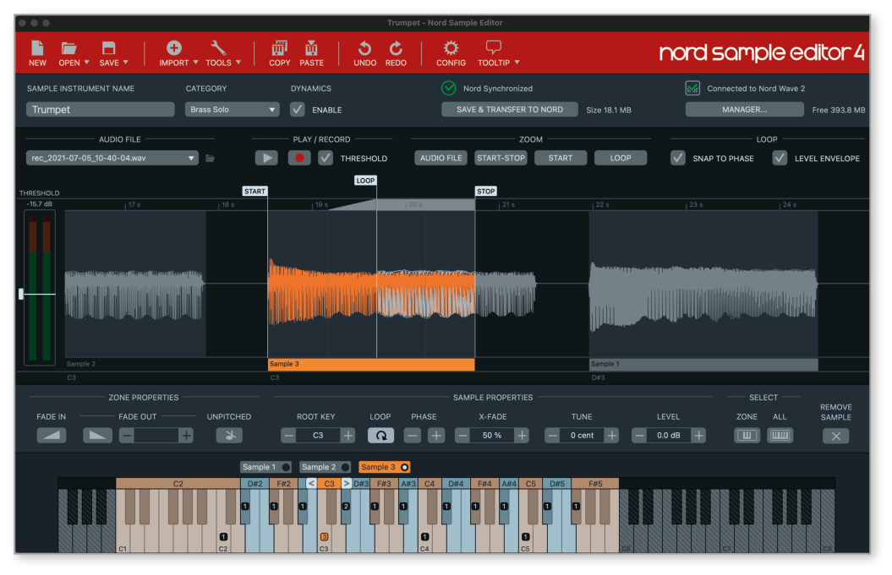
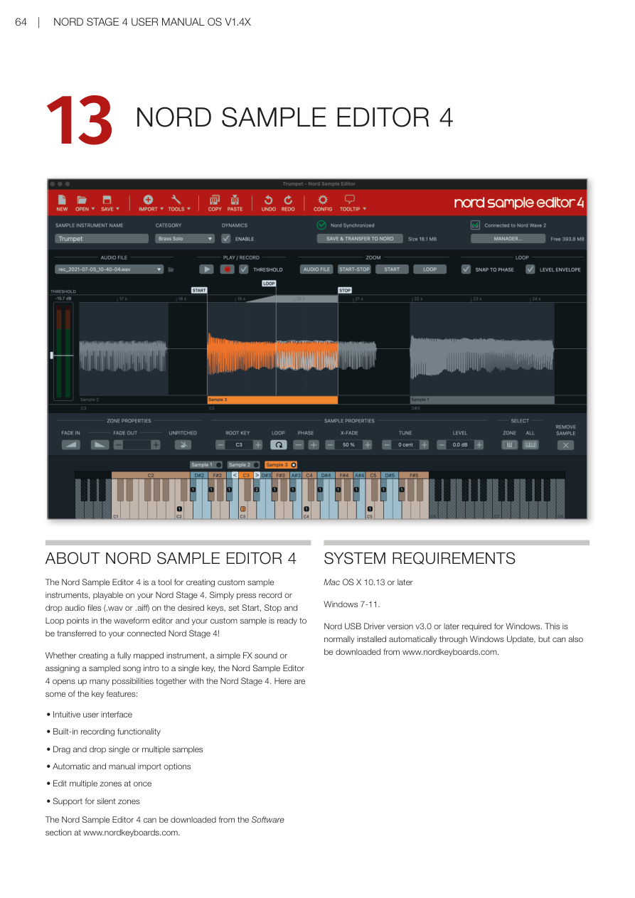

# 第十三章：Nord Sample Editor 4 / Chapter 13: Nord Sample Editor 4

---

## 關於 Nord Sample Editor 4 / ABOUT NORD SAMPLE EDITOR 4

Nord Sample Editor 4（取樣編輯工具）是一個用於為 Nord Stage 4 建立自訂取樣音色樂器的工具。只需按下錄音按鈕，或將聲音檔案（.wav 或 .aiff 格式）拖放到所需琴鍵上，在波形編輯器中設定開始點、結束點和循環點，你的自訂取樣音色就可以傳輸到連接的 Nord Stage 4 了！

The Nord Sample Editor 4 is a tool for creating custom sample instruments, playable on your Nord Stage 4. Simply press record or drop audio files (.wav or .aiff) on the desired keys, set Start, Stop and Loop points in the waveform editor and your custom sample is ready to be transferred to your connected Nord Stage 4!

無論是建立完整對應的樂器、簡單的音效，還是將取樣的歌曲前奏指定到單一琴鍵，Nord Sample Editor 4 與 Nord Stage 4 結合後開創了無限可能。以下是一些主要功能：

Whether creating a fully mapped instrument, a simple FX sound or assigning a sampled song intro to a single key, the Nord Sample Editor 4 opens up many possibilities together with the Nord Stage 4. Here are some of the key features:

- 直觀的用戶界面 / Intuitive user interface
- 內建錄音功能 / Built-in recording functionality
- 拖放單個或多個取樣音色 / Drag and drop single or multiple samples
- 自動和手動匯入選項 / Automatic and manual import options
- 一次編輯多個分區 / Edit multiple zones at once
- 支援靜音分區 / Support for silent zones

Nord Sample Editor 4 可從 www.nordkeyboards.com 的軟體區下載。

The Nord Sample Editor 4 can be downloaded from the Software section at www.nordkeyboards.com.

---

## 系統需求 / SYSTEM REQUIREMENTS

- **Mac**：OS X 10.13 或更新版本
- **Windows**：Windows 7–11

> 💡 Windows 用戶需要 Nord USB Driver 版本 v3.0 或更新版本。驅動程式通常透過 Windows Update 自動安裝，也可從 www.nordkeyboards.com 單獨下載。